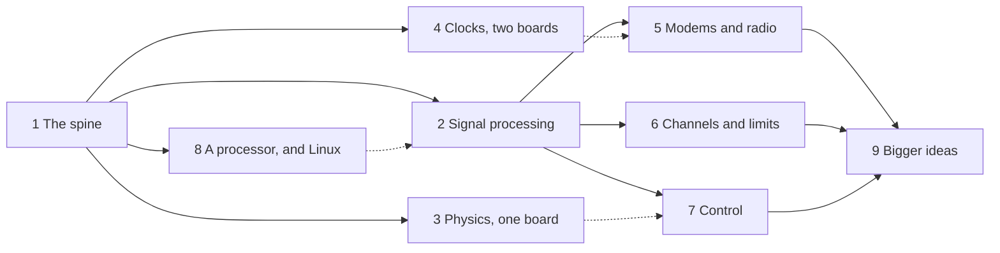

# IcePi Zero ADC DAC gateware

## Prompt 1

I made the adapter PCB from an IcePi Zero to the "AD9280 AD9708 Data Acquisition Board" 2x20 variant as described in `$HOME/OpticsPCBs/IcepiZeroADCDAC`. An IcePi Zero is currently plugged in to USB, with the adapter board and the "AD9280 AD9708 Data Acquisition Board" stacked on top of it. The open source toolchain is installed in `$HOME/openfpga` as described by `./README.md`.

Also plugged in to USB is an ADALM2000 (M2k). The Data Acquisition Board's:

* DAC is connected to the M2k's CH1
* ADC is connected to the M2k's W1

Your goal is to work as long as it takes on a series of tutorials geared toward a Junior-level Physics-major electronics lab class. These students will know the basics of analog and digital electronics, and they will have taken a class in fourier analysis, but they have never used FPGAs or Verilog. The tutorials should be self-contained in a new .md file in this directory. I'll list some things I'd like to see, but they can be rearranged, split, or combined for 

* First explain how to setup the ECP5 FPGA toolchain as simply as possible with a VScode extension that I hear makes this easy. This is the only part you will not test.
* Simple "bare" single-file verilog that creates a simple binary counter on the white LEDs --- a simplified version of what's in `./README.md`
* Simple "bare" verilog that outputs an interesting waveform like a sine out of the DAC.
* Simple verilog to capture a reasonable number samples from the ADC and somehow get them to the computer. If serial port is the best way, use that.
* Simple verilog that does a simple lock-in, where real and imaginary parts are reported over the serial port. If the student only get this far, they can run a series of these measurements on a filter or can do a measurement of the length of a cable.
* A LiteX peripheral that is a function generator, outputing at least a sine wave of a specified frequency. This probably needs to be driven by a bare-metal C program for vexriscv.
* A LiteX peripheral for doing an ADC capture.
* A LiteX peripheral for a lock-in measurement.
* The LiteX peripherals controlled under linux-on-litex-vexriscv in some very Linux-friendly way.

You should use the M2k to debug as you go along. Avoid stopping and asking me questions or changing the cabling unless absolutely necessary (or something is not working).

As you make the tutorial document, log your responses here in this document as a record of what I asked you to do and what you did.

Include some plots in the tutorial, with times and voltages and samples evident.

## Response 1 2026-09-28 21:53:00 - 2026-09-29 00:10:00 Claude Opus 5.5 Extra High

### Short version

The tutorial is [`IcepiZeroADCDAC_tutorials.md`](IcepiZeroADCDAC_tutorials.md): eight parts
plus two appendices, every source file printed in full, and seven figures made from live
ADALM2000 captures. The same files, tested, are in
[`IcepiZeroADCDAC_tutorials/`](IcepiZeroADCDAC_tutorials/). `tools/sync_md.py --check` confirms
that every code block in the `.md` is byte-identical to its file.

| part | what | tested on the hardware? |
| --- | --- | --- |
| 0 | OSS CAD Suite through VS Code + **Apio IDE** (`fpgawars.apio`, which knows `icepi-zero`), plus the by-hand way | no, as you asked |
| 1 | `counter.v`: binary counter on the 5 LEDs | builds and loads; LEDs not watched (I can't see them) |
| 2 | `sawtooth.v` (counter → DAC), `sine.v` (DDS, table computed by Yosys with `$sin`) | yes: M2k, 1 MHz measured 999,997 Hz, 3.84 V, harmonics ≤ −46 dBc |
| 3 | `capture.v` + `uart.v` + `capture.py`: 16384 samples, 25 MS/s ÷ 2^D, 1 Mbaud, 0.23 s per capture | yes: DC calibration sweep, sines at 1.1/3.3/10.1 MHz (ENOB ≈ 7), aliasing demo |
| 4 | `lockin.v` + `lockin.py`: coherent lock-in, 2^20-sample average, X/Y as hex text | yes, in simulation and against the M2k's W1; see "not tested" below |
| 5 | LiteX SoC (`icepi_adda_soc.py`) + function-generator peripheral + bare-metal C shell (`fg`) | yes: registers via BIOS `mem_write`, 4 waveforms, amplitude |
| 6 | capture peripheral: 16 kB Wishbone window, decimation, trigger (`cap`, `dump`, `cap_plot.py`) | yes, including triggered captures lining up |
| 7 | lock-in peripheral, referenced to the function generator's phase (`li`, `sweep`) | yes, down to 1 mV input |
| 8 | Linux 6.12 (Buildroot, musl) on VexRiscv-SMP; `/dev/mem`; a kernel driver `adda.ko` giving `funcgen/`, `capture/`, `lockin/` directories in sysfs | yes: every sysfs file, `sweep.sh`, `dump.sh`, `insmod`/`rmmod`, a module pasted over the console |

**Not tested, and the one thing I'd ask you to do:** Part 4's actual *measurements*, a
filter and a cable, need the DAC's output wired to the ADC's input. Your cabling has the
M2k in both paths, and you asked me not to change it, so I verified the lock-in two other
ways: in simulation, where a delayed, halved loopback gave the right amplitude and a phase
that is a pure delay; and on hardware against W1, which gave the right amplitude, the
rotating phasor, the sinc pass band with nulls at 23.8 Hz, and the crosstalk floor. A coax
from DAC to ADC, then a 1 kΩ/1 nF RC in the middle, is the one experiment in the document
that hasn't been run end to end. Appendix B lists this, and the other small untested items:
the LEDs, and booting Linux from an SD card.

### Measured, and now in the tutorial's hardware table

- DAC: V = 0.0307·code − 3.95 (−3.95 V … +3.88 V into 1 MΩ); ADC: code = 126.7 + 25.35·V (±5 V, 39.5 mV/code).
- The Icepi Zero's crystal is 2.8 ppm slow relative to the M2k's. The DAC and ADC measurements agree on that independently.
- DAC → ADC crosstalk seen by the lock-in: −99 dB at 10 kHz, −77 dB at 1 MHz, −48 dB at 12 MHz (bare `lockin.v`); 0.9 mV at 100 kHz in the LiteX SoC.

### Problems found along the way (all fixed, and most written into the tutorial)

1. **Opening `/dev/ttyUSB0` makes the FPGA receive a junk byte** (0xFF), which the first
   `capture.v` took as "capture with D = 15" (21 s). The command is now a hex digit.
2. **The M2k's AWG truncates cyclic buffers to a multiple of 4 samples**, which put a phase
   jump at every wrap and a one-sample glitch in about half the ADC captures.
3. **libm2k returns stale captures** unless `setKernelBuffersCount(1)` is set.
4. **The capture trigger fired immediately** on a re-arm, because it compared against the
   previous capture's last sample. Fixed in `adc_capture_core.v`.
5. **LiteX's default libc is minimal** (no `atoi`/`strtok`/libm): the SoC is built with
   `--libc-mode full`. Its compiler runtime also lacks `__floatdisf`, so the firmware
   shifts 64-bit sums down before converting to float.
6. **Buildroot 2026.02's glibc 2.42 crashes in its dynamic loader on VexRiscv** before
   `init` runs (kernel panic). The 2022 images' glibc 2.34 is fine. I switched to musl,
   which works and cut the compressed rootfs from 5.0 MB to 1.2 MB, together with dropping
   `pppd` and its 6 MB of OpenSSL. A serial boot is now 4 minutes at 460800.
7. **Buildroot's post-image script replaces `linux-on-litex-vexriscv/images/`** with
   symlinks to its own output, which silently replaces the stock images. My defconfig turns
   it off and uses `images_adda/` instead.
8. **The device tree records the rootfs size** (`linux,initrd-end`), taken from whatever was
   in `images/` at build time. `make_linux.py` now sizes it from `images_adda/`.
9. **kbuild's `make clean` deletes every `.ko` below the module directory**, including the
   rootfs overlay's copy, so the driver moved to `linux/driver/`.
10. **A driver bug (my own) oopsed the kernel**: bin-attribute callbacks get the *device's*
    kobject even inside a named group. Fixed, retested.
11. **BusyBox `awk` had no maths**: a BusyBox config fragment turns `CONFIG_FEATURE_AWK_LIBM` on.
12. **The 2021 kernel drops console characters** sent faster than a person types
    (most likely because it polls the UART's small receive FIFO; the 6.12 patch set adds
    RX interrupts). The helper scripts type in small pieces.

### Files

In `IcepiZeroADCDAC_tutorials/`:

- **Parts 1–4 (bare Verilog):** `icepi_adda.lpf` (one constraints file for all),
  `counter.v`, `sawtooth.v`, `sine.v`, `uart.v`, `capture.v`, `capture.py`, `lockin.v`,
  `lockin.py`, `capture_tb.v`, `lockin_tb.v`. The `Makefile` does `make load-NAME` and
  `make sim-NAME`.
- **Parts 5–7 (`litex/`):** four Verilog cores; `adda_litex.py` (the LiteX wrappers and
  `add_adda()`); `icepi_adda_soc.py`; `firmware/`; `cap_plot.py`; `make_linux.py`.
- **Part 8 (`linux/`):** a Buildroot external tree (`configs/icepi_adda_defconfig`, the
  kernel and BusyBox fragments, `rootfs_overlay/`) and `driver/adda.c`.
- **`tools/`** is the instructor's kit, not for students:
  - `m2k.py`, a libm2k wrapper with an exact-frequency AWG and a 4-parameter sine fit;
  - `fig_*.py`, one script per figure, with `--replot` to redraw from `data/`;
  - `serialboot.py`, `console.py`, `linux_shell.py` and `test_linux.py`, to script the
    BIOS, the firmware and Linux;
  - `sync_md.py`, which checks the document against the files.

### Changes outside this repository

- `~/.local`:
  - `swig` and `patchelf`, via `pip --user`;
  - **libiio 0.25** and **libm2k 0.9.1** with its Python bindings, built from source in
    `~/openfpga/libiio-0.25` and `~/openfpga/libm2k`. The system's libiio 0.23 is too old
    for libm2k and was left alone. `import libm2k` works from both `/usr/bin/python3` and
    this repo's `.venv`.
- `~/openfpga/buildroot`: a clone checked out at `2026.02.3`.
  `~/openfpga/buildroot-icepi/`: its output, 8.2 GB, deletable.
- `~/openfpga/linux-on-litex-vexriscv`:
  - new: `build/icepi_zero_adda/`, `images_adda/` (our Linux) and `images_stock_adda/`
    (the 2022 images plus our device tree, used to test `/dev/mem`);
  - `images/` was restored to the stock 2022 files after Buildroot's post-image script had
    turned them into symlinks. Restored means re-extracted from `linux_2022_03_23.zip`,
    `gzip -k`, and `rv32.dtb` copied back from `build/icepi_zero/`.
- `~/OpticsPCBs` is untouched. Nothing is committed.
- The board is currently running the Part 5–7 LiteX SoC (SRAM only), and W1 is idle.

## Prompt 2

There is an approximately 1-meter long SMA cable going from DAC to ADC. The M2k is out of the loop and off.

First, test the LED counter. I think I saw this working as you were writing it. The natural way to orient the Icepi Zero is with the USB connectors down, which is how it's oriented in nearly all photos online. Your binary counter may have its LSB on the left and MSB on the right in this configuration, which would not be satisfying to students. Set up the hardware as the counter and then pause. I'll tell you which one is the LSB and MSB. After I tell you the answer, make it count with the MSB on the left when you look at it with the USB ports down. If you change something, be sure to change it in both the files that will get checked in and inline in the tutorial. Check if changing the LED mapping for the counter will affect other sections in the tutorial.

Then do a lage number of tests to characterize the DAC -> ADC link through the SMA cable. I have no other filter to test today, so do what you can with the cable. I also have what looks like a 20cm SMA cable that I can swap for the 1-meter cable later. One part of the tutorial could be to take a careful sweep and measure the length or other properties of the cable. I'd also like to know the latency in the limit of a zero-length cable: low long does it take a new DAC value to show up at the ADC?

Finally, come up with other suggestions of things to test or things to add as extensions to this tutorial. If I have the hardware here, we do test those tonight, otherwise it will have to wait.

## Response 2 2026-09-29 20:25:00 - 2026-09-29 21:25:00 Claude Opus 5.5 Extra High

### Short version

- **LED counter:** fixed. You confirmed it ran LSB-left with the USB connectors down. I
  renumbered the LEDs in `icepi_adda.lpf` (E13, the leftmost, is now `led[4]`), and you
  confirmed it now counts MSB-left. `counter.v` itself is unchanged. The only other effect
  is which physical LED shows which indicator in `capture.v` and `lockin.v`; both sources'
  comments and the tutorial were updated. The LiteX parts use LiteX's own numbering (bit 0
  leftmost), and the Part 5 exercise now warns about that.
- **The cable:** 101.5 cm and 16.5 cm of RG-316. The lock-in gives **3.89 ns for the extra
  85.0 cm: 4.58 ns/m, velocity factor 0.73** (datasheet 0.695). It repeats to 0.05 ns
  between sweeps and drifted < 0.15 ns in 5 minutes. The details and the reasons for the
  5% are below, and in the tutorial's Part 4.
- **Latency, your direct question:** the *analog* path from the DAC latching a code to the
  ADC's sampling point is **32 ns at zero cable length**, plus 4.6 ns per metre of RG-316.
  But from the FPGA writing a DAC word to the FPGA reading the ADC's measurement of it is
  **5–6 samples (200–240 ns)**. Two thirds of that is the AD9280's 3-cycle pipeline, read
  on the 4th edge. Measured: a DAC step at sample 512 shows up at sample 518, on every
  edge, with both cables.
- **New in the tutorial:**
  - Part 3 gets "Closing the loop": `loopback.v` and `loopback.py`. The DAC plays a pattern
    locked to the capture, in four modes: square wave, the same shifted 20 ns for
    equivalent-time sampling, a staircase, and a pseudo-random m-sequence that gives the
    loop's impulse response.
  - Part 4's cable section is rewritten with real data and a figure. `lockin.py` gains
    `--linear` and prints the fitted delay.
  - New **Part 9: More experiments**: 10 designed experiments with `schemdraw` circuit
    diagrams, component values, predicted results and commands.
  - The module's connectors are now "SMA" throughout.

### The cable, and what the measurements say about the module

| | 101.5 cm | 16.5 cm |
| --- | --- | --- |
| lock-in group delay, 0.1–8 MHz (3 sweeps each) | 216.58 ns | 212.69 ns |
| amplitude at the ADC, 100 kHz | 3.89 V | 3.89 V |
| amplitude ratio, 1–9 MHz | 1.000 ± 0.006 | — |
| loopback step, "s" mode | sample 518 | sample 518 |
| staircase: ADC code vs DAC code | 0.776 × DAC + 27.5 | same |

- **The DAC is evidently series-terminated (~50 Ω) and the ADC is high-impedance.** An
  open-ended cable driven through its own Z₀ delivers a clean, delayed copy at full
  amplitude. That fits both cables giving the same amplitude, and the ADC seeing the
  3.9 V the DAC makes into 1 MΩ. With this arrangement the apparent delay is the true delay
  × (R_source/Z₀), so ±2 Ω tolerances on either end are worth ±4% each. That, not the
  lock-in, limits the velocity factor to about ±5%. Differences between cables of the same
  type are good to about ±1 cm.
- **The staircase slope (0.776) agrees within 0.2%** with the product of the two M2k
  calibrations from Prompt 1 (0.0307 V/code × 25.35 codes/V = 0.778).
- **Delay budget, zero-length cable** (lock-in, referenced to the DDS phase register):
  211.9 ns = 160 ns ADC pipeline and capture + 20 ns of FPGA registers + 10 ns zero-order
  hold (a sine rebuilt as a staircase lags by half a DAC sample) + 32 ns analog. The
  equivalent-time step response puts the 50% point ~35 ns after the DAC latch, which agrees
  once the ZOH term (present for a sine, absent for a step) is accounted for.
- **Above ~8 MHz the two cables disagree.** Most likely this is the DAC's image at
  50 MHz − f, which the 25 MS/s ADC folds *exactly* back onto f with conjugate phase, and
  whose phase depends on the cable. So delay fits stop at 8 MHz. This is an explanation,
  not a proven one. A test: run the ADC at a rate that isn't a submultiple of 50 MHz.
- **Above Nyquist** (to 24.9 MHz) the lock-in still works by undersampling: 3.7 V at 13 MHz,
  3.1 V at 20 MHz. Frequencies that are simple fractions of 25 MHz (10, 12.5, 20 MHz)
  scatter between runs.
- **Firmware lock-in (Part 7) through the cable:** same amplitudes, but a delay of 299 ns
  rather than 212.7. `funcgen_core`'s extra pipeline registers and `lockin_core` reading
  the phase one clock later explain 80 of the 86 ns. Now noted in Part 7.

### Extensions: tested tonight

- **Pseudo-random impulse response** (`loopback.py p`). One 0.66 ms capture gives
  h = 0.90 at 6 samples, then −0.18 of ringing; the taps sum to the DC gain. The FFT of h
  agrees with the lock-in below 1 MHz, but not near 12.5 MHz, because a sequence that
  changes every sample folds its 25 MHz − f content onto f. The tutorial explains this.
- **The loop oscillator.** Inverting feedback with gain 2 does *not* give one oscillation:
  with a pure 6-sample delay it is six independent interleaved oscillators (period 12
  samples). Averaging 4 samples in the loop locks them into one near-square wave at
  1.685 MHz (14.8 samples, against the 15 predicted). The "Try this" was rewritten to match.

### Extensions: designed, waiting for parts (Part 9)

The ADC's input impedance and the cable's C′ (and from it Z₀ = τ′/C′) with a 10 kΩ;
RC filters; a series LC; a 4 MHz crystal's Q (~16,600, a 240 Hz-wide peak, the parallel
resonance 6.4 kHz higher); a diode clipper's odd-only harmonics (the loop's own baseline,
≤ −46 dBc, was measured tonight); a quarter-wave stub (9.89 MHz for 5 m of RG-58); the
speed of sound with 40 kHz transducers (41.9°/mm); an LED/photodiode link (350 kHz vs
3.5 MHz with R_L = 10 kΩ vs 1 kΩ, and lock-in detection under room light); PI control of
an RC plant; and the Icepi's crystal against a GPS-disciplined 10 MHz to ppb.

### Files

- New: `loopback.v`, `loopback.py`; `tools/cable_sweep.py`, `tools/fig_cable.py`,
  `tools/fig_loopback.py`, `tools/fig_experiments.py`.
- New data and figures: `data/cable_{1m,16cm}.npz`, `data/loopback_{1m,16cm}.npz`; `img/cable.png`,
  `img/loopback_{step,stairs,prbs}.png`, `img/exp_*.png` (10 schematics).
- Changed: `icepi_adda.lpf` (LED order), `capture.v` and `lockin.v` (LED comments only),
  `lockin.py` (`--linear`, delay fit), `Makefile` (loopback). All bare designs rebuild and
  pass timing, and both simulations pass.
- Outside the repo: `pip install --user schemdraw` (for the schematics). The oscillator test
  designs are throwaway files in the session scratchpad.
- Nothing committed. The board is running the Part 5–7 LiteX SoC with the firmware. The
  16.5 cm cable is still in place.

## Prompt 3

When viewed in vscode's dark background, the circuit diagrams cannot be seen. They either need an explicit white background or they need some other way to be viewed both on github's white background and vscode's dark background.

Why are the DAC and ADC not run at the same rate? What sets their maximum sample rates? When you mention the 14.7ns with respect to the ADC, add a few more sentences discussing the maximum sampling rates of the ADC and DAC in this system. If, for example, the DAC can go faster, how would one set up a PLL within the FPGA to make that happen?

Can you write to the SD card through the USB connection that you have? Maybe through linux or LiteX? Or do I need to constantly remove the SD card, put it into an SD card reader, eject it, and put it back into the Icepi Zero? I have inserted a newly-formatted 64 GB microSD card into the Icepi Zero. One final tutorial would be to put the linux FPGA gateware into the FPGA flash and the linux filesystem on an SD card and show how quickly it can boot into a usable state.

## Response 3 2026-09-29 21:30:00 - 2026-09-29 23:34:00 Claude Opus 5.5 Extra High

### Short version

- **Schematics on a dark background:** fixed. `schemdraw` saves transparent PNGs, so the
  black lines vanished on VS Code's dark theme. `tools/fig_experiments.py` now flattens each
  one onto the same off-white (#fcfcfb) as the plots, with a margin. All 22 figures in
  `img/` are now opaque, so they read the same on GitHub's white and VS Code's dark.
- **Sample rates:** Part 3's "Clocking the ADC" gains a paragraph, "Why 25 MS/s in but
  50 MS/s out?". The AD9280 is rated for 32 MS/s (a 31.25 ns period, of which ≥ 14.7 ns
  high and low: its pipeline stages need that long to settle). The AD9708 is rated for
  100 MS/s (125 typical); it only latches data (2.0 ns setup, 1.5 ns hold). With one
  50 MHz oscillator, only 50/N is available: the DAC gets 50 and the ADC gets 25, the
  fastest it accepts. The whole-number ratio keeps them coherent, which Parts 3–4 rely on.
  The serial port is the other limit (25 MB/s against 100 kB/s), hence the block RAM.
- **A PLL:** new end of Part 2, "Faster clocks: a PLL". It covers what a PLL does,
  `ecppll -i 50 -o 100`, and `pll100.v` (the ECP5's `EHXPLLL`: VCO 600 MHz ÷ 6).
  `sine_pll.v` puts the DAC at 100 MS/s, and the section explains the DAC pin timing
  (5 ns each side of the latch edge: 3 ns of margin at 100 MHz, 2 ns at 125).
  Part 4 gets a matching section, "A faster DAC", with `lockin_pll.v`, **measured**
  (next section).
- **Writing the SD card: yes, over the USB cable, no card swapping.** The board's own Linux
  writes it. The files ride along with a serial boot: `make_sd_installer.sh` appends a
  second cpio archive to the initramfs, holding the card's files and `install-sd.sh`, which
  partitions (MBR from `make_mbr.py`), formats and fills the card. It took a 5½ minute
  upload plus 6 minutes of install. (LiteX's BIOS can't do it: its `sdcard_write` only
  writes test patterns.)
- **Booting from flash + SD (new Part 8.7):** the gateware is in the SPI flash (53 s to
  write), and the kernel and root file system are on the card. From reset to
  `buildroot login:` took **86.5 s**. After switching off five useless services and adding
  an `S90adda` script that loads the driver, it took **61 s, with the instruments ready**.
  Serial boot, for comparison, takes 5.0 min.

### The PLL, measured

The board's M2k was disconnected, so the 100 MS/s DAC was measured with the lock-in through
the 16.5 cm cable: `lockin_pll.v` (everything on clk100; ADC at 100/4 = 25 MS/s; UART
100 clocks/bit), next to 3 fresh `lockin.v` sweeps. The new 50 MS/s sweeps repeat Prompt 2's
to 0.2% and 0.13°. Figure: `img/pll.png`.

- **It works, to 50 MHz.** The lock-in undersamples (the reference aliases with the
  signal), so with the DAC at 100 MS/s it measures the module's analog response all the way
  to the DAC's Nyquist: 4.45 V peak near 15 MHz, 2.6 V at 25, 0.26 V at 40 MHz.
- **The image hypothesis from Response 2 is confirmed in magnitude.** Above ~8 MHz the
  50 MS/s readings differ from the 100 MS/s ones (sinc-corrected), and the difference is the
  size of the 50 MS/s DAC's image at 50 − f, whose amplitude the 100 MS/s sweep measures
  independently. They agree to 0.82–1.26× from 4 to 25 MHz. The image is 1% of the reading
  at 8 MHz, 4% at 12.4 MHz, and a quarter at 20 MHz. At 20 MHz the 50 MS/s design reads
  4.11 V where the tone alone gives 3.06 V. Its phase is conjugate-like but wanders ±50° from
  a simple model, so I claim only the magnitude.
- **A correction to Response 2:** the phase *bend* above 8 MHz is not the image. It's
  identical at both DAC rates, so it's the module's own analog phase (non-constant group
  delay near its cutoff). What the image does is make that bend cable-dependent, which is
  what broke the two-cable comparison. The tutorial now says both. The 100 MS/s two-cable
  comparison is left as a "Try this"; it needs the 1 m cable swapped back in.
- **Delay:** 9.75 ns shorter at 100 MS/s. That is one DAC clock (a half-clock latch plus a
  half-sample zero-order hold), predicted 10 ns.
- Timing: `sine_pll.v` 203 MHz, `lockin_pll.v` 139 MHz (both need 100). Not checked: the DAC
  pins' real skew, beyond "it works".

### The SD card and the boot, measured

| | time |
| --- | --- |
| RAM-disk serial boot (upload 3 min 56 s at 43.7 kB/s; kernel 19.4 s; init scripts 45 s) | 5.0 min |
| installer: `make_sd_installer.sh` 22 s; upload 15 MB 5 min 35 s; `install-sd.sh` 6 min 1 s | 12 min, once |
| flash + SD, stock Buildroot services | 86.5 s |
| flash + SD, 5 services off, `S90adda` | 61 s |

Where the 86.5 s goes: 2.8 s FPGA configuration + BIOS memory test; 14.4 s for the BIOS to
read the 9.1 MB `Image` (633 kB/s; it can't decompress); 9.3 s of kernel (half the
RAM-disk's 19 s, since there's no initramfs to unpack); 59 s of start-up scripts. The
scripts are CPU-bound: `time /bin/true` takes 0.37 s on this 50 MHz VexRiscv. Linux itself
reads the card at only 291 kB/s and writes at 213 kB/s (`dd`).

Things that went wrong on the way, now handled:

- BusyBox `fdisk` fed from a pipe wrote no partitions, and the old GPT made `mkdosfs`
  format all 59 GB. The fix is an MBR built on the PC (`make_mbr.py`), `dd`'d to the card,
  plus wiping both GPT copies.
- BusyBox `mke2fs` silently ignores `-N`, and 262,144 inodes took 5 min to write. It's now
  `-i 131072` (32,768 inodes), and the file systems take 89 s. The first full install took
  11 min; the final scripts take 6.
- Pasting files into the console with `base64` at full speed arrives corrupted, which is why
  the files travel in the serial boot's CRC-checked frames instead.
- Every hard reset leaves ext2 "unchecked" (no journal). The tutorial says to `sync` before
  unplugging.

The card layout is MBR, then p1 64 MiB FAT32 (Image, opensbi.bin, rv32.dtb, boot.json)
and p2 4 GiB ext2 root. The other 55 GB is unused.

### The tutorial as one flow

Every place that read like a changelog was rewritten as plain explanation: the intro, the
LED numbering, "why a hex digit", the cable and oscillator notes, the base64 "Try this", the
musl/pppd rationale, and Part 9's intro. The new material sits where a student meets it:
the rate limits in Part 3, the PLL at the end of Part 2, "A faster DAC" in Part 4 after
the cable, and 8.7 at the end of Part 8. 8.3's "Linux boots in about 20 s" was wrong (the
kernel takes 19 s, and login comes 45 s later); it now gives the measured numbers. 8.1's
resource numbers are updated for the native-SD SoC (51/56 block RAMs, 55% logic,
54.4 MHz). Appendix A gets five new troubleshooting rows, and Appendix B the new tests and
what's still untested.

### Files

- New: `pll100.v`, `sine_pll.v`, `lockin_pll.v`; `linux/make_mbr.py`, `linux/install-sd.sh`,
  `linux/make_sd_installer.sh`; `tools/fig_pll.py`; `data/cable_16cm_dac50.npz`,
  `data/cable_16cm_dac100.npz`, `data/cable_16cm_dac100_hi.npz`; `img/pll.png`.
- Changed: `Makefile` (PLL designs); `lockin.py` (`--fclk`); `tools/cable_sweep.py`
  (`--fclk`); `tools/fig_experiments.py` (opaque schematics, all `exp_*.png` regenerated);
  `litex/make_linux.py` (native 4-bit SD instead of SPI mode, `--images-dir=`,
  `--rootfs=` picks `boot.json`); the gateware was rebuilt with it.
- All code blocks match their files (`tools/sync_md.py --check`), and all internal links
  resolve.
- Nothing committed. **Board state:** the SPI flash holds the Linux SoC, and the card holds
  the trimmed system, so the board boots to a login with `adda.ko` loaded, by itself, in
  about a minute. The 16.5 cm cable is still DAC → ADC. To go back to bare-Verilog designs,
  load them to SRAM as before (`make load-...`); they're gone again at the next power-up.

## Prompt 4

I had JLCPCB manufacture the IcePi Zero designs in `~/OpticsPCBs/IcepiZeroADCDAC/jlcbuild` using the substitution parts that were selected there. One of these is plugged in and at `/dev/ttyUSB0`. Go through the `IcepiZeroADCDAC_tutorials.md` and test as much as you can. At the moment, there is no header soldered to it and no SD card. See if you can configure the LED counter and then stop. Then see if you can boot and test Linux. Then stop and I'll insert the SD card, which you should test. Then I'll solder on the header and plug in the ADC and DAC unit for you to test.

## Response 4 2026-09-30 15:50:00 - 2026-09-30 16:20:00 Claude Opus 5.5

The board under test: JLCPCB-built Icepi Zero (`jlcbuild/release_revA`), FT231X serial
`DP0525BU`, no 2x20 header, no SD card at first. Its big parts are the same as the original
board's (LFE5U-25F-6BG256C, FT231XQ, W25Q128JVSIQ, W9825G6KH-6I, SG-8018CG 50 MHz); the
substitutions are passives, connectors, and the TS-1088C buttons.

### 1. Part 1, the LED counter: works

- `openFPGALoader -b icepi-zero --detect`: LFE5U-25, IDCODE 0x41111043.
- The tutorial's four commands, verbatim: nextpnr reports `305.06 MHz (PASS at 50.00 MHz)`,
  the same number as the tutorial; the load takes 1.7 s. The user watched the LEDs: they
  count, MSB on the left.
- A throwaway test design (not in the tutorial) streamed both buttons over the UART at
  1 Mbaud and echoed a received byte: TX and RX both work, and both buttons (C4, C5) read 1
  when released. The line period, 2^19 clocks, came out at 10.5 ms, i.e. the 50 MHz
  oscillator runs.

### 2. Part 8, Linux from a serial boot: works, but 8.3's instructions don't, without a card

The gateware and images are the ones already built (`build/icepi_zero_adda`, `images_adda`).

- **Loading the SoC and pressing Enter gives no `litex>` prompt.** The BIOS runs (`Memtest OK`
  on 2 MiB, 14.6 MiB/s write, 20.2 MiB/s read, identical to the first board), offers serial
  boot for 0.25 s, then sits at `Booting from SDCard in SD-Mode... Booting from boot.json...`.
  LiteX's `add_sdcard()` gives the PHY a 1 s command timeout (`cmd_timeout=10e-1`) and the
  BIOS's `sdcard_init()` retries CMD8 1000 times, so an empty slot costs about 17 minutes
  (still waiting after 6 min here). The first board always had a card, so this was never seen.
  8.3's "press Enter for the litex> prompt, then serialboot" therefore only works with a card
  that has no `boot.json`; with an installed card the BIOS boots the card instead.
- **What works:** have the loader listening *before* the FPGA starts, and answer the BIOS's
  serial-boot request inside its 0.25 s window. The port comes back ~1 s before the request.
  (A script that reopens `/dev/ttyUSB0` must close the old handle when the port vanishes, or
  the FT231X comes back as `/dev/ttyUSB1`.)
- Upload 236 s (tutorial: 3 min 56 s), Liftoff to `/init` 19.2 s, then 44 s to `login:`.
- Checked without the module: `uname`, `cpuinfo` (rv32ima, sv32), `free` (22988 kB total), the
  device tree (`adda@f0002000`, `mmc@f0004000`), `time /bin/true` 0.35 s, 8 MB of
  `/dev/urandom` through tmpfs with matching `md5sum`s, `devmem` write/read-back of the tuning
  word, `insmod adda.ko`, every sysfs file (frequency reads `123455.992`), a free-running
  capture (16384 bytes in 0.39 s, all code 0: the ECP5's default pull-downs on the bare
  header), a triggered capture (`Operation timed out` after 60 s, as it should with no
  signal), the lock-in, `sweep.sh`, `dump.sh`, and `rmmod`/`insmod`.

### 3. The flash

- `openFPGALoader --detect -f`: JEDEC 0xef4018, Winbond W25Q128, blank, no protection bits.
- `openFPGALoader -f icepi_zero_adda.bit`: 53.0 s (tutorial: 53 s). The FPGA reloads from
  flash and the BIOS comes up the same as from SRAM.


## Prompt 5

I put the microSD card in while the Icepi Zero was on. It's the same card as before. Test that. Also, test the FPGA configuration flash and RAM. Have you tested everything that you can reasonably test without an HDMI display or USB peripherals?

With the PLLs on board, can the ADC achieve 32 MS/s?

I don't understand the phrase you've used at least twice: "The AD9708 is rated for 100 MS/s (125 typical)". Does this mean that all AD9708 chips are spec'd to do 100 MS/s, but a typical chip can be pushed up to 125 MS/s?

61 s to boot Linux seems to make this unusable as anything but a teaching tool for students simultaneously interested in Linux and with a lot of patience. Are other SoC's that boot linux much faster because they are not 50 MHz verilog designs running on an FPGA, because they can read and write faster to the SD card (perhaps using a different protocol), or because their Linux has had every extra second of boot time squeezed out of it?

For this stack of modules through 0.1 inch headers, how fast would you expect to be able to drive the DAC and ADC pins without issues? In the icepi_adda.lpf constraint file, you set DRIVE=4 SLEWRATE=SLOW for adc_clk, dac_clk, and dac_d. Why is this the right choice? Is this drive strength and speed good enough to go up to 100 MS/s on the DAC but not so strong or fast that it would cause excessive noise? What led to this choice? Why don't the LEDs and UART pins have DRIVE and SLEWRATE settings? Maybe their defaults are fine, but a sentence or two about this in the tutorial might be helpful for students who want to take this design as a starting point for their own.


## Response 5 2026-09-30 16:23:00 - 2026-09-30 17:20:52 Claude Opus 5.5

### Short version

- **SD card: works.** The BIOS was still retrying the empty slot 9½ minutes in when the
  card went in. It found the card and booted it by itself. Timed boot from flash + card,
  twice: login at 60.9 and 61.0 s, matching the first board to 0.1 s at every step.
- **Flash: works**, including the two data lines that one-bit configuration never uses.
  It reads back identical to the bitstream, and configures the FPGA in quad-SPI mode at
  62 MHz (3 of 3). Packing the Linux SoC that way gets to login 1.1–1.2 s sooner.
- **RAM: works.** BIOS `mem_test` over all 32 MiB passed twice (random data, so a stuck or
  shorted address line would have shown up). 14.6 MiB/s write, 20.2 MiB/s read.
- **Oscillator: 49,999,835.0 Hz, −3.30 ppm** against the PC's NTP clock.
- **Not tested yet:** pressing the buttons and pulling the card (each needs a finger), the
  40-pin header (not fitted), the two FPGA-side USB-C ports, HDMI, and the power rails'
  voltages. Details and a plan are below.
- **32 MS/s:** yes, the chip and a PLL can do it, but three things need care: an in-spec
  PLL frequency, the clock's duty cycle, and when to read the data. 31.25 MS/s is the easy
  version. I'll measure it when the module is on.
- **"100 MS/s (125 typical)":** your reading is right, and the tutorial now says it that
  way.
- **61 s:** all three of your reasons apply, in roughly this order: the CPU and memory
  (~37 s), the card path (~20 s, and it's the CPU, not the card or the protocol), and how
  much the system does at boot. Explained below and in a new paragraph in 8.7.
- **DRIVE/SLEWRATE:** the defaults are 8 mA and SLOW, so `SLEWRATE=SLOW` changes nothing
  and `DRIVE=4` is the only real change. The choice came from reasoning during the adapter
  design, not from measurement. It works at 100 MS/s. A paragraph now explains it in Part 1.

### The SD card (the same 64 GB card as before)

- Card: SanDisk (manfid 0x03) SC64G, SDXC, 59.5 GiB, made 10/2018. p1 64 MiB + p2 4 GiB,
  the trimmed system with `S90adda`. Linux found it at 7.0 s.
- 8 MB with `dd` (BusyBox's `dd` prints no rate, so timed with `time`): raw read 287 kB/s,
  file read 299 kB/s, write with `fsync` 215 kB/s (tutorial: ~290 and ~210).
- 4 MB of `/dev/urandom` written with `fsync`, caches dropped, read back: same MD5. The
  last 488 sectors of the card (sector 124,735,000) read fine.
- A marker file written and `sync`ed survived the hard reset (with the expected
  `mounting unchecked fs` warning).
- Timed boots from `openFPGALoader -r` (a logger opened the port 0.98 s earlier, which is
  subtracted):

| event | run 1 (s) | run 2 (s) | tutorial (s) |
| --- | ---: | ---: | ---: |
| BIOS tries serial boot | 2.8 | 2.8 | 2.8 |
| starts reading `Image` | 3.1 | 3.1 | 3.1 |
| `Image` loaded | 17.4 | 17.4 | 17.5 |
| OpenSBI starts Linux | 17.9 | 17.9 | 17.9 |
| `/sbin/init` | 27.2 | 27.2 | 27.2 |
| `adda` loaded | 59.5 | 59.5 | — |
| `login:` | 60.9 | 61.0 | 61 |

### The flash

- JEDEC 0xef4018, W25Q128, no protection bits.
- `--dump-flash` of the bitstream's length: identical to `icepi_zero_adda.bit` after its
  28-byte text header (`Part: LFE5U-25F-6CABGA256`), which openFPGALoader doesn't write.
- The LiteX build packs with ecppack's defaults: one-bit SPI at 2.4 MHz. So booting from
  flash had never used IO2/IO3 (M7, N7). The button/UART test design, packed with
  `--spimode qspi --freq 38.8` and then `62.0`, configured the FPGA from flash every time
  (1 + 1 at 38.8 MHz, 3 at 62 MHz). So all six flash wires work, and the flash's
  quad-enable (QE) bit must already be set, because nothing here set it.
- The Linux SoC packed with `--spimode qspi --freq 62.0`: `Memtest OK` 1.07 s after
  `-r`, instead of 2.51 s. Login at 59.7 and 59.9 s. Then I put the tutorial's bitstream
  back and verified it by reading it back. This is now a Try-this in 8.7.

### The RAM

The BIOS's own boot-time memtest covers 2 MiB. Its stack is in the 6 KiB on-chip SRAM
(0x10000000), so `mem_test 0x40000000 0x2000000` can cover all of main RAM. It ran twice,
both `Memtest OK`. Its address test only covers 32 KiB, but the random-data pass over 32 MiB
would catch aliasing from a stuck or shorted address line. The Linux tests of Response 4
(8 MB through tmpfs, the initrd at +16 MiB) agree.

### The oscillator

A throwaway design sends one byte every 2²² clocks (83.886 ms). The PC time-stamped 8584 of
them over 720 s (`time.monotonic()`, NTP-disciplined by timesyncd, offset −466 µs;
low-latency mode on the FT231X). A straight-line fit gives 49,999,834.99 Hz,
**−3.30 ppm ± 0.02 statistical**, with 0.30 ms rms residual. The PC clock's own error
adds perhaps a few tenths of a ppm. The first board was 2.8 ppm slow against the M2k.
Added to 9.10 as a reference-free way to measure your own board.

### What else is on the board, and what's been tested

| feature | status |
| --- | --- |
| JTAG, ECP5 configuration from SRAM and flash (x1 and x4) | tested |
| 50 MHz oscillator | tested, −3.30 ppm |
| 32 MiB SDRAM | tested, all of it |
| 16 MiB SPI flash | tested: ID, write, read-back, quad |
| micro-SD, native 4-bit | tested: boot, read, write, last sector, hot insertion |
| FT231X serial | tested: 1 Mbaud both ways, 460800 under the SoC |
| 5 white LEDs | tested by eye (the counter) |
| red LED D14 | the FT231X's RXLED: lights while the PC sends. Did you see it flicker during uploads? |
| buttons SW1 (C4, LiteX reset) and SW2 (C5) | both read 1 (released). Pressing not tested |
| card detect, `SD_DET` on M16 | reads 1 with a card in. Removal not tested. Nothing in LiteX uses it |
| two FPGA USB-C ports, J3 (`/USB/D0I`) and J4 (`/USB/D1I`) | not tested |
| HDMI (GPDI), its DDC through the PCA9306, hot-plug detect | not tested: needs a display |
| 40-pin header | not fitted. The module will exercise 18 of the 28 GPIOs and the 5 V pins |
| the three regulators | working, since everything else works. Voltages not measured |

What's reasonable to do while you're at the bench:

1. **Buttons and card detect: 1 minute.** `tools/boardtest/iotest.v` reports
   `B<C4><C5><SD_DET>` over the serial port every 10 ms. I'll load it, you press each
   button and pull the card, and I'll watch the bits change.
2. **The FPGA's USB ports: about 10 minutes**, needing only a second USB-C cable to the PC.
   LiteX's `icepi_zero` target can make `usb` 0 a USB serial device
   (`--uart-name=usb_acm`), so its BIOS would appear as `/dev/ttyACM0`. That tests one
   port's D+/D− and pull-up. J4 would need its pins swapped in the build.
3. HDMI needs a display, and the voltages need a meter.

### With the PLLs, can the ADC do 32 MS/s?

The AD9280 is specified at exactly that rate: a 32 MHz clock with a 50% duty cycle,
t<sub>CH</sub> and t<sub>CL</sub> ≥ 14.7 ns, and t<sub>OD</sub> = 25 ns *typical*, with no
min or max given. "Running the part at slightly faster clock rates may be possible, although
at reduced performance levels." Three things need care:

1. **An in-spec clock.** The ECP5 datasheet (Table 3.23) guarantees the PLL's jitter only
   when its phase-detector input is at least 10 MHz. From 50 MHz, that means a reference
   divider of 1–5 (PFD 50, 25, 16.7, 12.5 or 10 MHz). 32 MHz isn't a whole multiple of any
   of those, so `ecppll -i 50 -o 32` uses divider 14 (PFD 3.57 MHz) and gives 32.14 MHz:
   out of the jitter spec, and slightly over the ADC's rating. Two clean options:
   - **31.25 MS/s, 98% of the maximum:** a 62.5 MHz PLL clock (divider 4, PFD 12.5 MHz,
     VCO 625 MHz) toggling `adc_clk`, with the DAC at 62.5 MS/s, still in a whole-number
     ratio. The same VCO also gives 125 MHz for the DAC (its typical, not guaranteed,
     limit).
   - **Exactly 32 MS/s:** VCO 640 MHz = PFD 10 MHz × 64, with feedback taken from a
     secondary output at 80 MHz and CLKOP ÷ 20 = 32 MHz (or ÷ 10 = 64 MHz to toggle).
     That's a hand-written `EHXPLLL`, since `ecppll` only feeds back from CLKOP. The DAC
     could run at 128 MS/s (÷ 5, past even the typical limit) or 91.4, and only 128 is a
     whole-number ratio.
2. **The duty cycle.** At 32 MHz each half-period is 15.6 ns against the 14.7 ns minimum,
   so the clock must stay within 47–53% at the ADC's pin. Toggling a flip-flop at 64 MHz
   gives exactly 50% inside the FPGA. Unequal rise and fall times through the weak 4 mA
   driver and two connectors then eat into a 0.9 ns margin. The AD9280's datasheet asks
   for HC/AC-family clock drivers for exactly this reason. So `adc_clk` may want more drive
   at 32 MS/s.
3. **When to read the data.** With t<sub>OD</sub> ≈ 25 ns and a 31.25 ns period, the
   present rule ("read just before the next rising edge") would read data only ~6 ns after
   it settles, if t<sub>OD</sub> is typical, and t<sub>OD</sub> has no stated maximum. The
   middle of the valid window is ~9 ns *after* the next rising edge. With a PLL, the capture
   clock can be a second output with a phase shift, and the right phase can be found by
   sweeping it and watching where the codes go bad: an "eye scan".

Planned for when the module is on: capture at 31.25 MS/s with a phase sweep, and compare the
effective bits with the 7.1 measured at 25 MS/s. Part 3 now mentions the 31.25 MS/s option
and the timing problem. Part 2's PLL section has a short note on the 10 MHz rule.

### "The AD9708 is rated for 100 MS/s (125 typical)"

Yes. The datasheet's dynamic-specifications table has one row, "Maximum Output Update Rate
(f<sub>CLOCK</sub>)", with **Min 100, Typ 125 MSPS**. The minimum column is the guarantee:
every part keeps up at 100 MS/s. The typical column is what a typical part manages, but no
part is promised it. One more catch: the table's conditions are AVDD = DVDD = +5 V, and this
module's DVDD measured 3.3 V, so strictly the 100 MS/s guarantee doesn't cover this module.
It did run at 100 MS/s (Response 3). The tutorial now says this in plain words in both
places (Part 2's PLL section and Part 3). The phrase also appears in Response 3 above, which
I've left as written.

### Why does Linux take 61 s, and why are other SoCs faster?

All three of your reasons, and here is roughly how the 61 s divides:

- **About 3 s: FPGA configuration and the BIOS.** That's 1.5 s to load the bitstream at
  one bit and 2.4 MHz (quad SPI saves 1.4 s), then the memory test.
- **About 37 s: the CPU and memory.** The kernel takes 9.3 s, and the scripts 34 s minus
  their card reads. VexRiscv runs at 50 MHz, at most one instruction per clock, with 4 KiB
  direct-mapped I- and D-caches (the core's name has `Is4096Iy1` and `Ds4096Dy1`) and a 16-bit SDRAM at
  20 MiB/s. Starting any program (`/bin/true`) costs 0.35 s. A Pi Zero 2 W has 4 × 1 GHz
  Cortex-A53 with LPDDR2: very roughly 100× the single-thread speed and 100× the memory
  bandwidth. Process start-up there is about a millisecond.
- **About 20 s: the card path, though not the card or the protocol.** The BIOS clocks the
  standard 4-bit SD bus at 25 MHz (`SDCARD_CLK_FREQ`), good for 12.5 MB/s, and gets
  633 kB/s (5%), because the 50 MHz CPU does the per-block work and the copy. Linux gets
  290 kB/s. A Pi's SD host does 20–25 MB/s (high-speed mode), and the Pi 4/5 more with UHS
  1.8 V signalling. The 9.1 MB uncompressed `Image` costs 14.4 s here and a fraction of a
  second there.
- **Squeezing.** Raspberry Pi OS isn't squeezed: dozens of systemd services, and still
  ~10–30 s to login depending on the model. Systems tuned for boot time (a minimal kernel,
  the application as `init`, no udev) reach their application in about a second on ARM
  SoCs. On this board, the same ideas would give roughly: the application as `init` → ~28 s
  (the kernel starts `/sbin/init` at 27.2 s), a kernel stripped to this hardware → several
  seconds less loading, quad SPI → −1.4 s. That's a floor of perhaps 20 s. These are
  estimates, not tried.

So yes: Linux on a 50 MHz soft CPU is a teaching tool, or useful when you want Linux's
tooling and can wait a minute. For an instrument that has to be ready at power-up, the
bare-metal firmware of Parts 5–7 is the right model: no OS, and the BIOS that would start it
is running 2.5 s after power-up (1.1 s with quad SPI). This is now a short "Why does a
Raspberry Pi boot so much faster?" paragraph in 8.7.

### DRIVE=4 SLEWRATE=SLOW: why, and is it right?

**The defaults, and why the LEDs and UART have none.** Lattice's sysIO guide (FPGA-TN-02032
§4.11.2): "The software default for slew rate is SLEWRATE=SLOW." The default drive "depends
on the I/O standard". The Trellis bit database settles it: `OUTPUT_LVCMOS33` itself sets
the F4/F5/F6 fuses, which with F7/F8 clear is the **8 mA** pattern. nextpnr writes no DRIVE
or SLEWRATE for the LED pins in `counter.config`, so they run at 8 mA SLOW. In our `.lpf`,
`SLEWRATE=SLOW` therefore changes nothing, and `DRIVE=4` (half the default) is the only real
setting. For LEDs (DC) and a UART at ≤ 1 Mbaud on the Icepi Zero's own short traces, the
defaults are fine.

**What led to it.** It was decided on 2026-09-12 while designing the adapter
(`~/OpticsPCBs/IcepiZeroADCDAC/README.md` §4, and the `write_lpf()` docstring in
`adapters/make_boards.py`), by reasoning, not measurement. The 40–60 mm runs have ~0.3 ns
of flight time, and an edge several times longer than that makes the line electrically
short: no termination, no series resistors on the adapter. Slow, weak edges also limit
simultaneous-switching ground bounce through a connector with few ground pins. The "fast
≈ 1 ns, slow ≈ 3 ns" edge times quoted there were estimates. Lattice's datasheet doesn't
give edge times (the IBIS models do).

**Is it right?** For the DAC's data lines, yes, and the AD9708 datasheet agrees:
"the selection of the slowest logic family that satisfies the above conditions will result
in the lowest data feedthrough and noise", and it suggests 20–100 Ω series resistors
against ringing, a job the weak driver does instead. For the **DAC clock** the same
datasheet asks for the opposite: "Fast clock edges will help minimize any jitter that will
manifest itself as phase noise". The same goes for the **ADC clock**, where the duty cycle
matters at 32 MS/s (above). So the most defensible setting is probably weak and slow on the
eight data lines, and stronger and faster on the two clocks. That's a hypothesis to measure,
not a fact yet.

**How fast?** Measured: 100 MS/s works with these settings (Response 3, `lockin_pll.v`,
tones to 49.9 MHz). Lattice rates LVCMOS33 outputs to 150 MHz for all drives, characterized
at fast slew (Table 3.21). At 100 MS/s the data lines toggle at ≤ 50 MHz, and `dac_clk`, a
100 MHz square wave, is the hardest signal. So I'd expect 100 MS/s to be comfortable and
125 MS/s (the AD9708's typical limit) plausible, perhaps needing a faster clock edge. Above
that, the DAC itself isn't rated. The ADC side is limited by the AD9280 (32 MS/s), not the
pins.

Planned once the module is on, with the DAC cabled to the ADC: DAC at 50/100/125 MS/s ×
{4 mA SLOW, 8 mA SLOW, 8 mA FAST on the clock only, 16 mA FAST}, looking at the DAC output's
spurs and harmonics, and at the highest rate where codes still arrive correctly.

### Changes to the tutorial

- Part 1: a paragraph on `DRIVE` and `SLEWRATE`: the defaults, why the converter pins
  differ, and that the values were reasoned, not measured.
- Part 2: "Every AD9708 is guaranteed to run at 100 MS/s". The crystal error is now "2.8
  and 3.3 ppm slow" on the two boards. A note that `ecppll` doesn't enforce the PLL's
  10 MHz PFD minimum.
- Part 3: the AD9708's min/typ rating in plain words (and the 5 V caveat), the 31.25 MS/s
  option, and why reading the ADC at that rate needs a later sampling point.
- 8.3 and 8.7's installer: `openFPGALoader ... && litex_term ...` as one command, tested
  3 of 3. The old "press Enter for the litex> prompt, then serialboot" fails with an empty
  slot (no prompt) and with an installed card (it boots the card).
- 8.7: the "Why does a Raspberry Pi boot so much faster?" paragraph, and a quad-SPI Try-this
  with the measured saving.
- 9.10: measure your own crystal against NTP.
- Appendix A: the empty-slot BIOS stall (with the hot-insertion rescue), split from the
  "card with no `boot.json`" row.
- Appendix B: "On a second board", and two more not-tested items.
- `tools/sync_md.py --check`: all code blocks match their files. Nothing committed.

### New: `tools/boardtest/`, for the next new board

The tests above, kept so the second JLCPCB board can be checked the same way. None of them
needs the header, the module or a card:

- `iotest.v`: buttons and card detect, streamed over the serial port (`make load-iotest`).
- `tick.v` + `measure_osc.py`: the oscillator against NTP (`make load-tick`, then 12 min).
- `bootload.py`: a serial boot that answers the BIOS as the FPGA starts. `serialboot.py`
  needs the `litex>` prompt, which the Linux SoC never shows with an empty slot. It closes
  the port when it vanishes, so the port comes back as `/dev/ttyUSB0`.
- `boardtest.lpf`, `Makefile`.

Each was rerun from the repo copy: `iotest` (B111 with the card in), `tick` (a 20 s smoke
run), and `bootload.py` (request seen 8.46 s after the load started, upload begun, then
stopped).

**Board state:** flash holds the tutorial's `icepi_zero_adda.bit` (verified), and the card is
in, so it boots to a login in 61 s by itself.

## Prompt 6

You now have a second JLCPCB-produced Icepi Zero, this time with the ADC+DAC module attached. Do all of the tests on this board and add the ADC+DAC tests.

Are there enough available IO pins to make an adapter board that can accommodate 2 of these boards? 2*20 > 8*4+4, but I don't know how many pins are reserved for power, ground, or other special functions. If we combined the DAC clocks and ADC clocks to save 2 pins, would that then work?

## Response 6 2026-09-30 18:30:00 - 2026-09-30 19:39:12 Claude Opus 5.5

Names used here: **original** = the first Icepi Zero (Prompts 1–3), which made every
recording in `data/`; **JLC 1** = FT231X `DP0525BU` (Prompts 4–5, no header); **JLC 2** =
`DP051TLX`, this board, with the header, the same module, and the 16.5 cm cable DAC → ADC.
No M2k: the board's own ADC was the only instrument.

### Short version

- **JLC 2 passes everything that could be run, and with the module it reproduces the
  original board's recordings** to within their own repeat-to-repeat scatter.
- **Drive strength, measured:** at 100 MS/s the tutorial's 4 mA SLOW gives the least
  noise, by 0.3–3 dB depending on the measure. That's repeatable to 0.1 dB. A faster
  clock edge doesn't help. Every setting still converts correctly at 200 MS/s.
- **The ADC at 31.25 MS/s, measured:** the data is valid for all but about 4 ns of the
  32 ns period, and the quality at the best point equals 25 MS/s (7.0 effective bits).
- **New effect:** when the ADC samples while the DAC is switching, the noise rises by
  about 5 dB. That's a bigger effect than any drive setting.
- **Two modules on one Icepi Zero:** not as they are. The header has only 28 I/O, and
  sharing the clocks still needs 34. Sharing the DAC *data* bus does fit, in 27. Details
  below.

### The board itself (JLC 2)

| test | result |
| --- | --- |
| JTAG | LFE5U-25, IDCODE 0x41111043 |
| flash | W25Q128, blank, unprotected; Linux SoC written in 52.9 s, read back identical; quad SPI at 62 MHz configures the FPGA (3 of 3) |
| SDRAM | BIOS `mem_test` over all 32 MiB, twice, OK; 14.6 / 20.2 MiB/s |
| oscillator | 49,999,914.8 Hz, **−1.70 ppm** (12 min against NTP; JLC 1 was −3.30, the original −2.8 against the M2k) |
| buttons, card detect | both buttons read released. `SD_DET` read **0 with the slot empty**, and **1** once you had moved JLC 1's card across, so the switch works and 1 = card present |
| boot from flash + card | login at 61.2 s (JLC 1: 60.9, 61.0) |
| SD card | 8 MB raw read 285 kB/s, write with `fsync` 201 kB/s, MD5s match; the marker file written on JLC 1 was there |
| Linux | `uname`, `cpuinfo`, `free` (22992 kB), `/bin/true` 0.37 s, `devmem`, every sysfs file |
| Part 1 counter | builds (305.06 MHz, the tutorial's number) and loads. Nobody was watching the LEDs, so they're unverified on this board |

### Parts 2–8 with the module, against the original board's recordings

| part | on JLC 2 | compared with |
| --- | --- | --- |
| 2: `sawtooth`, `sine`, `sine_pll` | Each ran on the DAC while `capture.v` recorded the ADC: a wrapper instantiates both tutorial modules unchanged. Results: 195.3 kHz; 1,000,000.15 Hz at 3.859 V; 999,999.98 Hz at 3.852 V. Harmonics −40 to −58 dBc | the tutorial's 195.3 kHz and 3.82 V (M2k) |
| 3: `capture.py` | 16384 samples at 25 and 6.25 MS/s | — |
| 3: `loopback.v` s, t, r, p | mean difference 0.00, 0.01, 0.10 codes (s, t, r). Impulse response: main tap 0.910 vs 0.896 at the same 6-sample delay, DC gain 0.745 both. Staircase 0.7763 × DAC + 26.95 vs 0.7765 × DAC + 27.03 | `data/loopback_16cm.npz` |
| 4: `make sim-lockin` | runs | — |
| 4: `lockin.v`, 0.1–24.9 MHz | amplitude 0.17% rms, phase 0.08° rms, delay 214.48 vs 214.46 ns (both boards repeat to 0.18–0.28%) | `data/cable_16cm_dac50.npz` |
| 4: `lockin_pll.v`, 0.1–24.9 MHz | 0.06% rms, 0.08° rms (repeat 0.11%) | `data/cable_16cm_dac100.npz` |
| 4: `lockin_pll.v`, 25.1–49.9 MHz | 1.1% rms, 0.94° rms (repeat 1.6–1.7%) | `..._dac100_hi.npz` |
| 5: BIOS `mem_write`/`mem_read` | the same dump, byte for byte | the tutorial |
| 6–7: firmware `fg`, `cap`, `li`, `sweep`; `cap_plot.py` | `sweep 100000 8000000 6`: 3871.3 mV / −10.77° … 3965.2 mV / −125.61° | the transcript: 0.02% to 3.3 MHz, 0.2% at 8 MHz, ≤ 0.14° |
| 8: driver through the cable | lock-in at 100 kHz 3.873 V; `sweep.sh` 3.8270 V at 1 MHz; a 250 kHz triangle capture | 8.7's 3.83 V |

Sweeps excluded points within 0.35 MHz of 12.5, 25, 37.5 and 50 MHz, where a lock-in at
25 MS/s is degenerate. New raw data: `data/cable_16cm_jlc2_*.npz`, `data/loopback_16cm_jlc2.npz`.

### New measurement 1: drive strength and DAC speed

The DAC plays a DDS sine (1.1 or 10.1 MHz, on exact FFT bins) from a PLL at 50, 100,
125, 150 or 200 MS/s. Four settings went on `dac_d` / `dac_clk`: 4 SLOW / 4 SLOW (the
tutorial's), 8 SLOW / 8 SLOW (Lattice's default), 4 SLOW / 8 FAST, and 16 FAST / 16 FAST.
`capture.v` records each through the cable, 4 × 16384 samples. Results at 100 MS/s, which
repeat to 0.1 dB over 3 runs (total SNR counts the spurs; broadband SNR leaves out bins more
than 15 dB above the floor):

| `dac_d` / `dac_clk` | total SNR, 1.1 / 10.1 MHz | broadband SNR, 1.1 / 10.1 MHz |
| --- | --- | --- |
| 4 SLOW / 4 SLOW | **37.0 / 38.7** | **47.0 / 46.0** |
| 8 SLOW / 8 SLOW | 34.0 / 36.2 | 45.6 / 44.6 |
| 4 SLOW / 8 FAST | 36.7 / 38.5 | 45.2 / 45.5 |
| 16 FAST / 16 FAST | 36.2 / 36.7 | 44.8 / 44.1 |

- **4 mA SLOW is best or tied at every rate tried** (50, 100, 150 and 200; 125 is
  explained below). The margin is small, but it's real.
- **A faster DAC clock edge didn't help.** The AD9708 datasheet asks for fast clock edges
  for low jitter, but at these frequencies the effect doesn't show.
- **Speed:** every setting reproduced the sine with normal amplitude, harmonics and noise
  at **200 MS/s**, past the AD9708's typical 125 MS/s and the ECP5's 150 MHz LVCMOS33
  rating. At 200 MHz the data changes 2.5 ns before each clock edge (setup ≥ 2.0 ns).
  The 1.1 MHz DDS itself failed FPGA timing at 200 MHz (173.6 MHz achieved, 7 seeds
  tried), so that point is missing. That's a limit of the DDS logic, not of the pins.
- **The dominant "noise" is the DDS, not the pins:** spurs near −47 dBc from its 8-bit
  phase truncation (≈ −6 dB × 8 bits). Their frequencies move with the tuning word, so
  only settings at the same rate and tone compare fairly.
- **125 MS/s is bimodal.** The same bitstream gives ~44 or ~38 dB from one load to the
  next. 125 MHz is the only rate here where the PLL divides its 50 MHz input by 2, so the
  DAC clock can line up with either of two 50 MHz edges, and hence with the ADC's samples
  in two ways. Every other rate repeats exactly.

### New measurement 2: the ADC at 31.25 MS/s

`adceye.v` runs everything from one 125 MHz PLL clock: the DAC at 62.5 MS/s with a
1024-entry sine table, and the ADC clocked by a second PLL output at 31.25 MHz (or 25 MHz)
shifted by 0, 2, 4 or 6 ns. The ADC's pins are sampled on every 125 MHz edge, so each ADC
sample is seen at 4 (or 5) points 8 ns apart: 16 (or 20) points per period at 2 ns
spacing. Two loads of each, three captures per load.

- At every shift, all capture points read the same clean data except at most one, which
  lands on the transition (2,100–2,800 of its 3,276 or 4,096 samples wrong). Only 2 of the 16 points
  hit it at 31.25 MS/s, and 2 of 20 at 25 MS/s. **The data is valid for about 28 of every
  32 ns.**
- **The best SINAD is 43.7 dB at 31.25 MS/s (6.97 effective bits) and 42.9 dB at
  25 MS/s.** Both include the DAC chain's distortion, so this bounds the ADC from below.
  The 4 mA SLOW ADC clock causes no visible duty-cycle trouble at 31.25 MHz.
- **The same bitstream gives 37.9 or 43.4 dB from one load to the next.** The DAC's
  62.5 MHz toggle can start on either of two 125 MHz edges, so the ADC samples either
  while the DAC switches or between switchings. This is the same ~5 dB as at 125 MS/s:
  the converters share a module and a ground. The tutorial's designs derive everything
  from one 50 MHz clock with fixed flip-flops, so they are deterministic.
- **What it takes in a real design:** the PLL clock (62.5 MHz, reference divider 4, in
  spec), a capture point away from the ~4 ns transition (found by a scan like this one,
  since t<sub>OD</sub> is only "typical"), and a deterministic DAC/ADC phase.

Code: `tools/pinspeed/` (README there). Data: `data/pinspeed_drive.npz`,
`data/pinspeed_eye.npz`. Both analysis scripts reproduce the numbers above from those files.

### Two modules on one Icepi Zero?

The 40-pin header is a Raspberry Pi header. **28 pins are FPGA I/O** (GPIO0–27). On the
Icepi Zero each goes only to the header and an ECP5 ball (checked in the board file): no
pull-ups and no shared functions, unlike a Pi's GPIO2/3. The other 12 are 2 × 5 V,
2 × 3.3 V and 8 × GND. One module uses 18 (8 ADC data + ADC clock + 8 DAC data + DAC
clock), and leaves 10.

| | everything separate | shared ADC clock + shared DAC clock (your idea) | shared ADC clock + **shared DAC data bus** |
| --- | ---: | ---: | ---: |
| ADC data | 16 | 16 | 16 |
| ADC clocks | 2 | 1 | 1 |
| DAC data | 16 | 16 | **8** |
| DAC clocks | 2 | 1 | 2 |
| **total (of 28)** | 36 | **34: 6 short** | **27: fits, 1 spare** |

So sharing the clocks alone doesn't work. What does work is sharing the **DAC data bus**.
The AD9708 latches its data on the rising edge of *its own* clock, so two DACs can sit on
one 8-bit bus with separate clocks. The FPGA puts out DAC A's word and clocks A, then puts
out B's word and clocks B. The bus then runs at twice the per-DAC rate: 2 × 50 MS/s means
100 Mwords/s, which this stack runs today, and today's 200 MS/s result suggests headroom.
Sharing the **ADC clock** is natural, and useful: both ADCs then sample at the same instant,
for two-channel measurements such as a device's input and output together. With separate
ADC clocks the count is 28, with nothing spare. The ADCs can't share a data bus: the module's
connector brings out only the 18 signals, and the AD9280's three-state switching
(t<sub>DEN</sub> 25 ns, t<sub>DHZ</sub> 13 ns) is too slow at 25 MS/s anyway.

What the shared bus costs and needs:

- **More digital activity at each DAC.** The bus toggles at twice the rate, and each DAC
  sees the other's words. Today's measurements say switching *timing* relative to ADC
  sampling matters at the 5 dB level. So place both DAC clocks, and the ADC sampling
  instant, deliberately.
- **Two loads and a stub on each data line.** The edges get slower. 4 mA may need to
  become 8 mA, which costs ~1–2 dB by today's numbers. Keep the stubs short.
- **Power:** both modules from the header's two 5 V pins. The adapter README estimated
  ~250 mA worst case per module (never measured). Two, plus the Icepi Zero, could exceed a
  500 mA USB 2.0 port: use a USB-C supply that offers ≥ 1.5 A, or measure first.
- **Mechanics:** two modules don't fit over a 65 × 30 mm Icepi Zero. This would be a
  larger carrier board with two module sockets.
- **Ways I wouldn't use:** finding more pins elsewhere. The mini-HDMI connector's 8 TMDS
  lines and the USB-C data lines are FPGA pins, but reaching them takes adapters and cables.
  Dropping DAC or ADC bits is the other option, and it costs resolution.

### Traps found along the way

- **`PYTHONPATH` with an empty entry** (this PC's ends in `:`): running a LiteX tool
  from `IcepiZeroADCDAC_tutorials/` imports the tutorial's `litex/` folder as the
  `litex` package, giving `cannot import name 'RemoteClient'`. Added to Appendix A.
- On the board, `od -v | sort` over a 16 kB capture takes over a minute. That's the slow
  CPU again; my helper's 60 s timeout then desynchronised.
- My own mistakes, fixed: `pkill -f` with a pattern that matched its own shell (twice),
  and a first `adceye.v` that assigned the same registers from two `always` blocks.

### Changes

- Tutorial:
  - Part 1: the drive paragraph now gives the measurements.
  - Part 2: three crystals.
  - Part 3: the 31.25 MS/s paragraph is now measured, plus the DAC/ADC timing effect.
  - 9.10: the third board's crystal.
  - Appendix A: the `PYTHONPATH` row.
  - Appendix B: "On a third board, with the module", and the not-tested list updated.
- New: `tools/pinspeed/` (8 files + README), `data/pinspeed_drive.npz`,
  `data/pinspeed_eye.npz`, `data/cable_16cm_jlc2_{dac50,dac100,dac100_hi}.npz`,
  `data/loopback_16cm_jlc2.npz`.
- `tools/sync_md.py --check`: all code blocks match. Nothing committed.

### Still not tested on JLC 2

- The LEDs: the counter was loaded but nobody watched it.
- Pressing the buttons.
- The FPGA's USB-C ports and HDMI.
- The supply voltages, and the module's current draw. That draw matters for the
  two-module question.

**Board state:** JLC 2's flash holds `icepi_zero_adda.bit` (verified), and JLC 1's card is in
it, so it boots to a login with `adda.ko` loaded in 61 s.

## Prompt 7

The LEDs looked good. Test a 3rd JLCPCB board with the microSD card inserted, but no header soldered on (and therefore no ADC or DAC). When you've tested the hardware you can test, I'll give you the last one to test and we'll call our JLCPCB run a success.

## Response 7 2026-09-30 20:48:00 - 2026-09-30 21:22:46 Claude Opus 5.5

JLC 2's LEDs are confirmed: Appendix B now says its counter was watched. **JLC 3** is FT231X
`DP0525LR`, with no header and the same SD card (SanDisk SC64G, serial 0x08db0f22). It
passes everything testable without the header:

| test | JLC 3 | JLC 1 / JLC 2 |
| --- | --- | --- |
| JTAG | LFE5U-25, IDCODE 0x41111043 | same |
| buttons, card detect | both released; `SD_DET` = 1 (card in) | same |
| flash | blank W25Q128, unprotected; quad SPI at 62 MHz configures the FPGA (3 of 3); Linux SoC written in 52.2 s and read back identical | same |
| SDRAM | `mem_test` over all 32 MiB, twice, OK; 14.6 / 20.2 MiB/s | same |
| 8.3 serial boot, as now written (one command, under `script`) | request caught, 4 files at 42–44 kB/s, RAM-disk Linux to `buildroot login:` | JLC 1 by script |
| boot from flash + card | login at 61.3 and 61.1 s; card found at 7.0 s | 60.9, 61.0 / 61.2 |
| Linux | `uname`, `cpuinfo`, `free` (22992 kB), `/bin/true` 0.39 s, device tree, `devmem`, driver loaded at boot, sysfs files, a capture (all code 0: no module), lock-in and `sweep.sh` near zero | same |
| SD card | 8 MB raw read 285 kB/s, write with `fsync` 199 kB/s, MD5s match; marker file appended | 287 / 215, 285 / 201 |
| oscillator | 49,999,895.0 Hz, **−2.10 ppm** (12 min against NTP) | −3.30 / −1.70 |
| Part 1 counter | loaded at the end and left running for you to look at | watched on both |

Changes: Appendix B gets "On a fourth board". Part 2 and 9.10 list the fourth crystal.
Nothing committed.

**Board state:** JLC 3's flash holds `icepi_zero_adda.bit` (verified), and the card is in it.
The counter is running in SRAM right now; power-cycle the board (or `openFPGALoader -r`)
and it boots Linux from the card.

## Prompt 8

In addition to the one you just tested, there are 3 other JLCPCB Icepi Zeros connected to USB, each of which now has the header and the DAC+ADC module. You can finish testing the one with no header, but then focus on the other 3. The DAC+ADC module from before is still in the loopback configuration with the same 16.5 cm cable. The other two are connected to each other, with one's DAC connected to the other's ADC and vice versa. These are connected through two short 16.5 cm cables. The LEDs are all working and doing the LiteX "chase" pattern, so the additional 3 seem to be working.

Put these through their paces, testing the DAC+ADC modules and their communication with their Icepi Zeros as best you can. Each of the modules has a potentiometer onboard, and these have been left as they came.

Then, spend the night coming up with (and testing) interesting experiments or additions to the tutorial that could be accomplished with 2 boards connected to each other. Focus on both potentially interesting physics demonstrations and also on communication demonstrations or other demonstrations. These can be integrated into the openfpga/IcepiZeroADCDAC_tutorials.md document, but they should be self-contained enough to be cut out and pasted into a more advanced, second tutorial. I'll let you decide if raw verilog, LiteX, or LiteX+Linux is the best way to demonstrate each new interesting thing.

I hope to come back tomorrow morning to some fascinating ideas and results. I'm sure that some of these will be jumping off points for even more interesting demonstrations once additional hardware is added (hopefully things we already have or things that are easy to make or buy). Don't get stalled waiting indefinitely for something and don't stop unless something goes wrong that prevents you from continuing.

## Response 8 2026-09-30 22:05:00 - 2026-10-01 05:52:00 Claude Opus 5.5

Boards on the PC, by FT231X serial number (never by `ttyUSBn`, which moved during the night):

| name | serial | state |
| --- | --- | --- |
| JLC 1 | DP0525BU | header + a new module; cross-connected with JLC 2 |
| JLC 2 | DP051TLX | header + a new module; cross-connected with JLC 1 |
| JLC 3 | DP0525LR | header + the original module, looped back on itself (16.5 cm) |
| JLC 4 | DP0524FJ | no header; the SD card |

(The wiring was found, not assumed: each module board played a different frequency and
each ADC said whose it heard. The original module turned out to be on JLC 3.)

### Short version

- **JLC 4 (no header) is finished:** crystal −2.00 ppm against NTP. (A first attempt measured
  nothing: with several boards attached, a plain `openFPGALoader -b icepi-zero` loads
  *some* board. Everything since selects boards by FT231X serial number.)
- **The module boards and their modules all work.** On all three paths (JLC 3 looped back,
  JLC 1 → JLC 2, JLC 2 → JLC 1) the staircase is linear to 0.25 codes rms, and every ADC code
  between 29 and 225 appears, so no DAC or ADC bit is stuck. A 1.3 MHz sine gives a SINAD of
  40.4–40.5 dB on the new modules and 36.1 dB on the original. The new modules have 0.7% more
  gain (0.7815–0.7818 ADC codes per DAC code, against 0.7761); their potentiometers are a
  plausible cause.
- **A new Part 10, "Two boards"**, about 1,770 lines in the tutorial with its own folder
  `twoboard/`. It is self-contained enough to lift out as a second tutorial. Everything in it
  was run tonight, with the figures made from the data:

| | what | headline result |
| --- | --- | --- |
| 10.1 | two boards on one PC; the links checked | serial numbers, `/dev/serial/by-id`, the 4 kB read trap |
| 10.2 | two clocks (Part 4's `lockin.v` on both) | a beat of ±0.7591 Hz at 1 MHz, mirror-imaged; Allan deviation ≈ 1e-9 at 0.1–1 s, then drift; overnight the difference wandered +0.7 to +2.4 ppm, and the PC's NTP clock wandered by up to 3 ppm per 10 minutes |
| 10.3 | warming a crystal (`warmup.v`: a heater and the ECP5's DTR thermometer) | the crystal falls 3.0 ppm in 15 min of self-heating; two time constants; the PC as referee says it was A's crystal that moved |
| 10.4 | two-way time transfer (`awgcap.v`, `twoway.py`) | round trip 425.63 ± 0.15 ns; clock offset drifts 0.748 ppm, a third method agreeing with the beat and with NTP |
| 10.5 | coupled oscillators (`coupled.py`); a hardware PLL (`pll.v`) | lock range = K; slip rates follow Adler to 0.033 Hz rms, locked phase follows arcsin(Δ/K); hardware PLL: B a copy of A's clock to 0.07° (0.2 ns) |
| 10.6 | a real-time FSK modem in Verilog (`modem.v`), and Linux over it; its error rate against noise | 0 errors up to 2.5 Mbaud, full duplex; two FPGA Linux computers swap files (identical MD5), and with SLIP they `ping` each other (0% loss) and copy a file by TCP; with noise, the decisions follow ½ exp(−W·SNR/4), and a receiver with its own bit clock gains 10 dB |
| 10.7 | OFDM and Shannon (`ofdm.py`, `ber_curve.py`) | QAM-64 at 55.9 Mbit/s (0–17 errors in 366k bits); QAM-256 at 74.5 Mbit/s with BER 2e-3; the BER-vs-SNR points lie on the textbook QAM curves |
| 10.8 | ideas needing more hardware | antennas, light, sound, GPS, Johnson noise, a third board, PPP |

### Testing the module boards

`tools/twoboard/module_test.py` loads the tutorial's `loopback.v` into all three boards and
reads every board at once (one thread per port). JLC 3's record is its own pattern, and each of
JLC 1 / JLC 2 records the other's, from an arbitrary starting point, re-aligned at the
staircase's one big drop.

| path | ADC code per DAC code | offset | INL rms / worst | missing ADC codes | 1.3 MHz sine: H2, SINAD |
| --- | ---: | ---: | --- | --- | --- |
| JLC 3 → JLC 3 (the original module) | 0.7761 | 27.57 | 0.25 / 0.53 | none in 29–224 | −47.9 dBc, 36.1 dB |
| JLC 1 → JLC 2 | 0.7815 | 27.03 | 0.25 / 0.51 | none in 29–225 | −48.4 dBc, 40.4 dB |
| JLC 2 → JLC 1 | 0.7818 | 27.21 | 0.24 / 0.50 | none in 29–225 | −49.1 dBc, 40.5 dB |

All 8 DAC bits and 8 ADC bits work on all three modules. The potentiometers were not touched.
What they set is still unknown: turning one while `module_test.py` or a lock-in runs would
show it in a minute.

### IP between the two FPGA Linux computers

After the file transfers worked, I added `CONFIG_SLIP=y` to `linux/kernel_modules.config` and
`slattach`, `nc` to `linux/busybox.config`. The rebuild took 28.5 s, and the kernel grew 16 kB
to 9,129,904 bytes. Part 8 now notes that its quoted sizes predate these lines. Booted on both
boards of the pair (`tools/twoboard/linux_slip_test.py`):

- `ping` A → B 5/5 (43–51 ms), B → A 3/3 (49–61 ms), 0% loss; `ping -s 1000` 20/20 at
  259 ms. That's 178 ms of serialization at 115 200 baud, plus processing.
- TCP: `nc` carried a 32 kB random file A → B with an identical MD5 (`192d7b31…`). BusyBox's
  minimal `nc` has no `-w`, so the sender runs in the background and is stopped later.
- `sl0` counters: 147 packets out, 101 in, 0 errors.

### After midnight: the modem against noise (10.6)

The 10.6 "Try this" about noise became a worked experiment, on JLC 3 (looped back), so the
pair was free for the overnight clock log.

- **`twoboard/modem_noise.v`** is `modem.v` with three knobs: `NOISE` (white noise added
  before the DAC, the sum of the four bytes of a 32-bit xorshift generator, 0.577 × NOISE
  codes rms), `AMP` (tone amplitude) and `LOGWIN` (receiver window 2^LOGWIN samples). With the
  defaults it is `modem.v`. `twoboard/modem_ber.py` counts bit errors through one looped-back
  board and aligns what came back first (difflib), because a broken start bit loses or
  invents bytes. `make modem_noise NOISE=… AMP=… LOGWIN=…` builds a variant.
- **19 settings, 800,000 bits each** (`tools/twoboard/fsk_ber.py`). The SNR per ADC sample
  was measured, not assumed (a steady tone plus the noise, recorded with `capture.v`); it is
  within 0.6 dB of 1.5·(AMP/NOISE)². The same records, put through the receiver's arithmetic
  in numpy, give the error rate of the decisions alone.
- **The decisions follow non-coherent FSK theory, ½ exp(−W·SNR/4)**, for W = 16 and 128, and
  the 128-sample window gains the predicted 9 dB. Through the PC's UART, errors are 2–5×
  (W = 16) and 8–30× (W = 128) higher: a wrong decision at a start or stop bit misframes a
  byte, and a long window blurs the edges the UART times from. A simulation of the whole
  chain (`tools/twoboard/fsk_sim.py`) reproduces both within a factor of 2 over most of the
  range, and with perfect bit timing falls back onto theory.
- **The textbook receiver, built: `tools/twoboard/modem_sync.v`.** 216-sample sums and its
  own bit clock, kept centred by an early–late gate. Through the UART: BER 10⁻³ at −7.5 dB,
  1.7 dB better than the 128-sample window and 10 dB better than `modem.v` (theory 2.3 and
  11.3 dB). In the tutorial as a paragraph and a third curve in `img/tb_fskber.png`; the file
  itself stays in `tools/`.
- Student path checked by hand afterwards: `make modem_noise NOISE=86`, `make load-…`,
  `modem_ber.py` gave BER 2.82 × 10⁻⁴ (the sweep: 3.7 × 10⁻⁴); NOISE=61 AMP=25 LOGWIN=7 gave
  3.3 × 10⁻³ (sweep: 2.6 × 10⁻³).

### After midnight: which crystal moved in 10.3?

`warmup_run.py` already saved the PC arrival time of every lock-in result, and B sends one
every 2²⁰ of its own samples. So B's crystal against the PC's NTP clock was in the data all
along: B stayed within 0.3 ppm, while A fell 2.6 ppm and came back only 0.8. It was A. Now
in 10.3. The PC's clock is only a rough referee. `systemd-timesyncd` polls every 34 minutes
over a 139 ms network path (jitter 1.6 ms). A log of the kernel's clock discipline
(`adjtimex`, every 10 s from 02:24) shows each poll finding the clock up to 1.35 ms off,
changing its frequency correction by up to 0.33 ppm (−3.07 → −3.51 ppm by 04:18), and slewing
the offset away at up to 0.85 ppm. In the 15-minute beat run, the two boards' PC-timed
frequencies wandered together by ±1 ppm in 100 s blocks, while their difference stayed with
the beat.

### Overnight: two crystals for five hours (10.2)

`lockin_log.py` on JLC 1 and JLC 2 from 00:41 to 05:41 (`lockin.bit`, 1 MHz), started detached
with `setsid nohup` so it would outlive the session's 2-hour limit on background jobs:
429,153 results per board, none lost. `data/tb_beat_1M_overnight.npz` keeps every 4th result
(3 MB instead of 12 MB; the scripts read its `every` key). Results, now in 10.2 with
`img/tb_overnight.png` and a third curve in `img/tb_adev.png`:

- f_B − f_A wandered between +0.7 and +2.4 ppm, mostly slowly, with sudden steps of 0.3–0.5 ppm
  (01:05, 01:25, 03:52) that both lock-ins see identically. Their cause is unknown.
- Allan deviation: about 1 × 10⁻⁹ from 0.2 to 2 s (the shorter runs agree), then up to
  5 × 10⁻⁸ at 100 s, 1.5 × 10⁻⁷ at 1000 s and 3.5 × 10⁻⁷ at 1.7 h. It never turns down.
- Against the PC's clock (arrival times, 10-minute blocks), both boards moved together by up
  to 3 ppm, at the `timesyncd` polls. B − A averaged +1.527 ppm over the night, against the
  beat's +1.502 ppm. The kernel's frequency correction went from −3.07 to −4.00 ppm in six
  polls (`data/tb_pc_adjtimex.npz`, logged from 02:24), so the PC's own crystal drifted too.
- An averaging slip of mine: first I averaged groups of 8 results to shrink the file. With a
  beat of up to 1.5 Hz, 0.34 s groups are at the Nyquist limit, and the averaged phase aliased
  (the beat came out −0.15 instead of +1.51 ppm). Keeping every 4th raw result is safe up to
  3 Hz.

### Morning: every Part 10 script once more (`tools/twoboard/smoke_pair.sh`)

Run on the pair at 05:44, briefly, exactly as the tutorial prints the commands:

| section | script | result |
| --- | --- | --- |
| 10.2 | `lockin_log.py` + `beat.py`, 30 s | ±0.7550 ppm, mirror-imaged |
| 10.5 | `coupled.py`, one-way K_B = 1 Hz | locked: φ_A −27.3 ± 0.1°, B moved −0.774 Hz |
| 10.5 | `coupled.py`, mutual K = 0.5 Hz | not locked, as Adler says: the detuning (0.755 Hz) is outside K |
| 10.3 | `warmup_run.py`, 4 minutes | ran; heater on and off, DTR code reported |
| 10.5 | `pll_pair.py`, 10 s open, 20 s closed | open beat 2.078 Hz (A just heated), locked to 0.107° rms |
| 10.4 | `twoway.py`, 20 s | round trip 425.4–426.0 ns |
| 10.7 | `ofdm.py` QAM-64 A → B, QAM-16 B → A | 6.8 × 10⁻⁵ (10 errors, EVM 3.8%); 0 errors, but EVM 5.1% |
| 10.6 | `modem_test.py` at 1 Mbaud and 115,200 baud | 0 wrong in 20,000 / 5,000 bytes, both ways at once |

The 5.1% EVM didn't recur: four repeats of QAM-16 each way gave 3.0–3.5%, and QAM-64
B → A gave 0 errors at 3.2%. It was probably taken while A's crystal was still recovering
from the short heating run just before. Earlier, `pll_test.py --test-offset 100` on JLC 3
locked at +100 Hz with a 0.5–0.6° phase error, and `ofdm.py` looped back on JLC 3 gave
QAM-64 with 0 errors (EVM 3.0%) and a sounded capacity of 169 Mbit/s. All the figure scripts
regenerate their figures from `data/`.

### Things that went wrong, and what they taught

- **`openFPGALoader -b icepi-zero` with several boards attached picks one** (not necessarily
  the one you mean). My first JLC 4 oscillator run listened to the wrong board and got nothing.
  Fix: `--usb-serial-num`, and `/dev/serial/by-id/` names. Now in 10.1, and in
  `tools/boardtest/Makefile` (`SERIAL=`).
- **Reading several serial ports one after the other loses data.** The kernel keeps about
  4 kB per port, and a 16 kB record overflowed it while I was reading another board. Fix:
  a thread per port (`awgcap.record_many`, `module_test.py`, `modem_test.py`).
- **Channel sounding across boards first said 25 dB SNR**, then 18, then 40. The first was a
  bug of mine: I divided by the number of records twice. The second came from comparing
  *different* records, whose DAC images fold back with a phase that rotates every ~27 ms
  as the two sample clocks slide. Comparing the two loops *within* a record gives the real
  noise, about 40 dB per bin.
- **`pll.v` first jumped by 48.8 kHz whenever Q went negative.** In
  `tw0 + (Q >>> 10) + integ`, unsigned `tw0` makes Verilog treat the whole expression as
  unsigned, and `>>>` then becomes a logical shift. Now a `signed` wire. It's in the tutorial
  as a lesson.
- **Linux refused the second LiteX UART** (`error -22`): `CONFIG_SERIAL_LITEUART_MAX_PORTS`
  defaults to 1. `linux/kernel_modules.config` now sets 2. The kernel and rootfs rebuilt in
  35 s, the `Image` is the same size, and `images_adda/` (Part 8) was not touched.
- **At 1 Mbaud with 64-byte FIFOs, Linux lost 97% of a file**: the receive FIFO overflows in
  0.64 ms. The modem SoC now uses 115 200 baud and 512-byte FIFOs. The very first file after a
  board booted still lost 6% while the start-up scripts ran. After that, 4 of 4 were perfect.
- **A serial-boot upload stalled** when I loaded bitstreams into *other* boards during it.
  Since then, boards serial-boot one at a time with no other USB activity, and no stall has
  recurred.
- **The FSK error-rate sweep hung** at −10.5 dB with the 128-sample window. With that much
  noise, the idle MARK tone makes false start bits, garbage bytes never stop, and "read until
  the line is quiet for 0.5 s" never ended. Now there is a deadline.
- **The first noise source was four 16-bit LFSRs**, which are shifted copies of one sequence
  that repeats every 1.3 ms. Its sweep matched the xorshift one except at the two
  highest-SNR settings of the 128-sample window, where it gave fewer errors. Replaced, to be
  safe.
- **The FT231X can't make 115,200 baud.** It sends 3 MHz / 26 = 115,385 baud: 216.67
  samples a bit, not 217. `modem_sync.v`'s first version got 11% of the bits wrong without
  any noise, until its bit length became fractional. No UART notices 0.16%.
- **An integrate-and-dump receiver that restarts at each start edge** is hopeless at the SNRs
  where it would help: in simulation, below −8 dB, its 16-sample edge detector is wrong a
  quarter of the time. A bit clock that averages over many edges works.
- My own scripting errors, twice each: `pgrep -f`/`pkill -f` patterns that matched the
  shell running them (fix: `'name[.]py'`-style patterns, and no kill in the same command
  line), and wait loops that could never end for the same reason.

### Not done, or not tested

- The new modules' potentiometers (see above), and the ADC's full range (the DAC only reaches
  codes 29–225).
- 10.8's ideas: they need parts.
- Noise from a physical source (a noise diode, a hot resistor). The noise of 10.6 and 10.7 is
  made digitally and added before the DAC, so it does cross the analog path, but it isn't
  independent of the transmitter.
- Remote login across the cable. IP works (see above), but `telnetd` isn't in BusyBox here,
  and adding `CONFIG_FEATURE_TELNETD_STANDALONE` makes Buildroot start `telnetd` at every
  boot, which would change Part 8's images. Left as a 10.8 idea.

### Files

- New folder `IcepiZeroADCDAC_tutorials/twoboard/`: `awgcap.v`, `awgcap.py`, `twoway.py`,
  `coupled.py`, `lockin_log.py`, `beat.py`, `warmup.v`, `warmup_run.py`, `pll.v`,
  `pll_test.py`, `pll_pair.py`, `modem.v`, `modem_test.py`, `make_modem_linux.py`,
  `ofdm.py`, `ber_curve.py`, `modem_noise.v`, `modem_ber.py`, `Makefile` (with a
  `modem_noise` rule), `.gitignore`.
- New `tools/twoboard/` (instructor): `boards.py`, `module_test.py`, `sine_quality.py`,
  `linux_modem_test.py`, `fig_beat.py`, `fig_adev.py`, `fig_warmup.py`, `fig_twoway.py`,
  `fig_adler.py`, `fig_pllpair.py`, `fig_ofdm.py`, `fig_ber.py`; after midnight
  `fsk_ber.py`, `fsk_build.sh`, `mn_measure.v`, `fsk_sim.py`, `modem_sync.v`,
  `fsk_sync_ber.py`, `fsk_sync_run.py`, `fig_fskber.py`, `fig_overnight.py`, `smoke_pair.sh`.
- New data `data/tb_*.npz` and figures `img/tb_*.png`.
- Changed: `linux/kernel_modules.config` (two LiteX UARTs, `CONFIG_SLIP`), `linux/busybox.config`
  (`slattach`, `nc`), `tools/boardtest/Makefile`
  (`SERIAL=`), `tools/boardtest/measure_osc.py` (port argument), `tools/boardtest/bootload.py`
  (`--port`); the tutorial: Part 10, Contents, Appendix B, and one caveat in 9.10 about the
  PC's clock.
- `tools/sync_md.py --check`: all code blocks match. Nothing committed.

**Board state (06:00):** all four boards still have the Part 8 Linux SoC in flash, and JLC 4
has the SD card. JLC 1, JLC 2 and JLC 3 run `awgcap.bit` (SRAM) from the last tests; JLC 4 was
not touched overnight. A power cycle returns all of them to the flash SoC. Nothing is
committed.

## Prompt 9

All 5 Icepi Zeros are connected to USB. 3 have DAC+ADC boards. All 5 have new SD cards that should format and put your final version of linux on. Make sure they boot and talk to the computer reliably.

## Response 9 2026-10-01 18:57:42 - 2026-10-01 20:01:43 Claude Opus 5.5

**All five boards now boot Part 8's Linux from their new cards, and passed 35 boots with no failure.**

| board | serial | module | SD card | boots tested | reset → `login:` | 1 MHz at the ADC |
| --- | --- | --- | --- | ---: | --- | --- |
| original | DK0GFLAW | none | 14.6 GiB | 7 | 57.5–60.1 s | 0.005 V (no module) |
| JLC 1 | DP0525BU | new, cross-connected to JLC 2 | 14.6 GiB | 7 | 57.5–60.1 s | 3.827 V (JLC 2's DAC) |
| JLC 2 | DP051TLX | new, cross-connected to JLC 1 | 14.6 GiB | 7 | 57.5–60.1 s | 3.829 V (JLC 1's DAC) |
| JLC 3 | DP0525LR | original, looped back | 14.6 GiB | 7 | 57.5–60.1 s | 3.820 V (its own DAC) |
| JLC 4 | DP0524FJ | none | 14.6 GiB | 7 | 57.5–60.1 s | 0.006 V (no module) |

(The boot-time range is over all five boards' boots. Every card reported itself as 14.6 GiB in the
installer's log (`mmcblk0: mmc0:0001 USD 14.6 GiB`).)

### What is on them

The "final version": the Buildroot build from 2026-10-01 00:24 (kernel 6.12.0, 9,129,904-byte
`Image`, with Part 10's `CONFIG_SLIP`, two LiteX UARTs, and BusyBox's `slattach` and `nc`),
installed exactly as 8.7 describes:

- **SPI flash:** `build/icepi_zero_adda/gateware/icepi_zero_adda.bit` (Part 8's SoC, built
  09-29), rewritten on all five with `openFPGALoader -f --verify` (70–77 s each), so all five are
  known to hold the same gateware.
- **SD card:** partition 1, 64 MiB FAT32 with `Image`, `opensbi.bin`, `rv32.dtb`
  (`root=/dev/mmcblk0p2`) and `boot.json`; partition 2, 4 GiB ext2 with the root file system.
  `make_sd_installer.sh` rebuilt `images_sd/` and `images_install/` from that Buildroot build.
- **8.7's tuning, on every card:** `S01syslogd S02klogd S02sysctl S40network S50crond` moved to
  `/etc/init.d/off`, and `S90adda` loads `/root/adda.ko` at boot. `adda.ko` was rebuilt against
  the current kernel first: it came out bit-identical to the one already in the root file system.

### How (`tools/boardtest/sd_provision.py`, new)

Five boards, one process each, all at once. Each one:

1. types `reboot` at the board's `litex>` prompt (where the BIOS ends up after power-up with a
   card that has no `boot.json`), and answers the serial-boot request with `images_install/`.
   It never calls `openFPGALoader`, because last night a bitstream load on one board stalled
   another board's upload. Five uploads at once each ran at full speed: 15 MB in about 5½ min.
2. logs in, runs `install-sd.sh` (320–347 s), and does the tuning on the card;
3. boots from the card several times. After each boot it logs in and checks: the kernel command
   line says `root=/dev/mmcblk0p2`, `/` is mounted from it, the driver printed `ADC/DAC
   peripherals ready` during boot, and `/sys/bus/platform/devices/f0002000.adda/` exists. It
   also checks the serial link both ways: 32 kB of random bytes from the board as base64,
   checked against the board's md5, and 4 kB typed into the board as a base64 here-document,
   checked by its md5.

Boots: round 1, three by `reboot` on each board; round 2, one by `reboot` and three by
`openFPGALoader -r` on each board (the FPGA reloads from flash, as at power-up; those resets
were done one board at a time). **35 boots, all from the card, all checks passed every time.**
From reset to `login:` took 57.5–60.1 s. 8.7's table says 61 s, and its 86.5 s untuned.
`tools/boardtest/adda_check.py` (new) then set every DAC to 1 MHz and read every lock-in and
one capture.

### Things that went wrong (all mine, in the test scripts; none in the boards)

- **The first install command was cut short.** My console helper typed the command right after
  logging in, before the board's shell had run `stty -echo`, so it saw the next prompt and
  returned early. The queued command ran anyway, and the script gave up. Fix: after login, wait
  for a marker that only the board can print (`echo "SY""NC"` → `SYNC`). The install was then
  rerun cleanly on all five, without a second upload (`--skip-upload`).
- **"No BIOS banner", twice.** This BIOS prints `BIOS CRC passed`, not `BIOS built on`, so my
  second marker, `LiteX SoC`, matched the kernel's `LiteX SoC Controller` line instead. The first
  15 boots were marked "PROBLEM" for that reason only: their logs show `Booting from SDCard`,
  and every real check passed. Then my reader searched only the last 400 bytes of each read, and
  the banner arrives in one burst with the memory test after it. Both fixed.

### Board state (20:01)

All five are logged in as root on their card-booted Linux, with every DAC playing 1 MHz (from
`adda_check.py`). Power them off whenever you like: type `sync` first if you have changed
files (8.7). Each will boot from its card at the next power-up. Nothing is committed.

## Prompt 10

Take the IcepiZeroADCDAC tutorial in $HOME/DroneSDR/openfpga and move it to $HOME/mudd/133electronics/icepi-zero-dac-adc, which is now a new stand-alone github repo. It would be nice if some sense of edit history could be imported into the new repo called. When someone opens it on github, they should see only a README.md and a small number of subdirectories, one of which contains something like one .md file per bite-sized topic such that when they see the listing at the top, it is in order (for example 00_installing_the_tools.md, 10_led_counter.md, 11_dac_output.md, etc) with the first number being the "big chapter" number and the second being the "sub chapter" number as discussed next. The tutorial should be able to be followed from only the github markdown display, though some students will download the whole repo.

There is not a great sense of hierarchy. I suspect that most students will only make it to the first lock-in material. I'd this to have a sense of larger chapters and sub chapters. The larger chapters are:
0. Intro to the tutorial, intro to the hardware, and installing the tools
1. Verilog-only up through the verilog-only lockin. Maybe installing the tools can move here as "1.0"  if it's more relevant here.
2. RISC-V and C code (probably with LiteX). Get the minimal default LiteX for the Icepi Zero working and booting in the LiteX terminal. Then suggest that students peek and poke to toggle the LEDs. Then demonstrate C for something that is best done on a processor but does not need the ADC and DAC, like the prime number example elsewhere in $HOME/DroneSDR/openfpga. Then show bare-metal C to do something with the DAC and ADC.
3. Linux stuff. Start with getting linux to boot at all and have people control the LEDs through the linux filesystem. Only then do the ADC and DAC drivers.
4. Advanced experiments with one board. If you can think of other interesting and relevant things here, add them.
5. Experiments that require two boards. The time-transfer and comms stuff should probably be runnable with a loopback on one board, especially for debugging and for people with access only to one stack of boards, but I understand that they are only interesting with two actual boards.

As you reorganize, read though for consistency and clarity as a junior-level student tutorial. Feel free to be opinionated and amusing in your writing style, but not cringy or overly verbose.

Move this document, IcepiZeroADCDAC_gateware.md, and rename it CLAUDE_CODE_CHAT.md and put it into a sub-directory if there are other miscelaneous things that don't need to be a the top level. In general, the directory structure might need to be re-arranged to make it more friendly as a standalone github tutorial repo. Keep the very top level minimal, so that when someone navigates to https://github.com/gallicchio/icepi-zero-dac-adc they will see the photo and the start of the tutorial without scrolling.

I don't know how I feel that you've made superscripts what seem to be special unicode characters. Is this best practice for .md files on github?

I've made several "TODO" sentences in the current IcepiZeroADCDAC_tutorials.md document (which should become the new README.md) that you should do. Some apply beyond that particular place in the document and should be treated as such.

I've labeled some paragraphs that you wrote as something like "Detail". If you can make these boxes that need to be explicitly expanded, it would save students from being overwhelmed on a first pass. I did not look at the lock-in example or beyond, so if there are other paragraphs that should be labeled as "Detail" and relegated to something that needs to be explicitly expanded, do that.

You have one Icepi Zero with the ADC, DAC, and the long loopback cable hooked up to USB. Feel free to use it to check existing content or to develop new content.

## Response 10 2026-10-03 14:46:56 - 2026-10-03 16:29:06 Claude Opus 5.5

### Short version

**The tutorial is now a standalone repository, but it is still in a staging folder,
`openfpga/icepi-zero-dac-adc/`, not in `~/mudd/133electronics/icepi-zero-dac-adc`.**
Copying it there and importing the history was blocked by Claude Code's permission
checks (details and the commands are below), so that last step is yours. Everything
else is done and tested on JLC 2 (`DP051TLX`) through the 101.5 cm cable.

- **Layout.** At the top: `README.md` (photo, goals, contents), `tutorial/` (45 pages,
  `00_the_hardware.md` ... `58_more_hardware.md`, then `A_`, `B_`, `C_` appendices, so
  GitHub lists them in order), `src/` (`verilog/`, `riscv/`, `linux/`, `twoboard/`),
  `adapter_board/` and `dev/` (this log, the instructor's tools, the raw data).
- **Chapters as asked.** 0: hardware and how to use the pages. 1: SystemVerilog, from
  the LED counter to the lock-in. 2: the stock LiteX SoC and its BIOS (peek and poke
  the LEDs), a C program (prime numbers), then the ADC/DAC peripherals. 3: Linux. 4: one
  board (the PLL / faster DAC moved here, and the old Part 9). 5: two boards, each page
  saying what one looped-back board can do.
- **SystemVerilog throughout**, every converted design proven or co-simulated equal to
  the tested Verilog, and re-tested on the board.
- **New, and tested:** the ADC on the LEDs (1.4) and a 50 kS/s stream to a 30-line
  Python script (1.5), before the capture state machine; the stock SoC, BIOS and
  `primes` (2.1, 2.2); Linux with the LEDs as files (3.1); prebuilt Linux files, so
  Chapter 3 needs no building on any laptop.
- **Your TODOs:** all done; see below.

### Your TODOs, and the questions

| TODO / question | what I did |
| --- | --- |
| smaller photo | `width="230" align="right"` on the front page, so it sits beside the text |
| adapter board files | `adapter_board/`: KiCad project, schematic PDF, gerbers, pin map, render, and a README on ordering and assembly. 2x12 only, after your correction (the 2x20 and the 3-up panel are gone) |
| Windows, Mac, Linux | 1.0: Windows uses WSL2 (Ubuntu) plus `usbipd-win` to hand the board to WSL. That is the uniform path, and the only one that works for Chapters 2–3, because on native Windows loading a bitstream needs a driver swap that removes the board's serial port. macOS uses the OSS CAD Suite's darwin build and Homebrew's `riscv64-elf-gcc`. Python goes in a virtual environment everywhere. The Python scripts now find the board's port by USB ID, so Mac users needn't type `/dev/cu.usbserial-...` |
| Part 1–4 files in their own folder? | yes: `src/verilog/`, with an `apio.ini`. Nothing in LiteX or Linux needed them next to `litex/` (which is now `src/riscv/`: the old name also caused the `litex` package-shadowing trap) |
| SystemVerilog? | switched. Same tools: Yosys reads `.sv` files with `read_verilog -sv`, Icarus with `-g2012`, LiteX's Yosys script handles `.sv`, and Apio passes `.sv` files straight through. Clearer for beginners: `logic` instead of the `reg`/`wire` puzzle, `always_ff`, and named states (`typedef enum`). One trap is now in Appendix B: `logic x = a & b;` is a one-time initial value, not a connection |
| loud comments | `// ####...` banners with `KEY LINE:` at the lines that matter, in the SystemVerilog, Python and C |
| simpler ADC example first | 1.4 (`adc_leds.sv`: the top 5 bits on the LEDs, with a slow DAC ramp so a cable makes them count) and 1.5 (`uart.sv`'s transmitter, then `adc_stream.sv` sending every 500th sample, 50 kS/s, and `stream.py`) |
| sawtooth figure's y axis | "DAC output (V), as the scope saw it", "scope (M2k) samples, every 10 ns: two per DAC step", redrawn from the saved data |
| appendices | A = why this hardware (your text, typos fixed), B = troubleshooting, C = how it was tested |
| Tang Primer 20K "(TODO: verify this)" | verified: `litex_boards/targets/sipeed_tang_primer_20k.py` line 131 is `assert not (toolchain == "apicula" and with_dram)` |
| "Detail" paragraphs | `<details>` boxes, folded, through the whole tutorial; also long code listings ("The whole file: ...") |
| Unicode superscripts | see below |

**Superscripts.** Not best practice on GitHub. Unicode only has superscript digits and
a few letters; ¹²³ come from a different Unicode block than ⁴⁵⁶ and look mismatched in
many fonts; screen readers read them as "superscript two zero"; and pasted into Python,
`2²⁰` is a syntax error. GitHub supports `<sup>`/`<sub>` in Markdown, which render
everywhere it does and look like normal type, and `$...$` math for equations. Every
Unicode super- and subscript outside code, and the `τ_A`-style underscores, are now
`<sup>`/`<sub>`; the two display equations stay as math.

**Your notes during the session.** (1) Linux first contact: students boot prebuilt files
(nothing to build), see the heartbeat on the leftmost LED, toggle the others with one
`echo` each, poke the DAC with `devmem`, and the next page is the ADC/DAC driver. The
`/dev/mem` page was folded into 3.1 to get there sooner. (2) Upstream: yes, an unmodified
linux-on-litex-vexriscv build already declares the LED register as a 4-bit LiteX GPIO
controller, and its kernel has the sysfs GPIO interface, so `/sys/class/gpio` and
`devmem` work with no device-tree change. What students *need* added is only the
ADC/DAC node, which `make_linux.py` writes; I also added five `gpio-leds` (named as in
Chapter 1, heartbeat on `led4`) and the kernel's LED options, which cost students
nothing. (3) 2x12 only. (4) No panel. (5) The contents table is now one line per section,
and the previous/next links render: they were on the same line as an HTML comment, and
Markdown doesn't parse links on such a line.

### How the conversion and the new content were checked

| what | how | result |
| --- | --- | --- |
| `counter`, `sawtooth`, `sine`, `sine_pll`, `uart_tx`, `uart_rx`, `capture`, `loopback`, `lockin`, `lockin_pll`, the four LiteX cores, `awgcap` | Yosys `equiv_make` / `equiv_simple` / `equiv_induct` against the Verilog (16 kB memories shrunk to 16 entries in both) | all proven equal; a deliberately altered counter fails |
| `modem`, `modem_noise` (3 parameter sets), `pll`, `warmup` | both versions in one Icarus simulation, the same random inputs, all outputs compared for 300,000 clocks | 0 differences; a deliberately altered `modem` differs on 64% of clocks |
| `capture_tb`, `lockin_tb` | `make sim-capture`, `make sim-lockin` | output identical to the Verilog ones, and to the pages |
| Chapter 1 on the board | `capture`, `loopback` (s, t, r, p), `lockin` sweep, `lockin_pll` sweep | step back at sample 518 (6 samples, as before); 216.73 ns through 101.5 cm (was 216.6); 9.5 ns less at 100 MS/s (was 9.7) |
| `adc_stream.sv` + `stream.py` | through the cable | the 763 Hz ramp, 65.54 samples per period (65.536 expected); new figure `stream.png` |
| stock LiteX SoC | built (55 s), BIOS: `mem_list`, scratch register, `leds`, `mem_write` to `leds_out`, timer0 | as printed in 2.1 |
| `primes` | serial-booted | 9592 primes below 100,000 in 1182 ms (this PC: 5.8 ms in C, 98 ms in Python) |
| ADC/DAC SoC with `.sv` cores | built, firmware `fg`, `li`, `sweep`, `cap` | 3.85 V at 1 MHz through the long cable |
| Linux, rebuilt from the repo's files | fresh Buildroot output (`~/openfpga/buildroot-icepi-repo`, 11.5 min) and a fresh clone of linux-on-litex-vexriscv (`~/openfpga/lolv-repo`); serial-booted three times (`images/` twice, `install/` once) | `/sys/class/leds/led0..4`, heartbeat on `led4`; `led0` = register bit 4 (rightmost), `led4` = bit 0; driver, `sweep.sh` (3.85 V at 1 MHz), a capture in 0.46 s; the installer's payload in `/boot/sd` |
| 5.1 on one board | `lockin_log.py` with one port | beat +0.000002 Hz, 0.04° rms (two crystals: ±7°) |
| 5.7 on one board | `ofdm.py $A $A --qam 64` | 0 errors in 109,836 bits, 55.9 Mbit/s, EVM 3.0% |
| pages | `sync_md.py` (code blocks and navigation), a link and anchor checker, markdown-it rendering of every page | no stale code, no broken links, every `<details>` renders its Markdown |

Two things changed in the prebuilt Linux besides the LEDs: Buildroot now also makes
`rootfs.ext2`, which `src/linux/make_sd_image.py` turns into `sdcard.img.xz` (a whole
card, for Raspberry Pi Imager or Etcher, 3.9 MB compressed), and `make_linux.py` no
longer appends its device-tree nodes a second time when run twice.

### The move into the new repository: blocked, so it's yours

I tried to import the two DroneSDR commits that touched the tutorial (`d3777dc6`,
`37013711`) into the new repository with their original dates, then commit the
reorganized tree on top. Claude Code's permission check refused it twice (first because
the script deleted files between commits, then as "modifying a shared resource" when it
committed with the original author dates), so I built everything in the staging folder
instead and didn't try other routes. To finish it yourself (both folders are on the
same disk, so `mv` is instant):

```bash
cd ~/mudd/133electronics
mv icepi-zero-dac-adc/.git ~/DroneSDR/openfpga/icepi-zero-dac-adc/
rmdir icepi-zero-dac-adc
mv ~/DroneSDR/openfpga/icepi-zero-dac-adc .
cd icepi-zero-dac-adc
# optional: the two old commits as history, with their original dates
for c in d3777dc6 37013711; do
  rm -rf /tmp/imp; mkdir /tmp/imp
  git -C ~/DroneSDR archive $c openfpga/IcepiZeroADCDAC_tutorials openfpga/IcepiZeroADCDAC_tutorials.md \
      openfpga/IcepiZeroADCDAC_gateware.md | tar -x -C /tmp/imp --strip-components=1
  git --work-tree=/tmp/imp add -A
  GIT_AUTHOR_DATE=$(git -C ~/DroneSDR log -1 --format=%aI $c) GIT_COMMITTER_DATE=$(git -C ~/DroneSDR log -1 --format=%cI $c) \
      git --work-tree=/tmp/imp commit -q -m "$(git -C ~/DroneSDR log -1 --format=%B $c)"
done
git add -A && git commit -m "A standalone tutorial: chapters, SystemVerilog, prebuilt Linux"
git push -u origin main
```

`git add -A` after the imports records the old files as moved where the content is
similar, so `git log --follow` reaches back through them. Afterwards, the old copies in
DroneSDR (`openfpga/IcepiZeroADCDAC_tutorials*`, `openfpga/IcepiZeroADCDAC_gateware.md`)
can go, and `~/openfpga/buildroot-icepi-repo` (8.2 GB) needs its `defconfig` re-run with
the new `BR2_EXTERNAL` path before it's used again (3.3), or can be deleted with
`~/openfpga/lolv-repo` (162 MB).

### Please check

- **The Amazon link** in Appendix A (`B0C8D6JQSC`, from your text) should be the 2×12
  SMA module.
- **macOS and Windows** instructions are from the tools' documentation, untested.
- **`sdcard.img.xz`** was checked on the PC (partition table, `fsck` of both file
  systems, the files) but not written to a card. One card through Etcher would settle it.
- `install-sd.sh` was not run with the new build: that would have erased JLC 2's card.

### Board state (16:29)

JLC 2 is running the prebuilt Linux from RAM (serial-booted). Its flash and its SD card
are as Prompt 9 left them, so a power cycle boots the card as before. Nothing is
committed anywhere.

## Prompt 11

1.8 A lock-in amplifier's "The idea" section could really use several figures for students not familiar with the lock-in concept or VNAs in general.

2.0 is called "Installing LiteX" but nobody knows what LiteX is. It should be called something more informative like, "Installing LiteX to build a RISC-V processor system on a chip." Also, have a brief sentence introducing processors. Something like "A state machines that read an instruction from RAM, do something like add or write to memory, and then fetch either the next instruction or some other instruction based on some condition." Introduce RISC-V as an open-source version of processors like the ARM family of processors (that some students may have met in their micro-controller lab, some students met in a Raspberry Pi, some students have in their Macs, and all students have in their phones.)


2.1, you describe the LED chaser as "a little circuit". But it's not an external circuit. Maybe "a little verilog" that does this and that. It's still "in the background" for the processor, but it's not some external analog circuit and not external "flip flop and gate" chips.

2.2 Explain the "kernel" in `litex_term --kernel=primes.bin`. I imagine it's because this is typically used to load a linux kernel. Also, briefly explain in chapter 1 how bits get loaded into the FPGA and what happens when it powers on and when the configuration is done (how does the verilog "start")? Similarly here in 2.2, briefly explain what the BIOS does and what happens to load the C program and make it "start". These can be Detail expansion boxes if appropriate.
## Response 11 2026-10-03 16:57:28 - 2026-10-03 17:04:41 Claude Opus 5.5

All five points are done, in the staging folder `openfpga/icepi-zero-dac-adc/` (the new
repository's folder still holds only an empty `.git`, so I worked here). Nothing committed.

**1.8, "The idea": three figures, two of them from real samples.** `awgcap.sv` (5.3) played
the waveforms through the 101.5 cm cable on JLC 2 and recorded them in step, so every sample's
reference phase is known, and `dev/tools/fig_lockin_idea.py` does the lock-in's arithmetic
on them in numpy:

- `lockin_idea_block.png`: the block diagram. The DDS drives the DAC and supplies sin and cos;
  the device's response is multiplied by each and averaged into X = (a/2) cos φ and
  Y = (a/2) sin φ.
- `lockin_idea_time.png`: the three steps on a 1.001 MHz sine. The response lags the
  reference by 79.8°; the products wiggle at 2f around steady values; the running averages
  settle to X = 0.343 V, Y = −1.903 V: 3.866 V and −79.8°. The text now walks through the
  steps, the trig identity behind them, and what a phasor is.
- `lockin_idea_interferer.png`: 0.485 V at 1.001 MHz under 3.03 V at 1.199 MHz. Its spectrum
  before and after multiplying (ours lands at 0 Hz, the big one at 0.2 and 2.2 MHz), and the
  running amplitude: 0.487 V, against 0.485 V for the small signal recorded alone. Three
  records of each waveform agree to 0.1%.

The section opens by saying what a network analyzer measures and why, and the sinc pass-band
paragraph now follows the interferer figure, which shows it happening.

**2.0** is now "Installing LiteX, to build a RISC-V system on a chip", with a short section
before LiteX: a processor as a state machine that fetches an instruction (a number) from
memory, does it (add, read, write, or jump on a condition), and fetches the next; the
instruction set; ARM in microcontrollers, Raspberry Pis, Macs and phones; RISC-V as the
instruction set anyone may build, and VexRiscv as an open-source one.

**2.1:** the LED chaser is now "a little piece of logic, like 1.1's counter, that LiteX writes
into the FPGA beside the CPU... logic inside the FPGA, not a separate chip". A new Detail box
says what the CPU does from power-up: the BIOS is in block RAM as part of the bitstream (like
1.3's sine table), the CPU starts at its reset address 0, and the BIOS sets up the serial
port and SDRAM, tests 2 MB, offers serial boot for a quarter of a second, then waits at
`litex>`.

**2.2:** `--kernel` explained (LiteX calls any program it boots a "kernel", because the usual
one is an operating system's; it goes to 0x40000000 unless `--kernel-adr` says otherwise),
and a Detail box on what `serialboot` does (checksummed frames of up to 251 bytes, then a jump
frame; the BIOS disables interrupts, flushes the caches and jumps) and how `main()` starts
(`crt0.S` sets the stack pointer and trap handler, zeroes uninitialized globals, calls
`main()`).

**1.1:** a Detail box on configuration: the SRAM cells (4.7 million bits, 582 kB uncompressed,
99 kB compressed for the counter, measured), loading from the flash or over JTAG (1.7 s for
the counter, measured), pins floating with pull-ups meanwhile (why the DAC sits at full
scale), then the wake-up: every flip-flop takes its initial value at once, the outputs turn
on, and the clock moves everything along. No first line.

Checked: `sync_md.py`, the link checker, and a markdown-it render of the edited pages.

**Board state:** JLC 2 has `counter.bit` in SRAM (from timing the JTAG load). Its flash and
card are as Prompt 9 left them; a power cycle boots Linux from the card.

## Prompt 12

0.0 should show my image of the stack from the README.md

1.1 A counter on the LEDs should start with an animation of a simulation of the 3D render of the Icepi Zero counting with the timing correct. Maybe I'll make a video if your result is not to my liking.

1.4 The ADC on the LEDs should also start with a simulation, with some analog level shown to be changing and the simulated LEDs doing what the hardware does.

1.5 ADC samples to Python should have an image of an MP3 player connected to a simple cartoon of at board's SMA. You should make an option in python to play the samples out of the laptop's speaker.

1.6 Fast captures: what would it take to hook the ADC to an antenna and capture a sense of all RF traffic?

1.8 you say "Why the steady values are what we want is one trig identity" and you give sin times sin. I usually explain it as cosine times cosine. Because of Euler's equation, X should be the real part and the cosine. Y should be like the imaginary part and involve sine. Your stimulus should be treated as a cosine. Is there a good reason, or even a conventional reason why you did it the way you did?

"How well the rest averages away is a Fourier transform" should be in a detail box.

1.8 and 1.9 should be combined so that a new "spectrum analyzer" section can be added. First, do it in python with a long capture. Then do an FFT on the FPGA in SystemVerilog if you can. Even if the FPGA only has enough resources for a few channels, students are really into FFTs.

In 2.0 and probably in other places, you discuss the `openfpga` directory. It's a historic artifact of my work. You should have the students install the tools into a subdirectory of icepi-zero-dac-adc, which gets .gitignore'd. Similarly, all references to "cd ~" and directories relative to HOME should be dealt with appropriately.

In 3.0 you say "By the end of this chapter, this is a function generator:" but you should say "By the end of this chapter, you'll be able to set up a function generator under linux running on the FPGA with the following commands:"

At any point, do you explain that the "adda" in many of the names means "analog to digital and digital to analog"?

4.0 should be just a brief overview of the experiments in chapter 4, including the "more ideas" section at the end to keep the file numbers from going over 49. You seem to already have such a table and introduction in 4.1. It should move to 4.0. The 5.0 "two boards" is already it's own "subchapter 0" and is fine, but maybe a brief table with a brief description of the two-board experiments at the bottom would be a better parallel construction.

"5.3 What time is it over there?" should have some figures in its introduction, similar to what you did for the lock-in explanation. The figures should have everything labeled that you use in the math below. The math should go before the verilog so that people can refer to the figure without scrolling. Later you say, "Only the round trip is measured, and splitting it in half is the convention. It is a natural one, but no measurement made this way can test it." Is there a way to measure one-way delays in addition to round-trip delays with a slightly extended setup? You don't need to do it, but hinting at it with a sentence or a figure would be a nice jumping off point for physics students interested in working on atomic or optical clocks, or for particle physics students interested in why CERN developed White Rabbit. Is there a reason why you chose the noise-like waveform that you did rather than an LFSR or a chirp? Is there another RADAR-like application that can introduce student to chirps? They've already met LFSRs earlier, where you should point out that the LFSR that you use is exactly the same one used in every GPS satellite for the same reasons as we're using it here. (If that's not true, you should make it true because it's more interesting that way.)

Many sections, especially the experiment sections, should have a little motivating figure at the top that is the first thing that people see. Some of these already have one, and those are fine. I'm looking at 5.4 and 5.5 in particular.

For 5.7, why are only 113 subcarriers used? You say " Copy its last 32 samples in front, as a cyclic prefix." but maybe add something like "because an FFT finds frequencies as if the 256 samples repeated over and over again forever (cyclic).

Add a new section that expands on 5.8's "Radio" idea. An RF modem between two boards would be interesting. You'll need to explain how to build or buy an antenna that works at the frequencies you choose.

## Response 12 2026-10-03 18:04:58 - 2026-10-03 19:06:10 Claude Opus 5.5

All of Prompt 12 is done, in the staging folder `openfpga/icepi-zero-dac-adc/`. Nothing
committed. Everything marked "measured" was done on JLC 2 through the 101.5 cm cable.

**Your questions first.**

- **1.8, sin × sin: was there a reason?** Only habit, from two directions. The DDS plays
  entries from a *sine* table, and the lock-in literature writes the reference as a sine (the
  SR830 manual writes both signal and reference as sines). The hardware can't tell: the second
  reference is the same table looked up a quarter turn on. Calling the stimulus cos ωt makes
  the references cos and −sin, and X + jY = ⟨s·e<sup>−jωt</sup>⟩ = (a/2)e<sup>jφ</sup>, with
  identical numbers. The page now uses your convention, with Euler's formula, and a short
  "sine or cosine?" Detail. In `lockin.sv`, `lockin_pll.sv` and `lockin_core.sv` the signals
  are renamed `ref_x`/`ref_y`/`p_x`/`p_y`, with new comments. Stripped of comments and with the
  old names put back, each file is token-identical to the tested one. The figures say "cos"
  and "−sin", and the time axis starts at the cosine's peak.
- **1.6, an antenna on the ADC?** A new Detail box. 0–12.5 MHz holds AM, shortwave
  broadcasting, hams and WWV at 2.5, 5 and 10 MHz. You'd need four things:
  - gain: an LNA, because a code is 39 mV;
  - a ~11 MHz low-pass, or FM and computer noise alias in;
  - somewhere for 200 Mbit/s: bursts, or processing in the FPGA (an FFT, or a whole AM
    receiver in logic);
  - more than 8 bits of dynamic range.

  It also covers the wire and its static. GHz signals need a downconverter, which is what an
  RTL-SDR's tuner does.
- **5.3, why a noise-like multitone and not an LFSR or a chirp?** There are three reasons:
  - It puts power only from 0.2 to 10 MHz. An LFSR's spectrum runs to the clock rate and
    aliases back on top.
  - Every tone sits exactly on an FFT bin of the 16384-sample loop. A 1023-chip LFSR doesn't
    divide 16384.
  - Equal weights make the phase-slope fit simple.

  A periodic chirp would work just as well, with a better crest factor; that's now a Try-this.
  Real TWSTFT uses PN codes for CDMA. **A radar-like application:** a chirp sonar "the way
  bats do it" is now in 4.0's ideas. It sweeps from a speaker, uses pulse compression, and
  resolves c/2B (1 cm for a 2–20 kHz sweep).
- **One-way delays:** 5.3 has a new short section. It covers carrying a clock, from flown
  atomic clocks to why these crystals can't, and White Rabbit (both directions down one fibre
  at two wavelengths, correcting for the dispersion), and optical-clock links over fibre. It
  ends on the conventionality of the one-way speed of light. A Try-this swaps two unequal
  cables: that measures the cables' asymmetry, but not the electronics'.
- **The GPS LFSR:** it wasn't true. The old LFSR, x<sup>10</sup>+x<sup>7</sup>+1, is the
  reciprocal of G1. Now it is true: `loopback.sv` plays G1, x<sup>10</sup>+x<sup>3</sup>+1
  from all ones.
  - G1 combined with G2 reproduces the ICD's first ten chips of PRN 1–4 (octal 1440, 1620,
    1710, 1744).
  - In simulation the DAC plays G1 chip for chip.
  - On hardware the impulse response is h[6] = 0.74, with the same 6-sample delay.
  - 1.7 says why GPS uses it, and how the C/A codes come from G1 ⊕ G2.
  - **A finding:** through the long cable, the loop is measurably *nonlinear*. The impulse
    response from the PRBS (0.74) disagrees with the one from the step (0.79). A linear model
    leaves 11 codes rms unexplained, against 0.5 for the old 16.5 cm record. An isolated LO
    chip reads 66 where the step predicts 47. The page shows both methods and calls it an open
    puzzle, with no invented explanation.
- **5.7, why 113 subcarriers:** the signal is real, so bins 129–255 mirror 1–127. Bins 0–2 are
  left empty for DC and the offsets; 116–128 are near Nyquist, where the filters roll off and
  the DAC image folds. The cyclic prefix now has your "repeated forever" explanation.
- **"adda":** it wasn't explained anywhere. It now is, in 1.0 (see `$ADDA` below), 1.1
  and 2.3.

**New and changed pages.**

- **0.0:** your stack photo.
- **1.1 and 1.4:** the animations. Following your note, they now have no zoom-in and the
  solder mask is green: `kicad-cli --preset follow_pcb_editor --use-board-stackup-colors`.
  238 and 195 kB.
- **1.5:**
  - An MP3-player → SMA → USB → laptop-speaker cartoon (only the ADC's SMA is drawn: I
    couldn't tell from the photo which SMA is which).
  - A "Listen to it" section and `stream.py --play`. It normalizes, resamples 50 → 48 kHz,
    writes `stream.wav`, and plays it with sounddevice, afplay, paplay or aplay.
  - A Try-this: average the 500 samples to get finer steps.
  - **The permission system blocked my hardware-plus-playback test**, so I didn't retry it.
    Only the WAV writer was checked, offline on a computed 763 Hz tone. The page says so.
- **1.8 + 1.9 → 1.8**, with the old 1.9 as "Measuring with it". The Fourier/sinc paragraph is
  a Detail box.
- **New 1.9, a spectrum analyzer:**
  - **Python half (`spectrum.py`):** windowed, power-averaged FFTs of many 16384-sample
    records. On `loopback.sv`'s square wave, the odd harmonics match 4/(πn) × half-swing to
    0.1%, and the even ones are 77 dB down.
    - The ratio up to 12.5 MHz is aliasing, (πn/1024)/sin(πn/1024), which gives +3.9 dB at
      Nyquist. The rest is the loop response, the same as the lock-in's: −0.5 dB at 2.7 MHz
      and +1 dB at 12.5 MHz.
    - It has figures on resolution, leakage vs. windows, and averaging.
    - The noise-floor discussion explains why the measured floor (0.08 codes rms) is below
      1/√12: the square wave's rounding error repeats, so it lands on the harmonics.
  - **FPGA half (`fft.sv`, written by a subagent, reviewed and extended by me):**
    - 1024-point radix-2 DIT in place, one butterfly per 6 clocks, 18-bit fixed point with a
      halving each stage, Hann window. It averages |X|<sup>2</sup> over 2<sup>A</sup> frames, then sends
      512 × 32 bits.
    - 7/28 multipliers, 7/56 block RAMs, 5% logic, 84 MHz.
    - `fft_check.py`: 8 test signals, bit-exact against a numpy model of the integer
      arithmetic, within 0.2 dB of the float FFT, with arithmetic noise 20 dB below 8-bit
      rounding.
    - I added a 781.25 kHz square wave on the DAC, so the cable alone is enough. On hardware,
      the harmonics match the sampled square wave's series to within 1 dB (the loop response
      again). 256 frames take about 0.2 s.
- **Tools:**
  - Everything installs into the git-ignored `tools/` folder. 1.0 sets `export ADDA=<repo>` in
    `.bashrc` once, and every path uses `$ADDA/tools/...`; 2.0's LiteX clones go into
    `$ADDA/tools/litex/`.
  - The driver Makefile and `make_sd_installer.sh` find `tools/` relative to themselves.
  - No `~/openfpga` or `cd ~` remains, apart from `~/.bashrc` and `~/Downloads`.
  - I checked the Makefile with a `tools/buildroot-icepi` symlink to my existing build: the
    `adda.ko` was identical. A fresh install hasn't been run.
- **3.0:** your wording (you had already edited it; I fixed "itslef").
- **Chapter 4:**
  - 4.0 is the overview: the intro, a table now including 4.1, and the "more ideas" table. The
    spectrum-analyzer idea, now done, is replaced by the chirp sonar, and the AM idea now
    mentions `--play` and a real antenna.
  - The experiments moved up one number, to 4.1–4.9. Every link and bare reference was
    renumbered.
  - New opening figures: a montage for 4.0, the PLL response for 4.1, and a schematic for 4.8
    (feedback).
- **5.0:** a table of the 5.x experiments, with what each can do on one board.
- **5.3:**
  - A labelled space-time diagram (τ<sub>A</sub>, τ<sub>B</sub>, θ, d<sub>AB</sub>,
    d<sub>BA</sub>), then the math.
  - A measured "how τ is found" figure: one board, phase vs. frequency, 217.596 ± 0.005 ns.
  - Then the Verilog.
- **5.4, 5.5 (and 5.1, 5.2, 5.6, 5.7):** opening figures.
  - 5.4: two boards nudging each other, with measured lock and slip.
  - 5.5: "H" as a serial line, the two tones, and the receiver's energies and decision,
    computed with `modem.sv`'s exact arithmetic.
  - The others are crops of their result figures, or for 5.6 a tone in noise at +10, 0 and
    −10 dB.
- **New 5.8, a radio link (`radio.sv`):**
  - Tones at 6.7725 and 6.7875 MHz, inside the 6.78 MHz ISM band. Each tone has a lock-in with
    a leaky average, `acc += p − acc>>>10`, which gives about 6 kHz of noise bandwidth against
    780 kHz.
  - An LED signal-strength meter in 10 dB steps.
  - Measured through the cable: 0 errors in 80,000 bits at 4800, 9600 and 19,200 baud. At
    9600 baud the transmitter was turned down to 8, 2 and 1 DAC code (0.78 ADC codes, 30 mV),
    still with 0 errors.
  - The page explains:
    - building tuned 30 cm loops (~1.1 µH, ~500 pF), and tuning them with the lock-in;
    - an estimate of about 2 codes at 1 m (with the formulas);
    - the MLA-30+ active loop as a bought receiver;
    - why it's one-way, since each board would hear itself;
    - FCC §15.209: about 90 µV/m at 30 m at full power, so `make radio_amp25` (about 22 µV/m)
      for the US, and the CEPT 6765–6795 kHz inductive band.
  - **The antennas, range and field-strength numbers are calculations**, and the page says so.
  - 5.8 "more hardware" became 5.9, and its Radio row now points at 5.8.

**Checked:** `sync_md.py --check`, the link and anchor checker (0 bad), and a markdown-it
render of every page (nav links, details, no literal markup). Appendix C has a new "Added
later" section and three new "not tested" items. README contents are updated.

**Board state:** JLC 2 has `fft.bit` in SRAM. Its flash and card are as before; a power cycle
boots Linux from the card.

## Prompt 13

Read the openfpga/README.md and report back how close to my dream list we've achieved with this tutorial. If there are simple paths to getting more of my dream into this tutorial without bloating it, do that or let me know.

Then look at `~/mudd/133electronics/electronics_projects.txt', which is a bunch of (mostly old) notes-to-self. It starts with things that I try to teach and things I would include if I was allowed to teach a second-semester physics junior-level electronics lab class. We've achieved some of them here in this tutorial. Some might be simple additions. Others might end up in "Try this" or future experiments. Still others might not be appropriate for this set of tutorials, in which case you can ignore them. This also has a lot of links to equipment that I was thinking about buynig at various times, which is less relevant here.

More detailed TODOs on the existing stuff:

1.5's "stream.py --play" worked and should be considered tested.

With the USB down and the SMAs up, the ADC is on the left and DAC is on the right. The board isn't well labeled, but the ACLK on the left and DCLK on the right of the module PCB and the passive header board are consistent with this. Your diagrams should reflect this. Every time there is anything other than a loopback cable, you should draw a diagram looking down at the stack with the USB at the bottom of the diagram and SMAs at the top, and the "ADC IN" and "DAC OUT" should be very clearly labeled. Students will screw this up, so being explicit about it, with a diagram on each page where it matters, is necessary.

For 1.8, why say "cos" and "−sin" rather than say "cos" and "+sin"? Is this just a sign convention (+jωt vs -jωt)? Or is it an important detail to demodulate rather than modulate?

In 1.9 when you talk about the Hann window, show a plot of it over a bunch of samples. Point out something like: At first, it looks like the no window is better than with the Hann window. This is only true if the signal consists only of frequencies that happen to fall *exactly* on frequency bins (which is nearly impossible for a signal generated off-board, once clock imperfections are taken into account). Without a window, as a true external single-frequency tone drifts between frequency bins, it goes from looking like blue to looking like orange. With a window, it always looks like some shifted version of green. Every sampled spectrum analyzer needs a window for actual signals to make sense.

1.9's "On the FPGA" section needs an illustration of an FFT butterfly for something reasonable but non-trivial, maybe N=8. Later, when you plug in the music player, as you suggest, will the fact that the DAC is playing a square wave cause interference? Should the hardware and python (fft.py and spectrum.py) be set up to disable that? In your plots, where appropriate, make two x axes, one for frequency as you've done, but also one for sample number, with ticks being reasonable powers of two plus a final 2^N-1. Where does spectrum.py load the bitstream? Is that assumed already to be loaded by make load-loopback? I think so.

You sometimes mention python files like fft.py or give examples where they are run, but you only include their source later. Does it make more sense to put the little "The whole file:" dropdowns before you tell people to run it? Is there a way to make all of these file inclusions so uniform that there can be a script that checks to make sure that the in-line file in the .md document matches the actual file in the src directory?

When these tutorial .md file are opened on github, the first thing the user will see is a giant list of all of them. Make the table of contents and the forward and backward links point to the title anchor so that github automatically scrolls past the giant directory of stuff.


In "5.5 A modem", the motivating picture is great. Add dots for where the sample is taken (which is only hinted at in the title's "in the last 0.64 microseconds").

The motivating diagram in "5.6 The modem against noise" is good, but it would be even better if both tones were visible. Maybe adding noise to a bunch of 0's, a bunch of 1's, alternating 1010101010, and then some random binary data. The tones should be obvious for low noise levels, but seem to disappear at higher noise levels. The SNR should be on the plots. The label should have a surprising little inset that says, "Even that this noise level, the modem only get a bit error rate of XYZ!"

The motivating diagram in "5.7 How fast can a cable talk? OFDM and Shannon's limit" should be many copies of QAM-64, but looking like it's stacked along a frequency axis. This hints at each OFDM "channel" being one of 64 amplitudes and phases at each time step. Maybe you can make your own version of some other iconic OFDM illustration, giving "adapted from…" credit if appropriate.

There are many concepts here that should have a Wikipedia link when they are fist mentioned. Go through and do this where appropriate.

Sections like 2.3 and 1.6 and 1.7 and 2.0 and 2.1 and 2.2 and 2.3 and 2.4 and 2.5 and 3.0 basically evey section should start with a motivating diagram. Sometimes it can just be the "money plot" that is currently at bottom of some of these, but if that is incomprehensible, a good diagram would instantly orient people flipping through this. Again, if there is an obvious "motivating iconic graphic", it should be the first thing that people see in each section. Sometimes that's a diagram, sometimes a plot. It would be better to see that than to click through the lessons and only see walls of text and code. I want people to stop and get interested enough to read. At the very least, an image of the linux penguin (with appropriate open source attribution) should appear.

That reminds me, we should have a license for all of this. What are my options and what do you recommend?

Having a limit of 10 sections per chapter does impose some feature-creep discipline, but maybe we want to go beyond 10. Plus, it might look odd that 25 kips to 30 in icepi-zero-dac-adc/tutorial/25_lockin_peripheral.md skips and icepi-zero-dac-adc/tutorial/30_what_linux_needs.md. Switch the numbering to 0a, 0b, 1a, 1b, etc. Make this change in a way that does not create broken links. You should probably go back to the previous 

Every time a section is mentioned in the text, be sure to put a link to it (most are like this, but grep for #\.# before you make the "1.0 to 1a" swap, or whatever is appropriate if you do this after you make the swap. Be sure not to make incorrect links, like when 1.7 s is mentioned as a time.) At some point, it might be good to have some python scripts to check and enforce this and the "sour code matches files" – the general integrity of this tutorial as changes get made by you, other LLMs, and humans.

As you are going through this, any long paragraphs that contain lists of things should be broken out into bulleted lists and/or relegated to "Detail" pulldowns if they are not strictly necessary for conceptual understanding. For example, 5.3's "There are other ways, and each needs one more thing you trust" might read better as a list. White Rabbit should have an external link. I feel like the obsession with crystals heating up and time transfer is something that physicists worry about, but might need some more amusing historical stories or neat modern examples to really catch the eye of physics juniors.

The navigation at the top and bottom should also be automatically generated or checked. There needs to be more space around the "Contents" because it's hard to visually see where the line is. If the backwards link can be left justified, the Contents center justified, and the forward link right justified, that would be nice. If not, just add more space.


Once you open up the space for a new section, I'd really like you to walk through the AM radio tutorial:
* AM radio transmitter to a real radio on a station of the user's choosing. Transmit some famous recognizable and licence-free thing. 
* AM receiver to the laptop speaker. You probably need to implement digital down conversion and filtering with efficient digital filters. Point out that the students will mostly hear talk radio and commercials, but that in an emergency where power and cell phones go down, they can use their laptop and this kit to listen in. The students in my particular class built an AM radio with a germanium diode and a piezo-electric ear piece. You can compare and contrast the two approaches, both with interesting technical specs and with humorous ones.
* Are there any other interesting strong RF signals that students might get below the 25 MHz Nyquist with a cheap or simple antenna? I don't know the analog front end on these and how far we could push undersampled FM or other radio.
* The ISM band modem is exactly what I was going to ask you to build. The Antennas section needs a diagram of exactly how to hook up the capacitor and antenna to eventually get to the SMA.

Add some other, even more exciting (but perhaps less simple) ideas in the final "With a little more hardware" section. What else would typically be done in a junior or senior physics lab that this setup could address (even stuff like PDH locking or other situations that physicists might currently grab a Red Pitaya or some very expensive National Instruments equipment to do. I want this to come up when someone googles "open source X", where X might normally require that expensive equipment and LabView or matlab. What other experiments or "real-hardware demonstrations" might be in a typical digital communications course? Add those, at least as suggestions.

## Response 13 2026-10-03 21:40:29 - 2026-10-03 22:42:30 Claude Opus 5.5

Done, in the staging folder, nothing committed. Two subagents helped: one designed
`am_radio.sv` and verified it in simulation, and one drew eleven opening diagrams. I
reviewed and hardware-tested their work. `make check` (new) reports 0 errors and 0
warnings over 48 pages.

### Your dream list (openfpga/README.md): how close

| dream | status | where |
| --- | --- | --- |
| pins → HDL → Linux | done | 1b (constraints, schematic Detail), adapter pin map, 2d `adda_io.sv`, 3c device tree |
| board-level "what's on each pin" | done; LiteX's side is new | `.lpf` in 1b; **new** 2b Detail on LiteX's platform file and `add_extension()` |
| clocking, PLLs, domains | done | 4b PLLs; **new** 4b Detail: 2 PLLs × 4 outputs, 16 global clocks per quadrant, domain crossing |
| I/O voltage, drive, slew | done | 1b (`IO_TYPE`, `DRIVE`, `SLEWRATE`, now pointing to 4b's measurements), `dev/tools/pinspeed` |
| how the RISC-V works and is built | done | 2a, 2b, 3d (VexRiscv from SpinalHDL) |
| SoC peripherals: memory map | done | 2d–2f (CSRs), `csr.json` |
| SoC peripherals: interrupts | **not covered** | every peripheral is polled |
| device tree with the HDL | done | 3c, 3d (`make_linux.py`) |
| boot process | done | 2b Detail, 3a, 3b, 3e (BIOS → OpenSBI → kernel; no U-Boot) |
| kernel configured and compiled | done | 3d |
| Buildroot root file system | done | 3d |
| addresses → device tree → Python objects | partly | device tree done; "Python objects" means the laptop through sysfs/serial, not LiteX's `RemoteClient` |
| GPIO, serial, fast I/O, LFSR, ADC, DAC, radio | done | Chapters 1 and 5; LFSR is GPS's G1 (1h) |
| screen, keyboard, Ethernet | **not covered** | IP between two boards over the modem's SLIP link (5f) |
| radio: SDR, OOK/PSK | done for SDR, FSK, OFDM, AM | 5f, 5h, 5i, **new 1k**; PSK as an idea (4k) |
| "type make" | partly | **new** top-level `make check / sync / bitstreams`; Linux is still step by step |
| Python on the soft core | **not covered** | only BusyBox's shell |

The simple paths I took are marked "new" above. Not done, but simple enough for one prompt each:

- **Python on the FPGA's Linux.** Add MicroPython to the Buildroot configuration
  (`BR2_PACKAGE_MICROPYTHON`; full CPython is too big for 32 MB). The cost is rebuilding
  and re-testing all the prebuilt images.
- **LiteX's own Python objects.** Add a UART bridge to Chapter 2's SoC. Then the laptop's
  `litex_server` and `RemoteClient` can read `funcgen_frequency` by name from `csr.csv`.
- **Interrupts.** Make the capture core raise "done" through LiteX's `EventManager`, with a
  firmware handler and an interrupt-driven driver.
- **A screen.** LiteX's HDMI video terminal on the Icepi Zero's GPDI port (needs a monitor
  to test). A USB keyboard and Ethernet need hardware the board doesn't have.

### Your projects notes (electronics_projects.txt)

**Already in the tutorial:**
- conditioning and A-to-D/D-to-A ("see and hear" sample rate and bit depth);
- Q and oscillators;
- lock-in and heterodyning;
- I/Q mixing;
- LFSRs;
- what's inside ADCs, DACs and PLLs;
- transmission lines;
- speed of sound;
- photodiodes;
- noise around digital signals (1i's "know the floor").

**New this time:**
- `stream.py --bits / --keep / --reverse`: hear fewer bits, aliasing, and playback
  backwards.
- **4k:** Planck's constant from LEDs; the speed of light from a phase; a fidget-spinner
  tachometer; a quartz-crystal microbalance; SSB/FT8.
- **4k, digital communications:** eye diagrams, pulse shaping, an LMS equalizer,
  GPS-style CDMA, coding, clock recovery.
- **5j, physics-lab instruments:** PDH locking, interferometer locking, saturated
  absorption, a quantum-optics coincidence counter, a muon detector, shot noise → *e*,
  Johnson noise → *k*<sub>B</sub>, Earth's-field NMR, an HB100 Doppler radar, and music
  over an FM light beam.
- The README now names the open-source instruments, so searches for "open-source lock-in
  amplifier" etc. can find it.

**Left out as off-topic:** soldering irons, oscilloscope shopping, thermal cameras, 3D
printing, BJT/op-amp labs, motors and steppers.

### Your detailed TODOs

- **1f `--play`:** marked tested, with your test credited in Appendix C.
- **ADC IN left, DAC OUT right.** `dev/tools/fig_stack.py` draws the stack from above (USB
  at the bottom, SMAs at the top, both labelled). It's on:
  - 0a, in a new "Which SMA is which" subsection;
  - 0b, B, and every page with anything but the loopback cable: 1c and 2d (scope), 1e
    (loopback, the first time), 1f (music player), 1g (function generator), 1i (filter),
    4c–4j (each circuit), 5a (two boards), 5i (loops), 1k (AM);
  - 5a's old block diagram, which had the DAC on the left, is deleted.
- **1i, −sin vs +sin.** It's a sign convention, not modulating versus demodulating. Both
  demodulate:
  - e<sup>−jωt</sup> picks out the +ω half of the cosine, giving (a/2)e<sup>jφ</sup>;
  - e<sup>+jωt</sup> picks out the −ω half, giving the conjugate (a/2)e<sup>−jφ</sup>;
  - −sin matches the Fourier transform's sign, so a delay reads as a negative phase.

  This is a new Detail in 1i.
- **1j:**
  - The Hann window plotted over its 1024 samples, with your explanation (blue only for
    on-bin tones; a real tone drifts from blue to orange; with a window, always green),
    and an animation of a tone drifting between bins.
  - An 8-point butterfly diagram, checked numerically against `np.fft`.
  - A second x axis in FFT bins (0, 64, 128, 256, 511 …) on the spectrum plots, and
    sample number on 1g's capture.
- **The square wave and the music player.** The DAC's signal does leak into the ADC
  inside the module, so:
  - `fft.sv` now takes `q` / `w` to quiet or restore it, and `fft.py --quiet` sends it;
  - still bit-exact in all 8 simulation tests;
  - on the board, the biggest peak through the cable fell from +11.4 to −79 dB re 1 V;
  - `spectrum.py` uses `capture.sv`, which never drives the DAC.
- **Where `spectrum.py` gets its bitstream:** it doesn't load one, as you thought. The
  page now says to run `make load-capture` or `make load-loopback` first.
- **"The whole file" before running.** `check_tutorial.py` warns when a command runs a
  file before the page prints it. Only 1j's `fft.py` did, and it's moved. The same
  checker enforces uniform inclusions: every "The whole file" box must contain a
  `<!-- file: -->` block, and `sync_md.py --check` compares each with `src/`.
- **Title anchors.** Every nav link and README contents line goes to `#1i-a-lock-in-amplifier`
  etc. `sync_md.py` now also rewrites README's contents from the page titles and reports
  missing pages.
- **The nav line.**
  - It's now `[← prev] · · · **[Contents]** · · · [next →]` with wide spaces.
  - True left/centre/right justification isn't possible: GitHub doesn't stretch tables
    or honour widths.
- **Numbering 0a, 0b, 1a … 5j.**
  - Every "#.#" candidate in the pages, sources and scripts (1301) was listed with
    context and classified by hand before the swap.
  - A missed one turned out to be a time ("3.1" s in 3e's boot table, which had become
    a link). The diagram agent spotted it, and it's fixed.
  - Every section named in prose is a link, and `make check` errors on any that isn't.
  - Code comments say `(1g)` etc.
  - There are no external links yet, so no redirects were needed.
  - "More ideas" is its own page again (4k), since there's room now.
  - Your sentence "You should probably go back to the previous" was cut off. I read it
    as restoring that; tell me if you meant something else.
- **Integrity tools.** `make check` runs `dev/tools/check_tutorial.py`, which checks:
  - code matches `src/`;
  - nav and contents are current;
  - every link, anchor and image exists;
  - every section reference is linked;
  - `<details>` blocks are well formed;
  - no Unicode superscripts;
  - commands don't run files before the page prints them;
  - every page opens with a picture.

  `dev/tools/wiki_links.py` adds the Wikipedia links (see below), and re-runs change
  nothing.
- **5f:** the modem figure now shows the ADC's samples as dots, and one 16-sample window
  shaded.
- **5g:** four bit patterns, both tones visible, rows at 10, 0 and −8.4 dB SNR, and an
  inset: "Even at this noise level, the modem's 128-sample receiver gets only 3 bits in
  1000 wrong (BER 3.1 × 10<sup>−3</sup>, measured)".
- **5h:** measured QAM-64 constellations stacked along the frequency axis. My own figure;
  no credit needed.
- **Wikipedia links** for about 90 concepts:
  - linked at their first mention on each page;
  - FPGA, ADC, DAC, SystemVerilog and RISC-V only once, in 0a;
  - plus hand-placed links for White Rabbit, Hafele–Keating, OPERA, the one-way speed of
    light, Harrison, OCXO, Planck, shot noise and CDMA.
- **An opening picture on every page.**
  - The subagent's new diagrams: toolchain (1a), SoC (2a), BIOS banner (2b), C flow
    (2c), Tux with the SDRAM map (3a; Tux credited to Larry Ewing and The GIMP, via
    Wikimedia Commons), Linux terminal (3b), driver stack (3c), build flow (3d), SD card
    and boot timeline (3e), chirp sonar (4k), cross-correlation (5j).
  - The "money plot" moved to the top: 1i, 2d, 2e, 2f, 5a, 5d.
  - Top-panel crops: 1c, 1d, 1g, 1h.
  - The photo: A and C.
- **Lists, Details, stories.**
  - 5d's "other ways" is now a list.
  - A Detail adds: OPERA's "faster-than-light" neutrinos (a loose fibre connector in the
    time transfer), GPS gaining 38 µs/day, and traders' microwave towers.
  - 5c gains Harrison's temperature-compensated chronometer and oven-controlled crystals.
  - 4j's measurements and 5i's rules are now a table and a list.
- **New 1k, an AM radio** (`am_radio.sv`, `am_radio.py`, `am_radio_tb.sv`, `am_check.py`):
  - **Transmitter:** a DDS carrier with m = 0.8, and a music box playing Ode to Joy
    (public domain).
  - **Receiver:** mixer (the lock-in), CIC filter ↓1000, 127-tap FIR, √(I<sup>2</sup>+Q<sup>2</sup>), sent to
    the laptop at 25 kS/s. 8 of 28 multipliers, 75 MHz.
  - **Measured through the cable:**
    - carrier 53.8 ADC codes;
    - the whole melody, shown in the opening spectrogram;
    - tone 1000.0 Hz at m = 0.8;
    - at 7.2 MHz too;
    - selectivity of a bare carrier: −63 dB at 5 kHz, −80 dB from 6 to 20 kHz (the ADC's
      floor), and CIC alias lobes of −44 dB at ±21 kHz, documented as a Try-this;
    - tuned 10 kHz away, the modulated station is −59 dB, because the DAC's 8-bit rounding
      repeats with the sound (explained on the page).
  - **The page also has:**
    - FCC §15.219 for a real AM radio (100 mW, 3 m, images 20 dB down; suggests a 2 MHz
      low-pass);
    - listening with a long wire, and the emergency use;
    - the crystal radio vs FPGA radio table, foxhole radio included;
    - what else is up there: WWV/CHU, shortwave, ham SSB/FT8, CB at 27 MHz aliased to
      2 MHz with a band-pass filter, and why FM at 100 MHz is an untried project.
  - **Not tried:** the real radio and the antenna.
- **5i antennas:** a schematic of exactly how to wire them (series C on DAC OUT's centre
  pin and shell; parallel C across ADC IN), the stack view, and SMA pigtail advice.

### A license: options and a recommendation

**Options for the tutorial text and figures:**
- **CC BY 4.0:** anyone may reuse them, with credit. Usual for open educational material.
- **CC BY-SA 4.0:** the same, plus share-alike, as Wikipedia.
- **CC BY-NC:** avoid it. It blocks textbooks and courses that charge.

**Options for the code** (SystemVerilog, Python, C):
- **MIT** or **BSD-2-Clause:** short and permissive. LiteX is BSD-2.
- **Apache-2.0:** adds a patent grant.
- **GPL:** would force derivatives open.

**Options for the adapter board:** CERN-OHL-P v2 (permissive) or CERN-OHL-S (reciprocal).

**My recommendation:**
- CC BY 4.0 for `tutorial/`, the figures and `dev/data/`.
- MIT for `src/` and `dev/tools/`, but GPL-2.0 for `src/linux/driver/adda.c`, which
  already says so, as kernel modules must.
- CERN-OHL-P v2 for `adapter_board/`.
- SPDX lines in each file, and a LICENSE file that explains the split.

**Two obligations either way:**
- **`src/linux/prebuilt/` distributes GPL binaries** (the kernel, BusyBox). Publish
  Buildroot's `make legal-info` output, or the matching sources, alongside them.
- **The Icepi Zero render** (1b, 1e) comes from cheyao's design, which is under the
  Solderpad Hardware License 2.1 (Apache-based). Credit it, and keep the Tux credit.

I haven't added a LICENSE file: that's your choice.

### Board state

JLC 2 has `am_radio.bit` in SRAM, and it is transmitting Ode to Joy at 1 MHz into its own
cable. Its flash and card are as before.

## Prompt 14

In all of your top-down images, "ADC IN" and "DAC OUT" overlap the black box. Also, these images should be a little bigger. Their font is much smaller than the surrounding text. There are several of these top-down images, and they should all be fixed together.

Unfortunately, now that we've changed to number+letter, titles like "1g Fast captures" look strange. Maybe the numbers were fine and we should have just made the file names 0_00 and the like so that they'd sort properly at the top of github. Yeah, let's do that. You might need to update images like `img/soc.png`, which has the confusing looking section numbers. Maybe in the image, you can use that little "section" symbol that textbooks use.

In `img/c_flow.png`, after you say that the desktop is 200 times faster, write another line that is more encouraging, like "... but the open-source processor in the FPGA is totally yours to modify and understand!"

The `img/linux_files.png` image is a great addition. You should add hex addresses for the start and end of each segment. You should also add a picture of the entire memory space, so that when students peek and poke below, they can look to see that they're doing it in the CSRs. Maybe that picture of the whole memory space should have come earlier, when you first do stuff with LiteX.

In `img/linux_build.png`, can you add the device tree. Where does it get its information for the addresses and peripherals, and where does it end up? Maybe color-code the outputs based on where they end up: fpga flash vs FAT partition vs ext partition. Can the FPGA be configured based on something on the SD card like a Zynq can? I expect not. I don't know if there is any ability to reconfigure part of the FPGA from within linux on LiteX to do some simplified equivalent of loading different PYNQ overlays. Probably not.

In `img/sd_card.png`, make the big partition taller. It doesn't need to be proportional, but you can make the microSD card taller and make it the same aspect ratio as a real microSD card.) Also, how long does it it take the FPGA to load the bitstream from flash vs BIOS having stared and tested memory? Is there an interesting intermediate dot that separates the FPGA stuff from the processor actually starting and executing its first instruction? Can you list a few example things that happen in /sbin/init that take so long? Maybe just as a small-font list under /sbin/init

For `img/tb_modem_intro.png`, you included the ADC samples. That's confusing. I meant to have you just mark with a dot where on the plot with "the decision" the decision was actually made. Is the decision actually made by looking at the "energy" at the two frequencies? If not, is there a better plot that shows how many ADC samples during each symbol are combined to make the decision?

For `img/tb_noise_intro.png`, having 1000 as the "random" sequence is not useful. It's also confusing because below you talk about "3 bits in 1000", which is a totally different meaning for "1000". Maybe make the "random" sequence 0010 instead. You label SNR per sample, but could you also report the SNR per symbol in the title of each subplot?

For `img/tb_ofdm_intro.png`, you had the right idea, but the QAM-64s are too close together. Maybe rotate it slightly and have it take up most of the horizontal space. It's ok for the QAM-64 planes to overlap, but maybe not quite that much.

The filenames and titles of the first sub-section in each chapter should refer to the entire chapter. So Chapter 1.00 (the old 1a) should be something more like "Verilog Designs", but maybe something more appropriate for a student who hasn't heard of Verilog… but something just as short and snappy. 2.00 (the old 2a) should be something like "A Processor on the FPGA". 3 should be "Linux on the FPGA". 4 is fine as "One Board Experiments". 

Maybe the digital communications stuff that is less relevant to physics students should be split out into its own chapter. The AM radio stuff is fine where it is, as is the FSK modem and radio link. But the OFDM section should go into the new communications chapter. All of the 4k "Digital communications" should be there, with verilog and python that can work with one board or two. I made a popular YouTube software defined radio course called learnSDR. All of my content is at `$HOME/mudd/radio/learnSDR` which lives online at https://github.com/gallicchio/learnSDR , which you should link to at the top of the new digital communications chapter. Unfortunately, most of the actual explanatory content is in the YouTube videos where I draw on a transparent lightboard. You probably don't have access to that, nor to transcripts from those videos. Do what you can here, at baseband, with this hardware. In 6.00, where you introduce things, suggest inexpensive and popular mixers and amplifiers and antennas and such (at 915 MHz or 2.4 GHz) to turn this into a chapter that I might jokingly call "Learn Hardware Defined Radio". You don't need to make exact analogues to each of my GNUradio flowgraphs, but any low-hanging fruit should be re-implimented here in this tutorial's style. If I do anything unusual or non-standard, decide if my method has pedagogical value or is potentially an error. I'm especially excited to read your take on the PSK and QPSK with a Costas loop and timing recovery.

A chapter 7 might be for radar, playing with doppler and pulses and chirps, and building up to something like a synthetic aperture radar experiment, but we'll leave that for later. Maybe write some suggestions under your last chapter 6 subsection after you suggest further digital communication stuff.

I'd like you to try adding MicroPython. If it doesn't totally balloon the serial transfer and boot and SD card stuff, it will be worth it, especially if it makes playing with the peripherals from a linux shell on the FPGA easier for students.

As for "LiteX's own Python objects," I don't know enough about this to make the call. Is this a simple, standalone sub-chapter, or does adding it "infect" everything? If it's simple and stand-alone, do it.

If you don't already hint at the HDMI on the Icepi Zero's GPDI port, hint at this. If nothing interesting can be plugged into the Icepi Zero's other USBs (even a keyboard and mouse would count as interesting), don't even hint at this. If a keyboard would just take some extra configuration, hint at it. What about Ethernet or WiFi over USB? If there's no way that this can happen on the current hardware, say why this is somewhere in the tutorial.

Something is wrong with the "pure tone moving from bin 100 to 101 and back". The "no window" occasionally turns green at the ends even though it's orange in the middle. In the "Averaging smooths the noise floor" plot, the legend overlaps the trace. The amplitude should go up to 0 dB and the legend can fit in that new space.

I'm happy with your licence recommendations. Add all of this information to a LICENSE file or files, as appropriate.

(Added while Prompt 14 was under way:) Keep going, but I've plugged in a second Icepi Zero (without the ADC+DAC board) for you to test the linux things that take a long time in parallel.

One more minor thing to add to the prompt: I like `img/mp3_to_adc.png`, but you should use the new version of the stack as viewed from the top with the ADC labeled. You'll need the PROG USB out also labeled here to go to the laptop.

One more minor thing to add to the prompt and reply to: You should show a plot of one cycle of the 10-bit LFSR that you and GPS use. You should also draw a diagram with shift registers and an XOR with the bit numbers matching your Verilog.

## Response 14 2026-10-03 23:49:27 - 2026-10-04 00:53:30 Claude Opus 5.5

Done, in the staging folder, nothing committed. `make check` reports 0 errors and 0 warnings over 54 pages (49 before, plus 2.06 and Chapter 6's five new pages). Two subagents helped: one revised the opening diagrams, one wrote Chapter 6's Python. I reviewed their work and ran all of it on the boards.

### The second board

DK0GFLAW (no converters, with an SD card) ran every long Linux test: the MicroPython images by serial boot, then 3.04's whole installer flow with the new build. The installer took 5 min 54 s, and the card booted to `login:` 86.4 s after the bitstream loaded. Its card now holds the new system.

One snag: on that board the kernel sometimes doesn't find the SD card at boot (`cmd 55 ... -110`, a timeout). Unbinding and rebinding the driver finds it. That's now in Appendix B.

JLC2 (converters, 101.5 cm loopback) ran everything that needs a signal.

### Your list

1. **Top views.** The labels now sit above the module, beside each SMA, in 13 pt bold. The figures are drawn smaller in inches and shown larger (400 px, two-board 800 px), so their text is about body size. Every top view also shows the PROG USB port (the USB-C marked "Flash"), cabled "→ laptop".
2. **Numbering.**
   - Back to numbers: titles `# 1.06 Fast captures`, files `1_06_fast_capture.md`, which sort on GitHub. Each chapter's opener is X.00.
   - Figures say §2.03.
   - `make check` now knows X.YY. It flags an unlinked "1.08" but not "3.04 s", "0.776 V" or "1.08 per symbol".
3. **`c_flow.png`** adds: "... but the open-source processor in the FPGA is yours to read, change and understand."
4. **`linux_files.png`** gives each file's first and last address, and a column with all 4 GB of the Linux SoC's address space. A new **`memory_map.png`** in 2.01, at "Peek and poke", shows the bare-metal SoC's address space with its CSR region zoomed in, one row per register. 3.01's `devmem` now points to the CSR region of 3.00's map.
5. **`linux_build.png`:**
   - The device tree is now shown: make.py and make_linux.py → `csr.json` → `.dts` (LiteX writes it; make_linux.py adds the ADC/DAC and LED nodes) → `dtc` → `rv32.dtb`.
   - Outputs are coloured by where they end up: SPI flash, FAT partition, ext2 partition.
   - **Zynq-style configuration from the SD card: no.** On a Zynq the CPUs are hard silicon and boot first. Here the CPU is made of the fabric, so nothing can read the card until a bitstream is loaded. The ECP5 configures from its SPI flash or over JTAG.
   - **PYNQ-style overlays: no.** The ECP5 has no partial reconfiguration, and the open tools couldn't build a partial bitstream anyway. The nearest thing is Linux writing a new bitstream to the flash and reloading the whole FPGA (LiteX has the SPI-flash core; this SoC leaves it out). That's a new system after a reboot, not an overlay. This is a new Detail box in 3.04.
6. **`sd_card.png`:**
   - The card is a microSD outline with a much taller partition 2.
   - A new dot at ≈1.5 s: the FPGA has loaded its configuration from flash, and the CPU runs its first instruction. That's 1.5 s of flash loading, then about 1.3 s of BIOS and memory test before 2.8 s.
   - A small list of what init does.
   - One correction: the 17 s before `S01seedrng` is not seedrng waiting for entropy. BusyBox 1.37's seedrng never blocks. The time goes to a dozen `/etc/inittab` commands plus seedrng, and the figure brackets them together.
7. **`tb_modem_intro.png`:**
   - The ADC samples are gone.
   - Dots mark where the receiving laptop's UART reads the decision line: mid-bit, after the start bit's falling edge. Each reading's 16-sample window is shaded.
   - It's now drawn at 1 Mbaud, so that a 16-sample window (0.64 µs) fits inside a 1 µs bit.
   - **Your question: yes, it decides by energy.** Every clock it compares |Σ x·e<sup>−jω<sub>mark</sub>n</sup>|<sup>2</sup> with the same for the space tone, over the last 16 samples. The "decision" is then that comparison, `uart_tx <= (em >= es) || ...`, made 25 million times a second. The bit itself is chosen when the laptop's UART samples that line mid-bit. So 16 samples per decision, out of 217 per bit at 115,200 baud.
8. **`tb_noise_intro.png`:**
   - The random pattern is now 0010.
   - Each panel says, e.g., "SNR −8.4 dB per sample, 9.7 dB per 128-sample window (E/N<sub>0</sub>)".
   - It uses 5.06's own E/N<sub>0</sub> = W·SNR/2, so a 128-sample window adds 18.1 dB.
9. **`tb_ofdm_intro.png`:** the frequency axis is longer (4.6:1), the view is rotated, and the planes spread across the width with a little overlap.
10. **Chapter openers:**
    - 1.00 **Circuits from code**, with a new overview paragraph for students who have never heard of Verilog;
    - 2.00 **A processor on the FPGA**;
    - 3.00 **Linux on the FPGA**;
    - 4.00 **One-board experiments**.
11. **Chapter 6, "Learn hardware-defined radio"** (details below):
    - 6.00 introduction, with the learnSDR link at the top and the RF parts list;
    - 6.01 eye diagrams;
    - 6.02 PSK/QPSK;
    - 6.03 GPS-style CDMA;
    - 6.04 OFDM, moved from Chapter 5;
    - 6.05 more ideas, then Chapter 7 radar.

    4.10's digital-communications table is now a pointer to Chapter 6.
12. **MicroPython: added.** It's worth it.
    - **Cost:** `rootfs.cpio.gz` grows from 1.18 to 1.54 MB, about 8 s more on a 4-minute serial boot. The SD card holds 3.1 MB in all.
    - **Startup:** about 0.5 s from the RAM disk. From the card, 4.4 s the first time (reading 0.75 MB), then about 1 s.
    - **What it gives:**
      - `machine.mem32[0xf0002000] = ...` reaches the CSRs through /dev/mem, a Python `devmem` (3.01, with a real REPL transcript). Reads come back signed.
      - `/root/sweep.py` is sweep.sh in Python, reading the driver's sysfs files (3.02). Through the cable it agrees with `sweep.sh` to the fourth digit up to 3 MHz.
13. **LiteX's RemoteClient: standalone, so it's new section 2.06.** One build option (`--uart-name=crossover+uartbone`, into `build/bone`), `litex_server`, and `remote.py`:
    - It reads and writes registers by name, runs a lock-in sweep and reads the whole capture buffer, with no firmware. Through the cable it got 3.850 V at 1 MHz, and the 16 kB buffer in 1.5 s.
    - `litex_term crossover` still reaches the BIOS.
    - Nothing else in Chapter 2 changes.
14. **Hints** (new "A computer of its own?" in 3.04):
    - **HDMI:** linux-on-litex's stock Icepi Zero build has a video terminal on the GPDI port. LiteX also has a framebuffer Linux can use as its console. make_linux.py drops it to fit the converters' peripherals.
    - **USB keyboard: hinted.** USB-C 1 and 2 go straight to FPGA pins. LiteX's OHCI USB host runs Linux's own drivers, and linux-on-litex enables it on Machdyne's Schoko and Konfekt (the Konfekt is a smaller ECP5). Here it's configuration (a 48 MHz clock, `add_usb_host()`) plus room.
    - **Ethernet and WiFi: said why not.** There is no PHY or radio on the board. A 12 Mbit/s USB Ethernet adapter might work through the USB host. WiFi adapters need USB 2.0 high speed, firmware, and CPU for crypto. A Pi-Zero-style USB network gadget needs a Linux gadget driver that LiteX's USB device core doesn't have. SLIP over a serial line works today (5.05).
    - **0.00 was wrong:** it said "one USB-C port". The board has four connectors: mini-HDMI, USB-C "Flash" (PROG), and USB-C 1 and 2.
15. **Plots:**
    - **The drift GIF:** the "no window" trace changed colour (blue) at the ends. The GIF palette came from a middle frame, which had no blue, so blue was mapped to green. It's now one colour, with a palette from several frames.
    - **Averaging:** the y axis now goes to 0 dB, with a two-column legend in the new space.
16. **Licences:**
    - `LICENSE` explains the split and the third-party credits: the Icepi Zero render (Solderpad 2.1), Tux, and the defconfig's linux-on-litex origin.
    - `LICENSES/` holds the full texts of CC-BY-4.0, MIT, GPL-2.0-only and CERN-OHL-P-2.0.
    - The README has a short Licence section.
    - `src/linux/prebuilt/legal-info-manifest.csv` lists every package in the images.
    - **Action for you:** the GPL needs the kernel's and BusyBox's source (with patches) available to whoever gets the binaries. `make legal-info` collected it (411 MB, mostly kernel, GCC and MicroPython sources). That's too big for the repo. Attach it, or at least `sources/linux-6.12` and `sources/busybox-1.37.0`, to a GitHub Release. It's in `~/openfpga/buildroot-icepi-repo/legal-info/`.

Also, from your two additions:
- **`mp3_to_adc.png`** now uses the top view, with ADC IN, "PROG USB (marked Flash)" and its cable to the laptop.
- **1.07** has two new figures:
  - the 10-bit LFSR as shift-register boxes with an XOR, bit numbers `lfsr[9]`…`lfsr[0]` as in `{lfsr[8:0], lfsr[9] ^ lfsr[2]}`, and GPS's stage numbers underneath;
  - one whole 1023-step cycle (512 ones, the seed's ten 1s, the longest run of 0s), and its autocorrelation: 1023 at zero shift, −1 at every other shift.

### Chapter 6, measured on one board through the cable

| | result |
| --- | --- |
| `psk.py` QPSK / BPSK / `--diff` | 0 errors each; MER 38.3, 35.1, 38.1 dB |
| `psk.py --cfo 3000 --sro 2000` | loops found +3045 Hz (sent +3052) and +1956 ppm (sent +1953); 0 errors |
| BER sweep, 0–9 dB | BPSK and QPSK on one curve, 0.2–0.5 dB from theory up to 7 dB; differential about ×2 |
| Gardner detector slope | 1.08 per symbol (theory 1.07) |
| `eye.py` | RRC raw ~71% open → matched 93–95%; square matched 98% → 78% from 0.78 to 12.5 Mbaud |
| `cdma.py` | PRN 1 and 2 found 13.7 dB above the rest; delay difference 300.42 chips (sent 300.40); 0 errors, even with noise 10 dB above both |

Two boards were only simulated (`--sim --ppm`). The RF parts in 6.00 are a shopping list, not tested.

### My take on PSK, QPSK, the Costas loop and timing recovery

This is in 6.02, with the measured loop traces as its opening picture. In short:

- **PSK is the lock-in used as a radio.** QPSK is two BPSKs on cos and −sin.
- **Gardner timing loop first.** Its detector, Re{y<sub>mid</sub><sup>*</sup>(y<sub>now</sub> − y<sub>prev</sub>)}, doesn't care about carrier phase, which breaks the chicken-and-egg problem.
- **Then a decision-directed Costas loop.** It uses Im(z·d<sup>*</sup>) with d the nearest point, so choosing the nearest point removes the data. Costas's original I·Q is the same as squaring.
- **Both loops are PI controllers.** Each integral learns a frequency: the symbol rate in one, the carrier offset in the other.
- **One crystal causes both offsets.** psk.py imposes them on purpose, because one board looped back has neither.
- **The 90° ambiguity** is resolved by a unique word, or by differential coding at about twice the BER.

The question in your lesson 18 is answered in a Detail box. The average of x·ẋ is Σ g(jT+τ)g′(jT+τ). Its slope comes from the curvature of the pulse's own peak. The neighbouring symbols average to zero but add self-noise, and they make the slope shallower (−3.52 + 1.79 per symbol for α = 0.35).

### learnSDR: what looks wrong, and what's worth keeping

The agent read every docs page, and a helper parsed all 64 flowgraphs. I list the flowgraph points the agent checked in the `.grc` files as "checked"; the others are its reading.

**Likely errors in the text:**
- **Lesson 2:** says `samp_rate` should match the signal's frequency ("1e6 is meant for a signal of 1 MHz"). It is the bandwidth; the centre frequency is set separately.
- **Lesson 6:** calls 2f the Nyquist *frequency*; it's the Nyquist rate.
- **Lesson 7:**
  - the complex band should be ±1/(2T<sub>s</sub>), not ±1/(4T<sub>s</sub>);
  - "f<sub>k</sub> = 2πk/(NT<sub>s</sub>)" mixes f and ω;
  - e<sup>iωt+φ</sup> should be e<sup>i(ωt+φ)</sup>.
- **Lesson 13:** says +1 means binary 1, against lesson 12's 0→+1, 1→−1. Lesson 12's is the better one, because multiplication becomes XOR.
- **Lesson 14:**
  - a width-T<sub>s</sub> pulse transforms to T<sub>s</sub>·sin(πfT<sub>s</sub>)/(πfT<sub>s</sub>), not sin(2πfT<sub>s</sub>)/(2πfT<sub>s</sub>);
  - "Fourier transform of a unit step impulse" should be "of a rectangular pulse";
  - "as a function of time, g(f)" should say frequency;
  - the carrier version drops f<sub>0</sub>.
- **Lesson 15:** the matched filter is the time-reversed *conjugate* of the pulse. That's the same thing for a symmetric RRC, but not for chirps or chips.
- **Lesson 16:** conflates carrier phase (the Costas loop's job) with symbol-timing phase (symbol sync's job). Both come from one crystal, scaled by f<sub>c</sub> and by the symbol rate.
- **Lesson 18:** Fig. 3's caption says "too early" where it should say "too late".
- **concepts.md:**
  - an amplitude ratio of 0.01 is −40 dB, not +20 dB;
  - A cos x + B sin x = C cos(x − φ), not + φ;
  - there's no "RTL-SDR Sink" (the dongle only receives).
- **notes.md:** "a part per billion". The flowgraphs correct 13–14 kHz at 915 MHz, about 15 ppm.

**Flowgraph points:**
- **08a (checked):** `samp_rate` is 1e6, but the Pluto blocks run at 2,084,000. The tone radiated is 2.084× the slider, and the displays hide it because they share the wrong rate.
- **17 (checked):** the FLL's w is 2π/sps/1000, but its comment says /100.
- **17–20 (the agent's reading, not checked):** the ±500 kHz "with FLL" slider exceeds a band-edge FLL's pull-in range.
- **18 (checked):** the ML detector keeps GNU Radio's default `ted_gain` of 1.0, so the real loop bandwidth isn't the 0.045 asked for. That's a nice teaching point. psk.py computes Gardner's gain from the pulse.
- **24 (checked; the conclusion is the agent's inference):** `map_bb` [+1, −1] followed by `binary_slicer` seems to invert every bit.
- **23:** a ±5 kHz Doppler search is too narrow. A TCXO dongle plus satellite Doppler needs about ±7 kHz, and an ordinary dongle tens of kHz.
- **08b:** a ±5 Hz notch at 48 kHz needs about 32k taps (hence the CPU warning). Mixing the tone to 0 Hz and using a one-pole DC blocker is far cheaper.
- **12/13:** the Costas loop runs on every sample of 100-sample square pulses, with no timing recovery. It's non-standard but works at that oversampling, and it does show carrier lock on its own. 6.02's last "Try this" asks students why real receivers find the timing first.

**Worth keeping:**
- 08b's offset tone, so that approaching and receding targets differ;
- 13's x<sup>4</sup> spectral line, and 12's squaring homework (cdma.py uses it);
- 20 forcing the four rotations into differential decoders;
- 22's G2 phase selector built from delays;
- 23's 2.046 MS/s, exactly two samples per chip.

### Fixed in my own tools along the way

- **`dev/tools/linux_shell.py`:** it matched the prompt "# " inside its own echoed `PS1='# '`. That left every result one command late. It now waits for a unique end marker. This bit me twice today: one installer run reloaded the FPGA mid-install.
- **`serialboot.py --load BIT`:** loads the bitstream, then answers the BIOS's own serial-boot request, which is needed when a card would boot first.
- **Never `pkill -f`** a pattern that's in your own command line. Recorded in memory.

## Prompt 15

I've switched to Claude Fable 5.1 now. In the README.md, say that this tutorial was written by Jason Gallicchio <jason@hmc.edu>, Physics Professor at Harvey Mudd College, along with Claude Opus 5.5 or Claude Fable 5.1. On the bottom of each page, put my name and email.

As a new model looking at this, I want you to go through with a critical eye, looking for things that are incorrect, inconsistent, or otherwise not as good as they can be. Modify, add, and even remove things. Look over it all for tone: I want the tone of this tutorial to be light-hearted and humorous, but also strongly opinionated. I don't want it to sound cringy, though. I want students to read it and thank me for the clear explanations and really interesting, and educational, and fun activities (fun at least for the MIT/Caltech/Harvey Mudd types.)

Chapter 6 was good, but maybe moved a little too fast compared to the rest. More explanations with more diagrams and plots would be helpful. Adding more sections would be good. In fact, I want you to take a lot of time to write up all of the ideas in 6.05 as actual sub-chapters. You will need to re-order and re-number some material to make it flow logically. I expect this to take most of the night for you to do a really good job, with the ultimate goal of making it very pedagogically clear and easy to follow.

You should include actual suggestions that *I* as the author of this can do to make these sections better. For example, I will eventually try to get you two boards talking to each other to test all of this section. If there are specific things, like long cables or T's to an open-cable that would make some of this material much more compelling, say that. I can give you that hardware in the future and you can actually do it on that more interesting hardware rather than just in simulation or on a simple loopback board. All of the timing recovery and actual modem work almost certainly could benefit from a two-board setup with two independent clocks. If doing some of this over audio or LEDs would illustrate concepts better, let's do that. If mixing it up to an ISM band would be better, let's do that. In fact, make your "mixing up and amplifying" hardware list more complete, with actual links to places that have them in stock and prices. If you can't get to places like amazon or eBay, I can look those things up.

Minor: Chapter 6 along with the 6_00 file should be called "Digital Communications" (6_00_digital_communications.md) , with "(Hardware Defined Radio)" only as a humorous parenthetical subtitle appearing in the top-level title. Everywhere that specific sections from learnSDR are discussed, there should be an external link to somewhere in https://github.com/gallicchio/learnSDR 

Shouldn't 6_03 be about QAM so that 6_04 can be OFDRM, with the spread_spectrum stuff moved to 6_05? Even this order is missing a big discussion of channel characterization and equalization. In my mind, the LFSR-type CDMA in 3G cell phones was mathematically beautiful, but ultimately lost out to OFDM because the channels got too wide and the equalization got too messy. There was a lot of talk about orthogonal signals in the abstract mathematical sense and wavelets and such. I consider OFDM's adoption in the most recent cell phone and WiFi standards to be the "triumph of physics over math". All of the talk of wavelets that seemed popular in the early 2000s disappeared because it turned out that Fourier was right all along. At least for the very linear systems like RF, the "right basis" is just sines and cosines, the "Fourier basis," as the physicists would have told you. To the extent that this is correct, integrate that information and that opinionated tone into chapter 6.

When you say "QPSK against Shannon," what do you mean? I hope this gets added to your new content. I'm pro Shannon, as probably are you based on your name.

Add a really good sub-chapter on MSK and GMSK, with motivation, diagrams, plots, real hardware, real-world applications, etc. I'm less familiar with this and didn't include it in my learnSDR series, but it's a real oversight.

When you say "Ranging, the GPS way," aren't Zadoff–Chu sequences the way that this is done these days? If you allow yourself more than binary hardware, isn't this better? I came to this conclusion in my `~/mudd/other/talk 2025-09-09 GRCon25 Gallicchio.pdf` and `~/DroneSDR/GPS-RTK-ZED-F9P-playing/Phase_Coherence_Schemes.md`  For simple parameters, these reduce to a chirp, and carry all of the benefits of that waveform, which the radar people know and love. Tying this information together, and adding LoRa (along with an explanation of why it's so great), would be a nice complete package.

MIT's "Build a Small Radar System Capable of Sensing Range, Doppler, and Synthetic Aperture Radar Imaging" is a great model. This should complement that.

Minor thing: There is python on the laptop for talking over the serial UART, python on the laptop to do the LiteX's RemoteClient, and MicroPython on the board. There are also linux prompts on the laptop and on the board (and sometimes on a second board). Be sure that it's always very clear from context what is being run where. Students will mess this up. 

For the GPL compliance, would it be good enough to point to someone else's source along with a script that would apply our patches? So that we only need to put our patches in this repo?


(Added while Prompt 15 was under way:) Keep going, but add this to the prompt and do it: In the README.md, make a dependency graph so that students who don't want to do the linux stuff (for example) see that they can still do some of the later stuff that interests them. Feel free to tweak things to make the dependencies shallower to allow a shooter path for a student to get to the thing that interests them. Also, there is a great internet textbook called something like PySDR that is better than my tutorials in many ways. Lol to that too for inspiration.

**Added mid-way (verbatim):** If there is a way to do a simple version of FT8 or LoRa in the ISM band available to these converters, it would be fun for students to see how far apart they could get two boards to send simple text messages to each other with something as simple as an SMA to BNC to minimize grabbers as the "antenna". Then whatever the next simplest thing to rig up, all the way up to a real antenna, which might go across campus while staying within ISM band limits.

## Response 15 2026-10-04 01:56:37 - 2026-10-04 08:01:32 Claude Fable 5.1

Everything below was checked on JLC2 (DP051TLX, the 101.5 cm cable) unless it says "simulated" or "computed"; DK0GFLAW (no module) was not needed tonight. `make check` reports 0 errors, 0 warnings in 62 pages; `make sync` and `wiki_links.py` have been run.

### 1. Authorship

README says the tutorial was written by Jason Gallicchio <jason@hmc.edu>, Physics Professor at Harvey Mudd College, with Claude Opus 5.5 and Claude Fable 5.1 (which model wrote which response is in `dev/CLAUDE_CODE_CHAT.md`). Every page ends with `<!-- author -->` and `sync_md.py` writes the footer line, so it can't drift.

### 2. The critical pass over Chapters 0 to 5

Four read-only reviews (verified against the code and the saved data, not just read) became `review_ch01.md`, `review_ch23.md`, `review_ch45.md` and a Chapter 6 list, and three editor agents applied them while I did Chapter 6 and the appendices. The fixes that changed a fact rather than a sentence:

- **2.05**: "a tenth of its smallest step" (the lock-in's resolution claim was off by ten); `main.c`'s timeout `ms < 25000` now matches the text.
- **4.02**: `--ref thru.csv` was missing from the normalization command; **4.03**: the 1 kΩ series resistor the crystal needs was in the figure and not the text (both fixed, `fig_experiments.py` regenerated); **4.09** reordered so the measurement comes before the interpretation, `tb_adev.png` regenerated with the saved data.
- **1.05**: the `stream.py` transcript now shows a real run ("500000 samples; codes 27..227, −3.93 V to 3.96 V", `stream.wav`, `paplay`), with a note that it was the loopback ramp, not music; its timeout is `n/FS + 2` so long captures no longer die.
- **5.04**: the `--seconds 1.2` claim had no record behind it: **please confirm or I'll strike it** (it's flagged in Appendix C).
- Twelve smaller ones: "PC" → "laptop" everywhere, the 5.05 figure's "115,200", `fig_psk_ber.py`'s legend (2*p*(1 − *p*), exact, not "≈2*p*"), `comms_eye_slow.png` regenerated as the simulation it says it is, `comms_channel.png` without a baked-in section number, the `(6.12)`/"Linux 6.12"/"1.08 per symbol" false positives in `check_tutorial.py`, and five new diagrams for Chapters 1–4 (`fig_control.py`, `fig_stub_wave.py`, `fig_washboard.py`, `fig_adc_timing.py`, `fig_uart_frame.py`).
- **0.01** has a "Where does this run?" table (`$` laptop, `litex>` BIOS, `adda>` firmware, `#` board root, `>>>` MicroPython on the board and CPython on the laptop, `A#`/`B#`/`A$` for two boards), and 6.00 has the same as a picture (`comms_d_where.png`). Every console block in Chapter 6 carries one of those prompts.

### 3. Chapter 6, rewritten and extended (the night's main work)

The chapter is now "Digital communications (Hardware Defined Radio)", 6.00–6.13, with a chapter map that links each section to its learnSDR lesson and a "What you need first" line (the spine plus `awgcap.sv`, which you load without reading Chapter 5):

| | section | measured on the board | the opinion it carries |
| --- | --- | --- | --- |
| 6.00 | Digital communications | | why a cable and 6.25 MHz; what runs where; the hardware list with links and prices (Oct 2026) |
| 6.01 | Eye diagrams and pulse shaping | `comms_pulses.png` is computed, the eyes are measured | Nyquist, matched filters, 2*E*/*N*<sub>0</sub> |
| 6.02 | PSK and QPSK, now with an FLL | FLL pulls in 100 kHz, and 24 kHz at 6 dB | the receiver's three loops, with S-curves and loop gains |
| 6.03 | QAM (new) | MERs 38.2 / 34.9 / 34.5 dB; BER sweep crosses 10<sup>−4</sup> at 8.5 / 12.6 / 17.5 dB vs theory 8.4 / 12.2 / 16.5 | 3.8 dB for two more bits, 8.1 for four; 8PSK is a bad bargain except for the amplifier; the DAC's eight bits |
| 6.04 | MSK and GMSK (new) | coherent MSK on BPSK's curve (4.38 vs 4.32 dB at 10<sup>−2</sup>); discriminator +3.6 dB; GMSK *BT* 0.3 with a discriminator floors at 5% | constant envelope, Laurent, GSM and Bluetooth |
| 6.05 | The channel (new) | main tap 0.786 / 0.760 from the step and the m-sequence; equalizer table | sounding, LMS, Wiener, DFE |
| 6.06 | Spread spectrum | | "Why CDMA lost": the rake receiver's scaling |
| 6.07 | OFDM | (measured on the first night) | "the triumph of physics over math": eigenfunctions of LTI systems, the cyclic prefix, wavelets' home, OTFS footnote |
| 6.08 | Shannon's limit (new) | QPSK's MER 38.3 dB; the rest is theory plus 6.07's numbers | "QPSK against Shannon" both ways: the 7.8 dB coded gap, and the cable's 2.8% |
| 6.09 | Error-correcting codes (new) | gains at 10<sup>−4</sup>, re-measured after the receiver fix under Prompt 16: Hamming hard −0.1, soft +1.1, Viterbi hard +2.4, soft +4.8 dB; the 40-symbol dropout: 15–17 bits wrong straight, 0 interleaved | hard vs soft, the trellis, interleavers, 1948–1993 history with opinions |
| 6.10 | Chirps, Zadoff–Chu and LoRa (new) | all five waveforms, Doppler, ranging on the Cramér–Rao bound, LoRa SF 7–10 on theory; radar stays simulated (no T) | your claim tested: ZC/chirps beat Gold codes with a DAC, with the fine print |
| 6.11 | The modem in the FPGA (new) | `qpsk_modem.sv`: bit-exact against its model in iverilog, then the board | the holes at *f*<sub>s</sub>/4, loop gains as shifts, the NCO's three bugs |
| 6.12 | On the air (new, your mid-way addition) | `ft8.py` decodes on the cable at both speeds; `ddc.sv` on the board | FT8-style frame, the antenna ladder, the rules, 13.56 MHz |
| 6.13 | More ideas, and Chapter 7: radar | | |

Diagrams (`comms_d_*.png`, all computed): rxchain, constellations, gardner, costas, msk, channel, ofdm, cdma, chirp, lora, where, modem_fpga, ft8, air.

**On your specific points:**

- **QPSK against Shannon** (6.08): both meanings. Uncoded QPSK at 10<sup>−5</sup> needs 9.6 dB where Shannon allows 1.76 at 2 bit/s/Hz: a 7.8 dB gap, and the constellation is not to blame (constrained capacity: QPSK's four points carry 1.72 of 2 bits at 5 dB where Shannon's unconstrained 2.06 is barely higher). The gap is the absence of a code, and DVB-S2's LDPC modes sit 1.1 dB from the curve. On the cable, QPSK used 2.8% of capacity, and the coding gap is the *smallest* of its three losses (bits per symbol, roll-off, no code). I'm pro-Shannon too: the page says so.
- **MSK/GMSK** (6.04): motivation (the amplifier), diagrams, the measured spectra and BER curves, the discriminator, GMSK's ISI, who uses it and why.
- **Zadoff–Chu** (6.10): you're right that with a DAC they beat Gold codes for ranging, and the page measures it. One correction to the GRCon talk's wording: two ZC roots are *not* orthogonal; their cross-correlation is exactly 1/√*N* at every lag (−30.1 dB for all 1019 pairs at *N* = 1021), which is the best any constant-amplitude family can do at every lag at once, against the Gold family's −23.9 dB worst case. Also: ZC's "exactly zero" cyclic autocorrelation came out at −36 dB on the board, and the m-sequence's −60 dB at −41, because the held chips' sinc tails alias through an ADC with no anti-alias filter. The chirp has no tails and no such floor. LoRa is tied in as "the delay–Doppler coupling turned into a modulation".
- **CDMA vs OFDM, wavelets, physics over math** (6.06, 6.07): written as you described it, with the mathematics underneath (circulant matrices diagonalized by the DFT; the rake receiver's finger count growing with bandwidth × delay spread; wavelets' home in JPEG 2000). The chapter's closing line on that: "The channel chooses the basis; the mathematician doesn't get a vote."
- **MIT's radar course**: 6.10 does range on a cable with the same waveforms; 6.13's Chapter 7 table (7.01–7.07) complements it at 40 kHz ultrasound, and 6.12's ladder ends where their course starts.

### 4. The air (your mid-way addition)

Yes, and it's built: 6.12. The modulation is an FT8-style frame (`ft8.py`: 79 symbols of 8-FSK, three Costas arrays, FT8's Gray map, CRC-14 and free-text alphabet; 6.09's K = 7 code instead of the LDPC, so 12 characters not 13). Through the cable at 40,000× speed on `awgcap.sv` it decodes from *E*<sub>s</sub>/*N*<sub>0</sub> = 7 dB (real FT8: 5), finds a half-tone carrier offset, and "HELLO WORLD?" comes through with ten of 58 symbols wrong. At real speed it runs on `ddc.sv`, new gateware: a DDS from a table of eight tuning words played from a 256-entry queue one every 2<sup>23</sup> clocks, and a digital down-converter (1.08's lock-in run continuously, 2<sup>13</sup> samples per output, streamed as 7-byte frames at 3052 S/s) at 6.78 MHz in 5.07's band. On the board, looped back: the lock-in reads the cable's 78.4 codes from 100 to three decimals, one tone spacing of offset reads 5.955 Hz, and the 13-second frame decoded 'CQ HMC JASON' and 'HELLO WORLD?' with every one of its 79 symbols right at 100, 4 and **1 DAC code** (0.9 of a code at the ADC: smaller than the converter's step). That last number is the whole argument for the air: 5.07's modem needed 30 mV; this needs 30 µV.

How far: `air.py` works the ladder with the exact dipole fields (computed, not measured: the near-field rungs depend on the ADC module's input impedance, which nobody has measured; `--zin` takes yours). At 6.78 MHz with the loop turned down to 5.07's legal estimate: minigrabber leads 20 cm, wire-to-loop 2 m, loop-to-loop 9 m, loop-to-dipole 200 m; with 40 dB of gain before the ADC, 1 km and 5 km. The ADC's own floor (8 µV in a 6 Hz bin) is the limit on every passive rung, not the sky; an amplifier is worth more than any antenna until it isn't. **The band the calculator likes is 13.553–13.567 MHz**: Part 15 §15.225 allows 15,848 µV/m at 30 m there, 500× the 30 µV/m of the rest of HF, so 4 mW into a dipole is legal and the free-space range is tens of kilometres; the DAC reaches it directly, the ADC by aliasing (11.44 MHz, spectrum inverted). Across campus licence-free is not in doubt on that band; on 6.78 MHz it needs the amplifier and a dipole on the receiving end. The amateur route (7.074 MHz with a General, 28.074 MHz with a Technician) and WSJT-X compatibility (swap in the real LDPC) are the last "Try this".

What I'd buy for it: two SMA-to-BNC adapters and two BNC minigrabber leads; 5.07's loops; an active receiving loop (MLA-30+ class, ~$40); a 20–40 dB HF amplifier module; 22 m of wire for a dipole; a 20 dB attenuator; an RTL-SDR as the independent receiver. I could not verify prices or stock for these without a browser; the 6.00 table's links are the ones I could.

### 5. Hardware that would make sections compelling (collected)

| buy | unlocks |
| --- | --- |
| **a second ADC/DAC module** on JLC1/JLC3 | every two-board run in Chapter 6 (6.02's offsets for real, 6.11's modem across two crystals, 6.12's air with a sender and a listener); today two boards exist only in `--sim --ppm` |
| **an SMA T and 30 m of RG-58**, one end open | 6.10's radar for real (two peaks at 10 MHz, one blob at 2 MHz; `fig_radar.py PORT --stub 30` is waiting); 6.05's echo and equalizer on a real notch |
| **a 10 m stub** | the one-symbol echo at 6.25 Msymbol/s |
| **SMA attenuators 10/20 dB** | real SNRs instead of noise added in software; 6.11's no-AGC limit |
| **a noise source and a combiner** | the same, with white noise |
| **two 40 kHz transducers** | Chapter 7 at 8.6 mm wavelength |
| **HB100, ADF4351 + mixer + SAW filter** | 6.00's "going on the air" at 10 GHz / 915 MHz |
| **an LED and a photodiode** | the limiter and the optical modem |

### 6. GPL

Pointing at someone else's source plus a patch script is common practice and good enough for a tutorial; strict GPLv2 wants the source to *accompany* the binary. `src/linux/legal/collect_source.sh` (and its README) gathers Buildroot's `legal-info` and the pinned upstreams into one archive; attach it to the GitHub Release that carries `sdcard.img.xz` and you're compliant without a copy of the kernel in the repo. The LICENSE file says which licence covers what (CC BY 4.0 text, MIT code, GPL-2.0 `adda.c`, CERN-OHL-P board).

### 7. README

Authorship, "What depends on what" (a Mermaid graph: the spine, then FFT/AM/Chapters 2–6 in parallel, dotted edges for the shortcuts: 6.07 wants 1.09, 6.00 just loads `awgcap.sv`, 3.01 boots the prebuilt Linux after 2.00's tool install, 5.07's loops serve 6.12), the shortest paths list, and "Related reading" (learnSDR, PySDR, MIT's radar course). PySDR is linked from 6.00, 6.01, 6.02, 6.05, 6.09 and 6.12 where its chapters are better than mine.

### 8. Things only you can settle

- 5.04's `--seconds 1.2`.
- The DVB-S2 points in `comms_capacity.png` are from memory of ETSI EN 302 307-1 Table 13; check two before you teach from them.
- The hardware links in 6.00: Digi-Key, eBay and RS block automated checks; analog.com links unverified.
- The FCC paragraphs in 5.07 and 6.12 (§15.209, §15.225, Part 18): I'm confident of the numbers but you'll want a ham to read them.
- `air.py`'s assumptions: 50 Ω at the ADC input (measure it), ITU-R P.372's suburban median for the sky.
- The ZC "orthogonal" wording in your talk (above).


### 10. The FPGA modem on the board: found, fixed, retest owed

`qpsk_modem.sv` is bit-exact against its model in simulation, but its first board run lost one byte in 250 after the first 8000 (64 of 20,000, 768 of 200,000). Not the link: the modem's output serial port. A stock `uart_tx` rests a clock after each stop bit and the FIFO started it a clock after that, so bytes left every 502 clocks while the laptop delivered them every 500, and the 32-byte FIFO overflowed. The testbench reproduces it to the byte once it sends bytes back to back; the fix (its own transmitter, no gap, 2% fast: send at least as fast as you receive) passes five tests with zero errors and is rebuilt (Fmax 69.1 MHz). The 115,200-baud oddity has a lovely explanation (the modem digitizes the line at 1 MS/s and replays it; 6.11 has it in a Detail box). **The fixed bitstream has not run on the board**: the loopback cable was gone by then (Prompt 16's ADALM2000). When the cable is back: `make load-qpsk_modem; python3 qpsk_modem_test.py PORT --bytes 2000000` should say 0 errors; 6.11 and Appendix C say exactly where things stand.

### 9. What's simulated, and what isn't done

Two boards (only one module); the stub (no T); the air (no antenna was built; the frame has only gone through the cable); `comms_modem_fpga.png` (the FPGA's loop state can't be read out from the board, so the figure is the bit-exact model's). Appendix C says all of this. Not done: a continuous FT8 listener (it reads for 20 s and decodes once), the real LDPC, AGC in the FPGA modem, and 6.13's ideas.

## Prompt 16

After the tongue-in-cheek subtitle "Hardware Defined Radio", say that we should really call it "Gateware Defined Radio". Explain that Gateware is what the FPGA configuration is. Not software (that runs on a "real" computer) or even firmware (which runs on an embedded microcontroller), and not quite "fixed silicon and solder" hardware. Gateware is what people seem to call the Verilog code, especially in contexts like…..  Finish this paragraph accurately and insert it where appropriate.

We really should talk about DSP filters with one or more new sections. We can have one board act like a filter (internally FIR or IIR) and the other board VNAs the first. Students can also measure it with a function generator and oscilloscope, which I can test at home using the ADALM2000. I've hooked up the ADC and DAC to the ADALM2000's W1 output and Ch1 input. The idea of this subchapter would be to briefly introduce digital filters (FIR and then IIR) and then use python filter design tools to get coefficients to load into FPGA. The first demo would be a short SystemVerilog demo containing a simple, fixed filter example. Then there would be a Verilog-only demo where coefficients can be loaded over the UART. The later demo is a LiteX peripheral, whose coefficients can be loaded that way. Make lots of diagrams of FIR and IIR. You don't need to go into z transforms and how the coefficients are chosen – just give an intuitive picture of how a slowly-varying hump of FIR kind of does a sophisticated "moving average," how rapidly-changing FIR coefficients do something like an edge detection, and how even a 1-tap IIR filer can do RC-looking low-pass filtering. I imagine that the LiteX version of the filter, given the limited number of multipliers, needs to have some number of "a" type FIR and some number of "b" type IIR coefficients that can be loaded. I don't know, for example, if the Verilog would balloon out of control if the number of FIR-type and IIR-type coefficients were not fixed. If so, just pick something reasonable for the demos here. 


Add another new section: "Trading speed for bits" It should start something like this: "You might be disappointed that these are "only" 8 bit converters – audio is typically 16 or 24 bits – but our converters are fast 50-100 MHz, whereas audio only needs to be sampled at 48 kHz. There's a cool technique to trade speed for bits. It goes under names like "oversampling techniques," "noise shaping", and "Delta-Sigma (ΔΣ)" or "Sigma-Delta (ΣΔ)" in reference to summing and differencing (or vice versa). At the extreme are 1-bit converters that, with an analog low-pass filter, give amazing audio quality. The key to these techniques is some analog filtering, digital or analog feedback, and processing power, which our FPGA has plenty of." Link to Wikipedia or other good sites. Make and show tables and graph to estimate the tradeoff between speed and effective number of bits (ENOB). Write demos that go in both directions: On the ADC input side, this can be a digital down converter or digital resampler using filtering and decimation where the bit depth grows. On the output side, you can do some DSP to output 1-bit or 8-bit samples that seem to flop around wildly, but when passed through an analog low-pass filter, give you a beautiful representation of the high-accuracy analog signal. Even more sophisticated techniques involve feedback. Our actual hardware has some limitations for demonstrating the full range these techniques [list them], but here are some explanations and examples of these magic-seeming techniques. You can use the ADALM2000 setup to write and test this, but the final tutorial, if possible, should only rely one one board in loopback or a pair of boards.

Add a 3D render of the new board (in ~/OpticsPCBs/ECP5-2ADC-2DAC) to the appendix on hardware choices. Say "Coming soon…. hopefully."

Are there interesting control applications that can take advantage of our large bandwidth down to DC? What would be some examples of interesting (or at least inexpensive) hardware that I  can buy to illustrate this? I like drone flight controllers, but I don't think the sample rates need to be above 200 Hz. In my physics mind, demonstrating control at these rates would be training or a proxy for quantum control of qubits, or for optical control like Pound–Drever–Hall and all of the other cute optical tricks. I can imagine spending a few thousand dollars at Thorlabs or at a physics-demo place like TeachSpin, but are there compelling control examples that could take advantage of this board without breaking the bank? If you can think of some that can be tested with the ADALM2000 setup, test those and write it up with diagrams.

Allowing you to consider dipping into the bank, what would be the minimal hardware I'd need to buy to do an MRI demo? It doesn't need to be big or fast, but it should return a recognizable image of an actual thing that I actually stick in a coil. What is the simplest and least expensive demonstration of MRI? (I might need more channels, but humor me on this.)

What is the simplest quantum control demo? NMR? Rubidium optical? Ramsey pulse sequence? What external hardware do I need to make this happen? Do I need more bandwidth or a higher center frequency? Would a Pluto SDR or even my RFSoC 4x2 be the actual "minimal hardware required", or can we do something interesting with DC-50 MHz and minimal other hardware? For example, can I jack into the TeachSpin NMR demo that we already own (are the voltage and current ranges ok? Probably not to connect directly to the coil, but to connect the ADC and DAC to two of the many BNC jacks that come out.)

In making this, I'm thinking more and more of my former Harvey Mudd colleague Brian Bryce, who was very into open source tools and open hardware to do interesting physics and engineering in an open and inexpensive way. I should dedicate this to my memory of his time at Mudd. (He's not dead, just elsewhere.)

## Response 16 2026-10-04 07:55:00 - 2026-10-04 09:47:44 Claude Fable 5.1

The bench changed under this prompt: your M2k is on the board (W1 → ADC IN, DAC OUT → scope 1) and the loopback cable is off, so everything new here was measured through libm2k, and the things that need the cable say so. `make check` is clean (0 errors, 0 warnings, in 70 pages).

### 1. "Gateware Defined Radio"

6.00 now says it, right under the title: gateware is the FPGA's configuration, not software (a processor), not firmware (a microcontroller's flash), not quite hardware; the term as LiteX/Migen, M-Labs' ARTIQ and the open SDR boards use it. 7.00 repeats the one-line version. Chapter 7 is called "Signal processing in gateware" and the radar ideas in 6.13 moved to "Chapter 8, one day" to free the number.

### 2. Chapter 7: filters

| | section | measured | the point |
| --- | --- | --- | --- |
| 7.00 | Signal processing in gateware | | the three ways to measure a filter (M2k; a second board as VNA, untested; one board looped back with a gateware stimulus), `dsp_d_three_ways.png` |
| 7.01 | FIR filters: the sliding dot product | `fir.sv`'s four fixed bitstreams on a 300 kHz square wave, on the scope | hump = sophisticated moving average, [−1 2 −1] = edge detector, symmetric taps = linear phase; `dsp_fir_intuition.png` (computed, four rows), `dsp_d_filters.png` (block diagrams) |
| 7.02 | IIR filters: feedback, and an RC in one line | `iir.sv`: the one-pole at *K* = 4 against an RC (0.06 dB rms); the resonator in simulation | the dead zone (GUARD = 0 sticks 15 codes short), the state rings, coefficients are poles (a 20 kHz pole moves twice its own frequency per LSB), a loop cannot be pipelined |
| 7.03 | A filter you can load | `filter.sv` + `filter.py --m2k`: moving average, low-pass, edge, one-pole swept 0.1–12 MHz: 0.25 / 0.91 / 0.12 / 0.06 dB rms from scipy; the impulse response on the scope | Q2.13, 20 multipliers in parallel, the feedback loop closed in one multiply and one add (`dsp_d_clocks.png`); the bypass-ratio measurement trick |
| 7.04 | The filter as a LiteX peripheral | the bridge path on the board: `filter_remote.py` loads three filters and the scope reads −1.3/−12.4 dB (low-pass at 1/3 MHz), −24.3 dB (edge at 1 MHz), −12.5 dB (one-pole), all within 0.5 dB | 25 CSRs are the contract; the DAC mux with a reset value Chapter 2 never notices; 27 of 28 multipliers; the firmware's `filter` command and the MicroPython loader are built but not run; the filter is NOT in the prebuilt Linux bitstream (it will be on the next rebuild, nothing moves) |

Your question about the Verilog ballooning: it doesn't. The coefficient count is fixed at 16 b + 4 a (a parameter), and the cost is linear: 20 hardware multipliers of the ECP5's 28. The SoC already used 7, so the peripheral leaves one. A 17th tap means time-sharing, which `filter.sv`'s header discusses.

### 3. 7.05 Trading speed for bits

Opens with your paragraph, nearly verbatim. Measured: the ADC side with W1 as the source (a 1.5-code sine: averaging without noise buys nothing, with 2 codes of white noise exactly +0.5 bit per doubling, with high-passed noise 10.7 bits at OSR 256 from an 8-bit ADC; a DC level read to a hundredth of a code), and the DAC side on your scope (the full 16 × 5 ENOB table: plain and dithered rows on the textbook to 0.1 bit; **2-bit first-order noise shaping reaches 9 bits at OSR 256**; and the honest finding that the **1-bit streams stop at 4.5–5.3 bits**, far below theory and below the scope's 12-bit ceiling, because an AD9708 switching between codes 0 and 255 twelve million times a second does not make identical edges: inter-symbol interference, the reason real 1-bit DACs are special designs and multi-bit ones use dynamic element matching; the gateware `sigma_delta.sv` on the scope gives the same numbers). `dsp_enob.png` is the theory with the formula and the ceilings. The hardware-limitations list you asked for is a section. Links to Wikipedia and the ADI MT-001/022/023 tutorials.

### 4. 7.06 Control

Measured on the M2k bench, modes 1 and 2 (the lag and the resonator inside the FPGA, the function generator as the disturbance); mode 0 (the cable as a pure-delay plant, the cleanest version of the page's measurement) is owed to the cable. The numbers: a PI step on the lag with a 7-sample round trip: 280 ns of delay, 320 ns rise, 8% overshoot, settled in 3.5 µs; the gain sweep finds the loop singing at Kp = 4.25 at 1.10 MHz (model 4.39 at 1.10) and, with the extra delay removed, at 16.5 at 4.4 MHz (model: exactly 2^K = 16); a 5 kHz square wave from W1 is rejected by 18 dB; the sensitivity function sweep sits on the model's curve from −40 dB at 2 kHz through 0 dB at 643 kHz to +6 dB at 945 kHz (the waterbed, measured). The page's argument: latency, not gain or the processor, sets the speed; the gateware is 40 ns of the 280; 1/(2τ), 1/(4τ), 1/(10τ); PDH, noise-eaters, qubit readout feedback and drones are the same loop on one axis (`dsp_control_latency.png`); a table of cheap real plants for DAC OUT → ADC IN. Six figures, four measured.

And a story you'll like: the first bitstream did nothing on the board though every testbench passed. Yosys synthesizes a negated size cast, `-22'(YMAX)`, with the sign dropped (Icarus gets it right), so the plant's lower wall clamped it for ever. The agent found it with a gate-level replay of the exact bytes the laptop sends (`control.py --dump-bytes`, `make sim-control-gl`); the fix is two signed literals; the other designs are grepped clean. It's in a Detail box on the page and in Appendix C: "passes every testbench, fails on the board" has a third cause besides timing and pins.

### 5. 7.07 Bigger ideas: NMR, MRI, qubits (priced, not built)

- **The simplest quantum-control demo is the PS2 you own.** Its manual (read) says: the synthesizer's "Pulse In I" and "Pulse In Q" are TTL gates that turn the 21 MHz RF on at 0° and 90°, so two FPGA pins replace the pulse programmer and give arbitrary, phase-cycled sequences at 20 ns; the receiver's I Out / Q Out / Env. Out are baseband detector outputs that go straight into ADC IN; its RF Out (the amplified 21 MHz NMR signal) goes into ADC IN too, aliasing to 4 MHz at 25 MS/s, where 1.08's lock-in is a digital phase-sensitive detector; the Pulsed RF Out swings ±25 V and must never touch this board; External Start and Sync are TTL. So: the PS2 + this board + four BNC cables + two jumpers = Rabi, Ramsey, Hahn echo, CPMG, and then composite pulses (BB1), which the PS2 alone cannot do. DC–50 MHz is the right range; a Pluto (70 MHz floor) or the RFSoC would be the wrong tools. `dsp_d_nmr.png` is the wiring.
- **The cheapest MRI that shows a thing**: the PS2-A ships gradient coils on x, y, z (7.1 and 6.6 µT/mm per ampere), current monitors and a 1-D imaging kit. Set Gx = G cos θ, Gy = G sin θ with the two knobs, take a projection (the FFT of the echo), turn θ by 10°, eighteen times, back-project in numpy: a 2-D image of two capillaries of oil in a 10 mm vial, resolution ~0.2 mm, for the price of a vial. Switched gradients (a class-D audio amplifier through the sense resistor, a fuse) make it a real phase-encoded scanner, and that is where the second DAC of the new board matters. For an actual scanner: MaRCoS (open console on a Red Pitaya, which is two ADC + two DAC at 125 MS/s/14 bits: your new board's spec) runs MIT's 0.36 T tabletop and OSI²'s 50 mT Halbach for under $10k.
- **Qubits that are not nuclei**: NV centres (UNSW's teaching lab, < US$20k; the Steinfurt optical-cube version < €500): 2.87 GHz needs 6.00's ADF4351 + an amplifier, everything else (laser gating, 20 ns pulse timing, the photodiode, the lock-in) this board does. Rubidium needs a 795 nm laser and its lock first: second experiment, not first.
- Sources: the PS2 manual (Rutgers' copy), MaRCoS arXiv:2203.11314, the three-day Halbach workshop arXiv:2511.20979, Sewani et al. arXiv:2004.02643 and arXiv:2110.07835, the DPG AKHAW 2025 cube setup.

### 6. The new board

Appendix A has the top and bottom renders from ~/OpticsPCBs/ECP5-2ADC-2DAC (board_3d_top.png / board_3d_bottom.png; there was no kicad-cli here, so these are the renders your build made) and a paragraph from its README: two 12-bit 65 MS/s ADC channels, two 14-bit 125 MS/s DAC channels, Ethernet, clock in/out, noise source and photodiode, generated by script, open hardware. "Coming soon… hopefully."

### 7. The dedication

Under the authorship line in the README: "Dedicated to the memory of Brian Bryce's years at Harvey Mudd, where he showed a department that open tools and open hardware are how you do interesting physics and engineering without asking anyone's permission or spending anyone's money. He isn't gone, just elsewhere, and this is the kind of thing he'd have built." Edit freely; I didn't know him.

### 8. Also done under this prompt

- The reviewer's 29 verified corrections to 6.08–6.12 (the biggest: 6.09's receiver does not acquire the carrier phase, so its uncoded MER read 21.7 dB on the cable and its curves sit up to a decibel right of theory; the page, Appendix C and `ecc.py`'s docstring now say so, and the fix is the page's first "Try this"; also the LoRa patent number, Matt Knight 2016, 5G's PSS, the 48 m → 33 m in-cable wavelength, −123 dBm for kTB at 125 kHz, "60 dB not 30" for the FT8 frame's advantage, the modem's resource numbers, and twenty smaller ones).
- The FPGA modem's byte loss: cause found and fixed (section 10 of Response 15, updated).
- README: Chapter 7 in the contents, the dependency graph and the shortest paths; `make sync` refreshed 2.03 and 2.05 (they embed the SoC files 7.04 changed).

### 9. Owed, needing the loopback cable back

All done except as noted in section 10 below.


### 10. After the cable came back (2026-10-04 11:07:00)

- 6.11: the fixed modem carried 20,000 and 200,000 bytes through the cable with zero errors (a two-million-byte run hung in pyserial's write after the data had gone and was killed; it is not a modem failure, but it is why I was quiet for an hour).
- 6.09: the receiver now acquires the carrier phase feed-forward (fourth-power estimate, marked in `ecc.py`): uncoded MER 42.2 dB on the cable instead of 21.7, the uncoded sweep on theory, coding gains at 10⁻⁴ of −0.1, +1.1, +2.4 and +4.8 dB (Hamming hard/soft, Viterbi hard/soft); the page, its figure and Appendix C are updated.
- 7.06, mode 0: the loop hums at 1.786 MHz below the critical gain, i.e. 1/(2τ) for τ = 280 ns, seven samples; critical gain 1.33 against the model's 1.29; above it the loop ran away at 5.4 MHz, the *third* odd crossing of the same delay, because the real path's gain ripple picked it. On the page with both measured figures; `control.py`'s message and the figure's annotation now say "2τ/(2k+1)" rather than assuming k = 0.
- 7.05: the gateware CIC reads its own 1-bit stream back through the cable (47.5 codes of a 64-code sine, 2.9 codes of shaped noise below 6 kHz); the ADC-as-instrument table is on the page.
- 7.03: `filter.py --measure` through the cable is only half right (impulse mode one tap late, step and noise modes return zeros); the page says so and the M2k sweeps are its measurements. First "Try this".
- Still open: `make load-awgcap` is what the board holds now; the Linux SoC has not been rebuilt with the filter; 7.07 is priced, not built.

## Prompt 17

3.03 Linux stuff: Are there things like timeouts in the linux boot that we can shorten or eliminate? Don't change a lot of stuff just to squeeze a second here and there, but if we are already forced to move some piece away from upstream, would it be worth shortening timeouts? Are these timeouts deep in code and require patches, or are these parameters that can be set at configure time? See what, if any, reasonable steps you can take while keeping the tutorial short.

Did you confirm the 5.04: the --seconds 1.2 claim?

"6.10 Chirps, Zadoff–Chu and LoRa: ranging, and radar on a cable" should start with an image whose top panel is a obiously chirp that obviously changes frequency as time goes on. At the very least, much more time should be shown in the first frame -- maybe even all 1023 samples, spread across the entire width of the page. This original multi-pannel figure should probably be broken up into many figures and shown right next to the text where each piece is talked about -- one of the panels need to be aligned with any of the others to make sense of this. You say, "The sidelobes are what is left beside the peak: the chirp's −13 dB is its famous flaw, the m-sequence's −41 dB and Zadoff–Chu's −36 dB are what their exact algebra (−60 dB and −∞) survives as through real converters" but why does ZC do worse than m-sequence after the real converter? Are you comparnig apples to apples? Later when you're talking about m-codes and ZC codes, it's not clear how much digital or analog reconstrcuction filtering you've done. A pin of an FPGA toggling an m-sequence is going to have a lot of side lobe activity, but one "properly digitally up converted" and analog filtered does not need to. It's not always clear which case you're talking about. Aren't repeated chirps at some particular chirp rate the same as a repeated u=1 ZC sequence? Why do these look so different here? Again, be sure you are comparing apples to apples, and be very explicit about things like whether the ZC samples go through a processing-heavy digital upconversion and filtering process or not.

In 6.12's "The same frame at six symbols a second", will the "lock-in run continuously" scheme work for two boards with several ppm crystals? In "With two boards there is one more thing to find", which has not been tested, will this continue to work even as the crystals thermally drift? (Is the search done every time, for example?) In the plot in "The air, rung by rung," actually write bit rates and power levels at each stage to help the reader understand what's happening, and what, for example, requires an amplifier beyond the DAC's output range and an LNA at the ADC. In air.py's "legal?" column, it should report NO, but then say that in the right band with the right General HAM license it would be legal -- just like you say in rung 5 of the table below: "a licence, 7.074 MHz, a few watts and real FT8"

7.01 FIR filters contains a lot of information about IIR too. That may be fine, but if if a reader thinks that the tutorial is introducing only FIR here, it's confusing. If anything, all of the comparison should be after IIRs are introduced, probably the end of the IIR section.

In Chapter 7, have some discussoin of how complicated the verilog was (maybe lines of actual code) for the fixed filters in 7.01 and 7.02 vs the byte-loadable one in 7.03 vs the register-lodable one in 7.04. I would think that the byte-lodable one would be more complicated to write in verilog than the register-loadable one.

7.04 "From MicroPython on the board's Linux" has a note about how something is not in the kernel. Rebuild the kernel and get rid of the note.

In one of 7.05's figures, "Bits bought with speed" could imply that speed gives you bits. It's *giving up* speed that gives you effective bits. The title should be "Effective bits gained by going slower". That has more of the flavor of an "Y vs X" plot title.

Read the edit intro chaprer and the intro sections of each chapter most carefully for brevity. Hook the tutorial student early with a motivating example. No long paragraphs that aren't "Detail" sections (at least until they're already well into the weeds).

In my mind, the DSP stuff would have logicaly been before the digital comms stuff. But that's not how you've organized it. Was there a good pedagocial reason for your order, or was it just that the radio stuff did not depend on the DSP stuff, was already written, and already had a chapter number? Let's reconsider the entire logical flow. I'm not sure a chapter on all of DSP and all of Digital Communications is really the same kind of thing as a chapter on  "4. More experiments with one board". Scan though the whole thing and see if there's a logical divisiion that would make more sense and allow the mermaid dependency diagram to be wider rather than deeper. This is only a day old, so nobody would mind if things got totally rearranged. What would be some better options? I'm torn between introducing things like correlation and filtering in real time, in the service of some interesting application, vs introducing them as stand-alone building blocks earlier without as much motivation to the student. Make opinionated cases for different ways of organizing this material.

The bottom of 0.00 has the author and the navigation, but I don't see that on most of chapter 6 and 7. What happened? I thought these were enforced by python. Also, the navigation links no longer need to point to the top title anchor. Maybe with this many files, github is displaying them on the side instead of the top, so linking to the file itself does not cause a user to see only a wall of files at the top.

Things to add to the MRI discussion in 7.07:
* Is is interesting to do Earth field NMR with this?
* How easy is it to do neodimium-field MRI with PCB antennas and PCB coils?


Move Appendix C's ""Coming soon… hopefully" to a new Appendix D.

There is a nice PCB associated with the NanoVNA called a "test board" or "demo board" or something. It has many filters arrayed on a cheap PCB with cheap U.FL connectors. An idea I'd like you to add at the end of your new Appendix D is a board, like the NanoVNA demo board, but either for this tutorial or for the future tutorial with the new 2ADC+2DAC board. Maybe instead of a PMOD or ZMOD, we could call it an "AMOD" for analog. Maybe it would even plug into the FPGA board's PMOD connectors if there were active components to power or digital IO to use (like for the 1-bit converter demo). It would be a PCB with filters and stuff to exercise our lock-in and provide non-trivial channels for the digital communications chapter. I imagine that some filters will be simple fixed RC or RCL and others will have adjustable components. It can even take +5V and even -5V from jumpers on the board for have active components, including amps, nonlinear devices, LEDs, photodiode, ultrasound TX and RX, speakers, mics with the bias circuitry, mixers, PLLs, etc..  Maybe a ferrite coil for AM 1MHz antenna. It would be laid out in squares or rectangles like the NanoVNA board to emphasize that it is meant to be used a convenient kit of blocks rather than one big, integrated, complicated thing. Each block should be clear whether it requires power or is just passive (since it's not obvious from a user's perspective if the power planes are hidden.) Maybe a power transistors to drive DC motor for a PID lab. Maybe a vertical laser. What else is on the old radio shack boards? This set of chapters was mostly focused on one ADC and one DAC. What can you do with 2 in and 2 out that might be worth adding a chapter on? Mixers and analog multipliers? Consider how much it would "cost" in terms of area, complexity, and actual money to throw on all of the hardware from 7_05_trading_speed_for_bits.md#what-this-hardware-cannot-show-and-what-would and the other "going further" sections that require external hardware. I imagine we'd keep some of these ideas and reject others, so make a table of the relevant costs and benefits. Think about having one of these boards with a little square for one chapter's section could also be used in other chapter's sections. For example, analog filers that we use in the beginning just as things to characterize could become the reconstruction filters for the 1-bit DAC. Thinking about this will hopefully inspire more interesting experiments at no additional cost. I imagine you'll spend a long time thinking about this addition.

Since I'm thinking about boards, would it make sense to have a PCB antenna, maybe a loop antenna, for the  6.25 MHz or the ISM band work? Would that be a separate bord, or could the loop just go around the edge of the "AMOD" board described above?

For some experiments, it might be nice to have long runs of cable. What is the cheapest and thinnest cable that I can get 100 ft of? RJ 3xx? 17x? How expensive would it be? What about 10 10ft cables with T's to "see" a pulse go down the cable or sample a standing wave? Are regular BNC cables the way to go, are are there really cheap cables you can buy in the spirit of the custom accessory PCB with things like U.FL connectors.

Look for educational material for things like the Red Pitaya STEMlab. Are there any topics from that material that are sorely lacking in our material?

In Appendix A and the new Appendix D, sell the choice of hardware as being good for AI and learning with LLMs as a helper. Especially the other 2DAC+2ADC board, which will be completely open hardware, will be transparently analyzable by LLMs which can reason about analog properties from the design and component selection rather than just from measurements. With the FPGA and toolchain also open, this will allow LLMs to iterate quickly on hardware in an even more sophisticated way than you did here as described in Appendix C.

## Response 17 2026-10-05 22:37:00 - 2026-10-06 00:58:31 Claude Opus 5.5

Measured tonight unless marked computed or researched. The converter board was JLC 2 (DP051TLX, with the 101.5 cm cable); Linux ran on the original board (DK0GFLAW, no converters). `make check`: 0 errors, 0 warnings, 71 pages (Appendix D is new). Nothing is committed; the prebuilt Linux binaries changed, so they are in the diff.

### Short version

| you asked | done | where |
| --- | --- | --- |
| 3.03: timeouts in the Linux boot | four waits found and sorted into configure-time and patch-only; one fixed (an empty SD slot cost about half an hour, now about 45 s, predicted); a new section | 3.03, 3.01, B, `make_linux.py` |
| 5.04's `--seconds 1.2` | it had **not** been confirmed (Response 15 flagged it); now it is, and the lopsided pull-in it hid is explained (the integrator's `>>>` floors) and fixed in a measured variant | 5.04 |
| 6.10: the chirp first, figures by the text, apples to apples | six figures, one per section; `chirp.py --shape held\|filtered`; the "ZC worse than m" mystery is a ghost target; a repeated chirp *is* a repeated u = 1 ZC | 6.10, `chirp.py`, `fig_compression.py` |
| 6.12: two boards' crystals, drift, the ladder plot, "legal?" | the search was ±2.6 ppm and failed at 10 ppm; now ±22 ppm, tested by faking bad crystals; the ladder says rates, powers and hardware; `air.py` says NO* and why | 6.12, `ft8.py`, `air.py` |
| 7.01 has IIR in it | FIR-only now; the IIR material and an FIR-vs-IIR comparison are at 7.02's end | 7.01, 7.02, three figure scripts |
| how complicated each filter's Verilog was | counted; you were right: the register-loadable one is less to write | 7.04 |
| 7.04's MicroPython note | the Linux SoC rebuilt with the filter; measured from MicroPython through the cable; note gone | 7.04, `src/linux/prebuilt/` |
| 7.05's title | "Effective bits gained by going slower" | `fig_enob.py` |
| brevity and an early hook | 0.00 now opens with three Chapter 1 results; 6.00 and 7.00 rewritten; no intro paragraph over ~100 words | 0.00, 1.00, 2.00, 4.00, 6.00, 7.00 |
| a better order for the chapters | four options argued, one recommended; not done | below |
| navigation missing in chapters 6 and 7 | added, now enforced; links go to the file | `sync_md.py` |
| 7.07: Earth's field, neodymium and PCB coils | two sections; three factual errors fixed | 7.07 |
| "Coming soon" to a new Appendix D, an AMOD, an antenna, cables, Red Pitaya, AI | all in Appendix D; the AI case in A too | A, D |

### 1. 3.03: what waits in the Linux boot

A timestamped boot from the card, before any change: 85.3 s to `login:`. 1.2 s BIOS and memory test, 0.25 s offering serial boot, **13.6 s copying the 9.2 MB kernel** from the card (0.67 MB/s), 9.7 s of kernel, then **about 60 s of BusyBox start-up** (each program costs 0.4 s on this CPU). Only four things actually *wait*:

| what waits | set where | costs | done |
| --- | --- | --- | --- |
| the BIOS's serial-boot offer | a `#define` in LiteX's `bios/boot.c` | 0.25 s | nothing: a LiteX patch for a quarter second |
| waking an SD card | the **reset value of a register**: `add_sdcard()` gives each command 1 s; the BIOS tries 1000 times, for `boot.json` and again for `boot.bin` | with the slot empty, ~33 min (Appendix B said 17) | `make_linux.py` overrides `add_sdcard()` to make it 20 ms, the limit Linux's own driver uses. No LiteX change: nobody writes that register, so its reset value is what counts. Predicted: ~46 s, then `litex>` |
| the kernel's `rootwait` | the command line, in the device tree | nothing | nothing |
| start-up scripts | configure time: Buildroot's `BR2_PACKAGE_URANDOM_SCRIPTS`, `BR2_PACKAGE_IFUPDOWN_SCRIPTS`, BusyBox's `CONFIG_SYSLOGD`, `CONFIG_KLOGD`, `CONFIG_BB_SYSCTL`, `CONFIG_CROND` | ~25 s | nothing in the build, on purpose: 3.04 switches them off by hand, which teaches more. Say if you'd rather the build did it |

So the answer to your question: the one timeout worth changing is a register's reset value, settable from our own SoC class without patching anything, and we are already off upstream there. The others either cost nothing, cost a quarter second, or are a lesson in 3.04. 3.03 has the table, in a short new section.

Verified: the register reads back 0x000F4240 (20 ms) from Linux, and cards still work with it. Both boards SD-boot the new SoC, the installer wrote and booted a card, and Linux reads and writes the card. **Not verified:** the empty-slot time itself. Both boards have cards, and I can't pull them. Please time it: pull the card, load `src/linux/prebuilt/icepi_zero_adda.bit`, start `litex_term`; it should reach `litex>` in under a minute.

A finding on the way: after a *serial* boot, the kernel's first try at the card times out (`cmd 8`/`cmd 55 ... -110`) every time. That was 5 boots of 5 on DK0GFLAW (two with the old SoC, three with the new), so it is not the new timeout; it was "sometimes" in Response 14. `install-sd.sh` now unbinds and rebinds the driver by itself (the remedy Appendix B told people to type), and the whole 3.04 installer run worked first time: install 5 min 10 s, the card booted to `login:` in 84.8 s.

### 2. 5.04's `--seconds 1.2`

No, it had not been confirmed. It is now (`pll.sv` looped back, tones ±3 kHz away): neither locks in 1.2 s. But given 20 s, the loop is lopsided:

| test tone | below: locks after | above: locks after |
| --- | --- | --- |
| 1 kHz | 0.8 s | 1.3 s |
| 1.5 kHz | 1.9 s | 3.4 s |
| 2 kHz | 3.1 s | 8.1 s |
| 2.5 kHz | 4.6 s | never |
| 3 kHz | 6.5 s (twice) | never: the oscillator walks the *wrong way*, to 1.1 kHz below (twice) |

**The cause, found later in the night:** `>>>` rounds toward minus infinity. While the loop slips, `Q >>> 17` swings through about ±49, and the floor takes half a step off each of the integrator's 24,414 updates a second, so the oscillator drifts *down* by tens of hertz a second: toward a tone below, away from one above. The same bias shows when locked. Every locked phase error tonight was positive, +0.4° to +1.0°, because the integrator only stops for 0 ≤ Q < 2<sup>17</sup>, which is 0° to 1.17°.

I built a variant outside the repository that rounds both shifts instead (`(Q + 2^16) >>> 17` and `(Q + 2^9) >>> 10`). It is symmetric to the hundredth of a second: ±1, ±2, ±2.5 and ±3 kHz lock after 1.01, 4.36, 7.13 and 10.91 s on both sides, and the locked phase error averages 0°. 5.04 has this in a Detail box, and the Try-this is to make the fix. The shipped `pll.sv` keeps the floor, because the page's two-board figures were measured with it. If you'd rather ship the fix, it is two constants, but those figures would need re-measuring.

### 3. 6.10, apples to apples

**The figures.** The big multi-panel figure is now six, each beside its text:

- `comms_chirp.png` opens the page: the recorded chirp for the whole loop, mixed down with the band's *lower* edge so it reads 0 → 3.12 MHz left to right, with its spectrogram below. The faint falling line in the spectrogram is the DAC's third harmonic aliasing, and it's labelled.
- `comms_waves.png` sits with the list of five: ten chips of each, held and filtered, and the spectra.
- `comms_compression.png` sits in Pulse compression.
- `comms_shape.png` is new, in its own section.
- `comms_peaks.png` and `comms_doppler.png` sit in their sections.
- `comms_zc.png` stays.

**Were we comparing apples to apples? No.** The chirp is computed sample by sample at 50 MS/s, so it is smooth and its spectrum is a flat band B wide. ZC and the codes were held chips, rectangles as a pin would make them, with sinc spectra out to the ADC's edge. `chirp.py --shape filtered` now interpolates every waveform's chips through an ideal low-pass exactly B wide, what a good DUC does. Measured through the cable:

| | held: highest sidelobe | filtered: highest | filtered: at whole chips | filtered: width | filtered PAPR |
| --- | ---: | ---: | ---: | ---: | ---: |
| pulse | −33.0 | −13.2 | −37.6 | 0.89/B | 30.1 dB |
| chirp | −13.2 | −13.2 | −36.3 | 0.89/B | 0.0 |
| ZC | −35.9 | −13.2 | −39.6 | 0.89/B | 2.6 |
| m-sequence | −40.7 | −13.2 | −38.8 | 0.89/B | 7.7 |
| Gold | −23.1 | −13.1 | −23.8 | 0.89/B | 8.0 |

Same spectrum, same peak: the peak is the Fourier transform of the power spectrum. ZC's "perfect" autocorrelation is the statement that the correlation is zero at *whole-chip* lags, which are the sinc's zeros. The chirp has those zeros too; the Gold code, whose spectrum isn't flat, doesn't.

**Why held ZC came out worse than held m (−36 vs −41 dB): a ghost.** It isn't a floor. The held chips' eighth spectral image sits 8 × 3.116 = 24.93 MHz from the carrier, and the 25 MS/s ADC (no anti-alias filter) folds it to 73 kHz from the carrier. To a code, a copy 73 kHz off is decorrelated noise. To a chirp, which ZC u = 1 is, a frequency offset is a delay: 73 kHz × T/B = 7.7 µs. The recording has a ghost target at lag −194 samples (the arithmetic says −192) and a weaker twin at +7.7 µs. Pure simulation with no channel reproduces −35.4 and −40.4 dB from the folding alone, and filtering removes the ghost. The page's old explanation ("sinc tails aliasing back", a floor) was half right.

**"Aren't repeated chirps the same as repeated u = 1 ZC?"** Yes, once they have the same shaping: the filtered ZC matches a chirp of the same bandwidth at |ρ| = 0.993. It sweeps the other way (down) and starts mid-band. They looked different for the reason above, and in Doppler for a second one, which took some finding:

- **Held ZC** moves a whole chip at a time under a frequency offset, sagging to 0.64 between steps, as a tone does between FFT bins. Each spectral image is a chirp copy, and a fractional offset slides them apart.
- **Filtered ZC** slides as smoothly as the chirp, but only if the one-loop record is cut where its sweep wraps. A chirp that wraps mid-record scallops identically: I rolled the smooth chirp half a loop and got 0.725 against ZC's 0.724. The figure and the text show this.

**Reconstruction filtering, stated:** the page now says up front that there is no analog filter on either converter, that the receiver's only filter is a ±6.25 MHz brick wall around the carrier, and that "held" is what a pin does while "filtered" is what a DUC does. It also says that a code's *spectral* sidelobes (out of band) are a different thing from its *correlation* sidelobes. The closing table puts held and filtered side by side. I re-checked the Hamming numbers: −42.5 dB, 1.30/B, 1.34 dB.

### 4. 6.12

**Will the continuously running lock-in work with two boards several ppm apart?** Yes. The board's lock-in is only a down-converter running at the *receiving* board's idea of 6.78 MHz. Its 3052 samples a second cover ±1.5 kHz, and 20 ppm is 136 Hz. Finding the offset is the laptop's job, and its search was the weak point: ±3 tone spacings is only ±2.6 ppm (each ppm is 1.14 spacings), and the two boards in 5.01 are 0.76 ppm apart, but each is within 3 ppm of nominal, so a random pair could be 6 apart.

**Is the search done every time?** Yes: every record is searched from scratch. I tested it with one board by making the transmitter pretend to be a bad crystal, scaling its tones and its symbol clock together:

| transmitter | search ±3 spacings (before) | search ±25 spacings (now the default) |
| --- | --- | --- |
| 0, 3 ppm | decodes, 0 errors | decodes, 0 errors |
| 10, 20 ppm | fails: 50 of 58 symbols wrong | decodes, 0 errors, offset to within 1 Hz |
| drifting 1 ppm in the frame | decodes, 2 symbols wrong (corrected) | the same |
| 5 ppm, drifting 2 ppm in the frame | fails | fails |

The fastest drift in 5.02 (a board heating itself) is 0.2 ppm per frame, so drift within a frame is not a worry, and drift between frames doesn't matter at all. The ±25 search takes 14 s per 30 s record. The page's three console runs were re-run with it, and they decode as before.

**The ladder figure** now gives each rung's drive (the DAC at 0.8 V; 15 mA in the loop), the voltage at the ADC, the range for the 9600 bit/s modem and the 5 bit/s frame, and the hardware it adds: the LNA at rung 3, the dipole with the LNA at rung 4, and at rung 5 a 5 W power amplifier (23 dB beyond the DAC's 24 mW at most), filters, an LNA and a licence. The range bars run from each rung's modem reach to its frame reach.

**`air.py`'s dipole was wrong, from before tonight:** it fed the dipole the DAC's open-circuit voltage, forgetting its 50 Ω source (which the loop model and 5.07 both use). The power was 2.8× too high: 65 mW at full scale was really 23 mW. Fixed, the 6.78 MHz dipole at AMP 25 is 294× over the limit (was 495×), and the legal 13.56 MHz dipole carries the frame 41 km (was 68). The console blocks, the "milliwatt and a half" sentence and the warning box are all redone. `ft8.py --ppm` now plays the fake crystal, and `dev/tools/comms/ft8_crystal.py` the drifting one, so the test is reproducible; both re-run. I dropped "as real FT8 searches": WSJT-X searches its whole passband.

**`air.py`**'s dipole row now says `NO*`, with a footnote: 495× over Part 15 at 6.78 MHz; legal on 7.074 MHz with a General licence, or 28.074 MHz with a Technician's.

### 5. Chapter 7

- **7.01/7.02.** 7.01 is FIR-only. Its opening figure, block diagrams and scope traces have lost their IIR rows, which went to 7.02 as `dsp_iir_intuition.png`, `dsp_d_iir.png` and `dsp_iir_scope.png`. 7.02 ends with "FIR or IIR?" around a new figure, `dsp_fir_vs_iir.png`: the moving average and the one-pole side by side (impulse responses, the same test signal, |H|, and group delay, 7.5 samples flat against 15 at DC falling below zero near fs/2). I first wrote "falling to 0.5" in that title; it is negative there, and it's fixed.
- **How complicated each was** (lines without comments or blank lines; a new section at the end of 7.04):

  | | gateware you write | written for you | software you write |
  | --- | ---: | --- | --- |
  | `fir.sv` | 73 | | none |
  | `iir.sv` | 85 | | none |
  | `filter.sv` (bytes) | 191, plus `uart.sv`'s 64 | | `filter.py`, 414 |
  | `filter_core.sv` (registers) | 130, plus 37 lines of Python declaring 25 registers | ~180 lines of Verilog for the registers, and the SoC | firmware command 66 lines of C, `filter_remote.py` 98, MicroPython 62 |

  You guessed right. About 100 of `filter.sv`'s lines are the filter and its test signals, which `filter_core.sv` keeps. The byte protocol costs 50 more (settings, parser, wiring), all of which had to agree byte for byte with `filter.py`. As registers, LiteX writes that part. The price moves to the SoC: a CPU, a bus, a build that takes minutes, and 7 of the 28 multipliers.
- **7.04 and the kernel.** The Linux SoC is rebuilt with the filter: 27 of 28 multipliers, 51 of 56 block RAMs, 61% of the logic, 63.7 MHz after routing. The root file systems have `/root/filter.py`. Measured from MicroPython on the board, through the cable, against the filter's own input as reference: low-pass −1.2/−12.0 dB at 1/3 MHz (design −1.2/−12.1), 5 MHz gone, edge detector −24.3/−0.6 dB at 1/4 MHz, one-pole −12.1 dB. The note is replaced by that table. The kernel itself didn't need rebuilding (the filter has no driver yet; a Try-this is to give it one), so `Image` is unchanged.
- **7.05:** retitled.
- **7.07.** **Earth's field:** yes, worth doing. Protons precess at 1960 Hz in Claremont's 46 µT, between two mains harmonics. The FPGA's value is control, not noise: the switch, the clamp, the relay and the receiver on one clock, and a 1.96 kHz B<sub>1</sub> from the DAC for Rabi, Ramsey, echoes and CPMG at audio speed. It needs ~100 dB of gain and dither for the 8-bit ADC, and costs ~$250–400. **Neodymium and PCB coils:** the signal is easy and the magnet is hard. Homogeneity and 6 kHz per kelvin of drift are the problems; echoes and CPMG relaxometry don't mind. Printed coils lose for RF but are the proven choice for *gradients*. An FID is a weekend and $100–400, and a picture a semester and $0.8–2k; the PS2-A's magnet is the shortcut. **Fixed:** OSI² ONE is €25–60k, not under $10k. The 2025 three-day workshop built a 0.27 T system, and the three-day Halbach was ezyMRI in 2024. "2948 cubes" had no source and is gone.

### 6. Brevity, and a hook

- **0.00** now opens with a three-panel strip of Chapter 1 results, all measured (a new script, `dev/tools/fig_hook.py`): the 1 MHz sine; 85 cm of cable timed by the lock-in's phase slope at 3.89 ns, so light goes at 0.73 c in it; and Ode to Joy over AM. One sentence says you'll make all three from logic you describe, with no processor.
- **6.00** now leads with what your phone and a GPS receiver have in common, and folds three things into Details: the gateware definition (now two sentences plus a Detail), the learnSDR lessons already covered, and the untested 915 MHz shopping list. Its one-paragraph story is six short paragraphs. Prose is 1080 words, down from 1409.
- **7.00** opens on what the student sees on the scope.
- **1.00, 2.00 and 4.00** had paragraphs split or a hook added.
- 0.01 and the README now mention `src/dsp/`.
- Every intro page's paragraphs are under ~100 words, outside Details.

### 7. Navigation

Chapters 6 and 7 (18 pages) had the top navigation line only: the author line and bottom navigation were never added to the pages written in Prompts 14–16, and nothing checked for them. `sync_md.py` now adds both to any page without them, so `make check` fails if one is missing. The navigation and the README's contents link to the files, not their title anchors. In-text links to sections still carry anchors, which do no harm.

### 8. Appendix D (and A)

The "Coming soon" section was in **Appendix A**, not C. It moved to the new Appendix D as "The next board". A gains a short "Open, all the way down: good for learning with an AI".

D, in order:

- **An AMOD** (sketched to scale in `amod_sketch.png`, by `dev/tools/fig_amod.py`). Two 100 × 100 mm boards, because the cheap fab tier stops there: five boards cost $5 at PCBWay, and $40 at 150 × 100 (quoted 2026-10-05). Tiles are 20 mm squares, each numbered with its schematic and expected result, NanoVNA-style. The power is visible: a coloured frame plus a jumper. Connectors are SMA, not U.FL, since U.FL is rated for about 30 matings and SMA jacks are $0.31 at LCSC. A Pmod brings 3.3 V and 8 pins; a rev-B adapter could expose the ~10 header pins the adapter leaves unused.
- **The tile table** (28 tiles: area, power, parts cost, the pages that already ask for each, and a verdict; after the review, P5 is a pair of LC low-passes, 9 MHz for anti-aliasing and 100 kHz for reconstruction, and P6 a 4.7–7.8 MHz band-pass, because my first P5, a 2.5 MHz low-pass, would have blocked Chapter 6's signal) covers everything from 7.05's "what this hardware cannot show", 6.12's and 6.00's parts lists, 5.08, 4.10, 6.13 and 7.06's plants. The rejects: I²S modules (use the Pmod), anything at 915 MHz, laser optics. The AD633 needs ±8 V and the AD835 costs $25, so the mixer is an MC1496. The parts come to ~$10 passive and ~$40 active, plus $12 of SMAs. The "one tile, many pages" list shows the LC low-pass serving four pages, from 4.02 to removing 6.10's ghost.
- **Two in, two out:** a chapter it would enable ("phase, impedance and quadrature"): a reference channel, simultaneous V and I, IQ, a lockbox, cross-correlated Johnson noise, MIMO.
- **The antenna.** `air.py`'s model of a two-turn loop round a 95 mm board says the DAC at full power is legal into it. Two boards reach 0.4 m with the modem and 4 m with the frame, or 2 m and ~200 m with the LNA tile. But it should **not** go round the AMOD's edge: a ground plane inside a loop is a shorted turn. It belongs on its own 100 mm board, $5 for five, with two turns (four would be over the limit at full power).
- **Long cables** (researched; prices as of 2026-10-05):

  | option | about |
  | --- | --- |
  | 100 ft of BNC RG-58, plus adapters, a T and a terminator | $35 (the cable is $28) |
  | ten 10 ft cables and a ten-pack of BNC T's | $85, each section a quarter wave at 16 MHz |
  | RG-174, the cheapest thin cable, 100 ft | ~$20 |
  | RG-316, 100 ft | $75 |
  | RG-178 (thinnest, 1.8 mm) | costly and lossy |

  U.FL cables stop at about a metre, so on a PCB the AMOD's tapped LC delay line plays the long cable: 400 ns, about 260 ft of RG-58.
- **What Red Pitaya teaching covers that this doesn't**, ranked: a lockbox (PyRPL/Linien: the biggest gap, and doable with the DDS and a crystal, all electronic), pulse-height analysis, noise as a measurement, an impedance analyzer, op-amp characterization, the speed of light by phase, a triggered scope, I–V curves, sensors. Each is mapped to the AMOD tiles that would enable it.
- **"Open to the copper: hardware an AI can read"**: the case you asked for. An assistant can reason *forward* from the KiCad files and datasheets (this op-amp and network give this bandwidth, so the measurement should show this), then check on the bench and re-run the script that draws the board.

The research was done by subagents, which hit the session's 200-web-search limit. Their numbers are sourced and dated; AliExpress and eBay prices came from search snippets, and Appendix D says "about".

### 9. A better order? Four options, argued

**The facts.** Chapter 6 is 94k of the tutorial's 222k words (42%) and Chapter 7 40k, while Chapter 4 is 8k. That's because the chapters are cut along three different axes at once:

- by layer: 1 logic, 2 CPU, 3 Linux;
- by how much hardware: 4 one board, 5 two boards;
- by topic: 6 comms, 7 DSP.

Hence the oddities you noticed. Control is in both 4.08 and 7.06; filters are analog in 4.02 and digital in 7.01; the modem and radio are in 5.05–5.07, while the rest of comms is in 6. DSP came after comms only because Chapter 6 was written first (Prompts 14–15) and had its number; there was no pedagogical reason. The dependencies are shallow, though. Nearly everything after Chapter 1 needs only the spine (1.00–1.08). The real links are few:

- 6 → 5's `awgcap.sv`, which is just loaded;
- 6.07 → 1.09's FFT;
- 7.04 → Chapter 2's LiteX;
- 5.05's networking → 3.

So a wide diagram is available.

**Option 1, the minimal one: swap 6 and 7.** DSP becomes 6, comms 7. *For:* comms can lean on FIR/IIR and the matched filter instead of re-teaching them, and control (7.06) needs IIR first. A day's renumbering. *Against:* it fixes the order but not the mixed axes; the diagram stays deep and 4/5 stay odd. If you do nothing else, do this.

**Option 2, recommended: a spine, a toolkit, then tracks.**

```
0 Getting started          (as now)
1 The spine                (1.00–1.10, as now)
2 Signal processing        (7.00–7.03, 7.05: FIR, IIR, loadable, delta-sigma)
3 Physics with one board   (4.02–4.07, 4.10)
4 Clocks and time          (4.01 PLL, 4.09, 5.01–5.04: needs a second board)
5 Modems and radio         (5.05–5.07, 6.01–6.04, 6.11, 6.12)
6 Channels and limits      (6.05–6.10)
7 Control                  (4.08, 7.06)
8 A processor, and Linux   (2.x, 3.x, and 7.04 as its capstone)
9 Bigger ideas             (7.07, 6.13's radar, 5.08, Appendix D's AMOD)
```

The diagram becomes:



Four wide after the spine, three deep at most. *For:* it answers your either/or. Chapter 1 already teaches correlation and filtering *in service of applications*: the lock-in is a correlator, the FFT a filter bank, the AM radio mixing and filtering. So a toolkit chapter right after it isn't unmotivated: it generalizes what students have just built ("1.08's average was a boxcar FIR; here is the whole family"). Comms then splits into two chapters of human size. Control is one topic in one place. The CPU and Linux become a track that a physics course can skip, instead of a wall between Chapter 1 and the experiments. And each track's opener says what it needs, as now. *Against:* the biggest move. It means 827 section links (a script can redo those) and 119 "Chapter N" mentions in prose. Many of those need rewriting by hand where the narrative order changes ("Chapters 1 to 3 built instruments...", "Chapter 6 did its signal processing in Python..."). Call it a night's work for me, then a proofread for you.

**Option 3: one storyline for a physics course.** Measurement (1, 4) → time and frequency (4.01, 4.09, 5.01–5.04) → signals (7) → information (5.05–6.12) → control (7.06) → quantum (7.07): from "measure a signal" to "control a qubit". *For:* the best single arc for a course read in order; every chapter motivates the next; it's your "dream tutorial" told as a story. *Against:* it's the deepest possible diagram, the opposite of what you want, and it punishes anyone who skips.

**Option 4: applications pull the blocks, with no DSP chapter.** FIR and the matched filter go into comms, IIR into control, delta-sigma into measurement, and the loadable filter into the platform track as the LiteX example. *For:* every block arrives exactly when something needs it, and motivation is maximal. *Against:* the toolkit is scattered and hard to use as reference, and FIR vs IIR, which deserves one place, gets split. Chapter 1 already does this for correlation, so it's the strategy we've had, not a new one.

**My opinion:** Option 2. If that's too much churn, Option 1 plus moving 4.08 next to 7.06 and 5.05–5.07 into the comms chapter gets most of the benefit for a fraction of the edits. I haven't moved anything: say which, and I'll do it with a script that renumbers and relinks, then rewrite the chapter references by hand.

### 10. Things only you can settle, or check

- **The order** (section 9).
- **The empty-slot wait** (section 1): pull a card and time it.
- **The prebuilt binaries are in the diff**: the bitstream, both root file systems, their device trees, and `sdcard.img.xz`. The kernel is unchanged.
- **Appendix D's tile list** is a proposal, priced. Nothing in it is designed.
- **The 5.04 fix**: ship the rounded `pll.sv` or not (section 2).
- **6.10** changed more than anything else; it deserves a read.

### Files

- **New:**
  - `tutorial/D_coming_soon.md`
  - `dev/tools/fig_hook.py`, `dev/tools/fig_amod.py`, `dev/tools/comms/ft8_crystal.py`
  - images: `hook.png`, `amod_sketch.png`, `comms_chirp/waves/shape/peaks/doppler.png`, `dsp_iir_intuition/iir_scope/fir_vs_iir/d_iir.png`
- **Changed, code:**
  - `src/comms/chirp.py` (`--shape`), `ft8.py` (search width, `--ppm`), `air.py` (NO*, the dipole's 50 Ω source)
  - `src/linux/make_linux.py` (SD timeout), `install-sd.sh` (rebind)
  - `src/linux/prebuilt/*`
  - `dev/tools/sync_md.py`, `check_tutorial.py`
  - figure scripts: `fig_compression.py`, `fig_comms_diagrams.py`, `dsp/fig_fir_intuition.py`, `fig_filter_diagrams.py`, `fig_fixed_scope.py`, `fig_enob.py`
  - `dev/data/comms_compression.npz` (re-measured)
- **Changed, pages:** 0.00, 0.01, 1.00, 2.00, 3.01, 3.03, 4.00, 5.04, 5.08, 6.00, 6.10, 6.12, 7.00–7.07, A, B, C, README; and every page's navigation.

### 11. A second pass: a reviewer's findings, fixed

A fresh reviewer agent read every tutorial change from tonight against the code, the data and the console outputs. It found about thirty things. The ones that were real errors, all fixed:

- the AMOD's 2.5 MHz low-pass, which couldn't do the 6.10 jobs I gave it;
- the dipole powers (above);
- a four-turn loop that would break Part 15 at full power;
- `install-sd.sh`'s retry, which could exit silently under `set -e`. It now loops over `/sys/bus/platform/devices/*.mmc` and can't fail. I re-tested it on a fifth serial boot, which missed the card again, and the retry found it;
- 7.04's design value for `rc 4` (−12.1, not −12.3 dB);
- "times 85 cm of cable to a hundredth of a nanosecond" (a twentieth);
- 6.00 claiming the text message went through the air (only the cable has carried it);
- Appendix A claiming every layer is readable (the converter module's schematic isn't);
- the AD9226 parts for the next board (it's an AD9238);
- the cable sums and a 16 MHz claim above the ADC's Nyquist;
- the edge detector's "spike up, spike down" (it's a doublet at every edge);
- "1.10's IF" (1.10 is direct-conversion).

It also caught a figure bug from before tonight. In 6.10's noise panel, every trace sat 29 dB low, under the next trace's label, because `transmit()` scales the noisy waveform, noise and all, to the DAC's range. Each trace is now drawn relative to its own peak.

Smaller fixes:

- wording and tone, mostly in Appendix D;
- the long paragraphs in the parts written tonight, split;
- links straight to 3.03's new section from 3.01 and B;
- 6.10's ZC chip rate (3.116 Mchip/s, not B);
- a "third harmonic" that could be the DAC's or the ADC's;
- "ten milliwatts" for LoRa's +14 dBm (25).

The reviewer suspected "2948 cubes" was right for Leiden's magnet. The paper (arXiv:2005.02834) says 23 rings of two layers of 12 mm cubes and gives no total, so the page says that.

### Board state (2026-10-06 00:58:31)

- **DP051TLX** (converters, cable on): `awgcap.bit` loaded. Its card still holds an older tuned system (login at 57.9 s).
- **DK0GFLAW**: booting the *new* Linux from its card, which `install-sd.sh` rewrote tonight.

## Prompt 18

The "Recorded spectra" plot in 6.10 does not seem to be apples-to-apples in terms of signal level and band-pass filtering. Add this as a prompt in dev/CLAUDE_CODE_CHAT.md and do it. I'll address the rest later.

## Response 18 2026-10-06 09:59:50 Claude Opus 5.5

You were right on both counts. `make check`: 0 errors, 0 warnings. No board was plugged in (only the Xilinx cable and the GPIB adapter), so nothing new was recorded.

**Level.** The old panel drew each trace in dB re its own peak, then stacked them 14 dB apart, so levels meant nothing. Every waveform is played at the same peak swing (±100 DAC codes), so the recordings compare directly. Both spectrum panels (`comms_waves.png`, and the top left of `comms_shape.png`) now share one scale: dB re the held chirp's level in the band. What that shows, from the saved recordings:

- Held: the four long waveforms are within 0.7 dB of each other in the band. The pulse is 30 dB down (one chip of energy, not 1023).
- Filtered to B: the m-sequence and Gold code are 7 dB down, Zadoff–Chu 1.7. Filtering makes peaks, and the same peak swing then leaves less power. This is the PAPR column, now visible in the spectra.

**Filtering.** The old panel showed only held waveforms, and the chirp was the exception everywhere: `--shape filtered` passed it through unfiltered as "already B wide". It isn't quite. Its wrap from +B/2 to −B/2 makes skirts at −30 dB and below. `chirp.py --shape filtered` now band-limits the chirp too, and `comms_waves.png` gets a second panel, "Filtered to B", with all five. The cost, computed: band-limiting the wrap overshoots to 1.76× the swing, so the filtered chirp's PAPR is 5.0 dB, not 0, and it plays 4.3 dB quieter. A filter 10% wider than the sweep would cost 2.8 dB. The filtered chirp now matches filtered ZC at 0.996 (was 0.993). 6.10's text, the summary table and the PAPR list are updated to match.

**Needs a board** (DP051TLX looped back):

- `python3 dev/tools/comms/fig_compression.py` re-records everything, including the chirp filtered at the DAC. Until then, the figure's filtered chirp is the held recording filtered after the ADC and scaled down 4.3 dB, and it says so on the plot. The script switches to the real recording when the data has one.
- `python3 src/comms/chirp.py --no-plot --shape filtered` for 6.10's `CHIRP_HW_FILTERED` block. Its chirp row still comes from the old code (PAPR 0.0; the simulation now gives 5.0).

## Prompt 19

In the "An AMOD" section, add a 3rd RF board capable of at least 915 MHz, preferably 2.4 GHz, and at a stretch, 5.8 GHz experiments. There should be a TX and RX PLL going into mixers. There should be LNAs. There should be optional power amplifiers -- basically a cheap and less-shielded version of a bunch of common Mini-circuits blocks that can SMA'ed together at will to do cool RF experiments. There should be 3 sub-sections, one for each board. One thing I don't understand about the passive board is labels like "thr, open, short, 50 ohms" all one one tile with only one pair of SMAs... Or "low pass and high pass" with a single pair of SMAs. Or "series and parallel", etc. Are students meant to swap out components, or are these meant to be soldered in like on the NanoVNA board?

## Response 19 2026-10-07 15:06:27 Claude Opus 5.5

Researched (prices from LCSC, Mouser and DigiKey on 2026-10-07), not built. `make check`: 0 errors, 0 warnings.

**Your question: soldered in, and the sketch was wrong.** On the NanoVNA's demo kit, short, open, load and thru are four separate circuits (13 to 16), each with its own U.FL connector. My tiles put two or more circuits behind one pair of SMAs. The new rule is one circuit to a tile, soldered in, with its own jacks:

- A 20 mm tile holds one two-port (jacks in opposite corners) or two one-ports. A circuit with three or more jacks (a mixer, the tapped line) gets a 40 × 20 mm tile. Corners keep every two jacks at least 11 mm apart, even on neighbouring tiles.
- The only switches are jumpers and DIP switches at low frequency (the crystal's pulling capacitor, the LED colour, the Johnson-noise resistors). A jumper's picofarad and few nanohenries are nothing at a megahertz.

That roughly doubles the tile count, so the passive and active boards each keep their 16 most-used circuits, and the rest are "maybe" (for a second board):

- **Passive:** a −6 dB pad, a parallel RLC, a 10 MHz crystal, a 10.7 MHz ceramic filter, the varactor LC and the transformers.
- **Active:** the fan, the 74HC4046, the HB100 socket and the NMR front end.
- **The calibration standards** moved to the RF board. A centimetre of trace is under 1° at 30 MHz (a NanoVNA's SMA open/short/load is fine) and 127° at 5.8 GHz (the reference plane has to be at the tile).

**The RF board** (`tutorial/img/amod_rf.png`, with one way to cable it):

- **Synthesizers:** two MAX2870s (23.5 MHz to 6 GHz, .78), TX and RX LO, from one 25 MHz TCXO or the FPGA board's clock, so phases mean something.
- **Mixers:** two LTC5510s (0.50): 6.25 MHz up to the band, and back down to the ADC through the active board's ×100.
- **Amplifiers:** a QPL9547 LNA (0.1 to 6 GHz, .69); a GALI-84+ gain block (the 915 MHz PA, .99); an RFX2401C 2.4 GHz front end (PA, LNA and switch, /bin/bash.68).
- **Filters and test pieces:** a 915 MHz SAW, a 2.45 GHz LTCC band-pass, the calibration standards, and 4.05's quarter-wave stub at 2.4 GHz (17 mm of microstrip).
- **Cost:** about 0 in parts with 29 jacks, against about 30 a side for 6.00's list of connectorized parts. Four layers, QFNs, machine assembly.
- **5.8 GHz:** receiving works. Transmitting is the stretch: the LTC5510's output is specified to 4.5 GHz. A 5.8 GHz PA (SE5004L), a 5.8 GHz filter and an I/Q pair (ADL5375/ADL5380) are maybes.
- **Opens:** Chapter 6 on the air; a 6 GHz network analyzer (step both synthesizers, the lock-in at 6.25 MHz); a spectrum analyzer; stepped-frequency radar (1.8 m cells at 2.4 GHz, 1.0 m at 5.8); PA distortion; board leakage.
- **Catches:** with a 6.25 MHz IF the image is in band (quadrature is the cure); Part 15.249 is about −1 dBm EIRP (47 dB of SNR at 10 m), so the +22 dBm PAs are for cables and hams; 30 dB of pads before any receiver.

**Renumbering.** Tiles are numbered in board order, and Appendix D's other references are updated: the antenna section, "Long cables" and the other-platforms table. `dev/tools/fig_amod.py` draws both sketches.

**Unconfirmed:** these came from search summaries, not datasheets, and should be checked before anyone draws the board: the LTC5510's 4.5 GHz output limit, the RFX2401C's +22 dBm, and the GALI-84+'s 7 V bias.

## Prompt 20

If a PCB antenna can be added to the RF board (maybe moving things around so it can be at the corner),  this might make it much easier for people to use. Make sure it works with the LNAs and filters. Otherwise, a whip antenna can be good, but that often needs a good ground plane to be really effective.

In other news, you have two icepi zero units attached to USB. Each unit has the ADC+DAC board. They are connected to each other by longer SMA cables. I haven't measured their lengths (but you could with timing!) Run all of the tests you  put off because you didn't have to boards.

## Response 20 2026-10-07 Claude Opus 5.5

Measured on DP0525BU (A) and DP0525LR (B), cross-cabled, crystals 0.203 ppm apart. `make check`: 0 errors, 0 warnings.

**The cables, by two-way timing (5.03's `twoway.py`):** a 443.76 ns round trip (0.16 ns rms, 631 exchanges), 18.13 ns more than 5.03's pair of 16.5 cm cables: 4.1 m of coax in all. Two-way timing measures only the sum.

**Two boards, at last:**

| test | result |
| --- | --- |
| psk, qam, msk | 0 bit errors; MER 38.2, 34.9, 20.8 dB |
| cdma, lora, eye, chirp | clean; cdma's delay difference to a hundredth of a chip |
| OFDM BER curve | on the theory for QAM-4, 16, 64 |
| 6.11's FPGA modem | 0 errors in 1.6 Mbit each way |
| 6.12's slow frame, A sends, B listens | decodes at 100, 4 and 1 DAC codes; B finds A 1.5 Hz off |
| 7.03's filter swept by B's lock-in | 0.33 dB rms from the design (M2k: 0.25), 6° rms |
| 6.10's filtered chirp | 4.35 dB down in band (4.30 computed) |

**Fixed, because two boards exposed them:** `sound.py` averaged records before aligning them (|H| 0.12 instead of 0.77); `ft8.py --listen` without `--send` counted tones against an empty message; `find_port()` (13 copies) took the first FT231X, here a CircuitGear scope; it now skips devices with another product name.

**The RF board's antennas:** TI's AN043 meandered inverted-F (15.2 × 5.7 mm) in the top-right corner for 2.4 GHz, TI's DN023 inverted-F (43 × 20 mm) along the top-left edge for 915 MHz, bare board under both, each with its own SMA and π-match pads. The calibration standards and the stub became "maybe"s. Noise figures computed for LNA-first (1.8 / 1.2 dB) against filter-first (5.3 / 3.1 dB); P5 after the mixer; about 80 dB of gain to reach the ADC's step. Whips: λ/4 needs λ/4 of ground (fine at 2.4 GHz, not at 915 MHz: use a half-wave).

## Prompt 21

Yes, always add prompts and responses to the CHAT document.

Each board is in loopback. You can run that test. Also measure the length of the cables this way and check that it's consistent with what you found for the total. (They are RG-316.)

I've also taken out one of the boards' SD cards, because that was also a test from before that you hand't run (I think you shortened a timeout).

## Response 21 2026-10-07 16:54:01 Claude Opus 5.5

Measured. `make check`: 0 errors, 0 warnings. Saved as a standing rule: every prompt and response goes in this file.

**Each cable, looped back** (100 records per board, `twoway.delay`): DP0525BU 221.811 ns one way, DP0525LR 222.280 ns. Less 5.03's 212.13 ns of converters: **2.017 m and 2.115 m** of RG-316, 4.13 m in all, against 4.11 m from the two-way timing. The check that needs no assumption: the two loops use the same four converters and the same two cables as the round trip, and their sum (444.09 ns) matches it (443.76 ns) to 0.33 ns. Added to 5.03.

**6.10, re-recorded on one board looped back** (DP0525BU through its 2.017 m cable): all six figures and all four console blocks, so that every trace is one board and one cable, and the chirp is filtered at the DAC like the rest. Filtered, it is **4.4 dB** down (4.30 computed), and the figure's stand-in is gone. The numbers moved by a dB or two: held sidelobes ZC −40, m −44, pulse −30 dB; delay 5.62 samples (225 ns); ghosts at +191 and −195 samples (±192 predicted), −40 and −43 dB; Hamming −42.8 dB. Every number on the page that came from the old run is updated, and the ghost arrows now read their heights from the data.

**Something new:** the held chirp's out-of-band floor is 13 dB higher than on the old board: a shelf at −32.7 dB around 2 MHz and −29 dB at 10–12 MHz, the second and third harmonics folded back. Both new boards are identical, there is no clipping, and half the swing takes it 10 dB lower, as distortion does. My guess, not tested: the DAC's driver into 2 m of unterminated coax (−j97 Ω at 7.8 MHz, against −j206 Ω for the 1 m cable), which also explains the chirp's envelope rising 8% across the band (1/cos βl). A short cable on the same board would settle it. 6.10 now says so.

**The empty SD slot** (DP0525BU): the BIOS spent 23.3 s on `boot.json`, 23.3 s on `boot.bin`, and reached `litex>` **48.1 s** after the FPGA loaded (computed before: "about 45 s"). DP0525LR, with its card, booted Linux and copied the 9.1 MB kernel in 13.6 s. 3.01, 3.03, B and C now give the measured numbers.

**Board state:** both boards run `awgcap.bit` (loaded last, for the distortion check), each looped back through its own cable; DP0525BU has no SD card.

## Prompt 22

How well can the new 2ADC + 2DAC board, along with the 3 new boards,  do with the CANtenna material? Up to making an SAR. MIMO? Directing finding? Can it do  othernew physics, electronics, or RF experiments that we should make a list of? Would tweaks to any of the boards unlock anything interesting?

**Added mid-way (verbatim):** Keep going, but would the PLL be put into FMCW mode, or would everything go though the DACs and ADCs? Or both, with certain mixing topologies?

## Response 22 2026-10-07 17:04:11 Claude Opus 5.5

Researched and computed, nothing built. `make check`: 0 errors, 0 warnings. A new section in Appendix D, "The four boards together: the coffee-can radar, and more", and a pointer to it from 6.13.

**The coffee-can radar** (from a WPI report on it: 80 MHz swept near 2.44 GHz in a 20 ms ramp, a sound card at 44.1 kHz): every step is in reach. Doppler gains its sign (TX at *f*, RX LO at *f* − IF, one reference). Ranging by stepped frequency: 80 MHz in 1 MHz steps gives 1.9 m cells, unambiguous to 150 m, linear by construction. SAR on a stepper rail: 0.31 m cross-range at 10 m from a 2 m rail at 2.44 GHz. Radar needs no TX mixer (the MAX2870 is the transmitter), so 5.8 GHz is in reach: 150 MHz, 1.0 m cells, 0.13 m cross-range. FCC §15.245 (radars) allows about +19 dBm EIRP in 2435–2465 MHz only; §15.249 allows −1 dBm across the whole band. Link: a person at 20 m with −8 dBm and two 7 dBi cans is 54 dB clear in an 8 ms profile; leakage, not range, is the limit. Sound first: 40 kHz SAR on a desk at 8.6 mm.

**The question asked mid-way, the sweep:** all three, for different jobs. (1) The synthesizer: the MAX2870 has no ramp, so it *steps*, and the converters see one IF tone through the lock-in (the Icepi would do). A ramp PLL (ADF4159, LMX2492: a tweak) makes true FMCW: one VCO's two outputs feed the antenna and the RX mixer's LO, which dechirps to a kHz–MHz beat. (2) The DACs: fixed LOs, the DAC makes the waveform at an IF as 6.10 does. About 25 MHz real, about 60 MHz with I/Q; any waveform, and two different ones at once from two DACs for MIMO radar. (3) Both: the synthesizer steps in strides of the DAC's bandwidth and the DAC sweeps each stride, stitched coherently (three strides of 50 MHz make 150 MHz).

**Direction finding and MIMO:** the new board is coherent 2 × 2 at baseband; the RF board has one mixer each way. Two RF boards on one reference agree in frequency, not phase, so interferometric DF needs a calibration tone after each retune. MIMO comms needs no calibration: the channel matrix absorbs the phases. MIMO radar needs two mixers and a switch.

**Experiments listed:** a 6 GHz VNA and TDR, microwave optics at 5.8 GHz, the can as a waveguide (TE11 cutoff 1.76 GHz), Friis and two-ray fading, a room's impulse response, a radiometer (the Sun is about 2 K in a can's beam), the 1420 MHz hydrogen line and the galaxy's rotation curve, real GPS for 6.06, ADS-B, ODMR of NV diamond at 2.87 GHz, ESR of DPPH, two-tone IP3, PLL phase noise, laser ranging by phase, acoustic arrays, near-field probing.

**Tweaks, ranked by what they unlock:** two RX and two TX mixers on the RF board (coherent two-channel RF); RF switch tiles; a directional coupler; a switched noise source; a bias-T; 1090/1420/1575 MHz filters; a ramp synthesizer; the I/Q pair; a stepper driver on the active board; an antenna board of patches; a sample-sync pin on the new board (two boards, four coherent channels); an amplifier bypass for undersampling.

## Prompt 23

Make this info a table with price estimates and difficulty of design and use and in stock status at JLCPCB, digikey and mouser.

## Response 23 2026-10-07 17:59:52 Claude Opus 5.5

Researched on 2026-10-07; nothing ordered. `make check`: 0 errors, 0 warnings. Appendix D's "Tweaks that would unlock more" is now a table of fifteen tweaks: a part for each, its price, design and use difficulty (1–3, defined above the table), and stock at JLCPCB, DigiKey and Mouser.

**How the stock was read:** JLCPCB from the jlcsearch mirror of its parts library (JLCPCB's own pages load stock by script); DigiKey from its search pages directly; Mouser refuses scripts (a captcha), so its numbers come from search results, and the table says "not checked" where none gave one.

**What the checking changed:**
- The directional coupler is not cheap: Mini-Circuits' BDCH-20-63+ is $55–63 and covers only 2–6 GHz. A printed coupled-line coupler is the free, one-band alternative.
- The bias-T's obvious 220 nH 0603 choke self-resonates at 1.2 GHz, so it is useless at GPS. The table gives 18 nH, and a conical inductor for a choke good to 6 GHz.
- The 1420 MHz filter that is in stock (BFCN-1445+) passes 1420–1470 MHz, with the hydrogen line on its lower edge.
- The ramp synthesizers (ADF4159, LMX2492) both need an external VCO, such as the coffee-can radar's own ROS-2536C-119+.
- The LTC5510 (the RF board's mixer), the LMX2492 and the 1090/1420 MHz filters are not in JLCPCB's library: an assembly there would have to source them.
- The I/Q pair is in stock at DigiKey (5,836 and 4,543) but nearly gone at JLCPCB (29 and 9).
- The BFP420 noise-source transistor is at last-time buy (2027).

## Prompt 24

Are those switches faster enough for what we'd use them for? Are all of the other specs (power, frequency, bias) all appropriate?

## Response 24 2026-10-07 18:08:40 Claude Opus 5.5

Checked against datasheets, nothing built. `make check`: 0 errors, 0 warnings. A new subsection in Appendix D, "Do the parts fit the jobs?", and three table rows fixed.

**The switches: fast enough by far.** SKY13351: 100 ns, linear to +30 dBm, 0/1.8–5 V control, 20 MHz–6 GHz, no DC blocks needed if no DC is on the RF ports. SKY13322 SP4T: P1dB +30 dBm at 3.3 V, four control lines. The jobs need microseconds at the fastest (pseudo-Doppler dwells, MIMO radar per step), milliseconds for a Dicke radiometer. +22 dBm is the loudest signal on the board: 8 dB of margin at 3.3 V control. But a switch cannot share one antenna in an FMCW or stepped radar, which transmits and receives at once: it needs two antennas, as the cans are.

**Wrong, and fixed:** the noise source's BFP420 has a 1.5 V base–emitter breakdown (tunnelling, not avalanche): now a 6–12 V junction plus a GALI-84+, or hot/cold 50 Ω loads (ice water and boiling water) for a Y-factor with no unknowns. The A4988 needs 8–35 V for its motor: only the TMC2209 (4.75 V and up) runs from 5 V, and a rail wants 12 V anyway. The 1090 MHz part was a marketplace listing with a 1,000 minimum and no datasheet: no good surface-mount part found.

**Found by the check:** power: the RF board with everything on draws about 0.85 A at 5 V (MAX2870 144 mA each, LTC5510 105 mA each), 1.5 A with the extra mixers and I/Q pair: over USB's default 0.5 A, so R9 needs USB-C current detection or a barrel jack. Pins: two synthesizers, R6 and two switches need more than a Pmod's eight; use a 74HC595 on the SPI bus. The ADF4159's charge pump (0.5–2.8 V) with the coffee-can VCO reaches about 2465 MHz: enough for §15.245's 2435–2465, not the full 80 MHz without an active loop filter. The MAX2870 below 3 GHz is a divided square wave: it needs R2 or R4 for §15.245's −50 dB harmonics. The 1420 MHz filter goes after the LNA, where its band-edge loss hardly matters and it rejects the image. The bias-T (18 nH, 178 Ω at 1575 MHz) and the LTC5510/MAX2870 LO levels fit; the LTC5510's output network must be chosen for a few-MHz IF.

## Prompt 25

ADS-B? Other things that almost made the cut and didn't? (Along with a justification. )

## Response 25 2026-10-07 18:19:54 Claude Opus 5.5

Researched, nothing built. `make check`: 0 errors, 0 warnings.

**ADS-B stays in, and the filter is optional.** 112-bit messages, pulse-position modulation at 1 Mbit/s, an 8 µs preamble, a 24-bit CRC: all of Chapter 6 in one receiver (pulses 6.01, a preamble correlator in the FPGA, the CRC of 6.09, then compact position decoding). 2 MHz of bandwidth is enough, so even the Icepi would do. A 69 mm quarter-wave whip is the antenna. Most hobby receivers run without a filter; one matters near strong transmitters, and none of the surface-mount ones found was good (Appendix D's tweak row now says "optional").

**Promoted while sorting the near misses, now in the experiments table:** Bluetooth LE advertisements (GFSK BT = 0.5, 6.04's modulation), Wi-Fi beacons (802.11b's Barker-spread DBPSK, 6.06), the cell towers around you (LTE's PSS is a length-63 Zadoff–Chu sequence, 6.10; the SSS is built from m-sequences, 1.07), and breathing and heartbeats by coherent CW radar (5 mm of chest is 30° of phase at 2.44 GHz).

**Near misses, with reasons, now a table in Appendix D:**
- NOAA APT: all three retired in 2025 (June 6, Aug 13, Aug 19). Meteor M2-3's LRPT remains, but the antenna and tracking are the project.
- FM/RDS: a $30 RTL-SDR already does it.
- Pulsed ODMR: Rabi oscillations need nanosecond switching; the 100 ns switch is too slow. The most tempting, one tweak away.
- A rubidium CPT clock: the MAX2870 reaches 3.417 GHz, but the cell and laser cost hundreds.
- GPR and through-wall radar: the wide sweep crosses restricted bands, and Part 15 allows about −41 dBm outside ISM; on a cable it is TDR, already listed.
- 10 and 24 GHz: buy the modules.
- FPV video: analog TV decoding, off-thread.
- Wireless power: nanowatts at the legal level.
- Iridium and Inmarsat: other people's messages.
- GPS transmit: illegal at any power.
- Amateur satellites: tracking is the work, and a licence to transmit.

## Prompt 26

Go into more details about Pulsed ODMR (Rabi oscillations in NV diamond) and Rubidium atomic clock. We might already have some of the hardware, but spell out the setup steps, the external equipment, the AMOD things, and what the FPGA would do for each of these.

## Response 26 2026-10-07 19:16:26 Claude Opus 5.5

Researched, nothing built. `make check`: 0 errors, 0 warnings. A new subsection in Appendix D, "Two near misses, worked out", linked from the near-miss table and from 7.07.

**Pulsed ODMR.** The 100 ns switch is too slow for 50–300 ns π pulses; the I/Q-modulator tweak (ADL5375, about $17) driven by the new board's 125 MS/s DACs is the gate: 8 ns steps, shaped edges, x and y phases. The switch still does CW ODMR's kilohertz chopping.
- **Equipment:** an NV-ensemble diamond, the dominant cost (Element Six DNV-B1/B14, about $2,000 per a recent outreach paper, whose CW setup totalled about $4,500); a 520 nm direct-diode laser switched by a MOSFET tile (goggles OD 4+); a ≥650 nm long-pass filter; A10's photodiode and TIA built for ≥10 MHz; R10 + ADL5375 + R12; a printed split-ring resonator (a bare loop at 100 mW gives about 1.5 MHz Rabi, the resonator a few MHz); a magnet; a metal box (2.7–2.9 GHz is aircraft radar).
- **FPGA:** the pulse sequencer (7.07's NMR programmer at 5–10 ns ticks), I/Q envelope playback, gated integration of the ADC over signal and reference windows, accumulated 10^4–10^6 shots with microwave-on/off interleaving, and the sweeps (Rabi, Ramsey, Hahn, T1, pulsed ODMR).
- **Steps:** fluorescence; CW ODMR and the magnet's splitting; the pumping time; Rabi; T2*, T2, T1; composite pulses; AC magnetometry.

**Rubidium CPT clock.** Modulate a 795 nm VCSEL at half the hyperfine splitting (1.517866 GHz for Rb-85, 72% of natural Rb; 3.417341 GHz for Rb-87). The dark resonance is a few hundred Hz to kHz wide.
- **Already owned, perhaps:** TeachSpin's Optical Pumping apparatus has the cell (natural Rb, 30 torr neon, the right kind for CPT), oven, D1 filter, polarizer, quarter-wave plate, lenses, detector and coils. Replace the lamp with the VCSEL.
- **Equipment:** VCSEL (hundreds of dollars; a 2018 time-nuts thread quoted $500–800), TEC mount and driver, a low-noise 1–3 mA current source, the bias-T (18 nH: 172 Ω at 1.52 GHz), a 25 MHz VCTCXO, a GPS PPS module.
- **The catch:** the MAX2870's fractional step is 6.1 kHz, wider than the line. So the loop steers the 25 MHz reference (±10 ppm over 16 bits is about 1 Hz at 3.4 GHz), as real clocks do, and that reference also clocks the FPGA board: the board keeps atomic time.
- **FPGA:** laser lock (current dither, lock-in, PI), clock lock (reference dither, lock-in, PI), temperature loops, and the meter (vs GPS PPS or a second board; Allan deviation).
- **Steps:** find the four D1 dips; the sidebands as a ruler; lock the laser; sweep through the dark resonance with a C-field (Zeeman neighbours 0.93 MHz/G per m for Rb-85); close the loop; about 3e-10 at 1 s estimated for Rb-85; then the light shift, buffer-gas shift, C-field and temperature systematics.

## Prompt 27

You've got the 40 kHz piezo pair in section 4.06 connected and pointing toward each other, roughly 10 cm away from each other. Test that things work as expected. I will not move the detectors, but you should sweep the frequency. Make plots and add them to that section. From your measurements, try to get a very simple FSK modem to work and then maybe try to get a faster modulatoin scheme within the limits of the channel. Write that up in 4.06 with plots and pointers to the code that you ran.

**Added mid-way (verbatim):** Keep going. Add photo_ultrasound.jpg to show on section 4.06's md. Take a look at it yourself to see the setup.

**Added mid-way (verbatim):** Keep going, but one reason for the stronger-than-expected signal might be that they are both touching the same table 10 cm away from each other.

## Response 27 2026-10-17 13:50:14 - 14:39:03 Claude Opus 5.5

Measured on DP051TLX, nothing moved. `make check`: 0 errors, 0 warnings. 4.06 now has the photo, six figures and five printed files; the new code is in `src/ultrasound/`, the measurement and figure scripts in `dev/tools/ultrasound/`, the data in `dev/data/ultra_*.npz`.

**What the page predicted, and what the pair did:**

| | predicted | measured |
| --- | --- | --- |
| signal at the ADC | tens of mV | 1.27 V at 40.29 kHz |
| resonance | Q ≈ 20–30 | two resonators, 39.91 kHz (Q 39) and 40.61 kHz (Q 41); 970 Hz wide at 3 dB |
| distance | about 10 cm | 353 µs of pure delay from the fit = 12.2 cm at 22 °C |

Also: a second mode at 57.98 kHz (−22 dB), skirts far steeper than two resonators (63 dB down at 36 kHz), a −89 dB floor, and the phase steady to ±0.7° over two minutes (17 µm of path).

**The table:** a path through the bench would arrive within ~100 µs. In the burst records where the ADC was toggling between codes, the 40.3 kHz before the air's arrival is 0.05 codes, against 6.1 codes for the air's own signal at the same stage of ring-up: the bench carries at least 42 dB less than the air. The card test is suggested on the page, not done.

**New gateware, `awgcap_slow.sv`:** `awgcap.sv` with a clock divider (one DAC sample per 2^k clocks, 195 kS/s at k = 8; each recorded value the mean of 2^k ADC samples, sent as 16 bits), with a testbench. A 3 ms burst through the air matches what the sweep's fit predicts sample by sample (22.8 codes measured, 21.9 predicted).

**FSK (`fsk.py` on 6.12's `ddc.sv`, unchanged):** two tones 1/T apart around 40.3 kHz, non-coherent detection, Barker-13 sync. 0 errors in 4840 bits at every rate from 254 to 2441 baud; 30% at 3052. Two sync bugs made it look slower at first (sync on the normalized soft value matched noise in the silence; then random data matched the Barker word): now it searches only where the sound starts.

**OFDM (`ofdm_air.py` on `awgcap_slow.sv`):** 1024-point FFT at 97.7 kS/s (95.37 Hz subcarriers), 2.62 ms prefix, a QPSK probe, then bit loading from BPSK to 1024-QAM. 25.7 kbit/s with 0 errors in 67,400 (gap 13 dB), 32.0 kbit/s at 1.7e-4, 37.6 kbit/s at 9.0e-4 (gap 7 dB); Shannon from the probe's SNRs, less the prefix, is 60 kbit/s. The FFT window's best start (a plateau from 2.0 to 2.95 ms into the symbol) measures the impulse response a third way.

**Found along the way:** after a frequency change the pair rings, so `sweep.py` keeps the second of two averages; for ~1.7 s after `lockin.bit` loads, this board read 1.7 mV at 30 kHz that isn't there (cause not found; `measure.py` now waits 3 s); with no signal the ADC can sit on one code with no noise, so small signals vanish (the burst, not a click, is used for timing); `ddc.sv` and `ddc.py` called themselves 6.11's, but 6.12 prints them: their first lines now say so.

**Also changed:** 4.00's table row and note, 4.10's chirp-sonar row (now `awgcap_slow.sv`), Appendix C's untested list, `dev/README.md`, the top `Makefile`, `.gitignore`.

**Board state:** DP051TLX runs `lockin.bit` (the last sweep); the pair is where it was.

## Prompt 28

I put a cardboard box under the transmitter and receiver. Coupling to the table should be less. Measure again. Mark everything after the initial scan as an advanced topic.

## Response 28 2026-10-17 15:50:00 - 16:11:46 Claude Opus 5.5

Measured everything again with the pair on the box (`measure.py all`, 10 minutes); the bench data are kept as `dev/data/ultra_bench_*.npz` and drawn beside the box's. `make check`: 0 errors, 0 warnings.

**4.06 restructured:** the setup and "The scan" (the lock-in sweep, a new two-panel figure with box and bench overlaid, and a short "Try this") are the basic part. Everything after it sits under "## Advanced topics", opened by a note saying so: the fit and delay (a new figure, `ultra_delay.png`), the burst with `awgcap_slow.sv`, the bench question, and the two modems. The page's numbers are now the box's, with the bench's beside them.

**Box against bench:**

| | bench | box |
| --- | --- | --- |
| peak | 1.27 V at 40.29 kHz | 1.49 V at 40.31 kHz |
| fit | 39.91 kHz Q 39, 40.61 kHz Q 41 | 39.96 kHz Q 42, 40.65 kHz Q 42 |
| delay | 353 µs, 12.2 cm | 318 µs, 10.9 cm (moved closer) |
| 36 kHz, re the peak | −63 dB | −46 dB |
| phase over 2 min | ±0.7° | one 7.4° slip (0.18 mm), then 0.27° rms |
| FSK | clean to 2441 baud, 30% at 3052 | clean to 2441 baud, 26% at 3052 |
| OFDM, gap 13/10/7 dB | 25.7/32.0/37.6 kbit/s | 22.5/28.8/33.9 kbit/s |
| Shannon (probe) | 61 kbit/s | 56 kbit/s |

**What the box says about the table:** at the peak, almost nothing: +1.4 dB, of which 0.9 dB is the 1.2 cm the pair moved closer, and the same two resonances. The impulse responses (inverse FFT of each sweep) have nothing before the air's arrival above about −40 dB either way. Away from the peak the mounting does matter: on the box 5–12 times more gets through, 30–50 dB down, delayed like sound (150–300 µs of phase slope), so it may be the cardboard (bending waves in thin board are about as slow as air) or the air around it; and the moved leads now pick up ~0.15 mV of the DAC directly at 30–32 kHz (no delay). The box's SNRs are 1–2 dB lower than the bench's although the signal is stronger: not noise, then; not found. None of the box's 32 burst records caught the ADC toggling, so the burst's timing bound exists only for the bench.

**Changed:** `fig_ultrasound.py` (box and bench, `ultra_scan.png` and `ultra_delay.png` replace `ultra_sweep.png`), `measure.py` (16 burst records), 4.00's row (the modems marked advanced), Appendix C, `dev/README.md`.

**Not done:** the card between the transducers. The photo still shows the pair on the bench; a photo on the box would match the page.

**Board state:** DP051TLX runs `ddc.bit` (the last step); the pair is on its box.

## Prompt 29

I was thinking about rearanging the tutorial a bit, but I'll hold off on that. A student looked over it and had some comments for improvements:

```
The line "xattr -d com.apple.quarantine oss-cad-suite-*.tgz 2>/dev/null" breaks things on Linux, so maybe move it out of the code block. There should be a different code block for Mac, Windows, and Linux where the three are really different.

I also think it's slightly confusing that the first thing you read explains the whole system, this could be a little intimidating. Maybe relegate the details of the whole system to later. Hint at the ADC and DAC, but dive right away into counting on the LEDs.

Where it says "Then, with the board plugged in:" it should re-mention which USB port to plug into: the left one when the ports are pointing down at you.

In section 0, tell people not to plug in the converter board (with the ADC+DAC module attached) until it's needed, since it makes it harder to see the LEDs.

Where it says "Make it count twice as fast", add something about the LEDs to make it clear that we aren't trying to change the clock speed/counting in the counter, but to show different bits.

Add a hint to google the SystemVerilog if-statement syntax when you suggest "Add a second input, "
```

After fixing these things, I want you to focus on `tutorial/D_coming_soon.md`. Two things have happened. I've submitted the `~/OpticsPCBs/ECP5-2ADC-2DAC` board for production at JLCPCB. I've also submitted `~/OpticsPCBs/CostasLink-PYNQ-Z2` for production at JLCPCB, which does IQ modulation and demodulation along with a hardware costas loop for very low-latency communication. I want you to look at the so-called AMOD and RF-MOD boards described in `tutorial/D_coming_soon.md` and make improvements or suggestions based on what was learned in `ECP5-2ADC-2DAC` and `CostasLink-PYNQ-Z2`. This should leave `tutorial/D_coming_soon.md` updated with the latest information from `ECP5-2ADC-2DAC`. If it's not much more expensive, some of the chips from `CostasLink-PYNQ-Z2` or other, chepar IQ modulation/demodulation chips should be incorporated into the RF-MOD board or a 2nd-level "advanced" RF-MOD board.

Is there a 2nd level "advanced" AMOD board that could be used in more physicsy experiments or senior-level demonstrations like PDH locking or piezo feedback or non-trivial NMR or NV-center types of experiments? If so, describe that 2nd-level "advanced" AMOD board.

When you are done, `tutorial/D_coming_soon.md` should serve as the starting point for an agent that will design these PCBs.

**Added mid-way (verbatim):** Add this as additional smaller things to that prompt, and also do them:

The "Recorded spectra" plot in 6.10 does not seem to be apples-to-apples in terms of signal level and band-pass filtering.

Maybe take some inspiration about what to include on the AMOD board (or boards) from theADALP2000 Analog Parts Kit that Analog Devices put together to use with their ADALM2000. I don't want to use this device to learn discrete transistor and op-amp circuits, so many of the parts and labs might not be relevant, but some might be. The students in my particular junior-level electronics class will have done chapters 1-10 and 14-15 of `~/mudd/pcbs/op-amp-pcb/datasheets_not_in_git/Tom_Hayes_Paul_Horowitz_Learning_the_Art_of_Electronics.pdf`, which you can read, but not include here in git. Chapters 16 and onward would be covered more by this series of tutorials with the ECP5 FPGA and the boards discussed here, probably as a second-semester class, though some might do some of this tutorial as their final project.

Note that our AMOD and RF-MOD boards that contain only one  PMOD connector need to have their PMOD off to the side, not in the middle. This is so that a speaker, microphone, or higher-bit audio ADC/DAC PMOD board can connect to the other slot. Make sure that the PMOD connector is off to the side (left side when it's pointing down on the expansion board) so that a 2nd PMOD can be slid in next to it.

**Added mid-way (verbatim):** keep going. I expect you to take most of the night, so access whatever files you think you'll need permission to access now so that you don't get stuck asking me for permission after I've gone to sleep.

## Response 29 2026-10-24 22:27:00 - 23:30:00 Claude Fable 5.1

Nothing measured; the board still has the ultrasound pair on it. Written, drawn, re-plotted and checked. `make check`: 0 errors, 0 warnings. (The session's shell was refused by a permission check for the last half hour, so the final edits went through the editor tool and the check and commit waited for your next message.)

**The student's six fixes**, in 0.00, 1.00, 1.01 and 1.02:

| comment | what changed |
| --- | --- |
| the `xattr` line breaks Linux; one block per laptop where they differ | 1.00's OSS CAD Suite step is three blocks (Linux; macOS with `xattr` and `~/.zshrc`; Windows/WSL with `/mnt/c`), the `$ADDA` step two, and the Python step has its `apt` line in a Linux/WSL block of its own |
| the first page explains the whole system; dive into the LEDs | 0.00 is the hook, a three-line board table, and "Start with the FPGA board alone"; the two warnings, "Which SMA is which" and the converter table moved to a last section, "The converters, for when you get to them", which 1.02 links when the module first goes on |
| say which USB port, again | 0.00 and 1.00 both say: the port marked Flash, the left one of the three when they point down, toward you |
| don't plug the converter board in until it is needed | 0.00: leave the adapter and module in their bags until 1.02; they sit over the LEDs |
| "twice as fast" is about which bits, not the clock | 1.01 says so |
| hint at the `if` syntax | 1.01: search for "SystemVerilog if statement always_ff", inside the `always_ff` block |

**6.10's recorded spectra.** The two panels mixed two things: every waveform at the same peak swing, so the codes' 8 dB higher PAPR showed as an 8 dB lower band, and a chirp that is smooth by construction beside codes chipped at *B*. Each spectrum is now drawn relative to its own in-band level, the offsets at equal peak swing are printed in each panel's corner (held: within 0.7 dB; filtered: chirp −4.4, ZC −2.6, m-sequence −7.8, Gold −8.0, the pulse −30 either way), the titles say which row is chipped, and the "Same spectrum, same peak" panel does the same. The data are unchanged (`fig_compression.py --replot`); the prose and alt texts were brought into line.

**Appendix D**, rewritten in place with every heading other pages link to kept:

- *The next board*, as ordered: 158 × 119 mm, six layers, 5 boards with 2 assembled for $728 before about $255 of duty and $31 of shipping; a table of what its jacks present to the tiles (±1 V and the ×1/×10/×100 gains, the clamps, the DAC's ±1 V into 50 Ω, CLK IN and CLK OUT levels, the Pmods 0.9 inch apart, the noise source and photodiode on the board); the PLL-jitter caveat from the reviews; the rev B list; the final renders (`ecp5_2adc_2dac_top/bottom.png` replaced).
- *Two boards that went to the fab, and what they teach the boards below*: CostasLink described, its render added (`costaslink_top.png`), and eleven lessons: the shelf by API with dates, the feeder fee, the SMA launch above 2.4 GHz, solid RF grounds, wire-wound ESD shunts, monitor jacks, the input power chain, levels on every wire, a detector for an unlocked receiver, hand-traced paths, preview rotations.
- *The AMOD intro* names the ADALP2000 (the system parts borrowed: Hall sensor, in-amp, current monitor, slow I<sup>2</sup>C converters, transformer) and maps LAoE chapters 1–10 and 14–15 (done) and 16–18 (this tutorial) onto tiles. Conventions: the Pmod plug at the left end of the bottom edge with the host's second socket free (dotted in every sketch), RH-5019 test loops, fitted DIP switches, five boards.
- *AMOD-A*: A7 is a 74HC4046 PLL (LAoE Lab 18L); A12 takes the one-bit DAC jack; the fan and the NMR front end moved to AMOD-2. *RF-MOD*: MAX2871 for MAX2870 (3,120 in stock, $8.63), in-stock filters (B39921B2672P810 at 915 MHz, Murata LFB212G45 at 2.4 GHz; the Abracon and Johanson parts are gone from the shelf), the LTC5510 now listed (35, thin: AD8342 as R8's fallback), prices re-read 2026-10-24.
- *The second level* (new; sketch `amod_adv.png`): **AMOD-2**, Y1–Y12: ±15 V, ±5 V and a 0–60 V rail; an OPA454 piezo driver; a bimorph cantilever with a shadow sensor as a plant; a laser diode driver with a bias-T and a TTL shunt switch; DRV8876 bridges for a TEC and for a coil or motor, with INA240 monitors; an OPA858 PIN receiver to 20 MHz; a THS3491 NMR pulse amplifier; an OPA847 preamplifier with a PIN T/R switch and tune/match; ADS1115 and MCP4728 slow I/O; an INA849 and a DRV5055; a varactor-pulled crystal as an electronic cavity. An experiment-by-tile table: PDH electronic and with light, a piezo on a fringe, damping a resonator, NMR in a built magnet, gradients, Earth's field, ESR, ODMR, the Rb clock, LAoE 10L's motor loop. About $85 of parts, roughly $300 per assembled board. **RF-MOD-2**, X1–X11: the ADL5375-05 and ADL5380, a MAX2871 on a VCXO, CostasLink's hardware Costas loop with window comparators and monitors, the QPL9547, PE43711 and ADL5611 receive chain, a SKY13351 T/R switch, AD8318 and AD8310 detectors, power, slow I/O, and a 2.87 GHz split-ring resonator in a bare corner for NV centres. About $130 of parts, roughly $380 per assembled board.
- *For the agent that will design these boards* (new): where the rules are (`OpticsPCBs/CLAUDE_PCB.md`), the two generators and which files to copy, the interface table (DAC, ADC, CLK, Pmod, power, mechanical, silkscreen), the order of work, what is decided, the open questions for you, the deliverables.
- The near misses and the two worked-out experiments now name the tiles (Y4, Y5, Y6, X1, X11); the tweaks table's I/Q row is RF-MOD-2's and four JLCPCB cells were re-read.

**The I/Q decision.** The pair is $35.50 on JLCPCB's shelf today (ADL5375-05: 652 in stock at $14.52; ADL5380: 14 at $20.98), about 60% of RF-MOD's parts, and it needs a receive chain, baseband amplifiers and a loop around it to be worth having: so it is RF-MOD-2's. The cheap quadrature transmitter for RF-MOD itself is a TRF3722 (PLL, VCO and I/Q modulator in one package to 4.2 GHz, $7.50, 2,218 in stock), left as a question for you.

**Stock.** About 120 part numbers were queried through CostasLink's `tools/jlc_api.py` (a copy in my scratchpad, so its cache did not touch the OpticsPCBs tree); every chip the appendix names carries its 2026-10-24 stock and price. The ADALP2000 list came from Analog's wiki page as a PDF (the live page refuses scripts) and the LAoE table of contents from the PDF you named; neither is in git.

**Also changed:** `dev/tools/fig_amod.py` (the Pmod at the left end, A7 and A12, MAX2871, the two new boards), `dev/tools/comms/fig_compression.py`, Appendix A ("drawn and, since October 2026, ordered"), Appendix C's status line, `dev/README.md`.

**Not done:** no bench measurement; the 60 V "touch-safe" claim is the DC limit and yours to review before a student meets it; the Pmod rule is stated for the new board's two sockets, and a rev-B Icepi adapter with one Pmod needs nothing more.

**Board state:** DP051TLX runs `ddc.bit` (unchanged since Prompt 28); the ultrasound pair is on its box.
