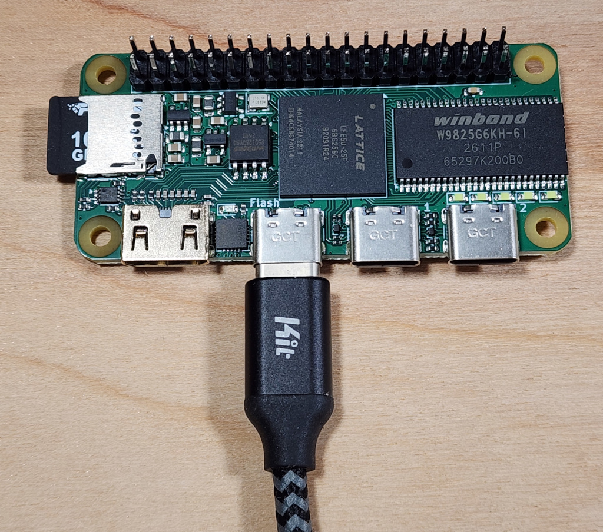

<!-- nav -->
[← Front page](../README.md) &emsp;&emsp;&emsp; **[Contents](../README.md#contents)** &emsp;&emsp;&emsp; [0.01 How to use this tutorial →](0_01_how_to_use_this_tutorial.md)

# 0.00 The hardware

This is the Icepi Zero FPGA+Memory board with the USB cable in the correct programming **Flash** port.

This is the hardware stack, including the analog stuff:

Three boards make the stack:
* an analog module on top containing
   - [ADC](https://en.wikipedia.org/wiki/Analog-to-digital_converter) that turns a voltage into a number and 
   - [DAC](https://en.wikipedia.org/wiki/Digital-to-analog_converter) that turns a
number into a voltage, each behind an SMA connector
* a small passive adapter in between
* an [FPGA](https://en.wikipedia.org/wiki/Field-programmable_gate_array) board at the bottom, 

| board | what it is |
| --- | --- |
| **"AD9280 AD9708 Data Acquisition Board"** | An 8-bit ADC and an 8-bit DAC on one module, about $30. Get the version with a **2×12** pin header and SMA connectors, the one in the photo. I got mine from [amazon](https://www.amazon.com/dp/B0C8D6JQSC) for $33, but they are widely available. |
| **[The adapter](../adapter_board/)** | A passive board you order yourself or ask me (about $2 for five). The [`adapter_board/`](../adapter_board/) folder has its KiCad files and gerbers, and says how to put it together. |
| **[Icepi Zero](https://github.com/cheyao/icepi-zero)** | A Lattice **ECP5 LFE5U-25F** FPGA on a Raspberry-Pi-Zero-sized board, with 5 white LEDs, 2 buttons and three USB-C ports. |

**Start with the FPGA board alone.** The first page of Chapter 1
([1.01](1_01_led_counter.md#101-a-counter-on-the-leds)) only makes the
LEDs count, and the module sits right over the LEDs. Leave the adapter
and the module off until
[1.02](1_02_dac_sawtooth.md#102-a-sawtooth-from-the-dac), where the DAC
first does something.

**Plug the USB-C cable** into the Icepi Zero's port
marked **Flash**: the left one of its three USB-C ports when they point
down, toward you. That one port loads your designs into the FPGA and is
also a serial port back to your laptop. (The other two USB ports do nothing unless you
program the FPGA to listen to them. Same with the HDMI socket.)

## What else you need

| for | what |
| --- | --- |
| [1.02+](1_02_dac_sawtooth.md#102-a-sawtooth-from-the-dac) | the adapter and the module. An oscilloscope helps a lot. (A USB instrument such as the ADALM2000 is plenty) |
| [1.04+](1_04_adc_on_the_leds.md#104-the-adc-on-the-leds) | a coax cable from the DAC output to the ADC input, SMA to SMA. The measurements here used RG-316, 16.5 cm and 101.5 cm long. A function generator is useful but not essential. |
| [3.04+](3_04_booting_from_sd.md#304-booting-from-an-sd-card) | a micro-SD card, 1 GB or more (it will be erased) |
| [4](4_00_one_board_experiments.md) | a few resistors, capacitors and other parts, listed in each section |
| [5](5_00_two_boards.md) | a second complete set of boards, and a second cable |

By the end of Chapter 1 you will have made all three of these, on
$120 of hardware, out of nothing but logic you describe yourself: 
* a sine wave ([1.03](1_03_dac_sine.md#103-a-sine-direct-digital-synthesis)), 
* a [lock-in amplifier](https://en.wikipedia.org/wiki/Lock-in_amplifier) that
times 85 cm of cable to a twentieth of a nanosecond and so measures the
speed of light in it ([1.08](1_08_lockin.md#108-a-lock-in-amplifier)), 
* and an AM transmitter and receiver that play a tune ([1.10](1_10_am_radio.md#110-an-am-radio)).

No processor is involved: just gates, flip-flops and a
50 MHz clock. You start smaller than that, though: the first thing you
build makes five LEDs count.

<!-- nav -->
[← Front page](../README.md) &emsp;&emsp;&emsp; **[Contents](../README.md#contents)** &emsp;&emsp;&emsp; [0.01 How to use this tutorial →](0_01_how_to_use_this_tutorial.md)

<!-- author -->
Jason Gallicchio, jason@hmc.edu, Harvey Mudd College
