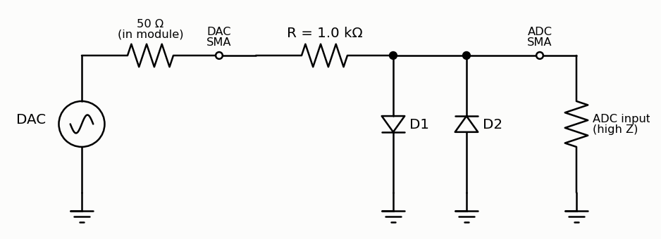
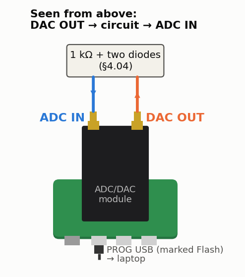
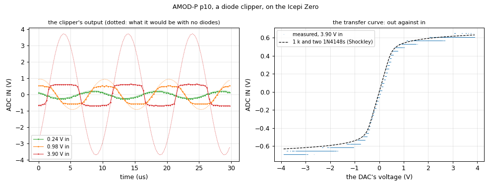
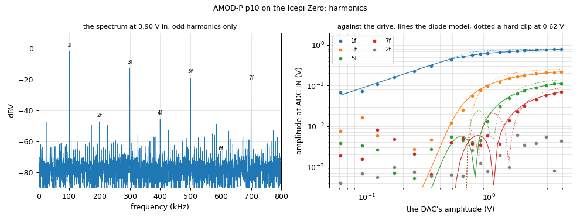

<!-- nav -->
[← 4.03 The Q of a quartz crystal](4_03_quartz_crystal.md) &emsp;&emsp;&emsp; **[Contents](../README.md#contents)** &emsp;&emsp;&emsp; [4.05 A quarter-wave stub →](4_05_quarter_wave_stub.md)

# 4.04 Harmonics: a diode clipper





**Where it plugs in.** With the USB connectors toward you, DAC OUT is the
right-hand SMA and ADC IN the left-hand one. AMOD-P's tile **p10** is the same
circuit ready-made (1 kΩ, then a 1N4148W each way to ground): DAC OUT to its IN,
top left, and its OUT, bottom right, to ADC IN.

**Drive 100 kHz at full amplitude (3.9 V).** About 3 mA flows, and the diodes
clip the output at ±0.65 V. Fourier-analysing that clipped sine predicts:

| | DC | 1*f* | 2*f* | 3*f* | 4*f* | 5*f* |
| --- | --- | --- | --- | --- | --- | --- |
| both diodes | 0 | 0.82 V | 0 | 0.26 V | 0 | 0.15 V |
| D1 only (clips the positive side) | −0.93 V | 2.36 V | 0.79 V | 0.13 V | 0.13 V | 0.07 V |

The symmetric clipper makes *only odd harmonics*: it satisfies
*v*(*t* + *T*/2) = −*v*(*t*), and every even Fourier coefficient of such a
function is zero. Remove D2 and the symmetry goes: the even harmonics and a
DC level all appear.

To measure it, use [Chapter 2](2_00_a_processor_on_the_fpga.md)'s SoC and firmware.

1. **Set the function generator** at the board's console:

```console
adda> fg 100000
```

2. **Capture and FFT on the laptop**, in Python, from `src/riscv/`:

```python
import cap_plot, numpy as np
t, code = cap_plot.cap(cap_plot.find_port(), 3)       # 3.125 MS/s: 31 samples per cycle
v = (code - 126.7) / 25.35
w = np.hanning(len(v))
amp = np.abs(np.fft.rfft((v - v.mean()) * w)) / w.sum() * 2
f = np.fft.rfftfreq(len(v), t[1] - t[0])
```

**The baseline to beat:** with a plain cable in place of the clipper, the
loop's own harmonics measured −64, −58, −56 and −46 dBc at 2*f* to 5*f*
(5*f* = 19 mV). The clipper's 3*f*, 0.26 V against the baseline's 4.9 mV
there, should stand 35 dB above it.

The table is for a hard clip, though. A 1N4148's exponential knee rounds the
corners of the clipped sine, so expect 5*f* and everything above it lower
than listed.

**The whole experiment in one go**, from `src/riscv/` with the firmware running:

```console
python3 clipper.py
```

It steps the function generator's amplitude from 4 to 255 (0.06 to 3.9 V),
captures at each, and fits the DC level and the first seven harmonics.
`clipper.py --sim` draws the same figures from the diode model alone, with no
board.





**Measured** on AMOD-P's p10 (2026-11-18, `dev/data/clipper/icepi_p10.npz`), at
3.9 V in:

| | 1*f* | 2*f* | 3*f* | 4*f* | 5*f* | 7*f* |
| --- | --- | --- | --- | --- | --- | --- |
| measured | 0.80 V | −45 dBc | 0.22 V (−11.2 dBc) | −44 dBc | 0.11 V (−17.1 dBc) | 0.070 V (−21.2 dBc) |
| the diode model | 0.78 V | 0 | −11.1 dBc | 0 | −16.6 dBc | −20.9 dBc |
| a hard clip at ±0.65 V | 0.82 V | 0 | 0.26 V | 0 | 0.15 V | 0.09 V |

The odd harmonics follow the diode equation, with no fitting: the rounded knee
takes 1.4 dB off a hard clip's 3*f* and 2.5 dB off its 5*f* and 7*f*. The even ones stay at the
loop's own baseline, 45 dB down: the two diodes match. Below about 0.4 V in the
diodes hardly conduct, and the harmonics sink into the 8-bit ADC's
quantization; between 0.5 and 1 V, where the knee is, 3*f* climbs 20 dB, and
5*f* passes through a null (near 0.8 V) as its sign changes. The output's
−0.04 V DC is the ADC's own offset: it is there with no drive at all.

<!-- nav -->
[← 4.03 The Q of a quartz crystal](4_03_quartz_crystal.md) &emsp;&emsp;&emsp; **[Contents](../README.md#contents)** &emsp;&emsp;&emsp; [4.05 A quarter-wave stub →](4_05_quarter_wave_stub.md)

<!-- author -->
<sub>Jason Gallicchio, jason@hmc.edu, Harvey Mudd College</sub>
