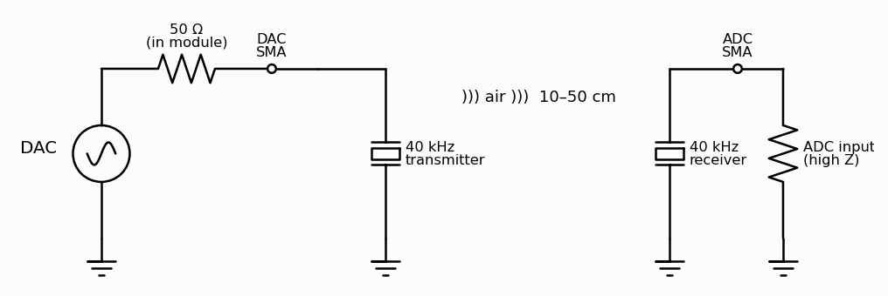
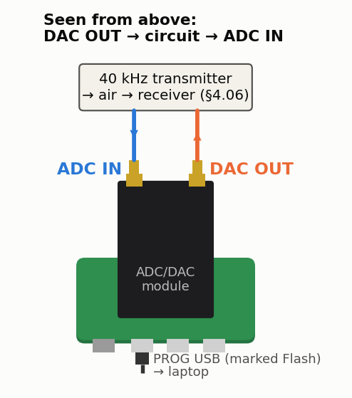
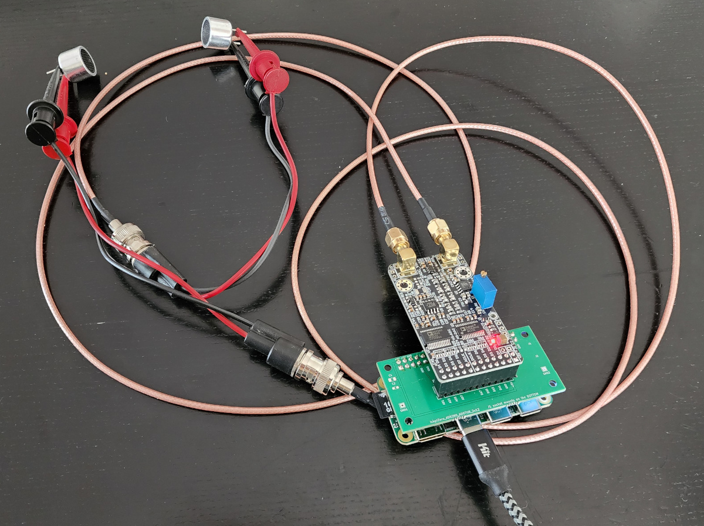

<!-- nav -->
[← 4.05 A quarter-wave stub](4_05_quarter_wave_stub.md) &emsp;&emsp;&emsp; **[Contents](../README.md#contents)** &emsp;&emsp;&emsp; [4.07 An optical link →](4_07_optical_link.md)

# 4.06 The speed of sound at 40 kHz





**Where it plugs in.** With the USB connectors toward you, DAC OUT is the
right-hand SMA and ADC IN the left-hand one.

Drive a 40 kHz piezo transmitter (e.g. Murata MA40S4S; up to 20 V<sub>pp</sub>
is allowed, the DAC gives 7.8) directly from the DAC. The matching receiver,
10–50 cm away, goes straight to the ADC. Expect a lot of signal: the pair
measured below gave 1.5 V at 11 cm, and the pressure falls as 1/distance, so
at 50 cm it is still about 0.3 V, which the lock-in reads easily ([2.05](2_05_lockin_peripheral.md#205-a-lock-in-peripheral)). At 20 °C, *c* = 343.4 m/s, so λ = 8.59 mm, and
the phase falls by **41.9° for every millimetre** you move the receiver away.

```bash
python3 lockin.py -f 40000       # slide the receiver along a ruler, 1 mm at a time
```

Unwrap the phase against distance and fit: the slope gives *c* to a few
tenths of a percent. A reflection off the bench adds a ripple to phase against
distance, so raise the pair off the table. Then warm the air with a hair dryer. Since
*c* ≈ 331.3 + 0.606 *T*(°C) m/s, that is 0.18% per kelvin. A sweep from 36 to
44 kHz shows the transducers' own resonance. The next section is that sweep
for one pair; the advanced topics after it ask what else the sweep can tell
you, and how fast the pair can carry data.

## One pair, measured



The pair measured here: two open-frame 16 mm transducers, each held by a
minigrabber lead, faces about 10 cm apart by eye, each wired through an
SMA-to-BNC adapter and about 2 m of RG-316 to the board (DP051TLX). The
photo shows them lying on the bench, where they were first measured. For
the results on this page they sit on a cardboard box instead, to keep the
bench from carrying the sound, and the bench's results are kept for
comparison. Nothing moved during either set of measurements: everything
comes from changing what the DAC plays.

### The scan

`sweep.py` steps `lockin.sv`'s frequency ([1.08](1_08_lockin.md#108-a-lock-in-amplifier)) and keeps the second
of two 42 ms averages at each step. The first is thrown away because the pair
*rings*: for a millisecond or two after the frequency changes it is still
singing the old one, and an average that starts at once hears it. (Measured:
a reading at 35 kHz taken just after 40 kHz gave 1.1 mV; the true response
there was 0.2 mV.) Wait a few seconds after loading `lockin.bit`, too: for the
first 1.7 s after it loaded, this board read 1.7 mV at 30 kHz, in step with
the drive, where there was really 0.04 mV, and then it let go. What settles
wasn't found. `sweep.py` also turns a sweep into an *impulse response* by an
inverse Fourier transform, for the curious.

<details>
<summary>The whole file: <code>sweep.py</code></summary>

<!-- file: src/ultrasound/sweep.py -->
```python
#!/usr/bin/env python3
"""4.06: the ultrasonic pair's frequency response, measured with lockin.sv (1.08).

    python3 sweep.py 37e3 43e3                  # 20 Hz steps; plots amplitude and phase
    python3 sweep.py 30e3 64e3 --step 10 -o pair.npz    # and save it
    python3 sweep.py --watch 40.3e3 --seconds 60        # one frequency against time
    python3 sweep.py --impulse pair.npz         # the impulse response from a saved sweep

lockin.bit must be loaded.  Each point is two 42 ms averages, of which only the
second is kept: the transducers ring for a millisecond or so after the frequency
changes, and the first average would still hear the last frequency.

The impulse response is the inverse Fourier transform of the sweep.  Only positive
frequencies were measured, so the transform gives the *analytic* impulse response,
whose magnitude is the envelope of h(t): when the sound arrives, and how long it rings.
"""
import argparse
import os
import sys
import time

import numpy as np

sys.path.insert(0, os.path.join(os.path.dirname(os.path.abspath(__file__)), "..", "verilog"))
import lockin                                   # noqa: E402  (1.08's laptop side)


def sweep(li, freqs, quiet=False):
    """Complex response (volts at the ADC) at each frequency, settled."""
    z = np.zeros(len(freqs), complex)
    for i, f in enumerate(freqs):
        li.measure(f)                           # let the transducers settle...
        f_used, z[i] = li.measure(f)            # ...then keep this one
        freqs[i] = f_used
        if not quiet and i % 25 == 0:
            print(f"{f_used:10.1f} Hz  {abs(z[i]) * 1e3:9.3f} mV  {np.degrees(np.angle(z[i])):8.1f} deg")
    return freqs, z


def impulse(f, z, fs_out=None):
    """The analytic impulse response from a sweep on a uniform grid of step df: a
    Hann window over the band (to keep the sidelobes down), then an inverse FFT.
    Returns t (s) and h (complex; |h| is the envelope)."""
    df = f[1] - f[0]
    n = int(2 ** np.ceil(np.log2(4 * len(f))))     # zero-padded: a smooth envelope
    w = np.hanning(len(f))
    spec = np.zeros(n, complex)
    k0 = int(round(f[0] / df))
    spec[:len(f)] = z * w
    h = np.fft.ifft(spec) * n
    t = np.arange(n) / (n * df)
    # the grid started at f[0], not 0: shift it back up, which only turns the phase
    h = h * np.exp(2j * np.pi * k0 * df * t)
    return t, h / w.sum()


def group_delay(f, z):
    return -np.gradient(np.unwrap(np.angle(z)), 2 * np.pi * f)


if __name__ == "__main__":
    ap = argparse.ArgumentParser(description=__doc__,
                                 formatter_class=argparse.RawDescriptionHelpFormatter)
    ap.add_argument("band", nargs="*", type=float, help="FMIN FMAX in Hz")
    ap.add_argument("--step", type=float, default=20.0, help="Hz between points")
    ap.add_argument("-o", "--out", help="save f, z (complex volts) and the time as .npz")
    ap.add_argument("--watch", type=float, help="measure this one frequency over and over")
    ap.add_argument("--seconds", type=float, default=30.0, help="how long to --watch")
    ap.add_argument("--impulse", help="plot the impulse response of a saved sweep")
    ap.add_argument("--port")
    ap.add_argument("--no-plot", action="store_true")
    a = ap.parse_args()

    if a.impulse:
        d = np.load(a.impulse)
        t, h = impulse(d["f"], d["z"])
        k = np.argmax(abs(h))
        print(f"envelope peaks at {t[k] * 1e6:.0f} us")
        if not a.no_plot:
            import matplotlib.pyplot as plt
            plt.plot(t * 1e3, abs(h))
            plt.xlim(0, 5); plt.xlabel("time (ms)"); plt.ylabel("|h(t)|")
            plt.show()
        sys.exit()

    li = lockin.LockIn(a.port)
    if a.watch:
        rows = []
        t0 = time.time()
        while time.time() - t0 < a.seconds:
            f, z = li.measure(a.watch)
            rows.append((time.time() - t0, z))
            print(f"{rows[-1][0]:7.2f} s  {abs(z) * 1e3:9.3f} mV  {np.degrees(np.angle(z)):8.2f} deg")
        t = np.array([r[0] for r in rows]); z = np.array([r[1] for r in rows])
        if a.out:
            np.savez(a.out, t=t, z=z, f=a.watch)
        sys.exit()

    if len(a.band) != 2:
        ap.error("give FMIN FMAX, or --watch F, or --impulse FILE")
    freqs = np.arange(a.band[0], a.band[1] + a.step / 2, a.step)
    t_start = time.time()
    f, z = sweep(li, freqs)
    print(f"{len(f)} points in {time.time() - t_start:.0f} s")
    k = np.argmax(abs(z))
    print(f"peak {abs(z[k]) * 1e3:.1f} mV at {f[k]:.0f} Hz; "
          f"group delay there {group_delay(f, z)[k] * 1e6:.0f} us")
    if a.out:
        np.savez(a.out, f=f, z=z, when=time.strftime("%Y-%m-%d %H:%M"))
    if not a.no_plot:
        import matplotlib.pyplot as plt
        fig, (p, q) = plt.subplots(2, 1, sharex=True)
        p.plot(f / 1e3, 20 * np.log10(abs(z))); p.set_ylabel("dB re 1 V")
        q.plot(f / 1e3, group_delay(f, z) * 1e6); q.set_ylabel("group delay (us)")
        q.set_xlabel("frequency (kHz)")
        plt.show()
```

</details>

```bash
cd src/ultrasound                # lockin.bit loaded (src/verilog: make load-lockin)
python3 sweep.py 37e3 43e3                            # 20 Hz steps, plotted
python3 sweep.py 30e3 64e3 --step 10 -o pair.npz      # the figure's sweep: 5 minutes
```


- **It is loud.** 1.49 V at 40.31 kHz, from the DAC's 3.9 V: far more than
  the "tens of millivolts" this page used to promise. The receiver drives the
  ADC's high-impedance input, so it is open-circuited.
- **One peak, about a kilohertz wide.** 950 Hz between the 3 dB points
  (39.85 to 40.80 kHz), so the pair together has *Q* = 40.31/0.95 ≈ 42.
- **Steep sides, and another mode.** 46 dB down at 36 kHz and 37 dB down at
  45 kHz. A second mode near 58 kHz is 22 dB down.
- **The bench hardly mattered at the peak.** Lying on the bench the same pair
  gave 1.27 V, 15% less, but it was also 1.2 cm farther apart (the advanced
  topics measure that), which accounts for most of it. The shape of the peak
  didn't change. Away from it, on the box, 5 to 12 times more gets
  through, 30 to 50 dB down from the peak.
- **The floor.** On the bench, where the pair passed nothing (30–34 kHz),
  one 42 ms average read about 36 µV (−89 dB re 1 V). On the box the same
  range reads 0.1 to 0.5 mV: about 0.15 mV of the DAC that the leads, moved
  with the pair, now pick up directly at 30–32 kHz (it arrives with no
  delay), and sound above that. (Two points at 31.25 and 62.5 kHz are left out:
  there 25 MHz divided by the frequency is a whole number, and `lockin.sv`'s
  reference repeats after a few samples.)

**Try this:**

- Run the ruler experiment at the peak, 40.3 kHz, and fit *c*.
- Swap the transducers and sweep again. Does the peak move?
- Move the receiver back to 50 cm. The peak should fall as 1/distance, by
  about 13 dB.
- `python3 sweep.py --watch 40.3e3` and a hair dryer: here 1 K of air turns
  the phase by about 8°.

## Advanced topics

> [!NOTE]
> **Everything from here on is an advanced topic.** It goes past the scan: a
> fit that separates the transducers from the air, a new design
> (`awgcap_slow.sv`) to watch the sound arrive, and two modems through the
> air, one on [6.12](6_12_on_the_air.md#the-same-frame-at-six-symbols-a-second)'s `ddc.sv` and one built on [6.07](6_07_ofdm.md#607-ofdm-the-triumph-of-physics-over-math)'s OFDM. Skip it on a
> first pass; nothing else in the tutorial depends on it.

### How far apart: the delay

A delay τ turns the phase by −360° × *f*τ, so the slope of the phase, the
[group delay](https://en.wikipedia.org/wiki/Group_delay_and_phase_delay), is the delay. At the peak it is 770 µs, far from the peak
300 to 400 µs, and both include the transducers: a resonator holds on to
what passes through it for up to 2*Q*/ω, 0.33 ms at *Q* = 42. A fit
separates the two.


- **Two resonators.** Between 37 and 44 kHz the response fits, to 2% rms,
  two resonances at 39.96 and 40.65 kHz with *Q* = 42 each, times a pure
  delay: one resonance in each transducer, a little apart, which makes the
  top flatter than either alone. The product cannot say which is the
  transmitter's; swapping the pair can. (The *Q* ≈ 20–30 this page used to
  guess was low.) On the bench the fit gave 39.91 and 40.61 kHz, *Q* = 39 and
  41: the same transducers. Outside 37 to 44 kHz the real response doesn't
  follow two resonators (below 37 kHz it falls much faster, and on the bench
  it did on both sides), so the fit is only for the peak.
- **The delay.** **318 µs**, which at 22 °C (*c* = 344.6 m/s) is
  **10.9 cm** of air. On the bench it was 353 µs, 12.2 cm: the pair moved
  closer when it went onto the box. The room's temperature wasn't measured,
  and each 3 K is a millimetre; the distance was "about 10 cm" by eye between
  the faces, and each diaphragm sits a few millimetres behind its face.
- **The phase, for two minutes** at 40.3 kHz: on the box it slipped once, by
  7.4° in about a second (0.18 mm: something settling on the cardboard), and
  otherwise held to 0.27° rms. On the bench it stayed within ±0.7° (0.34° rms):
  16 µm of path, or 75 mK of air. That is the floor under the ruler experiment
  (41.9° per mm), and the hair dryer has room: 1 K turns the phase by 8.1°
  here.

### Watching the sound arrive: `awgcap_slow.sv`

A lock-in sees one frequency at a time. To see the sound *arrive*, play a
burst and record what comes back. [6.00](6_00_digital_communications.md#600-digital-communications-hardware-defined-radio)'s `awgcap.sv` does exactly that, but its
loop is 327.68 µs long, about the length of the trip. `awgcap_slow.sv` is
`awgcap.sv` with one change: the DAC takes its next sample only every
2<sup>*k*</sup> clocks (*k* = 8: 195 kS/s, an 83.89 ms loop), and each value
it records is the average of 2<sup>*k*</sup> of the ADC's 25 MS/s samples
(97.7 kS/s, 167.77 ms, two loops). The average is the anti-alias filter, and
when there is noise to work with it adds bits ([7.05](7_05_trading_speed_for_bits.md#705-trading-speed-for-bits)), so the record comes
back as 16-bit numbers in 1/256ths of a code. `awgcap_slow_tb.sv` checks it
in simulation (`make sim-awgcap_slow`): a ramp from the DAC comes back as the
means of its pairs of samples, lined up with the start of the loop.

<details>
<summary>The whole file: <code>awgcap_slow.sv</code></summary>

<!-- file: src/ultrasound/awgcap_slow.sv -->
```systemverilog
// awgcap_slow.sv -- awgcap.sv (6.00) with a slower clock: an arbitrary waveform
// generator and a digitizer for signals of tens of kilohertz instead of megahertz.
//
// The DAC plays a 16384-sample waveform from block RAM, over and over, one sample
// every 2^k clocks: 195,312.5 samples a second at the default k = 8, so one loop is
// 83.89 ms.  The ADC still samples at 25 MS/s, but what is recorded is the AVERAGE of
// 2^k of its samples: one value every 2^(k+1) clocks (97,656.25 a second at k = 8),
// 16384 of them (167.77 ms = exactly two loops), starting on the first sample of a
// loop.  The average is the anti-alias filter (a boxcar, 7.05), and it buys bits: each
// value is sent as 16 bits, the average in 1/256ths of an ADC code.
//
// Serial port, 1,000,000 baud:
//   "W" then 16384 bytes   load a new waveform (the DAC keeps playing as it loads)
//   "K" then one byte k    the rate: one DAC sample every 2^k clocks, k = 0..12
//                          (default 8).  k = 0 plays at 50 MS/s, as awgcap.sv does
//   "C"                    record, then send back the 16384 values, 2 bytes each,
//                          high byte first: 256 x (the mean ADC code), 0..65280
//
// awgcap_slow.py does the laptop side.
module awgcap_slow (
    input  logic       clk,         // 50 MHz
    output logic [7:0] dac_d = 8'd128,
    output logic       dac_clk,
    input  logic [7:0] adc_d,
    output logic       adc_clk,
    input  logic       uart_rx,
    output logic       uart_tx,
    output logic [4:0] led
);
    localparam N = 16384;

    // ---- the rate: one DAC sample every 2^k clocks ------------------------------
    logic [3:0]  k = 4'd8;
    logic [12:0] last;                      // 2^k - 1: the divider's last count
    assign last = 13'((14'd1 << k) - 1);

    // ---- the waveform: one sample every 2^k clocks -------------------------------
    logic [7:0]  wave [0:N-1];
    logic [13:0] play = 0;                  // which sample the DAC is playing
    logic [12:0] div  = 0;                  // clocks into this sample
    initial for (int i = 0; i < N; i++) wave[i] = 8'd128;
    always_ff @(posedge clk) begin
        // ######################################################################
        // ##  KEY LINE: as awgcap.sv, but the next sample only every 2^k clocks.
        // ##  play wraps from 16383 to 0, so the waveform loops forever, and its
        // ##  zero is the instant every record is lined up with.
        // ######################################################################
        if (div >= last) begin
            div   <= 0;
            play  <= play + 1;
            dac_d <= wave[14'(play + 1)];   // so the DAC shows wave[play] while play holds it
        end else
            div <= div + 1;
    end
    assign dac_clk = ~clk;                  // as in the earlier designs

    // ---- the ADC: 25 MS/s, as in capture.sv ------------------------------------
    logic adc_clk_r = 0, new_sample = 0;
    logic [7:0] sample = 0;
    always_ff @(posedge clk) begin
        adc_clk_r  <= ~adc_clk_r;
        new_sample <= 0;
        if (adc_clk_r == 0) begin
            sample     <= adc_d;
            new_sample <= 1;
        end
    end
    assign adc_clk = adc_clk_r;

    // ---- serial port ----------------------------------------------------------
    logic [7:0] rx_data;
    logic       rx_valid, tx_busy;
    logic [7:0] tx_data = 0;
    logic       tx_start = 0;
    uart_rx #(.CLKS_PER_BIT(50)) urx (.clk(clk), .rx(uart_rx), .data(rx_data), .valid(rx_valid));
    uart_tx #(.CLKS_PER_BIT(50)) utx (.clk(clk), .data(tx_data), .start(tx_start), .busy(tx_busy), .tx(uart_tx));

    // ---- load, record (averaging), send ------------------------------------------
    logic [15:0] rec [0:N-1];
    logic [13:0] addr = 0;
    logic [15:0] rd = 0;
    logic [19:0] acc = 0;                   // up to 2^12 samples of 255
    logic [11:0] cnt = 0;                   // samples in acc so far
    logic [19:0] sum;
    logic [27:0] scaled;
    logic        hi = 1;                    // sending the high byte next
    assign sum    = acc + sample;
    assign scaled = {sum, 8'd0} >> k;       // 256 x the mean: sum x 2^(8-k)
    typedef enum logic [2:0] {IDLE, LOAD, RATE, ARM, RECORD, SEND, SEND2} state_t;
    state_t state = IDLE;
    always_ff @(posedge clk) begin
        tx_start <= 0;
        rd <= rec[addr];
        case (state)
            IDLE:
                if (rx_valid && rx_data == "W") begin addr <= 0; state <= LOAD; end
                else if (rx_valid && rx_data == "K") state <= RATE;
                else if (rx_valid && rx_data == "C") state <= ARM;
            LOAD:
                if (rx_valid) begin
                    wave[addr] <= rx_data;
                    addr <= addr + 1;
                    if (addr == N - 1) state <= IDLE;
                end
            RATE:
                if (rx_valid) begin
                    k <= (rx_data > 12) ? 4'd12 : rx_data[3:0];
                    state <= IDLE;
                end
            ARM:
                // ##############################################################
                // ##  KEY LINE: start on the first clock of a loop, so every
                // ##  record starts at the same instant of the waveform.
                // ##############################################################
                if (play == 0 && div == 0) begin
                    acc <= 0; cnt <= 0; addr <= 0; state <= RECORD;
                end
            RECORD:
                if (new_sample) begin
                    // ##########################################################
                    // ##  KEY LINE: add up 2^k samples, store their mean (in
                    // ##  1/256ths of a code), and start the next sum from zero.
                    // ##########################################################
                    if (cnt == last[11:0]) begin
                        rec[addr] <= scaled[15:0];
                        acc <= 0;
                        cnt <= 0;
                        addr <= addr + 1;
                        if (addr == N - 1) begin addr <= 0; hi <= 1; state <= SEND; end
                    end else begin
                        acc <= sum;
                        cnt <= cnt + 1;
                    end
                end
            SEND:  state <= SEND2;          // one clock for the RAM read
            SEND2:
                if (!tx_busy && !tx_start) begin
                    tx_data <= hi ? rd[15:8] : rd[7:0];
                    tx_start <= 1;
                    hi <= ~hi;
                    if (hi) state <= SEND2;                 // the low byte of the same value
                    else if (addr == N - 1) state <= IDLE;
                    else begin addr <= addr + 1; state <= SEND; end
                end
        endcase
    end
    assign led = {state, 2'b0};
endmodule
```

</details>

<details>
<summary>The whole file: <code>awgcap_slow.py</code></summary>

<!-- file: src/ultrasound/awgcap_slow.py -->
```python
#!/usr/bin/env python3
"""The laptop side of awgcap_slow.sv: play a waveform at 195 kS/s, record at 97.7 kS/s.

    import awgcap_slow as awg
    ser = awg.open_port()                  # finds the Icepi Zero (or open_port("/dev/ttyUSB0"))
    awg.upload(ser, wave)                  # 16384 DAC codes 0..255: one 83.89 ms loop, forever
    x = awg.record(ser)                    # 16384 mean ADC codes (floats), 167.77 ms, from a loop's start
    t_dac, t_adc = awg.times()             # the instants they belong to, in seconds

    python3 awgcap_slow.py --burst 40300 --ms 2    # a 2 ms tone burst, recorded and plotted

The record's value n is the mean of the ADC over [2n, 2n + 2) DAC sample periods, so
it belongs to the instant (2n + 1) / FS_DAC: half a record period after its start.
"""
import argparse
import time

import numpy as np

N = 16384
K = 8                                   # one DAC sample every 2^K clocks
FS_DAC = 50e6 / 2**K                    # 195,312.5 S/s
FS_ADC = FS_DAC / 2                     # 97,656.25 S/s: one record value per two DAC samples
LOOP = N / FS_DAC                       # 83.89 ms


def find_port():
    """The first FTDI FT231X serial port (USB ID 0403:6015): the Icepi Zero's."""
    from serial.tools import list_ports
    for p in list_ports.comports():
        if (p.vid, p.pid) == (0x0403, 0x6015) and p.product in (None, "FT231X USB UART"):
            return p.device
    raise SystemExit("No Icepi Zero found. Is it plugged in? (Or give --port.)")


def open_port(port=None, k=K):
    import serial                       # pip install pyserial
    ser = serial.Serial(port or find_port(), 1_000_000, timeout=2)
    time.sleep(0.02)
    ser.reset_input_buffer()            # the FT231X's junk byte on opening
    ser.write(b"K" + bytes([k]))
    return ser


def upload(ser, wave):
    w = np.clip(np.round(np.asarray(wave)), 0, 255).astype(np.uint8)
    assert len(w) == N
    ser.write(b"W" + w.tobytes())
    ser.flush()
    time.sleep(0.02)


def record(ser):
    ser.reset_input_buffer()
    ser.write(b"C")
    raw = ser.read(2 * N)
    if len(raw) != 2 * N:
        raise RuntimeError("got %d of %d bytes -- is awgcap_slow.bit loaded?" % (len(raw), 2 * N))
    return np.frombuffer(raw, ">u2").astype(float) / 256


def times():
    """When each DAC sample starts, and the middle of each record value, in seconds."""
    return np.arange(N) / FS_DAC, (2 * np.arange(N) + 1) / FS_DAC


def tone_burst(f, ms, amp=127, start_ms=1.0):
    """A burst of f Hz, ms long, starting start_ms into the loop; silence elsewhere."""
    t, _ = times()
    on = (t >= start_ms * 1e-3) & (t < (start_ms + ms) * 1e-3)
    return 128 + amp * np.sin(2 * np.pi * f * (t - start_ms * 1e-3)) * on


if __name__ == "__main__":
    ap = argparse.ArgumentParser(description=__doc__,
                                 formatter_class=argparse.RawDescriptionHelpFormatter)
    ap.add_argument("--port")
    ap.add_argument("--burst", type=float, default=40300.0, help="tone frequency, Hz")
    ap.add_argument("--ms", type=float, default=2.0, help="burst length, ms")
    ap.add_argument("--amp", type=float, default=127, help="DAC codes, 0..127")
    a = ap.parse_args()
    ser = open_port(a.port)
    wave = tone_burst(a.burst, a.ms, a.amp)
    upload(ser, wave)
    time.sleep(2 * LOOP)                # let the old waveform's sound die away
    x = record(ser)
    t_dac, t_adc = times()
    import matplotlib.pyplot as plt
    fig, (p, q) = plt.subplots(2, 1, sharex=True)
    p.plot(t_dac * 1e3, wave); p.set_ylabel("DAC code")
    q.plot(t_adc * 1e3, x); q.set_ylabel("mean ADC code"); q.set_xlabel("time (ms)")
    q.set_xlim(0, 10)
    plt.show()
```

</details>

```bash
cd src/ultrasound
make load-awgcap_slow
python3 awgcap_slow.py --burst 40300 --ms 3
```


For 318 µs, nothing; then the pair rings up, taking about a millisecond to
reach full strength, and after the DAC stops it rings down as long. The
orange curves weren't fitted to this record. They are the sweep's fit, two
resonators and a delay, applied to the burst that was played (held for
5.12 µs a sample, and averaged as `awgcap_slow.sv` averages): 25.7 codes of
steady signal predicted, 26.6 measured, and the ring-up followed sample by
sample. The frequency domain predicted the time domain.

That millisecond of ringing is the speed limit for anything that switches
the tone, which is every modem below.

> [!NOTE]
> **An ADC with no noise can't average.** With nothing coming in, this ADC
> often reads the same code every time: it has less than a code of noise.
> Then a signal smaller than half a code never changes the code, and no
> amount of averaging finds it ([7.05](7_05_trading_speed_for_bits.md#the-adc-side-averaging-buys-bits-only-from-noise) shows why). It is why the first few
> samples of the ring-up above sit a little below the prediction, and why a
> single-cycle click from the DAC, which should give the impulse response
> directly, comes back at only one code and lopsided. The measurements here
> use the long burst, whose 26 codes don't care, and the lock-in, whose drive
> is always on.

### Through the air, or through the bench?

Lying on the bench, the transducers could have sent the sound through the
bench instead of the air. Sound in a solid is fast, something like 1 to
4 km/s in wood or laminate against 0.34 km/s in air, so a path through the
bench would arrive within 10 to 100 µs, long before the air. Three
measurements say the bench carried almost nothing:

- **The box.** Lifting the pair onto it changed the peak by +1.4 dB, and
  0.9 dB of that is the 1.2 cm it moved closer (1/distance). The two
  resonances moved by 45 Hz, and their *Q* by a few percent.
- **The impulse responses.** The inverse Fourier transforms of the two sweeps
  (`sweep.py --impulse`) have nothing before the air's arrival above about
  −40 dB, the level of the transform's own sidelobes, either way.
- **The burst, on the bench.** In the 4 records of 16 in which the ADC
  happened to be toggling between two codes (the note above), the 40.3 kHz
  between 1.10 ms and the air's arrival was 0.05 codes, about the noise,
  while the air's own sound 230 µs after *it* arrived was 6.1 codes: whatever
  the bench carried was at least 42 dB weaker. (On the box none of 32
  records toggled, so this one has no box version.)

Away from the peak, though, the mounting matters. On the box the pair passes
5 to 12 times more at 32–36 and 46–54 kHz, 30 to 50 dB below the peak,
and that extra arrives as late as sound does (its phase turns as a 150 to
300 µs delay). Thin cardboard carries bending waves about as slowly as air,
so timing alone can't say whether it comes through the box or around it.
The test that needs no timing at all: slide a card between the two. The air's
path is blocked, the box's isn't.

### A modem through 11 cm of air

The pair is a channel 950 Hz wide at 3 dB, with 40 dB of signal-to-noise in
the middle. How fast can it carry data?

#### FSK, on `ddc.sv`

The simplest modem: two tones, a 0 below the peak and a 1 above it.
[6.12](6_12_on_the_air.md#the-same-frame-at-six-symbols-a-second)'s `ddc.sv` already plays tones from a table, one per symbol,
switched without a phase jump, and its receiver mixes the ADC down to
baseband at any frequency and streams I/Q, 12,207 samples a second
(*d* = 11). So a symbol is a whole number *M* of I/Q samples, the baud rate
is 12207/*M*, and the tones go 1/*T* apart, the closest at which each
tone's correlation ignores the other's. `fsk.py` correlates every symbol's
I/Q with both tones and keeps the bigger, as [6.12](6_12_on_the_air.md#612-on-the-air-whispers-and-how-far-they-carry)'s FT8 does with eight.
No carrier phase is needed. A 13-symbol [Barker code](https://en.wikipedia.org/wiki/Barker_code) at the front of each
frame says where the symbols start.

<details>
<summary>The whole file: <code>fsk.py</code></summary>

<!-- file: src/ultrasound/fsk.py -->
```python
#!/usr/bin/env python3
"""4.06: a frequency-shift-keying modem through the air, on ddc.sv (6.12).

    python3 fsk.py "HELLO THROUGH THE AIR"          # 509 baud (the default)
    python3 fsk.py "HELLO" --baud 1000              # the nearest rate it can do: 1017
    python3 fsk.py --ber --baud 509 --frames 20     # random bits: count the errors

ddc.bit must be loaded (in src/twoboard: make load-ddc).  Its transmitter has a table
of 8 tones and a FIFO of tone indices, played one per symbol and switched without a
phase jump; this modem uses two of the tones, a 0 at fc - df/2 and a 1 at fc + df/2,
with df equal to the baud rate.  Its receiver is a digital down-converter at fc that
streams I/Q, 12,207 samples a second (d = 11), so a symbol is a whole number M of
I/Q samples and the baud rate is 12207/M: 1017 (M = 12), 509 (24), 254 (48), ...

The receiver here is non-coherent, as FT8's (6.12) is with eight tones: correlate
each symbol's I/Q with each tone, compare the energies, keep the bigger.  It finds
where the symbols start from a 13-symbol Barker sync word at the front of every
frame.  A frame is at most 255 symbols (one FIFO load): the sync word and 242 bits.
"""
import argparse
import os
import sys
import time

import numpy as np

sys.path.insert(0, os.path.join(os.path.dirname(os.path.abspath(__file__)), "..", "twoboard"))
import ddc                                      # noqa: E402  (6.12's laptop side)

FC = 40300.0                                    # Hz: the pair's peak (sweep.py)
D = 11                                          # ddc.sv decimation: 2^11 ADC samples per I/Q
FS_IQ = ddc.FS_ADC / 2**D                       # 12,207.03 I/Q samples a second
CLOCKS_PER_IQ = 2 ** (D + 1)                    # 4096 clocks of 50 MHz
BARKER = np.array([1, 1, 1, 1, 1, 0, 0, 1, 1, 0, 1, 0, 1])
MAX_SYMBOLS = 255


def text_bits(text):
    return np.unpackbits(np.frombuffer(text.encode("ascii"), np.uint8))


def bits_text(bits):
    b = np.packbits(np.asarray(bits[:len(bits) // 8 * 8], np.uint8))
    return "".join(chr(c) if 32 <= c < 127 else "?" for c in b)


class Modem:
    def __init__(self, port=None, M=24, fc=FC, amp=127):
        self.M = M
        self.fc = fc
        self.baud = FS_IQ / M
        self.df = self.baud                     # the closest orthogonal spacing
        self.ser = ddc.open_port(port)
        ddc.set_tone(self.ser, 0, fc - self.df / 2)
        ddc.set_tone(self.ser, 1, fc + self.df / 2)
        ddc.set_amp(self.ser, amp)
        ddc.set_symbol(self.ser, M * CLOCKS_PER_IQ)
        ddc.tone(self.ser, None)                # no continuous tone: the FIFO plays
        ddc.set_rx(self.ser, fc)
        ddc.set_decim(self.ser, D)

    def send_and_listen(self, bits):
        """Queue the sync word and `bits`; return the I/Q stream (ADC codes) that heard them."""
        symbols = np.concatenate([BARKER, bits]).astype(int)
        assert len(symbols) <= MAX_SYMBOLS
        ddc.stream(self.ser, True)
        time.sleep(0.03)
        self.ser.reset_input_buffer()
        pre = int(0.02 * FS_IQ)                 # 20 ms of silence first, to see the start
        z0 = ddc.read_iq(self.ser, pre, D)
        ddc.queue(self.ser, list(symbols))
        n = (len(symbols) + 6) * self.M + int(0.05 * FS_IQ)   # and 50 ms for USB latency
        z1 = ddc.read_iq(self.ser, n, D)
        ddc.stream(self.ser, False)
        return np.concatenate([z0, z1])


def energies(z, M):
    """For every possible symbol start n: the energy at tone 0 and tone 1 over the M
    I/Q samples from n.  (A moving correlation: z times each tone's conjugate, summed
    over a window of M.)  The tones are at -df/2 and +df/2 from the NCO, df = 1/T."""
    df = FS_IQ / M
    t = np.arange(len(z)) / FS_IQ
    win = np.ones(M)
    e = []
    for f in (-df / 2, +df / 2):
        # ######################################################################
        # ##  KEY LINE: correlate with the tone (undo its rotation, then add up
        # ##  a symbol's worth); the energy is the magnitude squared.
        # ######################################################################
        c = np.convolve(z * np.exp(-2j * np.pi * f * t), win, "valid")
        e.append(abs(c) ** 2)
    return np.array(e)                          # shape (2, len(z) - M + 1)


def receive(z, M, nbits):
    """Find the frame (Barker correlation) and decide nbits bits after it.  Returns
    the bits, the soft values (E1 - E0) / (E1 + E0), and where the frame starts."""
    e = energies(z, M)
    soft = (e[1] - e[0]) / (e[1] + e[0] + 1e-12)
    # Look for the sync word only where the sound starts.  13 random bits match it
    # once in 8192 tries, and a frame of random data offers over a thousand.
    total = e[0] + e[1]
    onset = int(np.argmax(total > 0.25 * np.percentile(total, 90)))
    # Correlate the energy difference, not soft: in the silence before the frame
    # soft is +-1 at random.
    diff = e[1] - e[0]
    pattern = 2.0 * BARKER - 1
    best, start = -np.inf, 0
    for n in range(max(0, onset - M), onset + 3 * M):
        s = np.dot(diff[n:n + len(BARKER) * M:M], pattern)
        if s > best:
            best, start = s, n
    idx = start + M * (len(BARKER) + np.arange(nbits))
    v = soft[idx]
    return (v > 0).astype(int), v, start


def main():
    ap = argparse.ArgumentParser(description=__doc__,
                                 formatter_class=argparse.RawDescriptionHelpFormatter)
    ap.add_argument("text", nargs="?", help="the message (ASCII, up to 30 characters)")
    ap.add_argument("--port")
    ap.add_argument("--baud", type=float, default=509, help="rounded to 12207/M")
    ap.add_argument("--fc", type=float, default=FC)
    ap.add_argument("--amp", type=int, default=127, help="DAC codes, 0..127")
    ap.add_argument("--ber", action="store_true", help="random bits; count the errors")
    ap.add_argument("--frames", type=int, default=10)
    ap.add_argument("--seed", type=int, default=1)
    a = ap.parse_args()
    M = max(1, int(round(FS_IQ / a.baud)))
    m = Modem(a.port, M, a.fc, a.amp)
    print(f"{m.baud:.1f} baud: tones {a.fc - m.df / 2:.1f} and {a.fc + m.df / 2:.1f} Hz, "
          f"{M} I/Q samples a symbol")
    if a.ber:
        rng = np.random.default_rng(a.seed)
        errors = total = 0
        for k in range(a.frames):
            bits = rng.integers(0, 2, MAX_SYMBOLS - len(BARKER))
            z = m.send_and_listen(bits)
            got, soft, start = receive(z, M, len(bits))
            e = int(np.sum(got != bits))
            errors += e
            total += len(bits)
            print(f"frame {k + 1:3d}: {e:3d} errors in {len(bits)} bits; "
                  f"smallest |soft| {np.min(abs(soft)):.2f}")
        print(f"BER {errors}/{total} = {errors / total:.2e}")
    else:
        text = a.text or "HELLO THROUGH THE AIR"
        bits = text_bits(text)
        z = m.send_and_listen(bits)
        got, soft, start = receive(z, M, len(bits))
        print("sent:     ", text)
        print("received: ", bits_text(got))
        print(f"{np.sum(got != bits)} bit errors in {len(bits)}")


if __name__ == "__main__":
    main()
```

</details>

```console
$ cd src/twoboard && make load-ddc && cd ../ultrasound
$ python3 fsk.py "HELLO THROUGH THE AIR"
508.6 baud: tones 40045.7 and 40554.3 Hz, 24 I/Q samples a symbol
sent:      HELLO THROUGH THE AIR
received:  HELLO THROUGH THE AIR
0 bit errors in 168
$ python3 fsk.py --ber --baud 2441 --frames 20
```


| baud | tones (Hz) | bit errors, on the box | on the bench |
| --- | --- | --- | --- |
| 254 | 40173 and 40427 | 0 in 4840 | 0 in 4840 |
| 509 | 40046 and 40554 | 0 in 4840 | 0 in 4840 |
| 763 | 39919 and 40681 | 0 in 4840 | 0 in 4840 |
| 1017 | 39791 and 40809 | 0 in 4840 | 0 in 4840 |
| 1526 | 39537 and 41063 | 0 in 4840 | 0 in 4840 |
| 2035 | 39283 and 41317 | 0 in 4840 | 0 in 4840 |
| 2441 | 39079 and 41521 | 0 in 4840 | 0 in 4840 |
| 3052 | 38774 and 41826 | 26% | 30% |

Error-free to 2441 baud, through a resonance 950 Hz wide. The tones there
are 2.4 kHz apart, each 14 dB down the sides of the peak, but with
40 dB of SNR to spend that costs little. What stops it is the ringing: at
3052 baud a symbol is 0.33 ms, about the time a resonator with *Q* = 42
takes to ring up or down, so each symbol still carries the last one. In the
figure, at 509 baud the soft value has finished swinging long before the
receiver decides; at 2441 an isolated bit only gets half way; at 3052 the
soft value wanders, and the decisions with it. (With `ddc.sv` streaming at
*d* = 11 there is no rate in between: a symbol is 4 or 5 I/Q samples.)

Two bugs worth knowing, both in finding the sync word, and both made FSK
look slower than it is. The first `fsk.py` correlated the normalized soft
value, (E<sub>1</sub> − E<sub>0</sub>)/(E<sub>1</sub> + E<sub>0</sub>), and lost half its frames at 1526 baud. In
the silence before a frame both energies are tiny, so that ratio is ±1 at
random, and noise could match the Barker code better than the frame did.
Correlating E<sub>1</sub> − E<sub>0</sub>, which is small in the silence, fixed that. Then at
2035 baud 8 frames in 20 came out half wrong, each decision confident: the
receiver had locked on whole symbols away from the start. Thirteen random
bits match the sync word once in 8192 tries, and a frame of random data
offers over a thousand tries, more when nearly matching will do; the first
symbols, meanwhile, arrive weak, while the pair rings up. So now it looks
for the sync word only where the sound starts. Both versions' "limits" were
the receiver's, not the air's.

#### OFDM, on `awgcap_slow.sv`

To beat the ringing, don't switch: send many slow tones at once. That is
[OFDM](https://en.wikipedia.org/wiki/Orthogonal_frequency-division_multiplexing) ([6.07](6_07_ofdm.md#607-ofdm-the-triumph-of-physics-over-math)): each symbol is an inverse FFT, here 1024 points at the
record's 97.7 kS/s, so the subcarriers are 95.37 Hz apart and a symbol is
10.49 ms, and a 2.62 ms *cyclic prefix* in front of it is time for the
ringing to finish. Each subcarrier then sees the channel as one complex
number, which one known symbol measures. And because one board both plays
and records, with one clock and the record lined up with the loop, there is
no timing or carrier to recover.

The [QAM](https://en.wikipedia.org/wiki/Quadrature_amplitude_modulation) on each subcarrier is chosen to suit it ("bit loading", as DSL
does): a probe of QPSK on all 94 subcarriers from 36 to 45 kHz measures each
one's SNR, and each then carries the most bits *b* with 2<sup>*b*</sup> − 1 ≤
SNR/gap, from BPSK up to 1024-QAM. With a gap of 0 dB that would be
[Shannon's limit](https://en.wikipedia.org/wiki/Shannon%E2%80%93Hartley_theorem) ([6.08](6_08_shannons_limit.md#608-shannons-limit-and-how-far-from-it-you-are)); real QAM needs about 8 to 10 dB more for few errors.

<details>
<summary>The whole file: <code>ofdm_air.py</code></summary>

<!-- file: src/ultrasound/ofdm_air.py -->
```python
#!/usr/bin/env python3
"""4.06: OFDM through the air, with each subcarrier loaded to what it can carry.

    python3 ofdm_air.py --probe                  # QPSK everywhere: the SNR of each subcarrier
    python3 ofdm_air.py --loops 20               # probe, load the bits, send, count errors
    python3 ofdm_air.py --loops 20 --gap 12      # a more cautious loading (SNR gap, dB)

awgcap_slow.bit must be loaded (make load-awgcap_slow).  Its DAC plays a 16384-sample
loop at 195 kS/s (83.9 ms) and its ADC records the mean of each pair of DAC periods,
97.7 kS/s, from the start of a loop, so transmitter and receiver share one clock and
the record is already lined up: no timing or frequency recovery is needed.

The frame, in record samples (97,656.25 a second):
  each symbol  = a 1024-point FFT (10.49 ms; subcarriers 95.37 Hz apart)
               + a 256-sample cyclic prefix (2.62 ms), longer than the pair rings
  six symbols  = 7680 samples; the loop's last 512 samples are silent
  symbol 0     = known QPSK on every subcarrier: the first channel estimate
  symbols 1-5  = data
The DAC plays at twice the record rate, so the transmitter builds each symbol from a
2048-point inverse FFT (same subcarrier spacing) and a 512-sample prefix.  The
receiver's FFT window starts OFFSET samples into the prefix: late, because the sound
takes 0.36 ms to arrive and the pair rings for 2 ms more.

Bit loading: subcarrier k carries b_k bits (0, 1, 2, 4, 6, 8 or 10: none, BPSK, QPSK,
16-, 64-, 256-, 1024-QAM), the largest b with 2^b - 1 <= SNR_k / gap.  With gap = 0 dB
that would be Shannon's limit; real QAM needs about 8 to 10 dB more for few errors (6.08).
"""
import argparse
import os
import sys
import time

import numpy as np

sys.path.insert(0, os.path.dirname(os.path.abspath(__file__)))
import awgcap_slow as awg                       # noqa: E402

NFFT, CP = 1024, 256                            # record samples
SYM = NFFT + CP
NSYM = 6
OFFSET = 240                                    # where the FFT window starts in the prefix
DF = awg.FS_ADC / NFFT                          # 95.37 Hz
T_SYM = SYM / awg.FS_ADC                        # 13.11 ms
BAND = (36000.0, 45000.0)                       # Hz: the subcarriers to probe
KS = np.arange(int(np.ceil(BAND[0] / DF)), int(BAND[1] / DF) + 1)
RMS = 32.0                                      # DAC codes rms; OFDM's peaks are ~4x that
MAX_BITS = 10                                   # 1024-QAM


# ---- QAM: Gray-coded square constellations, unit average power -----------------------
def qam_points(b):
    if b == 1:
        return np.array([-1, 1], complex)
    m = 2 ** (b // 2)
    gray = np.arange(m) ^ (np.arange(m) >> 1)
    axis = np.empty(m)
    axis[gray] = np.arange(m) * 2 - (m - 1)     # Gray code -> level
    pts = (axis[:, None] + 1j * axis[None, :]).ravel()   # index = (i_bits << b/2) | q_bits
    return pts / np.sqrt(np.mean(abs(pts) ** 2))


def bits_to_symbols(bits, b):
    """bits: (n, sum(b)) -> (n, len(b)) complex, b_k bits on subcarrier k."""
    out = np.zeros((len(bits), len(b)), complex)
    pos = 0
    for k, bk in enumerate(b):
        if bk:
            idx = bits[:, pos:pos + bk] @ (2 ** np.arange(bk)[::-1])
            out[:, k] = qam_points(bk)[idx]
            pos += bk
    return out


def symbols_to_bits(Z, b):
    """The nearest constellation point on each subcarrier, back to bits."""
    cols = []
    for k, bk in enumerate(b):
        if bk:
            idx = np.argmin(abs(Z[:, k, None] - qam_points(bk)[None, :]), axis=1)
            cols.append((idx[:, None] >> np.arange(bk)[::-1]) & 1)
    return np.hstack(cols)


def nearest(Z, b):
    """Each value moved to the nearest point of its subcarrier's constellation."""
    out = np.zeros_like(Z)
    for k, bk in enumerate(b):
        if bk:
            pts = qam_points(bk)
            out[..., k] = pts[np.argmin(abs(Z[..., k, None] - pts), axis=-1)]
    return out


# ---- the transmitter -------------------------------------------------------------------
def training(seed=7):
    rng = np.random.default_rng(seed)
    return np.exp(1j * np.pi / 2 * (rng.integers(0, 4, len(KS)) + 0.5))


def waveform(symbols):
    """symbols: (NSYM, len(KS)) complex values on subcarriers KS.  Returns the loop
    (16384 DAC samples), not yet scaled."""
    nd, cpd = 2 * NFFT, 2 * CP                  # the DAC's samples per symbol
    out = np.zeros(awg.N)
    for s, X in enumerate(symbols):
        spec = np.zeros(nd, complex)
        spec[KS] = X
        # ######################################################################
        # ##  KEY LINE: one OFDM symbol is an inverse FFT; a real signal needs
        # ##  only the positive frequencies, so take twice the real part.
        # ######################################################################
        x = 2 * np.real(np.fft.ifft(spec)) * nd
        out[s * (nd + cpd):(s + 1) * (nd + cpd)] = np.concatenate([x[-cpd:], x])
    return out


def scale(x, rms=RMS):
    """To DAC codes: rms codes rms about mid-scale, the rare peaks clipped."""
    on = x[:NSYM * 2 * SYM]
    return np.clip(128 + x * rms / np.sqrt(np.mean(on ** 2)), 0, 255)


def run_loop(ser, symbols, rms=RMS, settle=2):
    awg.upload(ser, scale(waveform(symbols), rms))
    time.sleep(settle * awg.LOOP)               # the old loop dies away, the new one rings up
    return awg.record(ser)


# ---- the receiver ----------------------------------------------------------------------
def demux(rec, offset=OFFSET):
    """The record's two loops as (2, NSYM, len(KS)) subcarrier values."""
    half = awg.N // 2
    out = np.zeros((2, NSYM, len(KS)), complex)
    for L in range(2):
        r = rec[L * half:(L + 1) * half] - np.mean(rec)
        for s in range(NSYM):
            a = s * SYM + offset
            # ##################################################################
            # ##  KEY LINE: one FFT per symbol, past the prefix's echoes: each
            # ##  subcarrier comes out multiplied by the channel, H(f), and
            # ##  nothing else.
            # ##################################################################
            out[L, s] = np.fft.fft(r[a:a + NFFT])[KS]
    return out


def receive(Y, known, b):
    """One loop's symbols Y (NSYM, K): equalize by the training symbol, decide, then
    re-estimate the channel from every symbol's decisions and decide again."""
    H = Y[0] / known
    X = nearest(Y[1:] / H, b)                   # first decisions
    used = b > 0
    sent_guess = np.vstack([known, X])
    H2 = H.copy()
    H2[used] = np.mean(Y[:, used] / sent_guess[:, used], axis=0)   # decision-directed
    return Y[1:] / H2, H2


def probe(ser, rng, rms=RMS, offset=OFFSET, loops=2):
    """QPSK on every subcarrier.  Returns the SNR of each, and the channel H."""
    errs, Hs = [], []
    for _ in range(loops):
        sent = np.exp(1j * np.pi / 2 * (rng.integers(0, 4, (NSYM, len(KS))) + 0.5))
        Y = demux(run_loop(ser, sent, rms), offset)
        for L in range(2):
            H = np.mean(Y[L] / sent, axis=0)    # the channel, from all six known symbols
            errs.append(np.mean(abs(Y[L] / H - sent) ** 2, axis=0))
            Hs.append(H)
    return 1.0 / np.mean(errs, axis=0), np.mean(Hs, axis=0)


def loading(snr, gap_db):
    b = np.floor(np.log2(1 + snr / 10 ** (gap_db / 10))).astype(int)
    b = np.minimum(b, MAX_BITS)
    b[(b % 2 == 1) & (b > 1)] -= 1              # square QAM only: 3 -> 2, 5 -> 4, ...
    return b


def main():
    ap = argparse.ArgumentParser(description=__doc__,
                                 formatter_class=argparse.RawDescriptionHelpFormatter)
    ap.add_argument("--port")
    ap.add_argument("--probe", action="store_true", help="QPSK on every subcarrier only")
    ap.add_argument("--loops", type=int, default=10, help="data loops to send")
    ap.add_argument("--gap", type=float, default=10.0, help="SNR gap for the loading, dB")
    ap.add_argument("--offset", type=int, default=OFFSET, help="FFT window start in the prefix")
    ap.add_argument("--rms", type=float, default=RMS, help="DAC codes rms (default %g)" % RMS)
    ap.add_argument("--seed", type=int, default=1)
    ap.add_argument("-o", "--out", help="save everything as .npz")
    a = ap.parse_args()
    ser = awg.open_port(a.port)
    rng = np.random.default_rng(a.seed)
    known = training()

    snr, H = probe(ser, rng, a.rms, a.offset)
    cap = np.sum(DF * np.log2(1 + snr)) * NFFT / SYM
    print(f"probe: {len(KS)} subcarriers, {KS[0] * DF:.0f}..{KS[-1] * DF:.0f} Hz; "
          f"best SNR {10 * np.log10(snr.max()):.1f} dB at {KS[np.argmax(snr)] * DF:.0f} Hz")
    print(f"Shannon: sum of df log2(1 + SNR), less the prefix = {cap / 1e3:.1f} kbit/s")
    if a.probe:
        for k, s in zip(KS, snr):
            print(f"{k * DF:8.0f} Hz  SNR {10 * np.log10(s):5.1f} dB")
        return

    b = loading(snr, a.gap)
    nb = int(b.sum())
    counts = [int(np.sum(b == x)) for x in (1, 2, 4, 6, 8, 10)]
    print(f"loading (gap {a.gap:g} dB): {nb} bits a symbol on {np.sum(b > 0)} subcarriers = "
          f"{nb / T_SYM / 1e3:.1f} kbit/s; BPSK/4/16/64/256/1024-QAM on {counts} subcarriers")
    errors = total = 0
    err_k = np.zeros(len(KS))
    Zs, sents = [], []
    for L in range(a.loops):
        bits = rng.integers(0, 2, (NSYM - 1, nb))
        data = bits_to_symbols(bits, b)
        Y = demux(run_loop(ser, np.vstack([known, data]), a.rms), a.offset)
        for half in range(2):
            Z, _ = receive(Y[half], known, b)
            got = symbols_to_bits(Z, b)
            errors += int(np.sum(got != bits))
            total += bits.size
            err_k[b > 0] += np.sum(nearest(Z, b)[:, b > 0] != data[:, b > 0], axis=0)
            Zs.append(Z)
            sents.append(data)
        print(f"loop {L + 1:3d}: {errors} bit errors in {total} so far")
    print(f"BER {errors}/{total} = {errors / max(total, 1):.1e} at {nb / T_SYM / 1e3:.1f} kbit/s "
          f"({NSYM - 1} data symbols a loop: {(NSYM - 1) * nb / awg.LOOP / 1e3:.1f} kbit/s net)")
    if a.out:
        np.savez(a.out, ks=KS, df=DF, snr=snr, H=H, b=b, Z=np.array(Zs), sent=np.array(sents),
                 err_k=err_k, errors=errors, total=total, t_sym=T_SYM, gap=a.gap, cap=cap,
                 rms=a.rms, offset=a.offset)


if __name__ == "__main__":
    main()
```

</details>

```bash
cd src/ultrasound                # awgcap_slow.bit loaded
python3 ofdm_air.py --probe      # each subcarrier's SNR
python3 ofdm_air.py --loops 20 --gap 10
```

First, where to start each FFT. The prefix is there to soak up the
previous symbol's ringing, so start late; but not too late, or the window
reaches the next symbol:


The plateau is a fourth measurement of the same impulse response. Its left
edge, about 1.8 ms, is how long the pair takes to ring 33 dB down; its right
edge is the prefix (2.62 ms) plus the 318 µs that the next symbol takes to
cross the air. `ofdm_air.py` starts at 2.46 ms (240 samples), in the middle.


| gap | bits a symbol | rate | bit errors | on the bench |
| --- | --- | --- | --- | --- |
| 13 dB | 295 | 22.5 kbit/s | 0 in 59,000 | 25.7 kbit/s, 0 in 67,400 |
| 10 dB | 377 | 28.8 kbit/s | 7 in 75,400 (9 × 10<sup>−5</sup>) | 32.0 kbit/s, 1.7 × 10<sup>−4</sup> |
| 7 dB | 444 | 33.9 kbit/s | 133 in 88,800 (1.5 × 10<sup>−3</sup>) | 37.6 kbit/s, 9 × 10<sup>−4</sup> |

The rate is the bits of one symbol over its 13.11 ms, prefix included.
Each loop also spends one symbol of six on training and 5 ms on silence, so
the data through each loop is 5/6.4 of that.

On the box the subcarriers' SNRs came out 1 to 2 dB lower than on the bench,
though the signal was 1.4 dB stronger, and the loading gave up about 10% of
the rate. So the SNR here is not set by the noise, which more signal would
beat, but by something that grows with the signal; on the bench, too,
doubling the drive didn't raise it. What that is wasn't found: the DAC's
and ADC's 8 bits, the pair's own distortion, and the extra paths the box
opens are all candidates.

#### The score

| | on the box | on the bench |
| --- | --- | --- |
| FSK, two tones, 2441 baud | 2.4 kbit/s, no errors | the same |
| OFDM, gap 13 dB | 22.5 kbit/s, no errors | 25.7 kbit/s, no errors |
| OFDM, gap 7 dB | 33.9 kbit/s, 1.5 × 10<sup>−3</sup> | 37.6 kbit/s, 9 × 10<sup>−4</sup> |
| Shannon, from the probe's SNRs, less the prefix | 56 kbit/s | 61 kbit/s |

Nine to fifteen times faster than FSK, through the same few centimetres of
air. The 950 Hz bandwidth was the wrong number to start from. With 40 dB of
SNR at the peak, the band where the SNR is above 10 dB is 8 kHz wide, and
Shannon's limit counts every hertz of it, each at its own SNR. FSK used two
slices of it and threw the SNR away; OFDM spends both. That is 40 to 60% of
Shannon's limit with no error-correcting code ([6.09](6_09_error_correcting_codes.md#609-error-correcting-codes)), where [6.07](6_07_ofdm.md#607-ofdm-the-triumph-of-physics-over-math)'s
OFDM on the cable reached half.

All of this page's measurements and figures come from
[`dev/tools/ultrasound/`](../dev/tools/ultrasound/): `measure.py` loads each
bitstream in turn and saves the data, and `fig_ultrasound.py` draws the
figures and prints every number quoted here, for the box and the bench.

**Try this (advanced):**

- Swap the transducers and fit again. Which of the two resonances moved
  with the transmitter?
- Slide a card between them: does anything but the air carry the sound? Then
  try foam instead of cardboard, and watch the tails 30 to 50 dB down.
- Move the receiver back to 50 cm. The signal falls by 13 dB; run
  `ofdm_air.py` again and see what the loading gives up.
- `fsk.py --fc 58000`: the second mode is a second channel. How fast?
- `ofdm_air.py --offset 64`: start the FFT too early and watch the
  subcarriers lose 20 dB to the last symbol's ringing.

<!-- nav -->
[← 4.05 A quarter-wave stub](4_05_quarter_wave_stub.md) &emsp;&emsp;&emsp; **[Contents](../README.md#contents)** &emsp;&emsp;&emsp; [4.07 An optical link →](4_07_optical_link.md)

<!-- author -->
<sub>Jason Gallicchio, jason@hmc.edu, Harvey Mudd College</sub>
