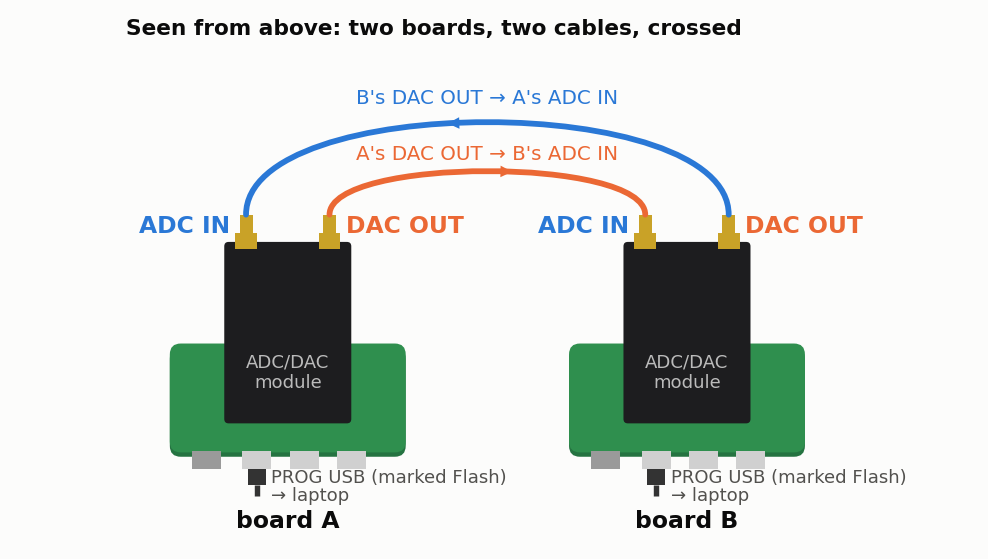

<!-- nav -->
[← 4.10 More ideas for one board](4_10_more_ideas.md) &emsp;&emsp;&emsp; **[Contents](../README.md#contents)** &emsp;&emsp;&emsp; [5.01 Two clocks →](5_01_two_clocks.md)

# 5.00 Two boards on one laptop



**What you need first:**
* Chapter 1 through [1.08](1_08_lockin.md#108-a-lock-in-amplifier)
* a second board, for most of it (the TIP below says what one board can do)
* Chapter 3, only for the network part of [5.05](5_05_fsk_modem.md#505-a-modem)

So far there was one board, and so one clock. Connect two boards, the DAC of
each to the ADC of the other, and you have two clocks that don't quite agree.
This chapter is mostly about that:
* comparing two clocks to parts per billion
* agreeing on the time when every message takes time to arrive
* two oscillators that hear each other falling into step
* how much information a 16 cm cable can carry

It ends with a show: the two boards drawing in 3D on an oscilloscope, one axis
each, kept in step through the cable.

| | |
| --- | --- |
| board A | Icepi Zero + adapter + module; its DAC → B's ADC through a 16.5 cm RG-316 cable |
| board B | the same; its DAC → A's ADC through a second 16.5 cm cable |
| (any one board) | looped back, its own DAC → its own ADC |

**Work in [`src/twoboard/`](../src/twoboard/)** (`cd src/twoboard`). The designs
are plain SystemVerilog plus Python, and they reuse a few of Chapter 1's files
(`uart.sv`, `sine.sv`, `loopback.sv`, `lockin.sv`, `pll100.sv` and
`icepi_adda.lpf`). The FPGAs do what must be on time to the nanosecond; the
laptop does the arithmetic.

> [!TIP]
> **Only one board?** Most of this chapter still works, with the board's DAC
> cabled to its own ADC: one board is its own partner, with the same clock at
> both ends. Each section says what you can do, and what you'll see. The
> modem ([5.05](5_05_fsk_modem.md#505-a-modem)) and its noise test ([5.06](5_06_modem_and_noise.md#506-the-modem-against-noise)) work fully on one board, and so does
> all of Chapter 6.

## Telling the boards apart

With two boards plugged in, `/dev/ttyUSB0` and `/dev/ttyUSB1` are no use: the
numbers go in the order the boards appear, and every `openFPGALoader` command
makes its board vanish and come back, often under a new number. **Name each
board by its FT231X serial number instead.** (On a Mac the ports already carry
it: `/dev/cu.usbserial-DP051TLX`.)

```console
$ openFPGALoader --scan-usb
Bus device vid:pid       probe_type manufacturer serial   product
005 015    0x0403:0x6015 ft231X     FTDI         DP051TLX FT231X USB UART
005 014    0x0403:0x6015 ft231X     FTDI         DP0525BU FT231X USB UART
$ openFPGALoader -b icepi-zero --usb-serial-num DP0525BU ../verilog/lockin.bit
$ ls /dev/serial/by-id/
usb-FTDI_FT231X_USB_UART_DP051TLX-if00-port0
usb-FTDI_FT231X_USB_UART_DP0525BU-if00-port0
```

The names in `/dev/serial/by-id/` follow the board whatever its `ttyUSB`
number. The Makefile takes the serial number too: `make load-awgcap SERIAL=DP0525BU`.

**Set `$A` and `$B` in each terminal you use**, with your own serial numbers.
The commands in this chapter use them. Here board A is DP0525BU and board B
is DP051TLX:

```bash
A=/dev/serial/by-id/usb-FTDI_FT231X_USB_UART_DP0525BU-if00-port0    # on a Mac: A=/dev/cu.usbserial-DP0525BU
B=/dev/serial/by-id/usb-FTDI_FT231X_USB_UART_DP051TLX-if00-port0
```

**Read each board in its own thread.** Linux keeps only about 4 kB of what a
board sends. If your program is busy reading the *other* board, the rest is
lost. `awgcap.record_many()` in [5.03](5_03_time_transfer.md#503-what-time-is-it-over-there) does it this way.

## Checking the links

Load [1.07](1_07_closing_the_loop.md#107-closing-the-loop-the-dac-talks-to-the-adc)'s `loopback.sv` into both boards and send each a
command. Each board then records the *other* board's staircase, starting at an
arbitrary point, since nothing ties one board's sample 0 to the other's. Lined
up at its one big drop, the staircase measures each direction of the link.
Here are both links, and a third board looped to itself for comparison
([`dev/tools/twoboard/module_test.py`](../dev/tools/twoboard/module_test.py)):

| path | ADC code per DAC code | offset (codes) | worst nonlinearity (codes) | missing ADC codes |
| --- | ---: | ---: | ---: | --- |
| A → B | 0.7815 | 27.03 | 0.51 | none in 29–225 |
| B → A | 0.7818 | 27.21 | 0.50 | none in 29–225 |
| a module looped to itself | 0.7761 | 27.57 | 0.53 | none in 29–224 |

Every data bit of both converters works, and the two modules differ in gain by
0.7%, probably because each module's potentiometer was left as it came.

## The experiments

| section | what happens | with one board, looped back |
| --- | --- | --- |
| [5.01 Two clocks](5_01_two_clocks.md#501-two-clocks) | two crystals beat against each other, 0.76 ppm apart, and wander: their [Allan deviation](https://en.wikipedia.org/wiki/Allan_variance) | the measurement's floor: a crystal against itself |
| [5.02 Warming a crystal](5_02_warming_a_crystal.md#502-warming-a-crystal) | one board heats itself with its own logic, and its crystal's frequency follows | against the laptop's clock instead (not tried) |
| [5.03 What time is it over there?](5_03_time_transfer.md#503-what-time-is-it-over-there) | two-way [time transfer](https://en.wikipedia.org/wiki/Time_transfer): the boards' clock offset, to a fraction of a nanosecond, and [Einstein's convention](https://en.wikipedia.org/wiki/Einstein_synchronisation) | the delay of its own loop |
| [5.04 Oscillators that listen to each other](5_04_coupled_oscillators.md#504-oscillators-that-listen-to-each-other) | coupled oscillators lock, as [Adler's equation](https://en.wikipedia.org/wiki/Injection_locking) says; then a [phase-locked loop](https://en.wikipedia.org/wiki/Phase-locked_loop) in hardware | the hardware loop |
| [5.05 A modem](5_05_fsk_modem.md#505-a-modem) | [frequency-shift keying](https://en.wikipedia.org/wiki/Frequency-shift_keying): typing from one laptop to the other, then two Linux computers on one cable | yes |
| [5.06 The modem against noise](5_06_modem_and_noise.md#506-the-modem-against-noise) | [bit error rate](https://en.wikipedia.org/wiki/Bit_error_rate) against [signal-to-noise ratio](https://en.wikipedia.org/wiki/Signal-to-noise_ratio), measured and predicted | yes: measured that way |
| [5.07 A radio link](5_07_radio_link.md#507-a-radio-link) | a narrowband modem through the air, between two loop antennas | yes, through a cable |
| [5.08 A 3D show on an oscilloscope](5_08_xy_show.md#508-a-3d-show-on-an-oscilloscope) | the two boards drive an oscilloscope in XY mode: the College seal in 3D and 22 animations, from the FPGAs alone, the boards kept in step through the cable | no: it takes both DACs |
| [5.09 With a little more hardware](5_09_more_hardware.md#509-with-a-little-more-hardware) | more ideas: light, sound, a GPS reference, thermal noise, a network of three | |

Chapter 6 ([6.00](6_00_digital_communications.md#600-digital-communications-hardware-defined-radio)) goes on from the modem to how real digital radios work: PSK with
clock and carrier recovery, spread spectrum, and OFDM ([6.07](6_07_ofdm.md#607-ofdm-the-triumph-of-physics-over-math)), with one board or two.

<!-- nav -->
[← 4.10 More ideas for one board](4_10_more_ideas.md) &emsp;&emsp;&emsp; **[Contents](../README.md#contents)** &emsp;&emsp;&emsp; [5.01 Two clocks →](5_01_two_clocks.md)

<!-- author -->
<sub>Jason Gallicchio, jason@hmc.edu, Harvey Mudd College</sub>
