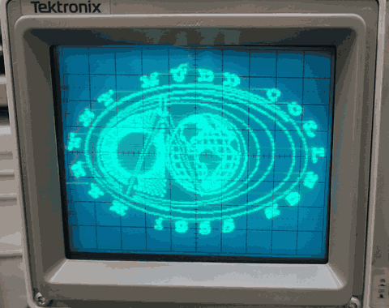
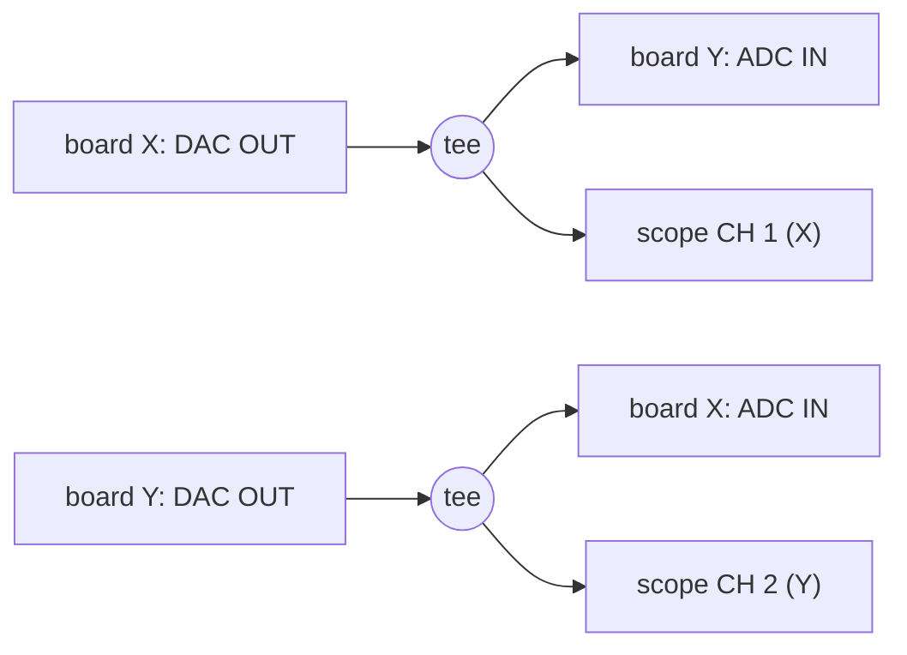
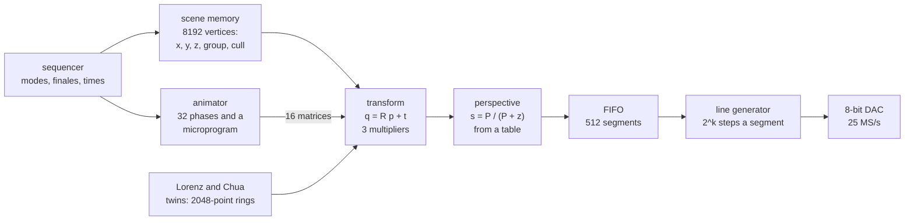
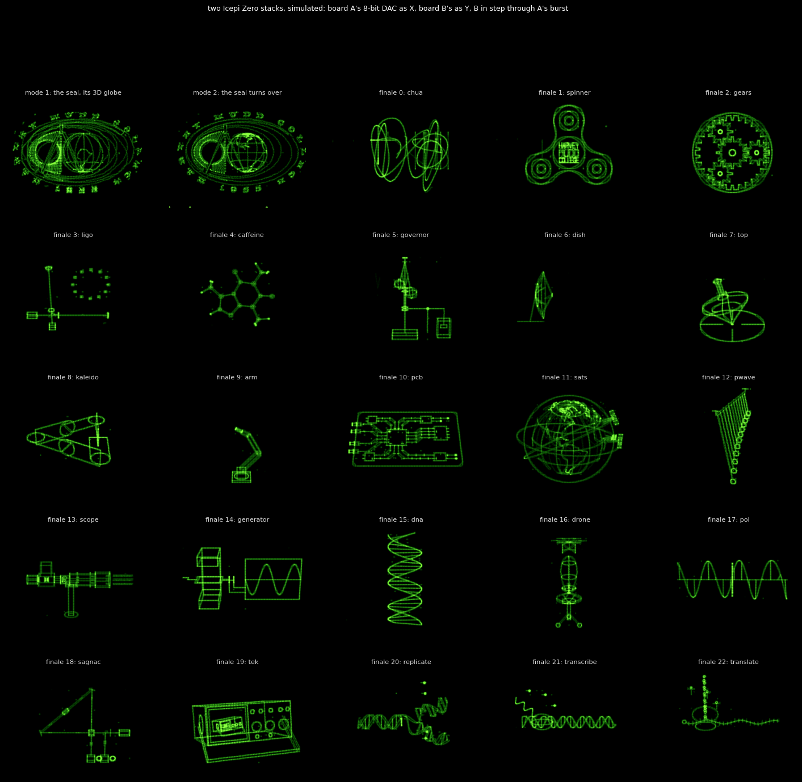
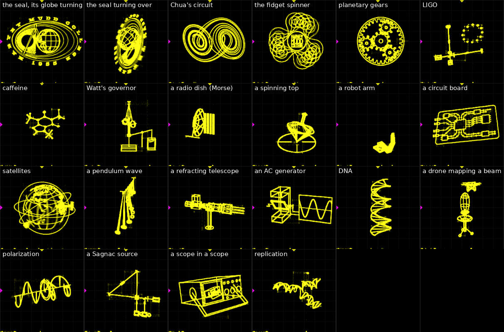

<!-- nav -->
[← 5.07 A radio link](5_07_radio_link.md) &emsp;&emsp;&emsp; **[Contents](../README.md#contents)** &emsp;&emsp;&emsp; [5.09 With a little more hardware →](5_09_more_hardware.md)

# 5.08 A 3D show on an oscilloscope



Two boards, each driving one input of an oscilloscope in XY mode, draw the College seal with a
spinning 3D globe in it. The seal turns over in perspective, and then the scope shows three of
20 short animations: a chaotic circuit computed live, a fidget spinner coasting to a stop, a
pendulum wave, a radio dish sending Morse code, an oscilloscope showing itself, and more. Then
the seal comes back. Nothing is attached but the scope: the drawings, the 3D maths and the
sequence are all inside the two FPGAs, and the show starts when the boards get power.

This page is different from the others. It doesn't take you through the code line by line.
It is a report on how the show works, for anyone who got this far and thinks drawing with an
electron beam is wonderful (it is). Each part is a trick you can reuse: a vector display, 3D
in fixed point, a tiny computer that does nothing but rotations, two chaotic circuits computed
live, and two boards kept in step to tens of nanoseconds through the same cable that carries the
picture. The clips of Verilog below are short; the whole design is in
[`src/xyshow/`](../src/xyshow/), apart from the rest of the tutorial.

**What you need first:** two boards cabled as in [5.00](5_00_two_boards.md#500-two-boards-on-one-laptop),
an oscilloscope with an XY mode (an old analog one is the most beautiful), two SMA tees and two
SMA-to-BNC cables from them to the scope. Building it needs only the OSS CAD Suite of
[1.00](1_00_circuits_from_code.md#100-circuits-from-code); changing the show needs Python.

## Make it and load it

Cable the boards as in [5.00](5_00_two_boards.md#500-two-boards-on-one-laptop), each DAC to the
other board's ADC, and put a tee at each ADC input so that each DAC goes to the scope as well:



Only one of the two links is used: board Y listens to board X's DAC, which carries a burst of
data 50 times a second (below). Board X never reads its ADC. Cabling both ways makes the two
boards interchangeable, so you never have to care which one became X. With only the one link,
you would have to load the X bitstream into the board whose DAC feeds the other's ADC.

Then, in `src/xyshow/`:

```console
$ cd src/xyshow
$ make
...
Info: Max frequency for clock '$glbnet$clk$TRELLIS_IO_IN': 59.96 MHz (PASS at 50.00 MHz)
$ make flash
Icepi Zeros (FT231X serial numbers): DK0GFLAW DP051TLX
X (role 0, the scope's X input) = DK0GFLAW, Y (role 1) = DP051TLX
...
done: X is DK0GFLAW, Y is DP051TLX
```

`make` builds two bitstreams from the same Verilog, `build/x.bit` and `build/y.bit` (one
parameter, `ROLE`, differs), in a few minutes; `make -j2` builds the two at once. `make flash` (that's
[`flash.py`](../src/xyshow/flash.py)) finds the two boards by their FT231X serial numbers, as
[5.00](5_00_two_boards.md#500-two-boards-on-one-laptop) does, sorts them, and writes the X design into
the first and the Y design into the second. So on the same computer the same board is always X,
whichever USB port it is in. It writes the flash, so the show starts by itself at every
power-up; `make load` puts it in the FPGAs' RAM instead, for a quick try. To choose for
yourself: `make flash X=DK0GFLAW Y=DP051TLX`.

Set the scope to XY, both channels DC at 1 MΩ (no 50 Ω terminators) and about 1 V per
division, centred (the drawing spans about ±3.7 V). On an analog scope, XY is usually the slowest end of the time-base knob;
the Tektronix 2213 in the picture labels its inputs "CH 1 OR X" and "CH 2 OR Y". Turn the
intensity down until the lines are thin. If the picture comes out turned by 90° or mirrored,
swap the two cables at the scope.

What you'll see: the seal with its 3D globe, still for a second and then turning once (5 s);
the seal turning over about an axis in its own plane (7.5 s); three finales; the seal again;
the next three; and round. A whole round is about four minutes. The button on board X skips to
the next part.

> [!TIP]
> **Is board Y in step?** `python3 host/show.py sync` asks it: bursts received good and bad,
> and how far it has trimmed its clock to board X's. Thousands good, none bad and a few ppm is
> right. If board Y never syncs, board Y's ADC isn't hearing board X's DAC: check the tee.
> `python3 host/show.py` alone says which board is which and what each is doing.

## How a scope draws: vectors, not pixels

In XY mode the scope's beam goes wherever the two voltages put it: channel 1 moves it across,
channel 2 up and down. Nothing else. To draw a line from A to B, the DACs step from A to B in
small increments, and the phosphor glows where the beam has been. A picture is a list of
strokes, drawn one after another and then drawn again, as fast as the boards can: about 1,300
times a second for the seal, which has 2,900 corners, and 5,000 times a second for a small
finale. This is how the first computer displays worked (the vector displays of the 1960s and of
the arcade game *Asteroids*), and how a laser show works.

Three things follow, and they shaped everything else.

**The brightness of a line is the time the beam spends on it.** A line drawn at half speed is
twice as bright. So the beam must cross every stroke at about the same speed:
[`vec3d.v`](../src/xyshow/rtl/vec3d.v) splits a segment of *d* DAC codes into 2<sup>*k*</sup>
steps with *k* the position of *d*'s leading one, minus a constant. A long line gets more steps
and a short one fewer, so the beam always moves 8 to 16 codes (of the engine's 4096) a sample.
Every drawn segment gets at least 8 steps, for a reason that comes later.

**A beam that stops is a bright dot.** A line's every point gets about one sample (40 ns) per
frame. A beam waiting 30 µs in one place gives that point 750 times as much light. The first
version did exactly that while the boards computed the next frame, and the analog scope showed
a blazing spot. Now the beam never waits on the screen: between frames and during the data
burst it is parked off the bottom edge (the `vis` flag below), and frames otherwise follow
each other with no pause at all, every other one drawn backwards so that each starts where the
last one ended.

**Every move shows.** These boards have no way to switch the beam off ("blanking"; some
scopes have a Z input for it), so a jump from the end of one stroke to the start of the next
is drawn too, faintly, because it is fast. The strokes of each drawing are put in an order
that keeps the jumps short (nearest end next, measured on the screen as the object moves:
`order_strokes` in [`host/gen_scene.py`](../src/xyshow/host/gen_scene.py)). In the telescope
finale that halved the number of jumps.

And persistence. The phosphor of a typical analog scope (P31) fades in tens of microseconds,
far faster than one frame of the seal (0.8 ms). What makes the picture stay is your eye, which
holds an image for about 50 to 100 ms. In that time the seal is drawn about a hundred times and
moved five times (the motion is updated 50 times a second); what you see is the average. A digital scope with "persistence" does the
same thing deliberately. The movie that `make movie` renders models the eye this way: each
frame of the movie is the beam's path through its 1/30 s, faded with an 80 ms time constant.

## The pipeline



Everything in the boxes is logic in the FPGA, running from tables that a Python program,
[`make_show.py`](../src/xyshow/make_show.py), wrote before the build: the scene, the
animator's program, the perspective and sine tables, and the show's times and rates. The
tables are committed, so building needs no Python.

## 3D in fixed point

### The scene

Every drawing is stored as 3D vertices in block RAM: 8,192 of them, 54 bits each.

| field | bits | what |
|---|---|---|
| x, y, z | 16 each | the position in Q2.14 fixed point: a signed number from −2 to almost +2, the screen being −1 to +1 |
| beam | 1 | 0 for the first vertex of a stroke (the beam jumps there), 1 for the rest (it draws to them) |
| group | 4 | which of 16 matrices moves this vertex |
| cull | 1 | hide this vertex when its rotated *z* is negative (half of the globe) |

The seal takes 2,888 vertices: 1,518 for its body, traced from the College's artwork, and 1,370
for the globe, a 30° grid of latitude and longitude lines and the real coastlines (Natural
Earth, at 1:110 million). The 20 finales share the rest; 783 are free.

### Groups and matrices

Each vertex belongs to one of 16 groups, and each group has a matrix: a 3×3 rotation *R* and a
translation *t*. A rigid part of a drawing is one group. The seal is group 0 and its globe group
1, so the globe can spin inside the seal while the seal turns over. The planetary gears are five
groups (the sun, three planets, the ring), and so on. Moving a drawing means changing a few
dozen numbers, not thousands of vertices.

The engine transforms one vertex at a time, *q* = *R p* + *t*, with three multipliers, one for
each row of *R*, taking one column per clock. The states, from
[`rtl/vec3d.v`](../src/xyshow/rtl/vec3d.v):

```verilog
S_M0: begin a0 <= me(m, 0); a1 <= me(m, 3); a2 <= me(m, 6); b <= px; va <= start + idx_next; st <= S_M1; end   // the next vertex read meanwhile
S_M1: begin m0q <= m0; m1q <= m1; m2q <= m2; a0 <= me(m, 1); a1 <= me(m, 4); a2 <= me(m, 7); b <= py; st <= S_M2; end
S_M2: begin acc0 <= m0q; acc1 <= m1q; acc2 <= m2q; m0q <= m0; m1q <= m1; m2q <= m2; a0 <= me(m, 2); a1 <= me(m, 5); a2 <= me(m, 8); b <= pz; st <= S_M3; end
S_M3: begin acc0 <= acc0 + m0q; acc1 <= acc1 + m1q; acc2 <= acc2 + m2q; m0q <= m0; m1q <= m1; m2q <= m2; st <= S_NORM; end
S_NORM: begin
    acc0 <= acc0 + m0q; acc1 <= acc1 + m1q; acc2 <= acc2 + m2q;
    if (ecull && z_sum[33]) begin                                // hidden: not drawn, not sent; the next visible point jumps
        hidden_q <= 1;
        if (!last_v) begin idx <= idx_next; st <= S_LOAD; end   // read at S_M0
        else if (!last_r) begin rng <= rng_next; st <= S_RANGE; end
        else begin frame_done <= 1; frames <= frames + 1; rng <= 0; st <= S_IDLE; end
    end else st <= S_PERSP;
end
S_PERSP: begin
    qx <= clip16((acc0 >>> 14) + me(m, 9)); qy <= clip16((acc1 >>> 14) + me(m, 10)); qz <= clip16((acc2 >>> 14) + me(m, 11));
    st <= S_PROJ;
end
S_PROJ: begin sc <= persp[(qz[15:0] + 16'd32768) >> 7]; st <= S_MULT; end    // the table's read lands next cycle
```

`S_NORM` is the hidden-surface test. A vertex marked *cull* is hidden when its rotated *z* is
negative, which is one half of the globe: drawn whole, its front and back would be a tangle of
lines. A hidden vertex costs no beam time at all; the next visible one is reached by a jump.

Then perspective: a point at depth *z* appears *P*/(*P* + *z*) times its size, with the eye at
*P* = 5 (the seal being 2 wide). Dividing is slow in logic, so the factor comes from a table of
512 entries indexed by *z*, written by Python, and the projection is two more multiplications.
The result is rounded to the nearest of the engine's 4096 codes. (It was truncated at first, and
the globe's equator, which lies exactly on the centre line, flickered between DAC codes 127 and
128 as the globe turned.)

### Between the DAC's codes: dither

The engine has 16 steps for each of the DAC's codes, and the DAC has 256 codes. Rounded to 8 bits,
a line that is nearly level climbs one code in a single step, and on an analog scope it looks like
a staircase. So the last 4 bits are not thrown away. Each clock's rounding error is added to the
next clock's value. A value 5/16 of the way from one code to the next is then output as the
higher code 5 clocks in 16 and the lower one the rest of the time. This is *error feedback*, the
simplest form of [noise shaping](https://en.wikipedia.org/wiki/Noise_shaping). The DAC runs at
50 MS/s, so the toggling sits up near 25 MHz, which the DAC's amplifier and the scope smooth
out. The beam ends up between the two codes, and the stair becomes a smooth line. From
[`rtl/top_icepi.v`](../src/xyshow/rtl/top_icepi.v):

```verilog
reg signed [4:0] derr = 5'sd0;                                      // the last rounding error, -8..7 sixteenths of a code
wire [13:0] dsum = {2'b0, (ROLE == 0) ? vx : vy} + ((ROLE == 0) ? {2'b0, X_OFFSET} : 14'd0) + 14'd8;
wire signed [15:0] dw = $signed({2'b0, dsum}) + (dither ? derr : 5'sd0);
wire dlo = dw < 16'sd0, dhi = dw > 16'sd4095;                        // past the DAC's ends: held there, the error dropped
wire [7:0] dq = dlo ? 8'd0 : dhi ? 8'd255 : dw[11:4];
always @(posedge clk) derr <= (dither && !dlo && !dhi) ? $signed({1'b0, dw[3:0]}) - 5'sd8 : 5'sd0;
```

The `+ 8` rounds: code *k* covers 16*k* − 8 to 16*k* + 7, so the screen's centre line (2048) is
in the middle of code 128. `python3 host/show.py dither 0` turns the dither off on both boards,
and `dither 1` turns it back on: watch a nearly level line while you do.

### The line generator, and why there's a FIFO

The line generator takes segments from a FIFO and steps the DAC along each. The number of steps
comes from the length's leading one:

```verilog
wire [3:0] p2kr = (lead1(p2d) > step_shift) ? lead1(p2d) - step_shift : 4'd0;
wire [3:0] p2k = p2on ? ((p2kr < min_k) ? min_k : p2kr) : 4'd0;
```

and the stepping itself, with each sub-step held `dwell` samples (1 at full speed) and the
position snapped to the exact end at the last step, so errors never add up. `vis` low parks the
beam below the screen (the engine's y output is then 0): when a frame has ended and none
follows, or when the generator has waited 16 samples for a segment.

```verilog
if (!busy) begin
    if (!p3v) begin
        if (starve != 6'd63) starve <= starve + 1;
        if ((st == S_IDLE && idle_n == IDLE_PARK && fifo_empty && !p1v && !p2v) || starve + 1 >= STARVE_PARK) vis <= 0;   // drawn and no frame follows, or starved: park
    end
    if (p3v) begin
        vis <= 1; starve <= 0;
        ix <= p3ix; iy <= p3iy; beam <= p3on; tx <= p3x; ty <= p3y;
        lx <= lx + p3ix; ly <= ly + p3iy;
        sub <= p3h ? 12'd1 : (12'd1 << p3k) - 12'd1; dc <= 0; busy <= (p3k != 0) || p3h; holding <= p3h; busy_done <= 1;
        if (p3k == 0) begin lx <= {1'b0, p3x, 8'b0}; ly <= {1'b0, p3y, 8'b0}; end
    end
end else begin
    if (dc + 1 >= (holding ? hold_n : dwell_f)) begin
        dc <= 0;
        if (sub == 1) begin busy <= 0; lx <= {1'b0, tx, 8'b0}; ly <= {1'b0, ty, 8'b0}; end   // snap to the exact end
        else begin lx <= lx + ix; ly <= ly + iy; end
        sub <= sub - 1;
    end else dc <= dc + 1;
```

The FIFO holds 512 segments. It is there because the engine and the beam don't keep the same
pace. A visible vertex takes the engine 10 clocks (5 samples), a hidden one 6. When half the
globe is hidden, the engine works through hundreds of vertices with nothing to draw. With the
16-segment FIFO it had at first, the beam waited for the engine about a third of the time and was
parked off the screen 13 to 20% of it; on the analog scope every park was a streak down and back.
Now every drawn segment takes at least 8 samples, so the engine runs ahead, the FIFO fills, and it
carries the beam through the hidden half while the engine catches up.

## The animator: a small computer for rotations

The matrices change 50 times a second, and there are 20 finales, each moving in its own way: gears
turning at the ratios of their teeth, an arm with five joints, satellites in inclined orbits,
twelve pendulums. Writing that in Verilog, finale by finale, would be a lot of logic. Instead
the matrices are computed by a tiny special-purpose computer,
[`rtl/matrix_unit.v`](../src/xyshow/rtl/matrix_unit.v), whose program a Python script writes.

### Phases: clocks for the motion

Everything that moves is driven by one of 32 *phases*: 32-bit numbers that the hardware adds a
rate to every millisecond, so that 2<sup>32</sup> is a full turn. These are the phase accumulators of
direct digital synthesis in [1.03](1_03_dac_sine.md#103-a-sine-direct-digital-synthesis), here
turning gears instead of making sines. Because the phases advance in real time, the motion runs
at the same speed whatever the frame rate. A finale switches on the phases it uses, and a phase
can be set to zero when a finale starts, so its pendulums are let go together or its message
starts at the beginning.

```verilog
// ---- the phases ----
reg [1023:0] ph = PH0;
wire [31:0] pha [0:31];
genvar k;
generate for (k = 0; k < 32; k = k + 1) begin : phs
    always @(posedge clk)
        if (load) ph[32*k +: 32] <= lph[32*k +: 32];
        else if (zero[k]) ph[32*k +: 32] <= 32'd0;
        else if (tick && en[k]) ph[32*k +: 32] <= ph[32*k +: 32] + w[32*k +: 32];
    assign pha[k] = ph[32*k +: 32];
end endgenerate
```

### The program

At the start of every 20 ms period, before its frames, the hardware writes the sine, cosine and
value of every phase into a file of 1,024 registers (Q2.14, in a block RAM), and then runs a program from the start of the section
for the current mode or finale. The instructions are few:

| instruction | does |
|---|---|
| `MUL d, a, b` | d = a × b |
| `MAC d, a, b` | d = d + a × b |
| `MSB d, a, b` | d = d − a × b |
| `SIN d, a`, `COS d, a` | d = sin or cos of a, a in turns, from a 1024-entry table |
| `END` | the matrices are ready |

The sums saturate instead of wrapping, so an overflow gives a slightly wrong picture, not a
wild one. One multiplier does all of it, an instruction every seven clocks:

```verilog
// the program: a wait for the fetch, then seven clocks an instruction (the operands a, b and the
// destination's old value read one after the other, the product, the sum saturated, the write)
4: st <= 5;
5: begin
       if (op == 3'd0) begin busy <= 0; done <= 1; st <= 0; end
       else begin aaddr <= i_a; b_q <= i_b; dst_q <= i_dst; op_q <= op; pc <= pc + 1; st <= 6; end
   end
6: begin aaddr <= b_q; st <= 7; end
7: begin oa <= ard[15:0]; aaddr <= dst_q; st <= 8; end
8: begin ob <= ard[15:0]; lidx <= oa[13:4] + (op_q == 3'd5 ? 10'd256 : 10'd0); st <= 9; end
9: begin vd <= ard[15:0]; prod <= oa * ob; st <= 10; end
10: begin
       case (op_q)
           3'd1: wval <= sat(prod >>> 14);
           3'd2: wval <= sat($signed({{2{vd[15]}}, vd}) + (prod >>> 14));
           3'd3: wval <= sat($signed({{2{vd[15]}}, vd}) - (prod >>> 14));
           default: wval <= lrd;                                   // SIN, COS
       endcase
       st <= 11;
   end
11: begin aaddr <= dst_q; awd <= {2'b00, wval}; awe <= 1; st <= 5; end
default: st <= 0;
```

The registers hold the constants (around 240 of them), the 32 phases' sines, cosines and values,
working space, and the 16 matrices, which the engine reads through the RAM's second port. The
whole program is 2,597 instructions in 4,096 words. The longest section, the pendulum wave's,
runs in about 60 µs.

The program is written by
[`host/gen_matrix_prog.py`](../src/xyshow/host/gen_matrix_prog.py), which has small helpers:
compose a rotation about *x* (`post_x`), multiply matrices, take a column times a number. For
example, the AC generator turns its coil and draws the voltage it makes on a chart:

```python
# ---- the AC generator: magnet and chart (4), the coil turning (5), its voltage as a travelling sine (6) ----
G = PR.GEN; P.begin("generator", [4, 5, 6])
V = R(4); view(V, -18.0, 22.0, 0.0); P.post_x(R(5), V, S("em"), C("em"))
a1, a2 = P.W(2); P.MUL(a1, K(G["amp"]), S("em")); P.MUL(a2, K(-G["amp"]), C("em"))
for i in range(3):
    P.MUL(R(6)[3 * i], k["ONE"], V[3 * i]); P.MUL(R(6)[3 * i + 1], V[3 * i + 1], a1); P.MUL(R(6)[3 * i + 2], V[3 * i + 1], a2)
P.col_times(T(6), V, 0, K(G["x0"]))
P.end()
```

The same file has `run()`, a model of the hardware's arithmetic, bit for bit. The preview movie
runs the very same program through it, so what the movie shows is what the boards compute.
[`host/check_prog.py`](../src/xyshow/host/check_prog.py) runs the newer finales' sections against
simple floating-point models of their motion: they agree to the sine table's step.

### Tricks of the trade

A matrix can do more than rotate, and some finales depend on it.

* **A wave that travels.** The EM wave and the generator's chart store each vertex of a sine
  curve as (*x*, cos *kx*, sin *kx*) instead of (*x*, *y*, 0). A matrix whose second row is
  (0, *A* sin ω*t*, −*A* cos ω*t*) then puts the vertex at height *A* sin(ω*t* − *kx*):
  a travelling wave, from a matrix. (That is the `a1`, `a2` above.)
* **Shears and scales.** The engine's connecting rod, LIGO's arms stretching and squeezing,
  growing wavefronts: matrices that aren't rotations.
* **A spinner that coasts.** The fidget spinner has to be flicked and then slow down evenly,
  so its angle is a quadratic in time. No phase does that, so the sequencer ramps one phase's
  rate: up for a quarter second, then down by the same amount every millisecond until it stops.
  The ramp's sizes are chosen so the spinner stops one lobe round, where it looks as it started.

  ```verilog
  if (ms && !hold && mode == 4'd3 && fin_ramp(fin)) begin
      if (rtm != 16'hffff) rtm <= rtm + 1;
      ramp_w <= (rtm < RAMP_T0) ? 32'd0 : (rtm < RAMP_T0 + RAMP_T1) ? ramp_w + RAMP_UP : (ramp_w > RAMP_DN) ? ramp_w - RAMP_DN : 32'd0;
  end
  ```
* **Twelve rates from one phase.** The pendulum wave needs twelve pendulums at 16, 17, … 27
  swings in 24 s. Instead of twelve phases, the program takes one phase φ and builds cos *n*φ for
  every *n* by doubling (16φ is four doublings) and then the angle-addition formulas.
* **Morse code, by culling.** The radio dish sends HMC in Morse: ten packets of plane waves
  that leave the dish one after another and vanish at the end of the beam. A packet must be
  invisible before it leaves and after it arrives, but the engine can only hide vertices by the
  cull test. So each packet's vertices are stored at *z* = 1, and the program makes the matrix
  entry that multiplies that *z* equal to (*u* − *d*)(*d* + *w* − *u*), where *u* is a slow phase,
  *d* when the packet leaves and *w* its flight. That is positive only while the packet is in
  flight: the hardware's hidden-surface test turned into an on/off switch.

  ```python
  # ---- the dish: its message, HMC in Morse, one packet a group (5-14), each drawn only in flight (objects.dish) ----
  dc = objects.dish_constants(consts["dish_per_s"]); els = dc["elements"]; nv = int(math.ceil(dc["v"] / 1.9))
  P.begin("dish", [4] + list(range(5, 5 + len(els))))
  V = R(4); phys_view(V); u = PV("pw")                     # the pendulum wave's phase, put to zero at the finale's start
  for n, el in enumerate(els):
      g = 5 + n; a, b, px = P.W(3)
      P.MUL(a, k["ONE"], u); P.MSB(a, k["ONE"], P.KV(el["d"]))                                  # u - d
      P.MUL(b, k["ONE"], P.KV(el["d"] + dc["w"])); P.MSB(b, k["ONE"], u)                        # d + w - u
      P.MUL(R(g)[8], a, b)                                                                      # >= 0 only in flight: the cull
      P.MUL(px, k["ONE"], P.KV(dc["x_rim"]))
      for _ in range(nv): P.MAC(px, a, P.KV(dc["v"] / nv))                                    # x_rim + v a, v over 2 in parts
      for j_ in (0, 1, 3, 4): P.MUL(R(g)[j_], k["ONE"], V[j_])                                   # x, y as V; z only the cull's
      P.col_times(T(g), V, 0, px)
  P.end()
  ```

### What it costs

| resource | used | of |
|---|---:|---:|
| scene memory (vertices) | 7,409 | 8,192 |
| phases | 32 | 32 |
| animator program (instructions) | 2,597 | 4,096 |
| block RAMs (the scene 24, the rings 12, the program 8, and four more) | 48 | 56 |
| multipliers | 17 | 28 |
| logic (LUTs), board X | about 12,000 | 24,288 |

The phases are the tightest: several finales share them (the slow swing of the viewpoint serves
twelve), and a new finale has to make do with rates that exist. The design runs at 50 MHz and
would close at about 60.

## Not geometry: two chaotic circuits, computed live

One finale is different, and a second is ready. The tail of Chua's double scroll isn't a stored drawing: it is the
path of a chaotic circuit, computed as the show runs. [`rtl/chua.v`](../src/xyshow/rtl/chua.v)
integrates Chua's equations in 38-bit fixed point by fourth-order Runge–Kutta, a step of 2<sup>−10</sup>
time units at a time, 2.5 time units a second. Its constants are picked so that every
multiplication is a few shifts and adds (α = 15.625 = 16 − 3/8; the diode's slopes −23/32 and
−7/32), so it needs no multiplier at all:

```verilog
// the derivative at (sx, sy, sz): f(x) = -(x/2 + x/8 + x/16 + x/32) - (d/4 - d/32), d = |x + 1| - |x - 1|
1: begin a1p <= sx + ONE; a2p <= sx - ONE; t1 <= (sx >>> 1) + (sx >>> 3); t2 <= (sx >>> 4) + (sx >>> 5); st <= 2; end
2: begin a1 <= a1p[37] ? -a1p : a1p; a2 <= a2p[37] ? -a2p : a2p; t <= t1 + t2; st <= 3; end
3: begin d <= a1 - a2; st <= 4; end
4: begin d2 <= (d >>> 2) - (d >>> 5); st <= 5; end
5: begin w <= (sy - sx) + t + d2; dy <= sx - sy + sz; dz <= (sy <<< 2) - (sy <<< 5); st <= 6; end      // w = y - x - f(x)
6: begin dx <= (w <<< 4) - (w >>> 2) - (w >>> 3); st <= 7; end                                         // alpha w
```

Every 14th step, the state is scaled and written into a ring buffer of 2,048 points, and the
finale draws the ring as one long stroke in 3D, through group 2's slowly turning matrix. The last
point is held for 20 µs every frame, so the head of the tail is bright and you can see which way
the trajectory is going. A second twin, [`rtl/lorenz.v`](../src/xyshow/rtl/lorenz.v), does the
same for the Lorenz equations (Euler steps, one 38×38 multiplier). Its finale isn't in the show
now, but it runs; add `("lorenz", 5.0)` to `FINALES` in `make_show.py` to see it.

On two boards this needs care: both boards must draw the same tail, and each computes its own.
How comes next.

## Two boards, one picture

An Icepi Zero has one DAC, and an XY picture needs two. So board X draws the x coordinates and
board Y the y coordinates, each computing the whole show. For the picture to make sense, sample
*n* of board X and sample *n* of board Y must be the same point, every sample, for minutes on
end. That is harder than it sounds:

* the boards have separate crystals, and [5.01](5_01_two_clocks.md#501-two-clocks) measured
  them about 1 ppm apart. At 25 million samples a second, that's 25 samples a second of drift,
  where a frame is a few thousand samples;
* everything that varies must be identical on both: the mode, the finale, every phase, both
  twins' states, which frame each is drawing.

The answer is that board X leads and board Y follows, and board X tells board Y everything it
needs, 50 times a second, through the cable that is already there.

### The burst

Every 20 ms, board X stops drawing, parks its beam, and sends a burst on its DAC: 16 samples at
code 0, then 920 bits at four samples each, low at code 0 and high at code 40. That's 148 µs, about
1% of the time. The burst is drawn too: a short streak along the bottom-left edge of the
picture, which you can point to. Board X's drawing stays clear of the gap's code 0: it uses codes
16 to 255, its 12-bit codes turned into 8 bits 7.5 codes higher than board Y's (`X_OFFSET`
in [`rtl/top_icepi.v`](../src/xyshow/rtl/top_icepi.v)). Board Y's ADC sees board X's DAC through the tee.

```verilog
reg [W-1:0] sh = 0; reg [12:0] n = 0; reg [1:0] sc = 0; reg [7:0] acc = 0; reg [9:0] b = 0;
always @(posedge clk) begin
    done <= 0;
    if (start && !active) begin active <= 1; sh <= payload; n <= 0; sc <= 0; level <= 8'd0; acc <= 0; b <= 0; end
    else if (active && tick) begin
        if (n < GAP) begin level <= 8'd0; n <= n + 1; end
        else if (n < GAP + SPB * W) begin
            if (sc == 0) begin                                            // a bit's first sample
                if (b[2:0] == 3'd0 && b != W - 8) acc <= acc + sh[W-1 -: 8];  // a byte starts: into the sum
                if (b == W - 8) begin sh[W-1 -: 8] <= acc; level <= acc[7] ? HI : 8'd0; end   // the last byte is the sum
                else level <= sh[W-1] ? HI : 8'd0;
            end
            if (sc == SPB - 1) begin sh <= {sh[W-2:0], 1'b0}; b <= b + 1; sc <= 0; end else sc <= sc + 1;
            n <= n + 1;
        end else begin active <= 0; done <= 1; level <= 8'd0; end
    end
end
```

The 920 bits are the whole state board Y needs:

```verilog
wire [W-1:0] payload = {4'b1010, nrep, frame_no, mode, fin, dwell_fr, tcount, every, wp, every2, wp2, 1'b0, stepc_cap, stepc2_cap, ph16, x_t, y_t, z_t, x2_t, y2_t, z2_t, 8'd0};
```

That is: a start pattern, the number of frames to draw before the next burst, the frame
number, the mode and finale, the drawing speed, board X's free-running sample count, both
twins' ring pointers and step counters, the top 16 bits of all 32 phases, both twins' x, y and
z (38 bits each), and a checksum. It is a very simple modem, like the one in
[5.05](5_05_fsk_modem.md#505-a-modem) but with two levels and four samples a bit:
the cable's edge takes about 20 ns and rings for 100 ns, so each bit is decided two samples in.
The receiver ([`rtl/sync_link.v`](../src/xyshow/rtl/sync_link.v)) waits for at least twelve
samples of gap, takes the next rising sample as the start of bit 0, adds the bytes up as they
arrive, and keeps the payload only if the checksum agrees.

The threshold between "gap" and "drawing" is set from the cable's measured transfer, ADC
code = 0.76 × DAC code + 30. The gap reads 30, and the lowest point of board X's drawing, code
16, reads 42; the other two modules, through the other cable, read 38 there. So the threshold is
34. (The first version used 8, which the ADC's offset never goes below, and board Y
never synced.)

### Then both boards draw the same frames

When a burst arrives, board Y loads everything: the phases into its animator, the twins' states
into its own twins, the ring pointers, the mode. Then it runs the same animator program on the
same phases, which gives exactly the same matrices, and draws the same frames back to back as
board X does, until the next burst. The two engines are identical logic fed identical numbers,
so they stay together sample for sample, as long as their clocks agree.

Three details made it work:

* **Board X waits.** Board X runs its animator before it sends the burst (it needs the frame
  count), and board Y runs its own after receiving it. So after the burst board X waits as long
  as its animator took, plus 9 samples measured on the bench (`TX_DELAY`), and then both start
  their first frame within a few tens of nanoseconds of each other (the median of 344 measured jumps:
  0 ns, the quartiles −24 and +12 ns).
* **Board X's phases stand still from its animator to the burst.** A millisecond tick could fall
  between them (about 3% of the time), and then board Y got phases a millisecond later than the
  ones board X had used. Their matrices differed, a few vertices crossed the cull test on one
  board and not the other, the frames had different lengths, and the boards drew different parts
  of the picture: a rectangle full of dots, for 20 ms. The fix holds the phases still for those
  0.2 ms.
* **The twins replay.** Board Y's twins are reloaded from board X's at every burst and then
  step on their own, at the same times relative to the burst (the burst carries the step
  counters too). Both rings get the same points in the same places, and each frame draws the
  ring from the pointer the burst carried, so both boards draw the same tail all period.

### Keeping the clocks together

Board Y's DAC is driven by a sample tick that comes from a 32-bit accumulator, so its rate can
be trimmed in tiny steps:

```verilog
// ---- the sample tick: one in two clocks, the Y board's trimmed by the loop below ----
reg [31:0] acc = 0; reg tick = 0; reg [31:0] rate = 32'h8000_0000;
always @(posedge clk) begin {tick, acc} <= {1'b0, acc} + {1'b0, rate}; end
```

With `rate` at 2<sup>31</sup>, the tick comes every second clock: 25 MS/s. Each burst carries board X's
count of its own ticks since power-up. Board Y compares how far board X's count went between two
bursts with how far its own went. The difference is the clock error, and the rate is corrected
by a fraction of it, summed over 10 ms:

```verilog
if (sy_valid) begin
    err <= $signed(sy_payload[858:827] - x_prev) - $signed(tcount_y - y_prev); nlat <= tcount_y - y_prev;
    x_prev <= sy_payload[858:827]; y_prev <= tcount_y; upd_rate <= have_prev; have_prev <= 1;
end
// the frames' differences and lengths are summed until 2^18 ticks (10 ms) have passed, so a tick of measurement is
// 4 ppm whatever the frame length (one 0.25 ms frame alone would make it 160 ppm); each correction is a quarter
// to a half of the summed fractional difference (2^30 err / 2^lead1(N))
if (upd_rate && {err_abs, 10'b0} < {10'b0, nlat}) begin err_acc <= err_acc + err; n_acc <= n_acc + nlat; upd2 <= 1; end
if (upd2 && n_acc[31:18] != 14'd0) begin sh <= 5'd30 - lead1(n_acc); err_app <= err_acc; err_acc <= 0; n_acc <= 0; upd3 <= 1; end
if (upd3) rate <= rate + (err_app <<< sh);
```

This is a frequency-locked loop, a cousin of the phase-locked loops of
[5.04](5_04_coupled_oscillators.md#504-oscillators-that-listen-to-each-other). Because the
counts are free-running, never reset, their differences add up exactly: over a long window only
its two ends are rounded. On the bench the trim settles at a few ppm (−3.8 one day, −2.9 another), the two crystals'
difference, and stays there; in the simulation, with board Y's clock 100 ppm fast, it settles at −100 ppm. Within a 20 ms
period the boards drift apart by less than a sample, and the next burst starts them again.

## How it was tested

**Simulated first.** Every part was simulated before it was loaded. `make sim` runs
[`sim/tb_icepi.v`](../src/xyshow/sim/tb_icepi.v): both boards, with board Y's clock 100 ppm
fast, joined by a modelled cable with the bench's measured gain and offset, an edge spread over
two samples with an overshoot, three samples of delay, and noise. It records board X's DAC
against board Y's, sample by sample, and draws them as the scope would. It also checks that board
Y's rings match board X's and that its clock trim settles at −100 ppm. Here is every mode and
finale, from the simulation (a finale's tile is all the samples recorded of it):



**A movie of the program.** `make movie` renders the show from `run()`, the bit-exact model of
the animator, with a model of the beam and its persistence, so a new finale can be judged before
a build.

**On the bench.** A digital scope (Siglent SDS1104X-E in XY at 1 V/div, 10 MS/s) took these,
from the boards running the bitstreams `make` builds (the dots along the bottom edge are the
burst):



**On an analog scope.** The digital scope samples at 10 MS/s, and its persistence hides what the
beam does between samples. The analog scope at the top of this page shows everything, and it
found the problems the simulations didn't:

| what it showed | why | the fix |
|---|---|---|
| a blazing spot near the middle | the beam sat on the last point of a frame while the animator ran, 8 to 34 µs | park the beam off the bottom of the screen between frames |
| dots above the U of MUDD, every frame | the beam came back from the park to the frame's first point, a 6 V step that overshot and rang | frames back to back, every other one drawn backwards: no return at all, except after the burst |
| vertical streaks through the seal | the beam parked 13 to 19 times a frame while the engine worked through the hidden half of the globe | the 512-segment FIFO, and at least 8 samples a segment so the engine runs ahead |
| lines drawn as beads | sub-steps of one to two DAC codes, each held two samples | half a code to one code a step, one sample each |
| ghost lines in empty parts of the screen | the strokes were in the order they were made, so the jumps between them were as long as the drawing | strokes reordered, nearest end first |
| the equator jumping up and down a little | it lies exactly on the boundary between DAC codes 127 and 128, and truncation put it on either | round to the nearest code |
| a rectangle of spots, now and then | board Y computed its matrices from phases a millisecond later than board X's | board X's phases held still from its animator to its burst |
| nearly level and nearly upright lines drawn as stairs | the 8-bit DAC: a line that climbs one code climbs it in one step, 1/256 of the DAC's range | more of the range (codes 16 to 255 for board X and 9 to 248 for board Y, not 25 to 230; the burst's streak moved to the picture's edge), and the dither between codes |

The digital scope found one more: a drawing sent from the laptop lost its first stroke. The
design came from a board whose engine runs on a second clock, so a write to the scene memory
reached the engine a clock or two after the address had stepped on, and the engine wrote to
`vaddr_h - 1`. On the Icepi Zero everything runs on one clock, the write lands before the step, and
`- 1` put every vertex one place early. The address is now `vaddr_h`. Moving code between clock
domains moves its off-by-ones too.

## The finales

In the order the show plays them, three between the seal's turns. `FINALES` in
[`make_show.py`](../src/xyshow/make_show.py) sets the order and the seconds.

| finale | what moves | what's in it |
|---|---|---|
| Chua's circuit | the double scroll's tail, computed live, turning in 3D | chaos |
| the HMC fidget spinner | flicked, it blurs, and coasts to a stop a lobe up; the College's name stays still on the cap | angular momentum and friction; a ramped phase |
| planetary gears | the sun drives, the planets go round and spin against the fixed ring (12, 9 and 30 teeth) | gear ratios, from the tooth counts |
| LIGO | a gravitational wave stretches one arm as it squeezes the other; a ring of free masses flexes the same way | interferometry; shears |
| caffeine | the molecule tumbling (PubChem's 3D structure) | chemistry |
| Watt's flyball governor | it speeds up, the balls swing out, the lever closes the throttle; it slows and they fall | feedback control |
| a radio dish | alone, then HMC in Morse code leaving it as plane-wave packets | antennas, modulation; culling as a switch |
| a spinning top | spin, precession about its tip, nutation | gyroscopes |
| a robot arm | five joints waving, seen from a turning viewpoint | forward kinematics |
| a circuit board | chips, 45° traces and vias, four SMAs, charge flowing along every trace | the electronics drawing this |
| satellites | the Earth (the seal's globe, enlarged) with three satellites on inclined orbits | orbits |
| a pendulum wave | twelve pendulums drift from a line into waves and into two alternating sets | simple harmonic motion; angle addition |
| a refracting telescope | light comes in as dashes and converges to the focus in the camera | optics |
| an AC generator | a coil turns in a magnet's gap; its voltage is drawn as a sine in step | induction; a travelling wave from a matrix |
| DNA | a double helix spinning and nodding | biology |
| a drone mapping a dish's beam | a hexacopter with a BicoLog antenna sweeps through a dish's beam pattern | antenna measurement from the air |
| polarization | a wave through a quarter-wave plate turns from linear to circular | wave plates |
| a Sagnac source | photons flowing both ways round the loop of an entangled-pair source | quantum optics |
| an oscilloscope in an oscilloscope | a Tektronix 2235 on its handle, its screen showing itself, four levels deep; as it swings, each drawing turns by the swing again, a moment later | recursion: a camera pointed at its own screen, with a delay. Each level's matrix is the last one's times the screen's frame times the view a quarter second earlier |
| replication | DNA's two strands separate at a fork and each gets a new partner | biology |

## Changing it

The show is [`make_show.py`](../src/xyshow/make_show.py): its constants at the top are the times,
the rates and speeds, and `FINALES`. After changing them, `python3 make_show.py` (or
`make tables`) writes the tables in `rtl/` again, `make` builds, `make flash` loads.
`make movie` renders `renders/show_movie.mp4` and `renders/show_finales.mp4` first, so you can
see a change before you build (it needs numpy, scipy, Pillow and ffmpeg).

* **Your own drawing.** `python3 host/show.py draw "HELLO"` writes stroke letters into both
  boards' free scene memory and shows them, turning over as the seal does; `python3 host/show.py
  auto` goes back to the show. It writes to both boards because each draws from its own memory.
* **A different order, or fewer.** Edit `FINALES`; `FINALES_PER_SEAL` is how many play between
  the seal's turns.
* **A finale of your own.** An object is a list of strokes, each in a group, in
  [`host/objects.py`](../src/xyshow/host/objects.py) (or a model in
  [`host/proposals.py`](../src/xyshow/host/proposals.py)); its motion is a section of
  [`host/gen_matrix_prog.py`](../src/xyshow/host/gen_matrix_prog.py) that writes its groups'
  matrices from the phases; and an entry in `KINDS` in `make_show.py` says which phases it uses.
  `make movie` shows it before you build. Watch the budgets above: 783 vertices are free, and
  every phase is taken, so a new finale shares rates that exist.
* **Bigger ideas.** A third board with a third DAC driving the scope's Z input could blank the
  beam during jumps. Board X's ADC is free (take its tee off): it could listen to a microphone
  and make the show react to sound. And `lorenz.v` was first written as the digital twin of an
  analog Lorenz circuit: through the ADC it can lock to the circuit (its `couple` and `mode`
  inputs), and in simulation, with the coupling cut, the two drift apart within a second, as chaos says they must.

<!-- nav -->
[← 5.07 A radio link](5_07_radio_link.md) &emsp;&emsp;&emsp; **[Contents](../README.md#contents)** &emsp;&emsp;&emsp; [5.09 With a little more hardware →](5_09_more_hardware.md)

<!-- author -->
<sub>Jason Gallicchio, jason@hmc.edu, Harvey Mudd College</sub>
