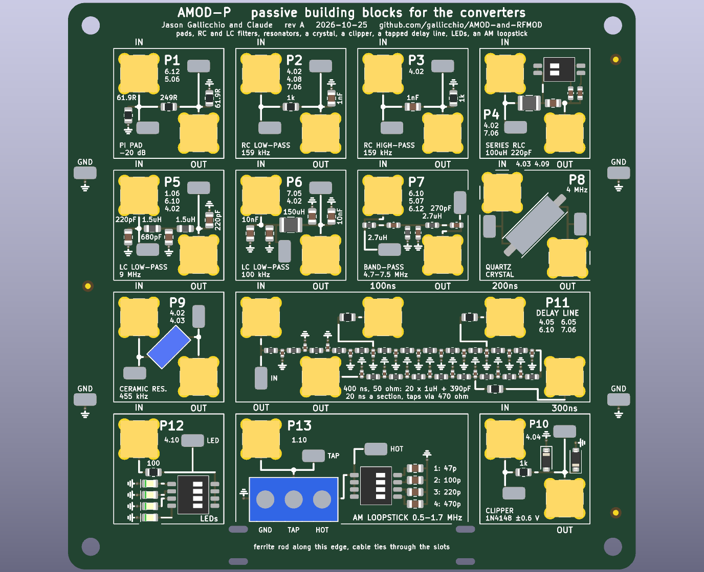
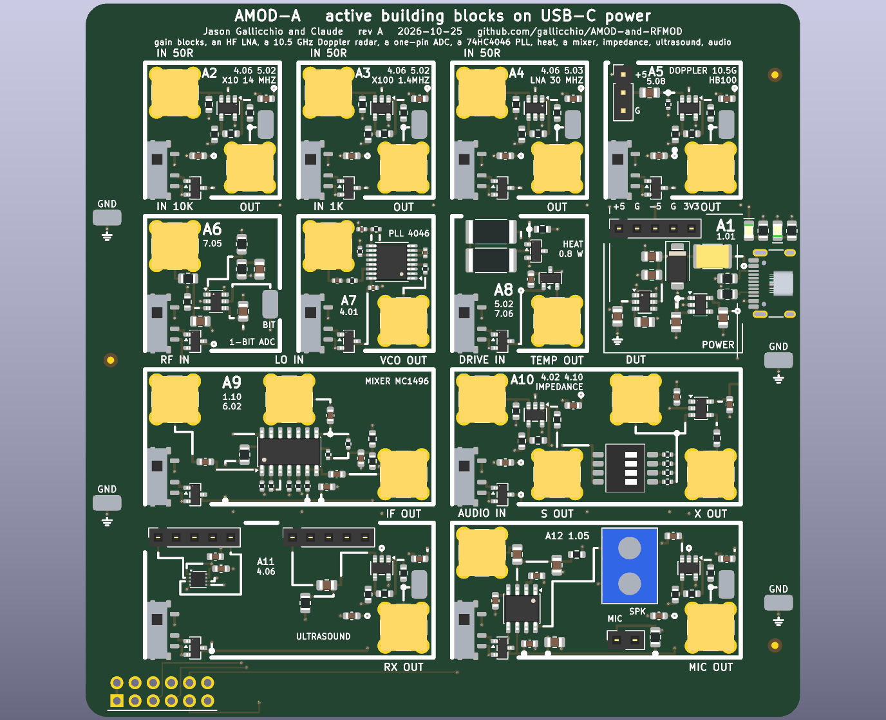
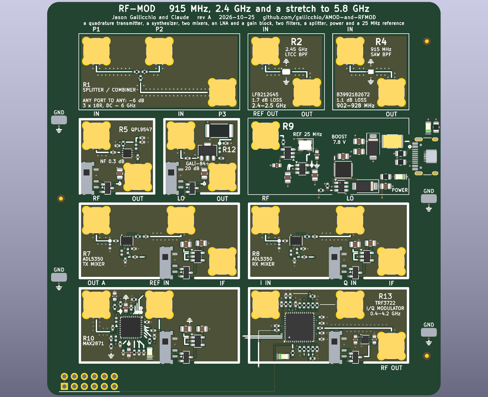

<!-- nav -->
[← Appendix C. How this tutorial was tested](C_how_it_was_tested.md) &emsp;&emsp;&emsp; **[Contents](../README.md#contents)**

# Appendix D. Coming soon… hopefully

![A 3D render of the ECP5+ADC+DAC board, rev A as ordered, from above: six SMAs down the left edge (CLK IN, CLK OUT, ADC A IN, ADC B IN, DAC 1 OUT, DAC 2 OUT), each with its circuit in a labelled silkscreen box beside it; the ECP5 in the middle under the SDRAM; the Si5351 clock generator and 25 MHz TCXO along the top with eight LEDs and two buttons; gigabit Ethernet, two USB-C ports, a mini-HDMI and two Pmod sockets down the right edge; the noise-source DIP switch, photodiode and power section along the bottom; and a legend printed on the board that says what every jumper and header does](img/ecp5_2adc_2dac_top.png)

Hardware that does not exist yet, and some that is on its way. The next
board, above, was ordered from JLCPCB in October 2026 and is in
production as this is written. Around it, five boards of analog and RF
building blocks are an idea: three first-level boards (passive, active and
RF) and two advanced ones for the experiments a senior lab wants (lasers,
piezos, spins, and quadrature radio). Then what the boards could do
together (the coffee-can radar, direction finding, MIMO, and a list of
experiments), the cheap extras that several pages ask for (long cables, an
antenna), what other teaching platforms cover that this tutorial does not
yet, and why openness all the way down matters for learning with an AI.
The last section before the cables is written for the agent that will
design the five boards: it says where the rules, the generators and the
decisions are.

## The next board

Everything in this tutorial was built around a $79 development board and a
$30 converter module, and the seams show: one ADC, one DAC, 8 bits, no
anti-alias filter, an input range of ±4 V that no antenna will ever fill,
and a USB serial port as the only way out.

The board above is what Claude and I drew for the next level, and then
sent to be made. It is a 158 × 119 mm six-layer board with the same ECP5
(an LFE5U-25F, so every design here still fits), 32 MB of SDRAM, 16 MB of
flash, gigabit Ethernet (for Chapter 3's Linux, and for streaming samples
faster than a [UART](https://en.wikipedia.org/wiki/Universal_asynchronous_receiver-transmitter)
ever will: about 940 Mbit/s of payload, one ADC channel at full rate or
both at 30 MS/s), an FT2232H for JTAG and serial on one USB-C and a
second USB-C straight into the FPGA, mini-HDMI, microSD, eight LEDs, two
buttons and two Pmods.

The analog part is the point, and because the boards of blocks below have
to plug into it, here is what it presents at its jacks:

| jack | what it is |
| --- | --- |
| **ADC A IN, ADC B IN** | two DC-coupled 12-bit channels of one AD9238 at up to 65 MS/s (one die, one reference, one clock tree, so the two match). ±1 V full scale at ×1, ±0.1 V at ×10, ±0.01 V at ×100: two OPA1612 stages, each ×1 or ×10 by a jumper, then a THS4521 fully differential driver; −3 dB at 23 MHz at ×1. 50 Ω or high impedance by a jumper. Clamped to the rails through a 100 Ω 1206 resistor: ±8 V continuous, ±10 V briefly. A U.FL monitor tap after the second stage |
| **DAC 1 OUT, DAC 2 OUT** | two DC-coupled 14-bit channels of one AD9767 at up to 125 MS/s, each through an OPA2810 difference amplifier: ±2 V open, ±1 V into 50 Ω, flat to 12 MHz, a full-scale sine clean to 10 MHz. Channel 1's unipolar node also drives a 0–50 mA current source into a red LED on the board, or an external LED, for [4.07](4_07_optical_link.md#407-an-optical-link) |
| **CLK IN** | a 10 MHz GPSDO sine of 0.3 V peak or more, or any 0.5–3.3 V square wave to 80 MHz, 50 Ω by a jumper, squared by a comparator into a PLL pin: a lab instrument's REF IN, so the converters run phase-locked to a reference or to a second board ([5.01](5_01_two_clocks.md#501-two-clocks)'s problem, solved in copper) |
| **CLK OUT** | any FPGA clock, 3.3 V CMOS through 49.9 Ω (1.65 V into 50 Ω): what the next board's CLK IN takes |
| **Pmod A, Pmod B** | 0.9 inch apart on the right edge, each 3.3 V, ground and eight FPGA pins through 33 Ω, so a double-width module spans both; a single-width module, or one of the boards below, takes one and leaves the other free |
| on the board | a 25 MHz TCXO (±2.5 ppm) as the system clock, an Si5351A making three more clocks from 2.5 kHz to 200 MHz, a Johnson-noise source (0, 100 Ω, 1 kΩ, 10 kΩ on a DIP switch, or your own resistor on a header) switched into channel A, a photodiode and transimpedance amplifier (10 kΩ, 9 MHz) switched into channel B, U.FL taps on both channels, the photodiode amplifier and the negative rail, and a header with every rail on it |

Two channels in and two out is what [6.13](6_13_more_ideas.md#613-more-ideas-and-a-radar-chapter)'s
MIMO and angle-of-arrival ideas, and Chapter 7's NMR, need. Twelve bits
is 24 dB more dynamic range than eight. The 32 MB of SDRAM hold 16.8 M
samples: 0.13 s of both ADCs at full rate, or 8 s of both at 1 MS/s. One
catch the design reviews found and the page keeps: an ECP5 PLL's jitter,
20–30 ps, caps the ADC's SNR near 55–59 dB for a 10 MHz input (the
converter's own 70 dB), so for full dynamic range at high frequencies the
sample clock should come from the TCXO, the Si5351 or CLK IN rather than
through the PLL; at 1 MHz it does not matter.

The design files are generated by a script, not drawn by hand, and are
open hardware like the adapter board in this repository. The generator
draws the seven schematic sheets, places the board, chooses the FPGA ball
for every bus bit, proves the pin plan in yosys and nextpnr, routes,
runs a DRC stricter than JLCPCB's, and writes the manufacturing release;
five LLM design reviews in two rounds were reconciled against the
datasheets before the order. The order was 5 boards, 2 of them
assembled: $728 at JLCPCB before shipping and US duty (about $255 of duty
at 35%, and $31 of shipping), so about $500 per assembled board with
three bare spares. Half of the assembly bill was the 49 "extended"
part types at $2.70 of feeder loading each, a lesson the boards below
take to heart.

When it arrives and works, this tutorial gets a second edition with two of
everything. The list for its rev B is already started: bypass jumpers for
the converters' filters (to show aliasing and the DAC's images on
purpose), an FT601 USB 3 FIFO for streaming both ADCs at full rate, the
45F or 85F FPGA (the same footprint; only the 25F was in stock), the
Pmod sockets 2.5 mm past the edge for the enclosure, and the footprint
outlines the silkscreen lost.

## Two boards that went to the fab, and what they teach the boards below

The next board is one of two that Claude and I took all the way to an
order in October 2026, and the building blocks below are designed in the
light of both. The other is **CostasLink**, a 5.8 GHz radio for a quantum
position-verification experiment: it carries one or two bits from one
FPGA to another in the speed-of-light time plus about 24 ns of
electronics, with an I/Q modulator and demodulator (the ADL5375 and
ADL5380), two MAX2871 synthesizers, a 5 GHz low-noise amplifier, a digital
step attenuator, gain blocks, and a *hardware* Costas loop: comparators,
an analog multiplier made of one switch, and an op-amp PI filter that
steers a 25 MHz VCXO. It plugs onto a PYNQ-Z2's or an Icepi Zero's 40-pin
header, and it was ordered on 2026-10-17 (5 boards, 2 assembled, about
$950 with duty).

![A 3D render of CostasLink rev A from above: five SMAs along the top edge (RX ANT, TX ANT, and the antenna switch's SW TX, ANT and SW RX), three down the left (TRIG A, TRIG B, TRIG IN) and REF IN on the right; the LNA, step attenuator and gain blocks in the top left, the I/Q demodulator and modulator in the middle, the two synthesizers with their oscillators below them, the Costas loop's amplifiers, comparators and PI filter along the bottom left, a row of yellow U.FL and MMCX monitor jacks across the board, each named with its level, and the 40-pin header along the bottom edge](img/costaslink_top.png)

What the two boards settled, for everything below:

- **Parts come from JLCPCB's shelf, checked by their API, dated.** Every
  chip named below was looked up in JLCPCB's parts library on 2026-10-24
  with the query tool CostasLink carries, and its stock and price are
  given with that date. A part that is not on the shelf is a consignment,
  and a consignment costs its shipping to Shenzhen, a week, and two spares
  a line that are never used: for a two-board order a shelf part up to
  about $100 dearer is still the cheaper buy. The MAX2870 of the first
  draft became the MAX2871 this way (the same synthesizer, cheaper, 3,120
  in stock), and the 915 MHz and 2.4 GHz filters changed to parts the
  shelf has.
- **Every distinct "extended" part costs about $2.70 of feeder loading**,
  and the ECP5 board had 49 of them. The tile boards use one op amp, one
  comparator, one regulator and a short list of resistor values wherever
  they can.
- **Through-hole SMAs are fine to 2.4 GHz and a trap above it.** The
  stock footprint's inner-layer rings and the plane under the pad are
  about 2 pF across a 50 Ω line at 5.8 GHz; CostasLink's gerbers had five
  such launches reflecting 85% one commit before the order, found by a
  gerber parser. The RF boards below use the launch CostasLink ended with:
  the pad on the end layers only, an antipad on every inner layer, the top
  pour held off, and the parser as a release gate.
- **RF grounds join the pour solidly**, with no thermal reliefs on the
  top or inner layers; a relief's four spokes are inductors at gigahertz.
- **An ESD shunt on a microwave line is a wire-wound inductor whose
  self-resonance is above the band** (CostasLink: 6.8 nH, resonant above
  6 GHz), on the jack's side of the DC block. A multilayer part of the
  same value is a capacitor there.
- **Monitor jacks, not test pads.** The ECP5 board has four U.FL taps
  through 49.9 Ω; CostasLink has twelve U.FL and six MMCX, each named
  with its frequency, level and DC offset. A pad an instrument cannot
  hold is not a test point. The tile boards give every tile a jack on
  its input and its output, and the advanced boards give the rails taps
  too.
- **Power comes in through a PTC fuse, an ideal-diode P-FET, a TVS and a
  polymer capacitor** (the ECP5 board's second review found 94 µF of
  ceramic ringing toward a 5.8 V absolute maximum on a hot plug). Quiet
  rails are LDOs (a TPS7A2033 at $0.21, an LP5907 for oscillators) with
  a U.FL on each.
- **Label every connector by rows and every wire with its level.**
  CostasLink's sheets carry a blue box on every signal wire with its
  frequency, level, bandwidth and DC offset, computed from one budget
  script, and a check that the numbers the documents quote match the
  build. The ECP5 board's silkscreen says beside every jumper what a
  shunt does, and prints a legend. The tile boards print each tile's
  schematic and its expected plot, as the NanoVNA kit does.
- **A coherent receiver's averaged ADC reads zero when it is not locked**,
  whatever the power, so a receiver that must survey a band it is not
  locked to needs a detector: a log amplifier after the channel filter, or
  comparators with DAC thresholds and a counter. RF-MOD-2 has both.
- **Trace every path by hand before an order.** Walking CostasLink's
  netlist hop by hop found two ADC input filters drawn capacitor-first and
  a balun with no DC blocks, which five reviewers reading the sheets had
  missed. CostasLink's `docs/PATHS.md` is the pattern.
- **Read the rotations in the fab's preview, both sides.** The ECP5
  order's SMAs and Pmod sockets came out a quarter turn wrong in JLCPCB's
  first preview and a 2835 LED a half turn wrong in the second; the
  release now computes the preview itself. Expect JLCPCB to e-mail about
  a polarity a week later, and answer from the board file.

## An AMOD: a board of analog blocks

![A sketch, to scale, of the two lower-frequency AMOD boards: 100 mm squares of 20 mm tiles, one circuit to a tile and every circuit with its own SMA jacks. The passive one holds a 20 dB pad, RC low- and high-passes, a series RLC, two LC low-passes, an LC band-pass, a crystal, a ceramic filter, a diode clipper, a tapped delay line, LEDs and an AM loopstick. The active one holds power, ×10 and ×100 gain blocks, an HF low-noise amplifier, a Johnson-noise amplifier, a one-pin delta-sigma ADC, a 74HC4046 phase-locked loop, a heater, a mixer, a light link, 40 kHz ultrasound, and a speaker, microphone and one-bit DAC jack, with each powered tile framed by its supply, a Pmod plug at the left end of its bottom edge, and the host's second Pmod socket drawn dotted beside it, free](img/amod_sketch.png)

### Built: rev A, 2026-10-25

Claude designed the three first-level boards and the Icepi Zero adapter overnight from the plan below and Jason's
answers at the end of this appendix.  Every board passed its electrical rules, its design rules and a fabrication
check of the files JLCPCB is sent, including every part code checked against JLCPCB's own description and stock on
the day.  The boards, their generator, the handbooks and the night's record are in
[github.com/gallicchio/AMOD-and-RFMOD](https://github.com/gallicchio/AMOD-and-RFMOD) (`~/mudd/pcbs/AMOD-and-RFMOD`).

| board | tiles | jacks | layers | parts per board |
| --- | --- | --- | --- | --- |
| AMOD-P, passive | 13 | 27 | 2 | $16.97 |
| AMOD-A, active, USB-C powered | 12 | 19 | 4 | $50.40 |
| RF-MOD, 915 MHz and 2.4 GHz | 10 | 22 | 4 | $57.19 |
| Icepi Zero 2x12 adapter with a Pmod | | | 4 | three hand-soldered headers |

What changed from the plan below, and why:

- **Fitting 20 mm cells.**  Several AMOD-A tiles lost a variant, a DIP switch or a test loop to the cell's room
  beside the power switch and its FET.  The handbook lists what each tile kept.
- **RF-MOD is one complete link on one reference.**  The LTC5510 mixers had 35 in stock; two ADL5350 mixers (LF to
  4 GHz, passive, either direction) took their places.  When Jason asked for the board to be filled with tiles that
  work together, the RFX2401C front end and the printed antennas made way for the second mixer and a splitter.  SMA
  whips replace the antennas.
- **Checked again against the ECP5-2ADC-2DAC board, before ordering.**  The host has its own Johnson-noise source,
  photodiode amplifier and LED driver, so two AMOD-A tiles changed: A5 is now a socket and x101 amplifier for an
  HB100 10.525 GHz Doppler module (5.08's speed gun, the only route above 6 GHz), and A10 an impedance and I-V tile
  (a DIP-selected reference resistor and V and I outputs for the host's two ADCs).  On RF-MOD the QPL9547 LNA is in
  (the taped QPL9547TR7 was in stock: 0.3 dB of noise figure instead of a second gain block), and a TRF3722
  quadrature transmitter (R13) on the host's two DACs replaced the second synthesizer: an image-free transmitter
  whose LO output drives a receive mixer coherently.
- **Every jack in a checkerboard.**  Each tile takes IN at a cell's top-left corner and OUT at its bottom-right, so
  no two jacks on any board are closer than 14.85 mm (10.5 mm in the first layout, too close for two cables and
  fingers).  The circuit fills the other two quarters of the cell.  Two parts changed package to fit: the OPA847
  went to its SOT-23-6 and the 74HC4046 to Nexperia's TSSOP-16.  The crystal and the ceramic resonator stand at
  45 degrees between their jacks.
- **No mounting holes on AMOD-A and RF-MOD.**  Four stick-on rubber feet replace them.  The Pmod plug moved into
  the corner when its pinout was found mirrored before the order and fixed.  AMOD-P keeps its M3 holes.
- **The Icepi Zero adapter with a Pmod** is the 2x12 adapter grown to 80 x 30 mm, the socket on the extra 15 mm
  past the Icepi's end, its eight lines on an inner layer.  The free header pins 8, 10, 22, 27, 28, 36, 38 and 40
  are the Pmod's IO1-8, and the generated `.lpf` names them `pmod[0..7]`.

What a bench needs beside the boards (USB-C supplies, SMA cables and adapters, SMA whips, the transducers, the
speaker, the electret, the ferrite rod and the rubber feet) is listed in the repository's `docs/KIT.md`.

The rest of this section is the plan as it stood before the boards were drawn.

The [NanoVNA](https://nanovna.com/)'s "RF demo kit" is a $13 board,
10 × 10 cm, of eighteen numbered circuits: calibration standards,
attenuators, filters, resonators. Each circuit is soldered in and has its
own connectors, with its schematic and a sketch of the *expected* result
printed beside it, so a student measures it and checks the answer on the
board itself. Short, open, load and thru are four circuits (13 to 16), not
one. I know of nothing like it for DC to 30 MHz, audio, ultrasound and
light, which is where this tutorial's converters live, nor a cheap one for
the radio bands above them. So here is one, an *AMOD* (an analog module, as
a Pmod is a peripheral module), on five boards: passive blocks, active
blocks, and RF blocks for 915 MHz and up (the three first-level boards,
this section), then an advanced analog board and an advanced RF board
([the second level](#the-second-level-two-advanced-boards)). It is a kit
of blocks, not one integrated circuit, laid out so that each experiment is
a square you can point at.

Two other kits shaped the list. Analog Devices'
[ADALP2000](https://www.analog.com/ADALP2000) parts kit, sold with the
ADALM2000, is a bag of parts for a breadboard: op amps and transistors,
but also the parts a *system* is built from rather than a transistor lab:
a Hall-effect field sensor, an instrumentation amplifier, a current-shunt
monitor, a 12-bit SPI ADC and DAC, an accelerometer, temperature sensors,
a voltage-to-frequency converter, transformers, a speaker, a microphone, a
photodiode and a phototransistor. This tutorial is not for learning
discrete transistor and op-amp circuits, so the tiles borrow the system
parts and leave the rest: a Hall sensor, a bridge amplifier, a current
monitor, slow precise converters on I2C and a transformer are
on the boards below because that kit showed how much a class does with
them. The second is *Learning the Art of Electronics* (Hayes and
Horowitz), whose chapters 1–10 and 14–15 (passive circuits, diodes,
transistors, op amps through PID loops, logic gates and flip-flops) the
students this is written for have done on breadboards before they meet
an FPGA. Its chapters 16 to 18 (counters, memory and state machines,
analog-to-digital conversion and the phase-locked loop) and its
microcontroller chapters are what this tutorial covers with gateware, a
RISC-V core and Linux instead. Where a tile continues one of the book's
labs the table says so: the AM radio of Lab 3L is P13 with A4, Lab 18L's
successive-approximation ADC and '4046 PLL are A6 and A7, Lab 10L's PID
motor loop is AMOD-2's H-bridge with a fan on it, and the crystals,
filters and resonators of Labs 2L and 3L come back with a lock-in to
measure them.

**The conventions.**

- **One circuit to a tile, soldered in, with its own jacks.** Nothing is
  swapped, as on the NanoVNA's kit. A 20 × 20 mm tile holds one two-port
  circuit, its input and output jacks in opposite corners, or two
  one-ports. A circuit with three jacks or more (a mixer, a tapped line)
  gets a 40 × 20 mm tile. Corners keep every two jacks at least 11 mm
  apart, even on neighbouring tiles: room for a cable's nut and two
  fingers. The only switches are where the frequency is low enough not to
  notice them: a jumper's picofarad and few nanohenries are nothing at a
  megahertz. So a jumper adds the crystal's pulling capacitor, and DIP
  switches pick an LED or a Johnson-noise resistor.
- **Each tile is labelled**: a number, a name, its schematic, a sketch of
  the expected Bode plot or trace, and the sections that use it.
- **The power is visible.** A passive tile has a white outline; a powered
  one has a filled frame marked with its supply, and a jumper that powers
  it, so an unused active tile draws nothing and a student can see what is
  alive. The power planes are hidden, so the silkscreen has to say it.
- **SMA jacks**, not U.FL. A U.FL connector is rated for about 30 matings,
  and a class reconnects a tile more often than that in a week. Generic SMA
  jacks are $0.30–0.41 each at LCSC in tens, against $0.06 for a U.FL plus
  $1.20 for every U.FL-to-SMA pigtail. SMA also matches the converter module
  and the new board, so a tile goes between DAC OUT and ADC IN with the
  same short cables.
- **Power and pins from a Pmod.** A 2 × 6 Pmod header brings 3.3 V and
  eight FPGA pins, for the tiles that need digital I/O: the one-pin
  delta-sigma converters, the ultrasound driver, the RF board's
  synthesizers. USB-C brings 5 V, and a charge pump (an LM2664, about
  $0.40) makes −5 V, behind its own jumper. The Icepi Zero's 40-pin header
  has about ten FPGA pins the adapter does not use, so a rev-B adapter
  could bring them out as a Pmod; the new board has two Pmods.
- **The Pmod plug sits at the left end of the board's bottom edge**
  (seen with the plug pointing down, into the host), never in the middle.
  The new board's two sockets are 0.9 inch apart, and a plug at the end
  of a 100 mm board leaves the host's second socket free for a speaker,
  a microphone or a higher-resolution audio ADC/DAC module (a Digilent
  Pmod I2S2, say) beside it; a plug in the middle would cover both. The
  sketches draw the second socket dotted. A board that needs more than
  eight lines puts them behind an I2C expander or a shift
  register rather than taking the second socket.
- **Test loops where a probe goes.** Every tile's input and output node,
  and every rail, gets a surface-mount wire loop (the RH-5019, $0.10) that
  a scope hook or a mini-grabber holds, beside the jack: the same part as
  the discrete op-amp board these students meet first. A 2.54 mm pin
  flops over with a hook on it.
- **Switches and jumpers that ship fitted.** Variants are on 2.54 mm DIP
  switches (the KingTek DSIC series) or on 2-pin headers of exact length,
  so nothing is loose in the bag; a 3-pin selector prints its two choices
  beside its outer pins and a tick through the middle, as the next board
  does.
- **Five boards of 100 × 100 mm**, because that is where the cheapest
  fabrication tier stops: five 2-layer boards of 100 × 100 mm cost $5 at
  PCBWay, and the same five at 150 × 100 mm cost $40 (quoted 2026-10-05).
  On the passive and active boards every part is 0805, SOIC or
  through-hole, so hand soldering is the cheap way; machine assembly at
  JLCPCB is about $100 for five boards with 25 different "extended" parts,
  most of that the $2.70 loading fee per part. The RF boards and the
  advanced analog board are different: four layers and QFN packages, so
  they are machine-assembled (below).

A 100 × 100 mm board holds sixteen tiles. One circuit to a tile is more
tiles than the passive and active boards have room for, so each keeps its
sixteen most-used circuits, marked "keep"; the rest are "maybe", for a
second board or a swap. In the tables, *tiles* is the area in 20 × 20 mm
tiles; *used in* is where this tutorial already asks for the part; the
prices are for the parts, at quantity 10, from LCSC, DigiKey or Mouser on
2026-10-05 (the RF board's, 2026-10-07); the chips' prices and stock were
read again from JLCPCB's parts library on 2026-10-24 wherever a number
says so.

### The passive board

| # | circuit | tiles | jacks | used in | parts | verdict |
| --- | --- | ---: | ---: | --- | --- | --- |
| P1 | a π attenuator, −20 dB | 1 | 2 | [6.12](6_12_on_the_air.md#612-on-the-air-whispers-and-how-far-they-carry)'s 20 dB pad ($10 as a connector), [5.06](5_06_modem_and_noise.md#506-the-modem-against-noise) | $0.05 | keep |
| P2 | an RC low-pass (1 kΩ, 1 nF) | 1 | 2 | [4.02](4_02_rc_and_lc_circuits.md#402-rc-and-lc-circuits), [4.08](4_08_feedback_control.md#408-feedback-control-of-an-rc-plant), [7.06](7_06_control.md#706-control-at-the-speed-of-the-cable)'s lag plant | $0.05 | keep |
| P3 | an RC high-pass (1 kΩ, 1 nF) | 1 | 2 | [4.02](4_02_rc_and_lc_circuits.md#402-rc-and-lc-circuits) | $0.05 | keep |
| P4 | a series RLC near 1 MHz, a trimmer for the C | 1 | 2 | [4.02](4_02_rc_and_lc_circuits.md#402-rc-and-lc-circuits), [7.06](7_06_control.md#706-control-at-the-speed-of-the-cable)'s resonant plant, a lockbox (below) | $0.50 | keep |
| P5 | an LC low-pass, 9 MHz | 1 | 2 | the anti-alias filter [1.06](1_06_fast_capture.md#106-fast-captures) lacks (it removes [6.10](6_10_chirps_and_lora.md#610-chirps-zadoffchu-and-lora-ranging-and-radar-on-a-cable)'s ghost) | $0.50 | keep: the most-used tile |
| P6 | an LC low-pass, 100 kHz | 1 | 2 | the reconstruction filter [7.05](7_05_trading_speed_for_bits.md#705-trading-speed-for-bits) lacks | $0.50 | keep |
| P7 | an LC band-pass, 4.7–7.8 MHz: Chapter 6's band | 1 | 2 | [6.10](6_10_chirps_and_lora.md#610-chirps-zadoffchu-and-lora-ranging-and-radar-on-a-cable)'s filtered chips, made in copper; [5.07](5_07_radio_link.md#507-a-radio-link), [6.12](6_12_on_the_air.md#612-on-the-air-whispers-and-how-far-they-carry): the transmitter's harmonics, the receiver's front end | $0.50 | keep |
| P8 | a 4 MHz quartz crystal, with a pulling capacitor on a jumper | 1 | 2 | [4.03](4_03_quartz_crystal.md#403-the-q-of-a-quartz-crystal), [4.09](4_09_your_crystal.md#409-your-crystal-against-a-reference), [4.10](4_10_more_ideas.md#410-more-ideas-for-one-board)'s microbalance | $0.15 | keep |
| P9 | a 455 kHz ceramic filter | 1 | 2 | a superheterodyne's IF, with A9's mixer and P13's loopstick; [4.02](4_02_rc_and_lc_circuits.md#402-rc-and-lc-circuits) | $0.50 | keep |
| P10 | a two-diode clipper | 1 | 2 | [4.04](4_04_harmonics.md#404-harmonics-a-diode-clipper) | $0.10 | keep |
| P11 | a delay line: 20 LC sections of 1 µH and 400 pF, 50 Ω, 20 ns each; jacks at the input, at 100, 200 and 300 ns, and at the output | 2 | 5 | [4.05](4_05_quarter_wave_stub.md#405-a-quarter-wave-stub)'s stub on a tile, [6.05](6_05_the_channel.md#605-the-channel-sounding-it-and-equalizing-it)'s echo, [6.10](6_10_chirps_and_lora.md#610-chirps-zadoffchu-and-lora-ranging-and-radar-on-a-cable)'s radar target, [7.06](7_06_control.md#706-control-at-the-speed-of-the-cable)'s pure-delay plant | $2 | keep: 400 ns is 260 ft of RG-58, and it disperses near its 16 MHz cut-off where you can watch it |
| P12 | LEDs of four colours, one at a time on a DIP switch | 1 | 1 | [4.10](4_10_more_ideas.md#410-more-ideas-for-one-board)'s Planck's constant | $0.20 | keep |
| P13 | an AM loopstick (a ferrite rod) and a two-gang tuning capacitor | 3 | 1 | [1.10](1_10_am_radio.md#110-an-am-radio): hear a real station | $3 | keep, with A4 |

The "maybe"s: a −6 dB pad; a parallel RLC; a 10 MHz crystal; a 10.7 MHz
ceramic filter (the through-hole part is out of stock; an SMD one is
$0.52); a varactor-tuned LC (two BB133, biased through 100 kΩ, for
[7.06](7_06_control.md#706-control-at-the-speed-of-the-cable), a VCO's tank
or FM); a 1:1 transformer, and two 1:4 baluns back to back for
[6.12](6_12_on_the_air.md#612-on-the-air-whispers-and-how-far-they-carry)'s
dipole; and calibration standards. A centimetre of trace is 61 ps,
under a degree of phase at 30 MHz, so the SMA open, short and load that
come with a NanoVNA calibrate at the jacks as well as standards on a tile
would. (At 5.8 GHz it is 127°, and the trace inside a tile is part of
what that tile is.)

The board's parts cost about $8, plus 27 SMA jacks, about $11 at the
$0.41 the two built boards paid for theirs.

### The active board

| # | tile | power | tiles | jacks | used in | parts | verdict |
| --- | --- | --- | ---: | ---: | --- | --- | --- |
| A1 | power: USB-C, the −5 V charge pump, a LED on each rail | ±5 | 1 | 0 | every active tile | $1 | keep |
| A2 | an op-amp gain block, ×10, 20 MHz | ±5 | 1 | 2 | [4.07](4_07_optical_link.md#407-an-optical-link), [6.12](6_12_on_the_air.md#612-on-the-air-whispers-and-how-far-they-carry)'s weak signals, the noise tiles | $1.50 | keep |
| A3 | an op-amp gain block, ×100 | ±5 | 1 | 2 | the same; ×1000 after A2; the volts the 8-bit ADC wants, after the RF board's receive mixer | $1.50 | keep |
| A4 | an HF low-noise amplifier, 1–30 MHz, 40 dB | +5 | 1 | 2 | [6.12](6_12_on_the_air.md#612-on-the-air-whispers-and-how-far-they-carry)'s rung 3 (an "SDR preamplifier" costs $15–40), [5.07](5_07_radio_link.md#507-a-radio-link), the AM loopstick | $3 | keep |
| A5 | Johnson noise: a ×1000 low-noise amplifier, and resistors on a DIP switch | ±5 | 1 | 1 | [5.08](5_08_more_hardware.md#508-with-a-little-more-hardware)'s Boltzmann's constant | $5 | keep |
| A6 | a comparator and RC integrator: a delta-sigma ADC from one FPGA pin | +5 | 1 | 1 | [7.05](7_05_trading_speed_for_bits.md#705-trading-speed-for-bits): the side this module cannot show | $2 | keep |
| A7 | a phase-locked loop in hardware: a 74HC4046 (input and VCO-output jacks, the loop filter's parts on a DIP switch) | +5 | 1 | 2 | [5.04](5_04_coupled_oscillators.md#504-oscillators-that-listen-to-each-other)'s PLL in gateware, beside the analog one; *Learning the Art of Electronics* Lab 18L's frequency multiplier, which these students build next | $0.77 | keep |
| A8 | heat: a 10 Ω resistor, a thermistor and a TMP36 | +5 | 1 | 1 | [5.02](5_02_warming_a_crystal.md#502-warming-a-crystal), which never measured the temperature; [7.06](7_06_control.md#706-control-at-the-speed-of-the-cable)'s slow plant | $2 | keep |
| A9 | a mixer: an MC1496 (RF, LO and IF jacks) | ±5 | 2 | 3 | [1.10](1_10_am_radio.md#110-an-am-radio), a superheterodyne with P9, the two-channel chapter below | $0.30 | keep the MC1496; the AD633 needs ±8 V, the AD835 costs $25, and a passive diode ring $6 |
| A10 | light: an LED, a 650 nm laser module, a photodiode and a transimpedance amplifier | +5 | 2 | 3 | [4.07](4_07_optical_link.md#407-an-optical-link), [4.10](4_10_more_ideas.md#410-more-ideas-for-one-board)'s speed of light, [7.06](7_06_control.md#706-control-at-the-speed-of-the-cable)'s noise-eater, shot noise | $5 (a VCSEL adds $7) | keep; VCSEL maybe |
| A11 | 40 kHz ultrasound: two transducers on the board's edge, an H-bridge driver from two Pmod pins (or a jack, from the DAC), a ×100 receiver | +5 | 2 | 2 | [4.06](4_06_speed_of_sound.md#406-the-speed-of-sound-at-40-khz), [6.13](6_13_more_ideas.md#613-more-ideas-and-a-radar-chapter)'s sonar and radar ideas | $4 | keep |
| A12 | audio: a 20 mm speaker, an electret microphone with its bias, a preamplifier, and the one-bit DAC (a Pmod pin, an RC and a 3.5 mm jack) | +5 | 2 | 2 | [4.06](4_06_speed_of_sound.md#406-the-speed-of-sound-at-40-khz), [4.10](4_10_more_ideas.md#410-more-ideas-for-one-board)'s bat sonar; [7.05](7_05_trading_speed_for_bits.md#705-trading-speed-for-bits): hear a one-bit stream, with P6 | $2.50 | keep |

The "maybe"s: a socket for an HB100 and its 60 dB audio amplifier
([5.08](5_08_more_hardware.md#508-with-a-little-more-hardware)'s speed gun),
and a transformer tile (a 1:1 and a 1:4, the ADALP2000's hexa-path idea)
for isolation, baluns and
[6.12](6_12_on_the_air.md#612-on-the-air-whispers-and-how-far-they-carry)'s
dipole. Two "maybe"s of the first draft moved to the advanced board, where
their supplies and neighbours are: the fan with a tachometer (AMOD-2's
H-bridge drives it) and the NMR front end (AMOD-2's Y7 and Y8).

Rejected: an I2S audio DAC or ADC module (plug it into the Pmod
instead: $5, and nothing to lay out); the optics of [5.08](5_08_more_hardware.md#508-with-a-little-more-hardware)'s laser locks (a breadboard's job,
not a PCB's). Anything at 915 MHz needs RF layout, so it has a board of its
own (next).

The board's parts cost about $29, plus 21 SMA jacks, about $9. With the
passive board, that is about $57: less than [6.12](6_12_on_the_air.md#612-on-the-air-whispers-and-how-far-they-carry)'s shopping
list of adapters, an active loop, an amplifier and an attenuator
($85–120).

**One tile, many pages.** The blocks earn their place by serving several
pages each:

- P5 to P7, the LC filters, are first filters to characterize in [4.02](4_02_rc_and_lc_circuits.md#402-rc-and-lc-circuits).
  Then P6, the 100 kHz low-pass, turns [7.05](7_05_trading_speed_for_bits.md#705-trading-speed-for-bits)'s one-bit stream into a tone in
  headphones, and P5, the 9 MHz one, in front of the ADC, removes [6.10](6_10_chirps_and_lora.md#610-chirps-zadoffchu-and-lora-ranging-and-radar-on-a-cable)'s
  ghost. P7, exactly as wide as Chapter 6's band, makes [6.10](6_10_chirps_and_lora.md#610-chirps-zadoffchu-and-lora-ranging-and-radar-on-a-cable)'s
  "filtered" chips in copper instead of arithmetic.
- P11, the delay line, is [4.05](4_05_quarter_wave_stub.md#405-a-quarter-wave-stub)'s stub on the bench, [6.05](6_05_the_channel.md#605-the-channel-sounding-it-and-equalizing-it)'s multipath
  echo, a target for [6.10](6_10_chirps_and_lora.md#610-chirps-zadoffchu-and-lora-ranging-and-radar-on-a-cable)'s radar on a cable, and [7.06](7_06_control.md#706-control-at-the-speed-of-the-cable)'s pure delay,
  the plant that sets every loop's speed.
- P4 and P8, the resonators, are [4.02](4_02_rc_and_lc_circuits.md#402-rc-and-lc-circuits)'s and [4.03](4_03_quartz_crystal.md#403-the-q-of-a-quartz-crystal)'s Q measurements, then
  the plant of the one experiment this tutorial most lacks: a lockbox (below).
- A2 to A4, the amplifiers, serve the antenna ladder of [6.12](6_12_on_the_air.md#612-on-the-air-whispers-and-how-far-they-carry), the
  optical link of [4.07](4_07_optical_link.md#407-an-optical-link), the noise measurements of [5.08](5_08_more_hardware.md#508-with-a-little-more-hardware), and the RF
  board's receiver.

**Two in, two out.** Most of this tutorial uses one ADC and one DAC. The
new board has two of each, and some experiments are only possible, or
only honest, with two:

- *a reference channel*: a Bode plot or a lock-in that measures the input
  and the output at once, so the cable and the converters drop out;
- *impedance*: the voltage across a part and the current through it, at
  the same instant, gives *Z* directly (an LCR meter);
- *quadrature*: I and Q out of two DACs into two mixers, an image-reject
  transmitter; I and Q into two ADCs, a real complex receiver;
- *a lockbox*: one DAC modulates, the other corrects, as in
  [5.08](5_08_more_hardware.md#508-with-a-little-more-hardware)'s Pound–Drever–Hall lock;
- *cross-correlation*: two ADCs on one resistor average their own noise
  away and keep the resistor's (Johnson noise without a perfect amplifier);
- *angle of arrival and MIMO*, from [6.13](6_13_more_ideas.md#613-more-ideas-and-a-radar-chapter); and a plain XY display for
  Lissajous figures.

That is a chapter of its own: "Two channels: phase, impedance and
quadrature", with the AMOD's mixer, resonators and noise tiles as its
hardware.

### The RF board: 915 MHz, 2.4 GHz, and a stretch to 5.8 GHz

![A sketch of the AMOD's RF board, a 100 mm square of tiles with printed antennas in its two top corners, bare board under them: a 915 MHz inverted-F along the top-left edge and a meandered 2.4 GHz one in the top-right corner, each with its own SMA jack. Below them a 915 MHz SAW filter, a 2.45 GHz band-pass, a 0.1–6 GHz low-noise amplifier, a 2.4 GHz front end with its power amplifier, two LTC5510 mixers, power and a 25 MHz reference, two MAX2871 synthesizers and a gain block. Beside it, one way to cable the tiles: the DAC's 6.25 MHz into the transmit mixer, whose LO is one synthesizer, then a filter and an optional power amplifier to an antenna; and an antenna, a low-noise amplifier, a filter, the receive mixer with the other synthesizer as its LO, a low-pass and the active board's gain into the ADC; one 25 MHz reference feeds both synthesizers and the FPGA board's clock](img/amod_rf.png)

[6.00](6_00_digital_communications.md#going-on-the-air) ends with a
shopping list for putting Chapter 6 on the air: at each end, a synthesizer
board, a connectorized mixer, a low-noise amplifier and a filter, about
$130 a side. Mini-Circuits sells most of those blocks in a machined box
with SMA jacks, and they are excellent, at $50 to $120 each. The third
AMOD board is those blocks as tiles: cheaper, unshielded, both ends of
the link on one board, with its antennas printed in two corners, cabled
together with SMA as you like, for about $65 in parts.

What is on it:

- **Antennas, printed in the top corners** (R1 and R3, below).
- **Two synthesizers, one reference.** R10 and R11 are MAX2871s (the
  MAX2870's cheaper twin, the one CostasLink uses: $8.63 and 3,120 in
  stock at JLCPCB on 2026-10-24), which make any frequency from 23.5 MHz
  to 6 GHz, set over SPI from the Pmod.
  One is the transmitter's local oscillator (LO), the other the
  receiver's. Both run from R9's 25 MHz TCXO, or from the FPGA board's
  clock through R9's jack, so the synthesizers and the converters share
  one clock and a phase the lock-in measures means something. Each has a
  second output, so one synthesizer can also drive both mixers.
- **Two mixers.** R7 and R8 are LTC5510 active mixers (1 MHz to 6 GHz in,
  a 0 dBm LO, which a MAX2871 drives directly; 35 in stock at JLCPCB at
  $14.34 on 2026-10-24, thin, so the AD8342, a receive mixer to 3.8 GHz
  at $6.54, is R8's fallback). R7 moves the DAC's
  6.25 MHz up to the band, and R8 brings the band down to 6.25 MHz for the
  ADC.
- **Low-noise amplifiers.** R5 is a QPL9547 (0.1–6 GHz; 0.3 dB noise figure
  and 19.5 dB of gain at 1.9 GHz), the receiver's first stage in any of
  the three bands. R6, below, has a second one for 2.4 GHz.
- **Power amplifiers, optional.** R12 is a GALI-84+ gain block (DC to
  6 GHz, +22 dBm at 1 dB compression at low frequencies): the power
  amplifier at 915 MHz, a driver above. It wants about 7 V through a bias
  resistor, so R9 has an 8 V boost converter. R6 is a whole 2.4 GHz front
  end in one $0.83 chip, the RFX2401C from the cheap nRF24L01 "PA+LNA"
  modules: a +22 dBm power amplifier, a low-noise amplifier, and the
  switch between them.
- **Filters.** R4 is a 915 MHz SAW filter (a B39921B2672P810, 26 MHz
  wide, 1.1 dB of loss, $0.44 and 6,411 in stock; the Abracon AFS915 of
  the first draft is out of stock at JLCPCB) and R2 a 2.4–2.5 GHz LTCC
  band-pass (a Murata LFB212G45SG8A127, 1.7 dB, $0.19 and 3,940; the
  Johanson 2450BP15 is out of stock there). After a power amplifier they take off
  its harmonics; before or after a low-noise amplifier they keep out the
  neighbours (below).

| # | tile | power | tiles | jacks | for | parts | verdict |
| --- | --- | --- | ---: | ---: | --- | --- | --- |
| R1 | a 915 MHz antenna: TI's DN023 printed inverted-F, 43 × 20 mm, and three pads for a matching network | | 2 | 1 | 868–955 MHz; about 0 dBi | free | keep |
| R2 | a 2.4–2.5 GHz LTCC band-pass (a Murata LFB212G45) | | 1 | 2 | 2.4–2.5 GHz | $0.19 | keep |
| R3 | a 2.4 GHz antenna: TI's AN043 meandered inverted-F, 15.2 × 5.7 mm | | 1 | 1 | 2.4–2.4835 GHz, VSWR under 2, no matching parts | free | keep |
| R4 | a 915 MHz SAW band-pass (a B39921B2672P810) | | 1 | 2 | 902–928 MHz in, the rest out | $0.44 | keep |
| R5 | a low-noise amplifier: a QPL9547, 0.1 to 6 GHz | +5 | 1 | 2 | every receiver | $6.27 (5,070 in stock) | keep |
| R6 | a 2.4 GHz front end: an RFX2401C (TX in, RX out, antenna) | +3.3 | 2 | 3 | +22 dBm out, an LNA in, the switch | $0.83 (58,226) | keep |
| R7 | the transmit mixer: an LTC5510 (IF in, LO, RF out) | +5 | 2 | 3 | 6.25 MHz up to the band | $14.34 (35) | keep |
| R8 | the receive mixer: the same (RF in, LO, IF out) | +5 | 2 | 3 | the band down to 6.25 MHz | $14.34 (35; an AD8342 at $6.54 as the fallback) | keep |
| R9 | power and reference: low-noise 3.3 and 5 V regulators, an 8 V boost, a 25 MHz TCXO, a jack for a reference in or out | +5 | 1 | 1 | every RF tile; one clock with the FPGA board | $5 | keep |
| R10 | the transmitter's synthesizer: a MAX2871, 23.5 MHz to 6 GHz | +3.3 | 1 | 2 | the TX LO; a signal generator | $8.63 (3,120) | keep |
| R11 | the receiver's synthesizer: the same | +3.3 | 1 | 2 | the RX LO | $8.63 | keep |
| R12 | a gain block: a GALI-84+, DC to 6 GHz, +22 dBm | +8 | 1 | 2 | the PA at 915 MHz, a driver above | $3.58 (144) | keep |

**The antennas.** An antenna on a board wants a corner. It wants the
board's edge, ground on one side only, and no copper under it on any
layer, so each one's corner is bare board, out to the edges. They cost
three tiles, which came from the calibration standards and the printed
stub (now "maybe"s). Both are TI designs with published dimensions:

- **R3 at 2.4 GHz** is [AN043](https://www.ti.com/lit/pdf/swra117)'s
  meandered inverted-F from the CC2511 USB dongle. It needs 15.2 × 5.7 mm,
  less than a tile, and has a VSWR under 2 across the band with no
  matching parts.
- **R1 at 915 MHz** is [DN023](https://www.ti.com/lit/pdf/swra228)'s
  inverted-F, which needs 43 × 20 mm, two tiles along the top edge, and
  has about 0 dBi of gain at best. A ceramic chip antenna (Johanson's
  0915AT43A0026, $0.50) would be smaller, but it still wants a 20 mm
  clearance and gives −4 to −1 dBi; the printed one is free and teaches
  more.

Each ends in its own SMA jack, through three pads for a π matching network
(a 0 Ω link until measured: the board's thickness and the jack's launch
detune a design note's antenna a little). So an antenna is cabled into the
receiver like any other tile. A NanoVNA V2 or a LiteVNA (to 3 and 6 GHz)
reads its match; without one, tune for the strongest signal between two
boards.

**With the amplifiers and filters.** The receive chain is antenna, R5,
filter, R8, then the passive board's P5 and the active board's A2 and A3
into the ADC. The order of the first two is a real choice, and with
cables it is a swap:

- *R5 first, then the filter*: the noise figure is the LNA's, about 1.8 dB
  at 915 MHz and 1.2 dB at 2.4 GHz (computed from the datasheets'
  0.3 dB, the SAW's 4.5 dB loss, the LTCC's 2.2 dB and the mixer's
  11.6 dB). But everything the antenna hears reaches the LNA, including
  phones and towers at 850 MHz, next door to 915. The QPL9547's linearity
  (+39 dBm OIP3) is why that is usually fine.
- *The filter first*: the neighbours never reach the LNA, but the
  filter's loss adds straight to the noise figure, which becomes about
  5.3 dB at 915 MHz and 3.1 dB at 2.4 GHz.
- *After the mixer*: the ADC has no anti-alias filter, so anything that
  lands above 12.5 MHz folds back into the band. P5, the 9 MHz low-pass,
  goes before the gain.
- *Gain*: about 80 dB in all (R5's 19.5, R8's 1.5, A3's 40 and A2's 20,
  less the filter) brings the antenna's own thermal noise up to the
  8-bit ADC's step. Less gain and the ADC's step, not the sky, sets the
  floor, as in [6.12](6_12_on_the_air.md#612-on-the-air-whispers-and-how-far-they-carry).
- *At 2.4 GHz*, R3 can also go straight into R6's antenna jack: R6's own
  LNA and switch then make a half-duplex front end, the way an
  nRF24L01+PA module is built.

**A whip instead.** A quarter-wave whip is half an antenna. The ground
plane at its base is the other half, and it wants to reach about a
quarter wavelength around it. At 2.4 GHz that is 31 mm, and the 100 mm
board is plenty. At 915 MHz it is 82 mm, the board is not enough, and the
cable's shield becomes the rest of the antenna. So for 915 MHz pick a
half-wave whip (end-fed, or a sleeve dipole), which needs no ground plane.
The printed antennas obey the same physics on a smaller scale: their
ground is the board. A cable plugged in next to one is part of it, so
lead cables away from the top edge, or clip a ferrite on them. At
5.8 GHz, the stretch, an FPV-style SMA antenna does the job, on a board
two wavelengths across.

The "maybe"s, for a second RF board: the calibration standards (open,
short, load and thru: on this board an SMA calibration kit, the kind
that comes with a NanoVNA, calibrates at the jacks, where every tile
starts); [4.05](4_05_quarter_wave_stub.md#405-a-quarter-wave-stub)'s
quarter-wave stub at 2.4 GHz, 17 mm of microstrip; a 5.8 GHz power
amplifier (an SE5004L, $7); a 5.8 GHz band-pass; a
Schottky-diode power detector; a printed Wilkinson divider; and footprints
for shield cans over the synthesizers and mixers. The I/Q modulator and
demodulator of the first draft's list are
[RF-MOD-2](#rf-mod-2-quadrature-a-hardware-costas-loop-and-detectors)'s
X1 and X2 now, and a cheap quadrature *transmitter* for this board is an
open question for the agent: a TRF3722, a PLL, VCO and I/Q modulator in
one $7.50 package to 4.2 GHz (2,218 in stock), would cover 915 MHz and
2.4 GHz on one more tile.

The parts cost about $65 at 2026-10-24's prices, plus 24 SMA jacks, about
$10. The board is four layers, with a solid ground under every 50 Ω
line, CostasLink's launch at every jack, and QFN packages that want
machine assembly, not a soldering iron.

**The three bands.** 915 MHz and 2.4 GHz work end to end, through the
printed antennas or through cables. At 5.8 GHz, the stretch, the receiver
works: the synthesizers, R5 and R8's input all reach 6 GHz. Transmitting
there is harder. The LTC5510's output is specified only to 4.5 GHz, FR4
loses about 0.15 dB per centimetre, and cheap SMA jacks are rated to
6 GHz at best, so at 5.8 GHz the jacks and their footprints are part of
every measurement. The MAX2871 alone is a 5.8 GHz transmitter of on-off
keying and FSK, and the "maybe" tiles above are the rest.

**What it opens.**

- *Chapter 6 on the air*, at 915 MHz and 2.4 GHz, between two boards'
  printed antennas, with the Python unchanged: [6.00](6_00_digital_communications.md#600-digital-communications-hardware-defined-radio)'s
  figure, built.
- *A network analyzer to 6 GHz.* Set R10 to *f* and R11 to *f* − 6.25 MHz,
  and step both: the lock-in at 6.25 MHz measures a tile's transmission in
  amplitude and, because one reference drives everything, phase.
  Calibrate at the cable ends, then measure R2, R4 and the cables, and the
  coupling from one board's antenna to another's: a NanoVNA, built from
  blocks. ([7.03](7_03_a_filter_you_can_load.md#703-a-filter-you-can-load) did the same with two
  converter boards at 25 MS/s, to 0.33 dB of the design.)
- *An antenna pattern*: one board transmits, the other turns, and the
  lock-in reads the level every few degrees. Then touch a cable near R1
  and watch it change.
- *A spectrum analyzer*: sweep R11 alone and watch Wi-Fi and Bluetooth at
  2.4 GHz, and LoRa at 915 MHz, [6.10](6_10_chirps_and_lora.md#610-chirps-zadoffchu-and-lora-ranging-and-radar-on-a-cable)'s
  chirps in the wild.
- *Radar*: Doppler at 2.4 or 5.8 GHz, and ranging by stepping both
  synthesizers across a whole ISM band. A range cell is *c*/2*B*:
  83.5 MHz at 2.4 GHz gives 1.8 m, and 150 MHz at 5.8 GHz 1.0 m.
- *A power amplifier's distortion*: drive R12 or R6 into compression
  with [6.03](6_03_qam.md#603-qam-more-bits-per-symbol)'s QAM and
  [6.04](6_04_msk_and_gmsk.md#604-msk-and-gmsk-constant-envelope)'s MSK,
  and watch the QAM's spectrum spread and the MSK's not.
- *Why Mini-Circuits uses boxes*: with no shields, measure how much of
  R10's LO reaches R5's input across the board, and how much reaches the
  antennas.

**The catches.**

- *Images.* A mixer makes the sum and the difference, LO ± 6.25 MHz, only
  12.5 MHz apart, and both fit inside 902–928 MHz and 2400–2483.5 MHz, so
  R4 and R2 cannot separate them. The transmitter radiates both, and the
  receiver hears both ([6.00](6_00_digital_communications.md#going-on-the-air)'s
  "one catch"). The cure is quadrature: the new board's two DACs and two
  ADCs, and
  [RF-MOD-2](#rf-mod-2-quadrature-a-hardware-costas-loop-and-detectors)'s
  I/Q pair.
- *The law.* FCC Part 15.249 lets anyone transmit in 902–928 MHz,
  2400–2483.5 MHz and 5725–5875 MHz at 50 mV/m at 3 m, about −1 dBm
  EIRP (0.75 mW), with harmonics 40 dB lower still. With the printed
  antennas' 0 dBi or so, that is about −1 dBm into the antenna, and it is
  enough: across 10 m of free space at 2.4 GHz it leaves about 47 dB of
  signal-to-noise ratio at the LNA in Chapter 6's 3 MHz band. The +22 dBm
  power amplifiers are for cables and attenuators, and for licensed radio
  amateurs, whose 33, 13 and 5 cm bands overlap all three.
- *Protect the receiver.* Never cable a power amplifier straight into R5
  or R8: put 30 dB of SMA attenuators between them first. Good ones,
  rated to 6 GHz, cost about $10 each, as
  [6.12](6_12_on_the_air.md#612-on-the-air-whispers-and-how-far-they-carry)
  found, and they are the one RF block worth buying instead of building.

## The second level: two advanced boards

![A sketch, to scale, of the two advanced boards: 100 mm squares of 20 mm tiles. AMOD-2 holds power with ±15 V and a 0–60 V rail, a laser diode driver, a piezo cantilever with a shadow sensor, an NMR duplexer with preamplifier and tuning, a piezo high-voltage driver, a TEC and heater H-bridge, a fast photodiode, an NMR pulse amplifier, a coil and motor driver, slow I2C converters, an instrumentation amplifier with a Hall sensor, and a varactor-pulled crystal. RF-MOD-2 holds a 2.87 GHz split-ring resonator in bare board in its corner, an I/Q modulator and an I/Q demodulator, a receive synthesizer on a VCXO, a hardware Costas loop, a receive chain of LNA, step attenuator and gain block, a T/R switch, a transmit gain block, RF and baseband log detectors, power and slow I/O. Each board's Pmod plug is at the left end of its bottom edge with the host's second socket drawn dotted beside it](img/amod_adv.png)

The first three boards serve this tutorial's pages. The two below serve
the experiments a senior lab or a final project reaches for and the pages
only point at: a Pound–Drever–Hall lock
([5.08](5_08_more_hardware.md#508-with-a-little-more-hardware)), a piezo
held on a fringe,
[7.07](7_07_bigger_ideas.md#707-bigger-ideas-nmr-mri-and-qubits)'s NMR in
a magnet you own, the NV-centre and rubidium experiments worked out
[below](#two-near-misses-worked-out), and Chapter 6's I/Q modems on a
real carrier. Both are 100 × 100 mm, four layers, machine-assembled, with
the same tile rules, the same SMA, test loops and left-end Pmod, and
prices from JLCPCB's shelf on 2026-10-24.

### Built: rev A, 2026-10-25

Asked to fill the second level with "whatever would make the most interesting RF (physics and communications)
tutorials", and told that these boards will almost certainly be used only with the ECP5-2ADC-2DAC board, Claude
changed the plan below in one direction: every tile was chosen so that the host's two DACs and two ADCs each have a
job (I and Q; incident and reflected; two antennas; signal and pump), and the optics tiles (the piezo driver, the
bimorph, the TEC, the fast photodiode, the varactor-pulled crystal) went to a future optics board.  Both boards passed
their electrical rules, their design rules and every fabrication check.

| board | tiles | layers | parts per board |
| --- | --- | --- | --- |
| AMOD-2: HF, magnetic resonance and the reflectometer | 10 | 4 | $78.19 |
| RF-MOD-2: coherent I/Q and microwave physics, 0.4-6 GHz | 11 | 4 | $98.61 |

AMOD-2 is a board for DC to 30 MHz, where the host samples directly:

- **Pulsed NMR.**  A THS3491 pulse amplifier (1 W into 50 ohm from the DAC's +-1 V, gated by a Pmod line, on +-15 V
  from a TPS65131), the textbook passive duplexer (crossed diodes, a quarter-wave cable) and an OPA847 preamplifier:
  [7.07](7_07_bigger_ideas.md#707-bigger-ideas-nmr-mri-and-qubits)'s spin echo in a magnet of N52 cubes, at 13-21 MHz.
  A DRV8876 coil driver adds a gradient (a one-dimensional image), a Helmholtz pair (ESR of DPPH) or an Earth's-field
  prepolarizer.
- **A reflection bridge.**  REFL / INC = Gamma, complex, at every frequency the DAC makes: the Smith chart, an NMR
  probe's match, a crystal's motional arm, time-domain reflectometry.
- **Coupled and parametric resonators.**  Two passive 10 MHz tanks tuned by varactors, read through 2.2 pF ports:
  normal-mode splitting and the avoided crossing, an EIT analogue with one tank damped, and parametric gain with the
  second DAC pumping at twice the frequency.
- **The ionosphere.**  Two LMH6629 receive channels (WWV's Doppler, direction finding, FT8) and a VLF loop amplifier
  (sferics, the Navy's 24 kHz stations, WWVB).
- **Noise, and light.**  A switched avalanche-noise source (Y-factor noise figure, transfer functions from noise) and
  a laser driver whose bias-T puts a synthesizer's gigahertz on the current: coherent population trapping in rubidium
  and pulsed ODMR, with RF-MOD-2.

RF-MOD-2 is a coherent transceiver: one MAX2871, locked to the host's CLK OUT and split, is the LO of an ADL5375 I/Q
modulator (the host's DACs on I and Q) and an ADL5380 I/Q demodulator (the host's ADCs on I and Q), so the transmitter
and the receiver share one phase and Chapter 6's modems run image-free on a real carrier.  Around it: the QPL9547
LNA, an AD8318 log detector, a SKY13370 switch, a switched noise source, a GNSS front end for an active antenna, and a
broadband loop for NV centres' microwave field.  With the host it is a radio link in any modulation, a vector network
analyzer, a stepped-frequency radar, an ODMR setup, a GPS receiver and a Dicke radiometer.

What changed from the plan below, and why:

- **The hardware Costas loop and the VCXO receive synthesizer gave way to coherence.**  With one synthesizer split
  to both mixers there is no carrier to recover in hardware; the gateware does what the loop would have done.
- **The printed split-ring resonator became a through-line loop**, and the printed coupler a switch.  Printed RF
  structures need a field solver for the stack and tuning on the bench; the loop works at 2.87 GHz and every Zeeman
  line around it with no tuning.
- **AMOD-2 kept the spins and lost the optics.**  The NMR tiles, the coil driver and the laser driver stayed; the
  slow I2C converters, the instrumentation amplifier and the Hall sensor gave way to the bridge, the
  resonators, the receivers and the noise source, which use both of the host's channels.
- The tile numbers in the plan below are the plan's; the boards renumbered them.  The repository's
  `PLAN_LEVEL2.md` has every change with its reason, `docs/HANDBOOK_amod_2.md` and `docs/HANDBOOK_rf_mod_2.md` the
  experiments step by step, and `docs/KIT.md` what each needs beside the boards.

The rest of this section is the plan as it stood before the boards were drawn.

### AMOD-2: lasers, piezos, spins and slow I/O

What a physics experiment adds to a converter board is nearly always one
of five things: a current you can set and modulate (a laser diode), a
voltage higher than an op amp's (a piezo), a temperature held still (a
TEC), a coil driven hard for a microsecond and listened to a microsecond
later (NMR), and slow, precise housekeeping (setpoints, monitors,
thermistors). AMOD-2 is those five, each as a tile with jacks, built for
the new board's ±1 V jacks and 3.3 V pins but usable from the Icepi Zero.

| # | tile | power | tiles | jacks | for | parts (JLCPCB, 2026-10-24) | about |
| --- | --- | --- | ---: | ---: | --- | --- | --- |
| Y1 | power: USB-C 5 V in (a PTC, an ideal-diode P-FET, a TVS, a polymer capacitor, CC pull-downs that ask for 1.5 A), ±15 V from a TPS65131 dual boost/inverter, ±5 V from a TPS7A4901 and a TPS7A3001, a 0–60 V rail from an LT3482 photoflash boost with a 10 mA limit and a bleeder, an optional 12–36 V barrel jack passed to the H-bridges; a LED and a U.FL on every rail | | 2 | 0 | every tile | TPS65131 $2.61 (2,201 in stock), LT3482 $6.50 (70), TPS7A4901 $1.27, TPS7A3001 $1.82 | $14 |
| Y2 | piezo driver: an OPA454 (100 V, 50 mA, 2.5 MHz) at ×30 with a 30 V offset, so the DAC's ±1 V covers 0–60 V; a second, AC-coupled input for a dither; a ÷30 monitor to an SMA for the ADC; the output on an SMA and a screw terminal through 100 Ω | HV, ±15 | 1 | 3 | a piezo stack or bimorph: a mirror on a fringe, a cavity's length, [7.06](7_06_control.md#706-control-at-the-speed-of-the-cable)'s piezo-mirror plant; 60 V into 1 µF slews 50 V/ms, small signals to tens of kHz | OPA454 $5.97 (220) | $7 |
| Y3 | a mechanical plant: a piezo bimorph cantilever (hand-fitted, about $5) with a flag on its tip in the beam between an LED and two photodiodes, a shadow sensor whose difference is the deflection; drive it from Y2 or straight from a DAC, read it on an SMA | +5 | 2 | 2 | a resonance with a Q of 50–200 to find, damp, excite and lock: [4.08](4_08_feedback_control.md#408-feedback-control-of-an-rc-plant) and [7.06](7_06_control.md#706-control-at-the-speed-of-the-cable) on something that moves; an AFM's cantilever in miniature | 2 × PD70-01C $0.21, OPA2810 $2.19 | $8 |
| Y4 | laser diode driver: a slow-start op-amp current source (an OPA2388, an AO3400 pass FET, a sense resistor chosen by jumper for 0–30 mA or 0–500 mA), set by a DAC jack or by Y10, with a modulation input (DC–1 MHz into the setpoint), a bias-T (2.2 µH and 100 nF: 1–50 MHz straight onto the diode, for PDH's sidebands), a TTL shunt switch (a 2N7002 across the diode, driven by a 74LVC1G17 from a Pmod pin: 10–20 ns edges) for pulsed ODMR, an INA240 current monitor to an SMA, an enable jumper and an interlock input, and a 2-pin socket or screw terminal for a TO-can diode | +5 | 2 | 4 | a 520 nm 50–100 mW diode for NV centres, a 650 nm diode for [4.07](4_07_optical_link.md#407-an-optical-link), a 795 nm VCSEL for rubidium (the milliamp range); goggles for anything over 5 mW | OPA2388 $1.83, INA240 $0.77, AO3400 (Basic) | $5 |
| Y5 | TEC and heater: a DRV8876 H-bridge (3.5 A) from two Pmod PWM pins through an LC filter, a thermistor bridge (a 10 kΩ NTC against a 2.5 V LM4040) to an SMA and to Y10, the bridge's current from its IPROPI pin | +5 or the barrel jack | 1 | 1 | the laser's TEC, the rubidium cell's oven, the NMR magnet's thermostat ([7.07](7_07_bigger_ideas.md#707-bigger-ideas-nmr-mri-and-qubits): 6 kHz per kelvin at 0.12 T), [5.02](5_02_warming_a_crystal.md#502-warming-a-crystal)'s crystal; the loop is the FPGA's ([7.06](7_06_control.md#706-control-at-the-speed-of-the-cable)) | DRV8876 $0.55 (39,085), LM4040 $0.40 | $2 |
| Y6 | fast photodiode: a small PIN diode (an Everlight PD70-01C, with a socket for your own S5973 or SFH 2400) reverse-biased from +12 V, into an OPA858 transimpedance amplifier (5.5 GHz gain-bandwidth) with 1 kΩ or 10 kΩ of feedback by jumper: 20 MHz or more at 1 kΩ, DC-coupled, 50 Ω out | +5 | 1 | 1 | PDH's reflected light at a 10–25 MHz modulation, pulsed ODMR's 300 ns readout window, [4.10](4_10_more_ideas.md#410-more-ideas-for-one-board)'s speed of light; A10's 9 MHz amplifier is for [4.07](4_07_optical_link.md#407-an-optical-link)'s link | OPA858 $4.63 (89), PD70-01C $0.21 (77,545) | $6 |
| Y7 | NMR pulse amplifier: a THS3491 (±15 V, 420 mA, 900 MHz) at ×10 into 50 Ω, about 1.5 W peak at 1–30 MHz, gated by its power-down pin from a Pmod pin so that it is silent between pulses; a ÷100 monitor | ±15 | 1 | 3 | [7.07](7_07_bigger_ideas.md#707-bigger-ideas-nmr-mri-and-qubits)'s permanent-magnet NMR at 5–21 MHz, a 100 MHz ESR drive at reduced power, the Earth's-field spin-flip coil | THS3491 $12.31 (237) | $14 |
| Y8 | NMR duplexer, preamplifier and probe: crossed diodes and a PIN-diode T/R switch (BAP64-03, from a Pmod pin) between the transmitter, the coil and the receiver; an OPA847 low-noise preamplifier (0.85 nV/√Hz, ×20) with a blanking switch; a tune-and-match network of two trimmers; the coil on an SMA and a 2-pin terminal | ±5 | 2 | 3 | the same experiments: a free-induction decay from a vial in a magnet you built, then CPMG, then gradients | OPA847 $4.81 (1,466), BAP64-03 $0.04 (30,093) | $8 |
| Y9 | coil and motor driver: a second DRV8876 with an INA240 current monitor, from two Pmod pins, on the barrel jack's 12–36 V | the barrel jack | 1 | 1 | a gradient coil for [7.07](7_07_bigger_ideas.md#707-bigger-ideas-nmr-mri-and-qubits)'s imaging, the ESR Helmholtz pair, the Earth's-field prepolarizing coil (with the clamp diode that page asks for), a fan with a tachometer or a small DC motor: *Learning the Art of Electronics* Lab 10L's PID plant, now in gateware | DRV8876 $0.55, INA240 $0.77 | $2 |
| Y10 | slow I/O: two ADS1115 (8 channels, 16 bits, 860 S/s) and two MCP4728 (8 channels, 12 bits) on I2C from two Pmod pins, a 2.5 V reference, a PCA9555 for the enables; the channels on a header and wired to the tiles' monitors and setpoints | +5 | 1 | 0 | setpoints and monitors that must not drift: the laser current, the TEC, the piezo offset, the thermistors; the ADALP2000's AD7920 and AD5626 lesson, and *Learning the Art of Electronics* chapter 18 | 2 × ADS1115 $1.33, 2 × MCP4728 $2.26, PCA9555 about $1 | $9 |
| Y11 | an INA849 instrumentation amplifier (1 nV/√Hz, gain 10–1000 by jumper) with a 4-pin bridge terminal, and a DRV5055 Hall sensor (100 mV/mT) on a stalk at the board's edge | ±15 | 1 | 2 | the Earth's-field NMR preamplifier [7.07](7_07_bigger_ideas.md#707-bigger-ideas-nmr-mri-and-qubits) asks for, a strain gauge or thermistor bridge, the piezo's sense electrode; the Hall sensor maps the NMR magnet and reads a coil's current from its field | INA849 about $5 (4,167), DRV5055 $0.45 (19,217) | $6 |
| Y12 | a varactor-pulled crystal: a 4–10 MHz crystal in a series arm with a 1SV305 varactor, tuned by 0–10 V from an op amp (×10 from a DAC jack); input, output and tune jacks | ±15 | 1 | 3 | an electronic Fabry–Pérot: a resonance with a Q of 104 whose frequency an actuator moves, for a side-of-fringe, dither and PDH lock with no optics, before the real cavity | 1SV305 $0.08 (56,376), a crystal | $1 |

The parts cost about $85, plus 23 SMA jacks ($10) and the bimorph. Four
layers, for the 20 MHz photodiode amplifier's and the NMR preamplifier's
grounds. Five boards with two assembled would be about $450–500 at JLCPCB
before duty (the parts, about 30 extended part types at $2.70 of feeder
loading each, and the setup, stencil and fixture fees the ECP5 order
paid), roughly $600–650 with it: about $300 per assembled board with three
bare spares.

Two cautions belong on the silkscreen. The 60 V rail sits at the limit
that counts as touch-safe for DC, it is current-limited to 10 mA and it
bleeds off in under a second, but a solder jumper takes it to 85 V for
stacks rated 100 or 150 V, and then it is not. And a 50–100 mW laser is
class 3B: Y4's enable jumper, its interlock input and a pair of goggles
for the wavelength are part of the tile.

**After Jason's answers (2026-10-25).**  Most of the lab's piezo stacks are Thorlabs' 150 V parts, so Y2 needs a
150 V range behind a jumper next to the 60 V default.  The OPA454 stops at 100 V of supply.  The OPA462 (TI, 180 V
single supply, 6.5 MHz, 30-45 mA, SOIC-8 with a pad; LCSC C1855811, 945 in stock at $19.03 on 2026-10-25) drives
0-150 V from a 165 V rail and is the part for both ranges.  That rail is beyond the LT3482's 90 V; an LT8365
(150 V switch, LCSC C673785, 87 in stock) with one charge-pump doubler stage on its switch node reaches it.  Either
way the rail stays current-limited to 10 mA with a bleeder, and the 150 V position carries a warning on the
silkscreen.

**The bimorph for Y3** is a three-wire bender driven 0-150 V on its centre electrode with the outer ones at 0 V and
150 V, exactly the range Y2's 150 V position gives.  Two that can be bought today:

| part | size (mm) | free length | tip travel at 150 V | blocking force | first resonance | capacitance | price |
| --- | --- | --- | --- | --- | --- | --- | --- |
| Thorlabs PB4NB2W (PB4NB2S with a holder) | 32.0 x 7.8 x 0.8 | 28 mm | ±450 µm ±15 % | 1.5 N | 370 Hz | not found | Thorlabs list |
| PiezoDrive BA4010 | 40 x 10 x 0.8 | 33 mm | 1.1 mm p-p | 0.18 N | 250 Hz | 100 nF | $16.50 |

The Thorlabs numbers are from its product table as cached by a search engine, and should be re-read on Thorlabs'
page before buying.  PiezoDrive's are from its own bender page.  For steering a mirror, a 3-5 mm mirror glued at
the tip of the Thorlabs part tilts about 1.5 x 0.45 / 28 = 24 mrad mechanically, and the beam turns twice that:
about ±3 degrees, at a few hundred hertz before the resonance.  That resonance is the plant Y3 exists to find, damp
and lock.  The added mirror lowers it, so measure it first.

**What AMOD-2 makes possible, tile by tile:**

| experiment | tiles | and beyond the boards |
| --- | --- | --- |
| **a Pound–Drever–Hall lock, electronic first** | Y12 is the cavity, the DAC the laser (its frequency modulated in gateware), the new board's ADC and lock-in the detector, Y12's tune input the actuator | nothing: the whole loop on the bench, the error signal on a scope |
| **a PDH lock, with light** | Y4 drives the laser with the modulation on its bias-T, Y6 sees the reflected light, the FPGA demodulates and runs the PI loop ([7.06](7_06_control.md#706-control-at-the-speed-of-the-cable)), Y2 moves the cavity's piezo or Y4 the laser's current, Y5 holds the laser's temperature | a diode laser, a Fabry–Pérot cavity with a piezo-mounted mirror, a photodiode mount, the optics |
| **a piezo on a fringe** | Y2 on a Michelson's mirror, Y6 or A10 on the fringe, the FPGA's dither and lock-in; or Y3 alone as the plant | a Michelson interferometer |
| **piezo feedback: damping and locking a resonator** | Y3's cantilever and shadow sensor, Y2 or a DAC to drive it, the FPGA's filter ([7.03](7_03_a_filter_you_can_load.md#703-a-filter-you-can-load)) as the controller: a notch, a damper, a phase-locked drive | nothing |
| **NMR in a magnet you built** ([7.07](7_07_bigger_ideas.md#707-bigger-ideas-nmr-mri-and-qubits)) | Y7 makes the pulses, Y8 is the switch, probe and preamplifier, the new board's 65 MS/s ADC is the receiver at 5–21 MHz directly (no aliasing), Y5 the magnet's thermostat, Y11's Hall sensor maps the field | 32 N52 cubes in a printed former, a vial, a coil |
| **gradients and a one-dimensional image** | Y9's H-bridge on a gradient coil, timed by the pulse programmer | a printed gradient coil |
| **Earth's-field NMR** | Y9 polarizes (with the clamp), Y11 is the 1 nV/√Hz preamplifier, Y10 or the ADC records the 2 kHz decay | a 1000-turn coil round a bottle, outdoors |
| **ESR of DPPH at 100 MHz** | Y7 at low power into a loop, Y9 on a Helmholtz pair, the ADC at 65 MS/s or undersampled | coils, DPPH |
| **CW and pulsed ODMR of NV centres** | Y4 switches the 520 nm laser, Y6 reads the fluorescence through a long-pass filter, RF-MOD-2's X1 shapes the microwave pulses and X11 is the resonator | a diamond, the filter, a magnet, goggles |
| **a rubidium CPT clock** | Y4's milliamp range and bias-T on the VCSEL, Y5 on its TEC and on the cell's oven, Y10's setpoints, RF-MOD's R10 at 1.518 or 3.417 GHz | the VCSEL, the TeachSpin optical pumping apparatus |
| **a seismometer, a thermostat, a motor loop** | Y11 with a geophone coil, Y5 on a heater, Y9 on a fan with a tachometer (*Learning the Art of Electronics* Lab 10L) | the sensor or the fan |

### RF-MOD-2: quadrature, a hardware Costas loop and detectors

RF-MOD's two mixers make the sum and the difference of the LO and the IF,
and Chapter 6's whole band fits twice inside each ISM band, so the
transmitter radiates an image and the receiver hears one (the
[catch](#the-rf-board-915-mhz-24-ghz-and-a-stretch-to-58-ghz) above).
The cure is quadrature: two DACs into an I/Q modulator, an I/Q
demodulator into two ADCs, which the new board has the channels for and
the Icepi Zero does not. RF-MOD-2 is that, built from CostasLink's parts
and its lessons, with CostasLink's hardware Costas loop beside it, so
that the analog phase-locked loop a radio textbook draws can be probed
jack by jack and compared with the one
[6.02](6_02_psk_and_qpsk.md#602-psk-and-qpsk-finding-the-clock-and-the-carrier)
runs in software. It takes its transmit LO and its antennas from RF-MOD
by cable, or stands alone at 5.8 GHz with a whip.

| # | tile | power | tiles | jacks | for | parts (JLCPCB, 2026-10-24) | about |
| --- | --- | --- | ---: | ---: | --- | --- | --- |
| X1 | the I/Q modulator: an ADL5375-05 (0.4–6 GHz); I and Q in on 50 Ω from the new board's DACs, shifted to the chip's 0.5 V bias by a resistor network; LO in from R10 or X3; RF out at about −3 dBm with a carrier-null trim from X10 | +5 | 2 | 4 | an image-free transmitter for Chapter 6's I/Q modems at 915 MHz, 2.4 and 5.8 GHz; shaped microwave pulses of any phase for pulsed ODMR, 8 ns steps from the DACs; chirps 60 MHz wide for the radar | ADL5375-05 $14.52 (652) | $15 |
| X2 | the I/Q demodulator: an ADL5380 (0.4–6 GHz, 390 MHz of baseband); RF in on a single-ended jack for 915 MHz and 2.4 GHz and through a TDK HHM1907B1 balun on a second jack for 5.8 GHz, each with a DC block and a 6.8 nH shunt; LO in; I and Q out DC-coupled through X4's amplifiers, re-centred to 0 V for the new board's ±1 V inputs | +5 | 2 | 5 | a real complex receiver: the images gone, two ADCs as I and Q | ADL5380 $20.98 (14; Digi-Key as the fallback), HHM1907B1 $0.10 (7,829) | $21 |
| X3 | the receive synthesizer: a MAX2871 whose 25 MHz reference is a VCXO (±100 ppm of pull, a 15 kHz modulation bandwidth: the Costas loop's VCO) or REF IN from the TCXO on RF-MOD; a REF OUT; a LO MON tap | +3.3 | 1 | 2 | the RX LO; a second LO for RF-MOD's radar | MAX2871 $8.63 (3,120), VCXO $1.24 | $11 |
| X4 | the hardware Costas loop, CostasLink's: THS4541 fully differential arms on I and Q (gain 4, 100 MHz), a TLV3601 comparator for sign(I), a 74LVC1G3157 switch that selects +Q or −Q (the multiplier), an OPA2388 PI filter with a HOLD switch and a source jumper (the loop, or the FPGA's DAC), its output to X3's VCXO; two TLV3603 window comparators on I and Q with thresholds from X10; monitors on MMCX: I, Q, ERR, VC | +3.3, ±2.5 for the arms | 2 | 4 | the analog BPSK lock that [6.02](6_02_psk_and_qpsk.md#602-psk-and-qpsk-finding-the-clock-and-the-carrier) does in gateware, locked and unlocked on a scope; a receiver that decides in nanoseconds; the loop's bandwidth, capture range and phase noise measured | 2 × THS4541 $6.38, TLV3601 $4.11, 2 × TLV3603, 74LVC1G3157 $0.08, OPA2388 $1.83 | $30 |
| X5 | the receive chain: a QPL9547 low-noise amplifier (0.1–6 GHz, 0.3 dB), a PE43711 digital step attenuator (0–31.75 dB in 0.25 dB steps, on the SPI bus: the receiver's gain set in software from 3 m to 3 km) and an ADL5611 gain block (14 dB at 5.8 GHz, 22 at 1 GHz) | +5 | 2 | 2 | every receiver here, its gain set in software and its linearity kept; never cable a transmitter into it | QPL9547 $6.27 (5,070), PE43711 $3.46 (1,679), ADL5611 $5.24 (1,597) | $15 |
| X6 | the transmit gain: an ADL5611 after X1 (about +10 dBm) with a printed −20 dB coupler to a TX MON U.FL | +5 | 1 | 2 | the legal −1 dBm EIRP with a pad, or a driver for R12 and R6 | ADL5611 $5.24 | $5 |
| X7 | a T/R switch: a SKY13351 SPDT (20 MHz–6 GHz, 100 ns, 24 dB of isolation, +30 dBm) with TX, RX and ANT jacks, controlled from a Pmod pin or a jumper | +3.3 | 2 | 3 | one antenna for a half-duplex link, MIMO radar's taking turns, a Dicke radiometer. CostasLink's HMC536 (15 ns) had 3 in stock; the HMC8038 (150 ns, 60 dB, $7.65, 340) is the choice if isolation matters more than speed | SKY13351-378LF $0.61 (9,676) | $1 |
| X8 | detectors: an AD8318 log detector at RF (1 MHz–8 GHz, 60 dB) on a jack, an AD8310 log amplifier (DC–440 MHz, 95 dB) on the Q arm with a peak hold, an NTC for the board's temperature; all read by the ADS1115 on X10 | +5 | 1 | 2 | the band's power whether or not the loop is locked (the lesson above); Wi-Fi's bursts as a histogram; the receiver's calibration | AD8318 $13.87 (152), AD8310 $9.30 (2,726) | $24 |
| X9 | power: USB-C 5 V in with CC pull-downs that ask for 1.5 A, a PTC, an ideal-diode P-FET, a TVS, a polymer capacitor; +5 V RF through a bead; TPS7A2033 LDOs for the PLL, the analog and the digital 3.3 V, an LP5907 for the oscillators, an LM27761 for −2.5 V; a U.FL on each rail | | 1 | 0 | about 1.4 A in all with everything on | TPS7A2033 $0.21, LP5907 $0.17, LM27761 $1.17 | $4 |
| X10 | slow I/O: an MCP4728 (the comparators' thresholds, the carrier null, the VC offset; an AD5696R-class 16-bit DAC instead if the window thresholds must step by 0.04 mV as CostasLink's do), an ADS1115 (I, Q, VC, ERR, the detectors), a PCA9555 for the control lines (HOLD, SEL, T/R, the enables), all on I2C; the SPI bus (SCLK, SDATA, two LEs) to X3 and X5. That is 2 + 4 + 2 comparator pins: one Pmod | +3.3 | 1 | 0 | trims and thresholds in software, not trimmers | MCP4728 $2.26, ADS1115 $1.33, PCA9555 about $1 | $5 |
| X11 | a 2.87 GHz split-ring resonator in copper, in a bare corner, fed from a jack through a tapped microstrip, with pads for a tuning capacitor | | 1 | 1 | NV centres: a Q of 20–50 multiplies the microwave field, so X1 and R12's +20 dBm give a Rabi frequency of a few megahertz; the diamond sits in the gap | copper | free |

The parts cost about $130, plus 25 SMA jacks and a dozen U.FL and MMCX
monitors, about $20. Four layers on JLCPCB's JLC04161H-7628 stack-up,
grounded coplanar lines, via fences and CostasLink's launch; machine
assembly. Five boards with two assembled would be about $550–600 before
duty and $750–800 with it: about $380 per assembled board, near what
CostasLink cost, which has the same chips.

**What RF-MOD-2 opens.**

- *Chapter 6's I/Q modems on the air*:
  [6.02](6_02_psk_and_qpsk.md#602-psk-and-qpsk-finding-the-clock-and-the-carrier)'s
  QPSK, [6.03](6_03_qam.md#603-qam-more-bits-per-symbol)'s QAM and
  [6.07](6_07_ofdm.md#607-ofdm-the-triumph-of-physics-over-math)'s OFDM
  through X1 and X2 at 2.4 GHz with no image and no 6.25 MHz IF, the
  Python unchanged except for the carrier.
- *Two phase-locked loops side by side*: X4's analog Costas loop and the
  gateware one, locked to the same transmitter; measure each one's
  capture range, bandwidth and phase noise, and watch the analog one
  decide a bit in nanoseconds.
- *Pulsed ODMR's gate*: X1 shapes 8 ns steps of microwave envelope from
  the DACs, with *x* and *y* phases.
- *A 5.8 GHz link, as CostasLink is*: X5, X2, X4 and a whip receive it;
  X1 and X6 transmit it.
- *Wideband radar from the DACs*: a 60 MHz chirp through X1 and back
  through X2, image-free, for 2.5 m range cells.
- *Direction finding with one calibration*: X2 and R8 on one LO are two
  coherent receive channels; X3's second output feeds both.

## An antenna: on the AMOD, or on its own board?

[5.07](5_07_radio_link.md#507-a-radio-link)'s and [6.12](6_12_on_the_air.md#612-on-the-air-whispers-and-how-far-they-carry)'s loops are 30 cm across. A loop round the edge of a
100 mm board is an eighth of the area, so in the magnetic near field it is
weaker as a transmitter and as a receiver. `air.py`'s model, with two turns
round a 95 mm square and a Q of 20, says it is weak but usable. The DAC
at full power is legal into it (21.8 µV/m at 30 m), and two boards
reach each other at 0.4 m with the 9600 bit/s modem and 4 m with
[6.12](6_12_on_the_air.md#612-on-the-air-whispers-and-how-far-they-carry)'s FT8-style frame. With the AMOD's LNA (A4) they reach 2 m and
about 200 m.

But it should not go round the AMOD's edge. A loop works by the magnetic
flux through it, and a ground plane inside the loop is a shorted turn that
cancels the flux. The AMOD's tiles need their ground.

Put the loop on its own 100 × 100 mm board instead: two turns, a trimmer
and a varactor to tune it, and an SMA. (Four turns would be twice as
strong, and over the limit at full power; turn the DAC down to about 70
codes.) It costs the same $5 for five, and it is the "tuned 30 cm loop" of
the ladder's second rung, made small.

The same
loop covers 6.25 MHz (Chapter 6's carrier) and 6.78 MHz (the ISM band)
with its trimmer, and 13.56 MHz with fewer turns. The 915 MHz and 2.4 GHz
ISM bands have PCB antennas a few centimetres long, but the converters
reach those bands only through the AMOD's RF board, which has them
printed in two corners.

## The four boards together: the coffee-can radar, and more

MIT Lincoln Laboratory's [coffee-can radar](https://ocw.mit.edu/courses/res-ll-003-build-a-small-radar-system-capable-of-sensing-range-doppler-and-synthetic-aperture-radar-imaging-january-iap-2011/)
is the model for [6.13](6_13_more_ideas.md#613-more-ideas-and-a-radar-chapter)'s radar chapter. It has six
Mini-Circuits parts, two coffee cans as antennas, an analog voltage-controlled
oscillator swept 80 MHz near 2.44 GHz in a 20 ms ramp, and a laptop's sound
card at 44.1 kHz as the digitizer. With the new board and the AMOD
boards, every experiment in that course is in reach, some of them better.
The cans stay: a printed antenna's 0 dBi is no substitute for a can's few
dBi of gain and its beam.

Researched and computed, none of it built.

### The coffee-can radar, step by step

| | the coffee-can radar | the four boards |
| --- | --- | --- |
| **Doppler** (8.02) | a CW tone, mixed with its own echo to audio; the sign of the velocity is lost | R10 at *f*, R11 at *f* − IF, one reference for both: the echo arrives at the IF *plus* its Doppler, so coming and going have opposite signs. 1 m/s is 16 Hz at 2.44 GHz. The 12-bit ADCs hold the static leakage and a weak mover at once |
| **Range** (8.03) | an analog ramp, 80 MHz in 20 ms; the VCO's non-linearity smears the peaks | *stepped frequency*: step R10 and R11 together across the band, read the complex echo at each step with the lock-in, and an inverse FFT is the range profile. 80 MHz in 1 MHz steps: 1.9 m cells, unambiguous to 150 m, linear by construction. At tens to a hundred µs a step (the VCO band from a table, as ADI's note on the MAX2871 suggests), a profile every few ms |
| **Range and Doppler** (8.04) | profiles every 40 ms | the same, faster; the phase from profile to profile is coherent, so the 2-D FFT works |
| **SAR** (8.06) | the radar carried a few centimetres at a time along a line by hand; seven of nine groups got images | the same, on a rail with a stepper (see the tweaks), the position known to a step. Cross-range resolution λ*R*/2*L*: 0.31 m at 10 m from a 2 m rail at 2.44 GHz |
| **power** | milliwatts into a can, licence questions unasked | §15.249 allows −1 dBm EIRP in 2400–2483.5 MHz; §15.245, written for radars ("field disturbance sensors"), allows 500 mV/m at 3 m, about +19 dBm EIRP, but only in 2435–2465 MHz (30 MHz: 5 m cells) |

How far: a person (1 m2) at 20 m, with −8 dBm into a 7 dBi can and a
7 dBi can listening, returns about −97 dBm. A profile of 8 ms is a
125 Hz bandwidth, where the noise is about −151 dBm, so the echo stands
54 dB clear. Range is not the problem; the transmitter leaking into the
receiver is.

Two things the cans' radar cannot do that this one can:

- **5.8 GHz.** A stepped-frequency radar needs no transmit mixer: R10's
  MAX2871 *is* the transmitter, straight to a filter and the antenna. The
  RF board's 5.8 GHz "stretch" is only a stretch for a mixer, so a radar
  gets 5725–5875 MHz: 150 MHz, 1.0 m cells, and λ = 5.2 cm, which makes the
  SAR's cross-range resolution 0.13 m.
- **Sound first.** [4.06](4_06_speed_of_sound.md#406-the-speed-of-sound-at-40-khz)'s 40 kHz ultrasound has a wavelength of
  8.6 mm. A SAR of objects on a desk, from a 0.5 m rail, resolves 8.6 mm
  across at 1 m, and the active board's speaker and microphone (2–20 kHz,
  1 cm range cells) image a room. Every algorithm is the radio one, at a
  speed you can watch.

### Where the sweep comes from

A radar's bandwidth has to come from somewhere: the synthesizer, the
DACs, or both. Each puts the converters in a different place, and each
suits different experiments.

**In the synthesizer.** The RF board's MAX2871s have no ramp, so they
*step*: R10 transmits *f*, R11 sits at *f* − IF, and the converters only
ever see one tone at the IF, through [1.08](1_08_lockin.md#108-a-lock-in-amplifier)'s lock-in. That is the
table's "stepped frequency". The bandwidth is whatever the steps cover,
up to a whole ISM band (150 MHz at 5.8 GHz), and the converters can be
slow: even today's Icepi Zero would do. The cost is time, a settling per
step. A synthesizer with a ramp (the ADF4159 or LMX2492 tweak) makes it
true FMCW, the coffee-can way done digitally: its two outputs, from one
VCO, feed the transmit antenna and the receive mixer's LO, the mixer
*dechirps* the echo against the sweep it came from, and what reaches the
ADC is a beat of kilohertz to a few megahertz whose frequency is the
range. Fast, wide and linear; the converters see only the beat.

**In the DACs.** Hold both synthesizers still and let a DAC make the
waveform at an IF, as [6.10](6_10_chirps_and_lora.md#610-chirps-zadoffchu-and-lora-ranging-and-radar-on-a-cable)
does on a cable: chirps, Zadoff–Chu, codes, OFDM, anything. The ADC
records the whole band, and the matched filter does the pulse compression.
The bandwidth is the converters': about 25 MHz on a real IF from the new
board's 65 MS/s ADCs (6 m cells), and up to about 60 MHz with RF-MOD-2's
I/Q pair, which also removes the image that a single mixer makes of a
wideband IF. In exchange, every sweep is one record, no settling, and the
waveform is anything. The two DACs can send two *different* waveforms at
once (two Zadoff–Chu roots, or an up- and a down-chirp), which is how a
MIMO radar transmits from two antennas at the same time instead of taking
turns; that needs the two-mixer tweak.

**Both.** The synthesizer steps in strides of the DAC's bandwidth, and at
each stop the DAC sweeps the stride: three strides of 50 MHz make
150 MHz from converters that only ever see 50. Stitching the sub-bands
needs their phases to join, which the one shared reference gives. This is
how wideband radars and some network analyzers get more bandwidth than
their digitizers have.

Which for what: Doppler wants a single tone, from either one. Ranging and
SAR start with the stepped synthesizer, because it works with the RF
board as drawn and gives the most bandwidth. Moving targets want FMCW
(the ramp tweak) or the DAC's chirp, one sweep per record. Waveform
experiments, [6.10](6_10_chirps_and_lora.md#610-chirps-zadoffchu-and-lora-ranging-and-radar-on-a-cable)'s kind and MIMO radar, want the DACs.

### Direction finding and MIMO

The new board's two ADCs and two DACs share a clock, so at baseband it is
a coherent 2 × 2 already. The RF board is where that stops: it has one
receive mixer and one transmit mixer.

- **Direction finding by phase** (an interferometer) needs two receive
  channels whose local oscillators keep a fixed phase. Two RF boards on
  one 25 MHz reference agree in frequency but not in phase: a
  fractional-N synthesizer starts each retune at a new phase (the MAX2871
  can adjust its phase, but not to an absolute). It works with a
  calibration tone through a splitter into both after each retune. With
  two antennas λ/2 apart (61 mm at 2.44 GHz) the angle is unambiguous
  across ±90°. A degree of phase noise is a third of a degree of angle at
  broadside; in a room, multipath makes it a few degrees.
- **Without a second channel**: turn a can on a turntable and find the
  peak (a "fox hunt"), or switch one receiver between antennas
  (pseudo-Doppler; see the tweaks). Or time the arrival at two of today's
  boards with [5.03](5_03_time_transfer.md#503-what-time-is-it-over-there)'s two-way transfer: its
  0.16 ns of scatter is 5 cm of path.
- **2 × 2 MIMO**, as [6.13](6_13_more_ideas.md#613-more-ideas-and-a-radar-chapter) proposes with
  [6.07](6_07_ofdm.md#607-ofdm-the-triumph-of-physics-over-math)'s OFDM: two RF boards at each end, each pair
  on one reference. The channel matrix, estimated per subcarrier from the
  pilots, swallows the oscillators' phases, so MIMO needs no calibration.
  Indoors, where reflections make the matrix full rank, two streams share
  one channel.
- **MIMO radar**: two transmitters taking turns and two receivers make a
  four-element virtual array, as a car's radar chip does with three and
  four. It needs the two-mixer tweak and an RF switch.

### More experiments

| experiment | what it shows | boards | needs |
| --- | --- | --- | --- |
| **a vector network analyzer to 6 GHz** | R10 at *f*, R11 at *f* − IF, stepped; [7.03](7_03_a_filter_you_can_load.md#703-a-filter-you-can-load) measured to 0.33 dB the same way at 25 MS/s. Its inverse FFT is time-domain reflectometry: a cable's faults to centimetres | RF, new | a directional coupler for reflection (a tweak) |
| **microwave optics at 5.8 GHz** | the classic 10.5 GHz teaching kit's experiments (two-slit interference, Bragg diffraction from a lattice of rods, a Michelson interferometer of metal plates, wire-grid polarizers, Brewster's angle) at λ = 5.2 cm, with phase as well as power | RF, new | metal sheets, a lattice |
| **the can is a waveguide** | a 10 cm can's TE11 mode cuts off at 1.76 GHz: sweep through it and nothing passes below. Then a cavity's modes and Q, and the speed of light from them | RF, new | cans and boxes |
| **Friis and the two-ray channel** | received power against distance, λ2 between 915 MHz and 5.8 GHz, and the fades as a ground reflection beats with the direct path | RF ×2 | |
| **a room's impulse response** | [6.05](6_05_the_channel.md#605-the-channel-sounding-it-and-equalizing-it)'s sounding at 2.44 GHz with 50 MHz of bandwidth: the room's delay spread, 10–50 ns, which a 3 MHz link never sees | RF ×2, new ×2 | |
| **a microwave radiometer** | the receiver as a thermometer: a hand (310 K), the floor and the sky (a few K at 2.4 GHz) through a can. With 50 MHz and a second, it resolves 0.06 K; the quiet Sun is about 2 K in a can's beam | RF, new | a switched noise source to calibrate (a tweak) |
| **the hydrogen line, 1420.4 MHz** | the 21 cm emission of the Milky Way, and its Doppler shifts across the sky: the galaxy's rotation curve, the radio astronomer's evidence for dark matter. Amateurs do it with a horn of cardboard and foil, an LNA and a cheap SDR; the FPGA's FFT averages the spectrum | RF, new | a horn, a 1420 MHz filter (a tweak) |
| **GPS, for real** | [6.06](6_06_spread_spectrum.md#606-spread-spectrum-the-gps-way)'s acquisition on real satellites at 1575.42 MHz: their codes, Doppler and delays, 20 dB under the noise | RF, new | an active patch antenna and a bias-T (a tweak) |
| **ADS-B at 1090 MHz** | aircraft announcing their position, speed and call sign twice a second: 112-bit messages in pulse-position modulation at 1 Mbit/s after an 8 µs preamble, protected by a 24-bit CRC. The receiver is all of Chapter 6 in one: detect a pulse train ([6.01](6_01_eye_diagrams.md#601-eye-diagrams-and-pulse-shaping)), find the preamble by correlation (a job for the FPGA), check the CRC ([6.09](6_09_error_correcting_codes.md#609-error-correcting-codes)), decode the compact position, and draw the sky | RF, new (or the Icepi: 2 MHz is enough) | a 69 mm quarter-wave whip for 1090 MHz; a filter only near strong transmitters (most hobby receivers run without one) |
| **Bluetooth LE advertisements** | the beacons every phone and tag sends on 2402, 2426 and 2480 MHz: GFSK at 1 Msymbol/s, [6.04](6_04_msk_and_gmsk.md#604-msk-and-gmsk-constant-envelope)'s Gaussian-filtered FSK with BT = 0.5, a known access address to sync on, whitening and a CRC | RF, new | nothing (the addresses are randomized, the content public by design) |
| **Wi-Fi beacons** | 802.11b's 1 Mbit/s frames: differential BPSK spread by an 11-chip Barker code, [6.06](6_06_spread_spectrum.md#606-spread-spectrum-the-gps-way)'s spread spectrum in the band it made famous. Decode the network names around you | RF, new (22 MHz wide: the new board's 65 MS/s) | nothing |
| **The cell towers around you** | LTE's primary synchronization signal is a Zadoff–Chu sequence of length 63 with one of three roots, the [6.10](6_10_chirps_and_lora.md#610-chirps-zadoffchu-and-lora-ranging-and-radar-on-a-cable) waveform on a tower; the secondary one, built from m-sequences ([1.07](1_07_closing_the_loop.md#107-closing-the-loop-the-dac-talks-to-the-adc)), gives the cell's ID. Synchronization only: nothing a subscriber sends | RF, new (1.08 MHz) | an antenna for the local band |
| **Breathing and heartbeats by radar** | a coherent CW tone at 2.44 or 5.8 GHz off a chest: breathing moves it 5 mm, 30° of phase at 2.44 GHz, and the heart a tenth of that, still visible. The phase, not the frequency, is the measurement: Doppler's quieter cousin | RF, new | two cans or patches |
| **ODMR of NV centres in diamond** | the quantum-sensing experiment: green light in, red fluorescence out, and a dip when the microwaves cross 2.87 GHz. A magnet splits the dip, 28 GHz per tesla: a magnetometer made of spins. The [7.07](7_07_bigger_ideas.md#707-bigger-ideas-nmr-mri-and-qubits) page's qubits, in a crystal at room temperature | RF, new, A10 (photodiode) | a diamond with NV centres, a green laser, a loop |
| **electron spin resonance** | DPPH's free electrons at g = 2, 28 GHz per tesla: 100 MHz in 3.6 mT from a pair of Helmholtz coils. [7.07](7_07_bigger_ideas.md#707-bigger-ideas-nmr-mri-and-qubits)'s NMR at a thousand times the frequency | RF, new | coils, DPPH |
| **two-tone intermodulation** | the new board's two DACs make the two tones; through R5 or R6, the third-order products give the amplifier's IP3, the number every RF datasheet quotes | RF, new | a combiner |
| **phase noise** | a MAX2871 against the TCXO it locks to, through the lock-in: the loop bandwidth, the fractional-N spurs, why radar wants a clean oscillator | RF, new | |
| **laser ranging by phase** | the new board's LED driver and photodiode, modulated at 50 MHz: a 3 m wavelength, and the phase gives distance to millimetres | new | a mirror |
| **acoustic arrays** | two DACs into two transducers steer a beam; two microphones find a speaker (a bat's ears) | new, A11, A12 | |
| **finding the noisy chip** | near-field probes and the spectrum analyzer: which part of a board radiates its clock's harmonics | RF, new | a probe tile (a tweak) |

### Near misses

Ideas that came close and did not make the lists above, and why:

| idea | why not |
| --- | --- |
| **NOAA weather satellites (APT, 137 MHz)** | for twenty years the first satellite most SDR owners heard; NOAA retired the last three in 2025 (NOAA-18 on 6 June, NOAA-19 on 13 August, NOAA-15 on 19 August). Russia's Meteor M2-3 still sends LRPT at 137 MHz, digital QPSK with a convolutional code, which the boards could receive (the MAX2871 goes down to 23.5 MHz, the LNA to 100 MHz), but it needs a turnstile or V-dipole antenna and pass-tracking, and it is one satellite: the antenna is the project, not the radio |
| **FM broadcast and RDS** | it works, and it is fun, but a $30 RTL-SDR does it already and it adds little to [1.10](1_10_am_radio.md#110-an-am-radio) and [6.04](6_04_msk_and_gmsk.md#604-msk-and-gmsk-constant-envelope); [6.13](6_13_more_ideas.md#613-more-ideas-and-a-radar-chapter)'s FM transmitter idea covers the physics |
| **pulsed ODMR (Rabi oscillations in NV diamond)** ([worked out below](#pulsed-odmr-rabi-oscillations-of-nv-centres-in-diamond)) | the step after ODMR: microwave pulses of tens of nanoseconds flip the spins, the qubit experiment proper. The 100 ns switch is too slow for clean π pulses; RF-MOD-2's I/Q modulator, driven by the new board's DACs, is the gate, and AMOD-2 has the laser driver and the fast photodiode. One expensive diamond away, and the most tempting of these |
| **an atomic clock** (coherent population trapping in rubidium; [worked out below](#a-rubidium-atomic-clock-by-coherent-population-trapping)) | a chip-scale atomic clock modulates a 795 nm VCSEL at 3.417 GHz, half rubidium-87's 6.835 GHz hyperfine splitting, which the MAX2871 reaches. But the heated vapour cell and a laser held on the line cost hundreds of dollars and a semester |
| **ground-penetrating and through-wall radar** | stepped from 300 MHz to 3 GHz, the synthesizers would give 6 cm range cells. But that sweep crosses restricted bands where nothing may radiate, and outside the ISM bands Part 15 allows about −41 dBm EIRP. On a cable it is time-domain reflectometry, which the network-analyzer row already has |
| **10 and 24 GHz** | past the MAX2871, FR4 and cheap SMA jacks. The $5 HB100 and CDM324 modules ([6.13](6_13_more_ideas.md#613-more-ideas-and-a-radar-chapter)'s 8.07) are the right way in; a board of LTC5549 mixers (2–14 GHz) is a different board |
| **5.8 GHz FPV video** | receiving a drone's analog video is easy (FM, 6–8 MHz wide) and the new board could show it over HDMI, but it is analog TV decoding, far from this tutorial's thread, and today's digital links are proprietary |
| **wireless power** (a Schottky rectenna) | the physics is good, but the legal −1 dBm EIRP leaves nanowatts a metre away; on a cable it is a rectifier measurement the passive board's diode tile (P10) already makes |
| **Iridium and Inmarsat at 1.6 GHz** | receivable with a patch antenna, but what they carry is other people's messages: in the US, intercepting their content is restricted. The tutorial sticks to signals meant for everyone: navigation, beacons, synchronization, aircraft position reports |
| **transmitting near GPS** | spoofing and jamming experiments are illegal on the air at any power. Cables only, and [6.06](6_06_spread_spectrum.md#606-spread-spectrum-the-gps-way) already does that |
| **amateur satellites** | 435 and 145 MHz downlinks are in reach, but tracking a Yagi across the sky is the work, and transmitting needs a licence |

### Two near misses, worked out

The two most tempting near misses, in enough detail to start. Both are
researched, not built; prices are estimates to check.

#### Pulsed ODMR: Rabi oscillations of NV centres in diamond

**The physics.** A nitrogen–vacancy centre is a spin 1 whose
*m*s = 0 and ±1 levels sit 2.870 GHz apart with no field at all.
Green light (≈520–532 nm) pumps it into *m*s = 0 in about a
microsecond and makes it glow red (637–800 nm), about 30% less brightly
from ±1 than from 0 in a single centre, a few percent in an ensemble. So
the brightness reads the spin, the light resets it, and a microwave pulse
at 2.87 GHz rotates it: a qubit at room temperature that you read with a
photodiode. A magnet splits the line by 28 GHz per tesla, which makes the
same setup a magnetometer. It is [7.07](7_07_bigger_ideas.md#707-bigger-ideas-nmr-mri-and-qubits)'s
NMR pulse sequences at 140 times the frequency, on an electron spin.

**Why the 100 ns switch is not the pulse gate.** A π pulse here is 50 to
300 ns, and the measurement steps its length in nanoseconds. RF-MOD-2's
I/Q modulator (X1, an ADL5375) is the right gate: the new
board's two DACs at 125 MS/s write the pulse envelope into I and Q, which
gives 8 ns steps, shaped edges, and any phase (*x* and *y* pulses for
echoes and phase cycling). The 100 ns switch is fine for *continuous-wave*
ODMR, where it only chops the microwaves at a kilohertz for the lock-in.

**What you need.**

| item | from | about |
| --- | --- | --- |
| a diamond with an NV ensemble | Element Six's DNV-B1 or DNV-B14 (a recent outreach paper used one and quotes about $2,000); NV microdiamond powders cost less but are sold by quote. Ask your department's quantum or materials labs first | $2,000, the dominant cost |
| a green laser diode, 50–100 mW, switched directly (no acousto-optic modulator) | a 520 nm direct-diode module on AMOD-2's laser driver (Y4), whose shunt MOSFET switches it from an FPGA pin in tens of nanoseconds | tens of dollars; laser goggles for 520 nm, OD 4 or more, are not optional |
| a red long-pass filter (≥ 650 nm) over the photodiode | coloured glass or an interference filter | $20–100 |
| a photodiode and transimpedance amplifier, ≥ 10 MHz | AMOD-2's Y6, a PIN diode and a 20 MHz transimpedance amplifier (a 300 ns readout window needs it; A10's 9 MHz would blur it) | on the board |
| 2.87 GHz | R10's MAX2871 as the LO, RF-MOD-2's X1 as the pulse modulator, R12's GALI-84+ (about +20 dBm) | on the boards |
| a microwave loop | a printed split-ring resonator at 2.87 GHz under the diamond: a Q of 20–50 multiplies the field several times, so 100 mW gives a Rabi frequency of a few megahertz (a bare loop: about 1.5 MHz), and its 60–140 MHz bandwidth still passes both lines with a modest magnet. A bare loop needs a 1–2 W amplifier instead | RF-MOD-2's X11, in a corner of the board |
| a magnet | a neodymium block on a slide, to split and pick a line | $5 |
| a metal box | 2.7–2.9 GHz is an aircraft-radar band: keep the field in a near-field loop, at low power, shielded | a biscuit tin |

**The FPGA's jobs.**

- *A pulse sequencer*: a table of (outputs, duration) entries at 100 or
  200 MHz ticks: laser on, I/Q envelope playback from sample memory, the
  ADC's gates, a scope trigger. [7.07](7_07_bigger_ideas.md#707-bigger-ideas-nmr-mri-and-qubits)'s NMR pulse programmer is the same
  gateware.
- *Gated integration*: in each shot, sum the ADC (65 MS/s) over a signal
  window (the first ~300 ns of the readout pulse, while the spin still
  shows) and a reference window (the last microsecond, repolarized), and
  accumulate 104 to 106 shots in hardware. Alternate
  shots with and without the microwave pulse so that laser drift cancels.
  The contrast is 1 − signal/reference.
- *Sweeps*: the pulse length (Rabi), the free time (Ramsey, *T*2\*),
  the echo time (Hahn, *T*2), the dark time (*T*1), and the
  frequency with a π pulse (pulsed ODMR, narrower than CW).
- *For CW ODMR first*: [1.08](1_08_lockin.md#108-a-lock-in-amplifier)'s lock-in at the chopping frequency while the
  MAX2871 steps across 2.80–2.94 GHz.

**Setup, in order.**

1. Goggles on. Focus the laser on the diamond, put the filter and
   photodiode behind it, and see the red glow and its signal; check that
   it vanishes with the laser off.
2. CW ODMR: laser on, microwaves chopped at 1 kHz, lock-in, sweep. A dip
   at 2.870 GHz of about 1%. Bring the magnet in: the dip splits into
   pairs, one per NV orientation. Pick the outermost line.
3. The pumping time: switch the laser on and record the fluorescence
   falling as the spins polarize (about a microsecond). That sets the
   initialization and readout windows.
4. Rabi: laser 3 µs, wait 1 µs, microwave pulse of length τ, laser again
   (readout); τ from 0 to 1 µs in 8 ns steps. The contrast oscillates; its
   first minimum is the π pulse.
5. Ramsey, Hahn echo, *T*1. Then [7.07](7_07_bigger_ideas.md#707-bigger-ideas-nmr-mri-and-qubits)'s composite pulses (BB1, CORPSE),
   and AC magnetometry: an echo sequence that senses a small coil's
   field at a chosen frequency.

#### A rubidium atomic clock by coherent population trapping

**The physics.** Rubidium's ground state is split by its hyperfine
interaction: 6.834 682 611 GHz in rubidium-87, 3.035 732 439 GHz in
rubidium-85. Shine a laser on the D1 line (795 nm) and modulate its
current at *half* the splitting: the two first sidebands are then exactly
one hyperfine splitting apart, both ground states are driven at once, and
when the difference matches the atoms fall into a *dark state* that
absorbs nothing. The cell's transmission rises in a resonance a few
hundred hertz to a few kilohertz wide on a 6.8 GHz splitting: a quality
factor of millions. Lock the modulation to the top of it and you have a
chip-scale atomic clock's physics, the one in commercial CSACs.

**What you may already have.** TeachSpin's Optical Pumping apparatus,
common in advanced labs, has the hard parts: a cell of natural rubidium
(both isotopes) with 30 torr of neon buffer gas, which is what narrows a
CPT resonance; an oven and its controller; a D1 interference filter, a
linear polarizer and a quarter-wave plate for circular polarization; lenses;
a photodiode detector; and Helmholtz coils to cancel the Earth's field and
set a small "C-field". Replace its rubidium lamp with a 795 nm VCSEL and the
optical pumping experiment becomes a CPT clock. Without that apparatus,
a buffer-gas cell, a magnetic shield and the optics are where most of
the money goes.

**Start with rubidium-85.** It is 72% of natural rubidium, and half its
splitting is 1.517 866 GHz, comfortably inside the MAX2871's range.
Rubidium-87's 3.417 341 GHz is too, and is the classic clock line.

**What you need beyond the boards and the TeachSpin.**

| item | why | about |
| --- | --- | --- |
| a single-mode 795 nm VCSEL with gigahertz modulation bandwidth | the light source and the modulator in one; it tunes by current and temperature | hundreds of dollars (a 2018 time-nuts thread quoted $500–800; check current prices) |
| a TO-46 mount with a thermoelectric cooler, and a TEC driver | to put the VCSEL's wavelength on the D1 line and hold it | a mount with TEC $100–300; AMOD-2's Y5 drives it |
| a low-noise current source, about 1–3 mA | VCSELs die from current spikes: a slow-start op-amp source set by a DAC | AMOD-2's Y4, on its milliamp range |
| a bias-T | DC current and RF on one lead (18 nH is 172 Ω at 1.52 GHz and 386 Ω at 3.42 GHz: fine); Y4 has one, with the RF inductor swapped for this band | on the board |
| a 25 MHz voltage-controlled TCXO | the oscillator the atoms will steer (see below) | a few dollars |
| a GPS module with a pulse-per-second output, or a GPS-disciplined oscillator | something to measure the clock against | $20 for a PPS module |

**The frequency-resolution catch.** The MAX2871's fractional-N steps are
its 25 MHz reference over a 12-bit modulus: 6.1 kHz, larger than the
resonance. So the clock does what real ones do: set the MAX2871 once, and
steer its *reference*. A voltage-controlled TCXO pulled ±10 ppm by a 16-bit
DAC moves 3.417 GHz in steps of about 1 Hz. That disciplined 25 MHz
then also clocks the FPGA board (the new board has a clock input), so the
board itself keeps atomic time, and
[5.01](5_01_two_clocks.md#501-two-clocks)'s and [5.03](5_03_time_transfer.md#503-what-time-is-it-over-there)'s tools measure it.

**The FPGA's jobs.** Three loops and a meter, all from Chapters 1, 5 and 7:

- *Laser lock*: dither the VCSEL current at about 10 kHz, demodulate the
  photodiode with the lock-in ([2.05](2_05_lockin_peripheral.md#205-a-lock-in-peripheral)), and hold the current (a PI
  loop, [7.06](7_06_control.md#706-control-at-the-speed-of-the-cable)) on the D1 absorption.
- *Clock lock*: dither the TCXO's control voltage at a few hundred hertz,
  demodulate the transmission, and steer the TCXO to the top of the dark
  resonance.
- *Temperatures*: the VCSEL's TEC, and the cell's oven if the TeachSpin's
  controller is not used ([5.02](5_02_warming_a_crystal.md#502-warming-a-crystal) and the A8 tile's loop).
- *The meter*: count the disciplined clock against GPS's pulse per second,
  or beat it against a second board's crystal, and compute the Allan
  deviation.

**Setup, in order.**

1. With the lamp removed, mount the VCSEL where it was, with a lens to
   collimate it. Set the cell oven as the optical pumping lab does.
2. Sweep the VCSEL's current slowly and find rubidium: four
   Doppler-broadened absorption dips (two hyperfine levels of each
   isotope), about half a gigahertz wide. The current-to-wavelength scale
   comes from their known spacing.
3. Turn on the RF (R10 at 1.518 GHz, through the bias-T). Sidebands
   appear as extra copies of every dip, displaced by exactly the
   modulation frequency: a ruler for the laser's tuning that needs no
   wavemeter. Adjust the RF power until the first sidebands are strongest.
4. Lock the laser so that the two first sidebands sit on the two
   hyperfine lines of rubidium-85.
5. Set a C-field of a few tens of milligauss with the coils, and sweep
   the TCXO's control through the dark resonance: a peak in the
   transmission a kilohertz or so wide, with its Zeeman neighbours split
   off by 0.93 MHz per gauss per unit of *m*. The neighbours make it a
   magnetometer too.
6. Close the clock loop. Measure the Allan deviation against GPS or a
   second board. A kilohertz-wide line with a signal-to-noise ratio of a
   thousand in a second suggests about 3 × 10−10 at 1 s for
   rubidium-85, better than the TCXO it steers, and, unlike the TCXO, no
   drift.
7. Then the systematics a clock-maker fights: the light shift (the
   frequency against laser power), the buffer gas's pressure shift, the
   C-field's second-order shift, and the cell temperature.

**If the lab has a surplus rubidium standard** (the lamp-pumped kind,
sold used for time-nuts projects), the boards can measure it first, and
the comparison between a lamp-pumped standard and a CPT one is itself a
lesson in atomic clocks.

### Tweaks that would unlock more

Each tweak with a part that does it, its price, how hard it is to design
in and to use, and whether the three places this tutorial's boards would
be bought from had it in stock on 2026-10-07 (a JLCPCB cell that says
2026-10-24 was read again that day). Prices are per part at
quantity 10 where the distributor gives one, else at quantity 1.

*Design*: 1, a footprint and the datasheet's circuit; 2, RF layout or a
loop to design; 3, a new RF design to tune. *Use*: 1, plug in and
measure; 2, a calibration or some gateware first; 3, a project in itself.

| tweak | board | unlocks | a part that does it | price | design | use | JLCPCB | DigiKey | Mouser |
| --- | --- | --- | --- | --- | :---: | :---: | --- | --- | --- |
| **two more mixers**, each pair on one synthesizer's A and B outputs | RF | two coherent RF channels: direction finding with one calibration, MIMO from one board, MIMO radar, beam steering | Analog Devices LTC5510IUF, two | $10–14 each; +4 tiles | 2 | 2 | 35 ($14.34), 2026-10-24 | 3,173 ($13.48) | 4,285 ($10.49) |
| **an SPDT switch** | RF | TX and RX on one antenna, MIMO radar's taking turns, a Dicke radiometer | Skyworks SKY13351-378LF (20 MHz–6 GHz) | $0.61–0.85 | 1 | 1 | 9,676 ($0.61), 2026-10-24 | listed ($0.81) | about 15,000 ($0.85) |
| **an SP4T switch** | RF | pseudo-Doppler direction finding, four-antenna arrays | Skyworks SKY13322-375LF (20 MHz–6 GHz) | $1.36–2.63 | 1 | 2 | 8 ($1.36), 2026-10-24 | listed ($2.58) | 250 ($2.63) |
| **a directional coupler** | RF | reflection (S11): an antenna's match, measured by the board that tunes it | Mini-Circuits BDCH-20-63+ (2–6 GHz; 915 MHz needs another), or a printed coupled-line coupler for one band, free | $55–63, or free | 1, or 3 printed | 2 | not listed | 60 ($63.03) | 269 ($55.14) |
| **a switched noise source** | RF | Y-factor noise figure, radiometer calibration | a junction in avalanche, 6–12 V (a 2N3904-class base–emitter junction, or a Zener), then a GALI-84+ to lift it; *not* an RF transistor like the BFP420, whose base–emitter junction breaks down at 1.5 V | about $3 with the amplifier | 2 | 3 (its noise must itself be calibrated) | parts common | parts common | parts common |
| **a bias-T** | RF | active GPS antennas, mast-head LNAs | an 18 nH RF inductor (Murata LQW18AN18N) and a capacitor; a choke good to 6 GHz needs a conical inductor (a 220 nH 0603 self-resonates at 1.2 GHz) | $0.10 | 1 | 1 | 164,255 ($0.07) | not checked | not checked |
| **a GPS L1 filter** | RF | GPS, for [6.06](6_06_spread_spectrum.md#606-spread-spectrum-the-gps-way) | Murata SAFFB1G56KB0F0AR1X; at DigiKey, Raltron RSF-1575.420-2000-1411-TR | $0.07–0.43 | 1 | 1 | 10,050 ($0.07, Murata), 2026-10-24 | 2,737 ($0.43, Raltron) | not checked |
| **a 1090 MHz filter** (optional: ADS-B decodes without one except near strong transmitters) | RF | ADS-B in a city | no good surface-mount part found: TGS SDF1090MDX9742 is a marketplace listing with a 1,000 minimum and no datasheet on the page; Anatech's AM1090S816 is $43. A connectorized ADS-B filter, or an LC filter designed for the job, instead | $3.30 (at 1,000) to $43 | 1, or 2 for an LC design | 1 | not listed | 30,000 (marketplace); AM1090S816 136 | not checked |
| **a 1420 MHz filter** | RF | the hydrogen line | Mini-Circuits BFCN-1445+ (passes 1420–1470 MHz: the line sits on its lower edge, so check its loss there) | $13–15 | 1 | 2 | not listed (LCSC: 0) | about 2,000 ($13.21) | 132 ($14.96) |
| **a synthesizer with a ramp** | RF | true linear FMCW in hardware | Analog Devices ADF4159 (with an external VCO, such as the coffee-can radar's Mini-Circuits ROS-2536C-119+ at 2.3–2.5 GHz); or TI's LMX2492, also with an external VCO | ADF4159 $11–25, LMX2492 $19–23, plus the VCO | 3 | 2 | ADF4159 1,342 ($10.80); LMX2492 not listed | ADF4159 listed ($25.22); LMX2492 469 ($18.56) | ADF4159 291 ($20.44); LMX2492 not checked |
| **an I/Q modulator and demodulator** (RF-MOD-2's X1 and X2 now) | RF-MOD-2 | image-free mixing; chirps from the DACs about 60 MHz wide | Analog Devices ADL5375-05 and ADL5380 | $35.50 the pair | 2 | 2 (I/Q balance to calibrate) | 652 ($14.52) and 14 ($20.98), 2026-10-24 | 5,836 ($13.70) and 4,543 ($14.27) | not checked |
| **a stepper-motor driver**, from two Pmod pins | active | a SAR rail and an antenna turntable, automated | Analog Devices TMC2209-LA-T (runs from 4.75 V). The cheaper Allegro A4988SETTR-T needs 8–35 V for the motor, more than the active board's 5 V, and a rail's motor wants 12 V anyway: a separate supply | TMC2209 $2.44–4.59; A4988 $0.93–2.83 | 1 | 1 (the rail is the work) | 16,307 ($2.44); A4988 694 ($0.93) | 28,056 ($4.48); A4988 17,653 ($2.83) | 4,293 ($4.59) |
| **an antenna board**: two or four 2.44 GHz patches λ/2 apart, or 4 × 4 at 5.8 GHz | its own | gain without cans; arrays for direction finding and MIMO | copper only (a 2.44 GHz patch on FR4 is about 29 mm square) | about $5 for five boards | 2 (FR4's permittivity varies: one tuning pass) | 1 | PCB only | — | — |
| **a sample-sync input** | new | two new boards on one clock *and* one sample count: four coherent channels, MUSIC, beamforming | a Pmod pin, or an SMA into the FPGA | nothing to $1 | 1 | 2 (gateware to align the counters) | — | — | — |
| **an ADC path around the amplifiers** | new | undersampling an IF, or the FM band, with the AD9238's wide input | 0 Ω links | nothing | 1 | 3 (a band-pass before the ADC, and Nyquist zones) | — | — | — |

JLCPCB's stock is its own parts library (read from the
[jlcsearch](https://jlcsearch.tscircuit.com/) mirror of it); "not listed"
there means a JLCPCB assembly would have to source the part itself.
DigiKey's is from its search pages; "listed" means a price was shown but
not a stock count. Mouser's page refuses scripts, so its numbers come from
search results, and "not checked" means none gave one. Stock changes by
the day: check before ordering.

### Do the parts fit the jobs?

Checked against the datasheets (2026-10-07), for what each part would do here:

- **The switches are fast enough by a wide margin.** The SKY13351 switches
  in 100 ns. The slowest job is a Dicke radiometer (a hundred to a
  thousand switches a second); the fastest is pseudo-Doppler direction
  finding, which dwells tens of microseconds per antenna, so the 100 ns is
  blanked out of each dwell, and MIMO radar switches once per frequency
  step or sweep. A *pulsed* radar gating 100 ns pulses would want faster
  switches; nothing here does that. Power: the SKY13351 is linear to
  +30 dBm, the SKY13322 has a 1 dB compression point of +30 dBm at 3.3 V
  control, and the loudest thing on the board is +22 dBm (R6 or R12): 8 dB
  of margin, so drive the controls at 3.3 V, not 1.8. Both cover 20 MHz to
  6 GHz. Two cautions: neither may see DC on an RF port (keep the bias-T on
  the antenna's side of any switch), and a switch cannot share one antenna
  between a radar's transmitter and receiver, because an FMCW or
  stepped-frequency radar transmits and receives *at once*; it needs two
  antennas, as the cans are. The SPDT's 24 dB of isolation at 2.45 GHz is
  enough for a half-duplex radio, where the receiver is idle while the
  transmitter runs.
- **Control pins run out.** The SPDT takes one or two lines, the SP4T four
  (one per throw), R6 two (transmit, receive), and the two synthesizers four
  for their SPI. That is more than a Pmod's eight. A shift register (a
  74HC595) on the synthesizers' SPI bus drives all the switch and enable
  lines for one more pin; the new board's second Pmod is the other answer.
- **Power: more than USB's default.** Everything on the RF board at once
  draws about 0.85 A at 5 V: two MAX2871s with both outputs on (144 mA
  each), two LTC5510s (105 mA each), the QPL9547 (65 mA), the GALI-84+ (about
  0.18 A from 5 V through its 8 V boost), R6 transmitting (about 100 mA)
  and the reference. The two extra mixers add 0.21 A and the I/Q pair
  0.45 A (203 and 245 mA): 1.5 A in all, 4–8 W. USB's default is 0.5 A
  (0.9 A for USB 3), so R9 needs a USB-C input that reads the source's
  1.5 or 3 A advertisement, or a barrel jack. The jumper on each tile
  helps: a radar with both synthesizers, one mixer and the LNA draws
  0.46 A.
- **The mixers and synthesizers fit.** The LTC5510 wants a 0 dBm LO and the
  MAX2871 gives −4 to +5 dBm per output, so each output drives a mixer
  directly, no splitter; the two outputs of one MAX2871 come from one VCO
  and keep a fixed phase, which is what the two-mixer tweak relies on. The
  LTC5510's output works down to 1 MHz, but its output network (a
  transformer or inductors, per its datasheet) has to be chosen for an IF
  of a few megahertz rather than its usual hundreds.
- **The ramp synthesizer needs care with its VCO.** The ADF4159's charge
  pump swings 0.5–2.8 V. The coffee-can radar's VCO, the ROS-2536C-119+,
  tunes 2315–2536 MHz over 0.5–5 V and reaches about 2480 MHz near 3 V, so
  a plain loop filter reaches about 2465 MHz: enough for §15.245's
  2435–2465 MHz, not for the coffee-can's 80 MHz. An active loop filter (an
  op-amp from 5 V, as ADI's evaluation board has) covers the whole band.
- **The MAX2871 alone as a transmitter needs its filter.** Below 3 GHz its
  output is the VCO divided down, nearly a square wave, with odd harmonics
  and some of the VCO at twice the frequency. §15.245 wants harmonics
  50 dB under the fundamental (1.6 against 500 mV/m), so R2 or R4 after it
  is required, and its rejection at 4.9 and 7.3 GHz is worth checking.
- **The bias-T** is fine at GPS: 18 nH is 178 Ω at 1575 MHz, about 0.1 dB of
  loss across a 50 Ω line, and carries far more than an active antenna's
  10–30 mA.
- **The 1420 MHz filter goes after the LNA.** The in-stock BFCN-1445+ puts
  1420.4 MHz on its lower edge. Before the LNA its loss would add straight
  to the noise; after R5's 19.5 dB it hardly matters. It also helps: with
  the LO 6.25 MHz below the line, the image at 1407.9 MHz lies outside its
  passband.
- **The noise source and the stepper driver were wrong picks** in the
  first version of the table, and are fixed above: the BFP420's base–emitter
  junction breaks down at 1.5 V, which is tunnelling, not avalanche, and
  makes little noise; the A4988 needs 8 V for its motor. Without any noise
  source there is still a Y-factor with no unknowns: a 50 Ω termination in
  ice water and then in boiling water, 273 and 373 K.

With the first tweak, one RF board and one new board make a two-channel
coherent radio from 23.5 MHz to 6 GHz: direction finding, MIMO and an
imaging radar from about $150 of boards. The coffee-can course's
six parts cost more than that in 2011.

## For the agent that will design these boards

This appendix is the brief. What follows is where everything else is, in
the order a design session would want it.

**Where the rules are.** The boards are designed in the `OpticsPCBs`
repository, beside the two that were built, and its `CLAUDE_PCB.md` is
the rule book: how Jason works (log every prompt, be opinionated, review
your own design before reading anyone else's, rev A until ordered), one
source of truth per fact, JLCPCB's shelf and its API, schematics to the
*Art of Electronics* standard, placement and routing, a silkscreen that
explains the board, the manufacturing package and its verification
gates, and the RF, fast-digital and power sections. Read it first and all
of it; every rule in it is a fault that a fab, a reviewer or a bench
found.

**What to copy.** Two generators exist and work:

- `ECP5-2ADC-2DAC/`, for a mixed-signal board: `gen/` writes the sheets
  from one parts table with every LCSC code and the reason for it,
  `pcb/` places by floorplan, escapes the BGA, routes with its own
  router and lays the buses as rivers, `mfg/` writes the release and
  computes JLCPCB's placement preview and its cost line by line;
  `tools/trace_paths.py` walks every signal path through the netlist;
  `sim/*.cir` are the analog stages in ngspice.
- `CostasLink-PYNQ-Z2/`, for an RF board: `sim/budget.py` holds every
  number the design chooses, and the generator, the block diagrams and
  the documents are made from it; `gen/levels.py` prints each wire's
  level; `sim/rf_lines.py` gives the 50 Ω geometry on JLCPCB's 4-layer
  stack-up and `sim/launch/` the SMA launch solve; `tools/launch_check.py`
  parses the gerbers; `tools/path_walk.py` and `docs/PATHS.md` are the
  hand trace; `tools/jlc_api.py` is the stock query every price in this
  appendix came from; `mfg/make_release.py` applies the consignment
  fallback and the release gates; `BRINGUP.md` is the shape of a bring-up
  plan.

Start each board as its own directory with a `PLAN.md`, a `budget.py`, a
`parts.py` and a `CLAUDE_CODE_CHAT.md`, as those two did.

**The interfaces the tiles must meet.**

| side | what it is |
| --- | --- |
| the new board's DAC jacks | ±1 V into 50 Ω, ±2 V open, DC-coupled, to 12 MHz; a tile's input is 50 Ω or high impedance and its silkscreen says which |
| the new board's ADC jacks | ±1 V full scale (±0.1 V at ×10), 50 Ω or high impedance by its jumper, DC-coupled, survives ±8 V; a tile's output is 50 Ω back-terminated |
| the Icepi Zero's module | the DAC about ±4 V open, the ADC ±5 V at high impedance: every first-level tile must take ±4 V in without harm |
| CLK IN and CLK OUT | 3.3 V CMOS through 49.9 Ω out; a sine of 0.3 V peak or any 0.5–3.3 V square wave to 80 MHz in |
| the Pmod | 3.3 V, ground and eight FPGA pins through 33 Ω (LVCMOS33); Pmod pins 1–4 and 7–10 are the I/Os, 5 and 11 ground, 6 and 12 power; the plug a right-angle 2 × 6 header at the left end of the board's bottom edge |
| power | USB-C 5 V with CC pull-downs (5.1 kΩ) that ask for 1.5 or 3 A where a board needs more than 0.5 A; never 5 V from the Pmod |
| mechanical | 100 × 100 mm, M3 holes 4 mm in from the corners, a 20 mm tile grid with 1.5 mm gutters, two SMA jacks in opposite corners of a 20 × 20 tile (the BWSMA-KWE-Z001 right-angle through-hole jack, C496551, its barrel off the tile's edge), 11 mm between any two jack centres |
| silkscreen | each tile's number, name, schematic, expected plot and the sections that use it; a white outline for a passive tile, a filled frame with the supply for a powered one; a legend; the revision and date from one place |

**The order of work,** for each board:

1. A `PLAN.md` from the tile table above: the idea in a paragraph, the
   block diagram, the budget (every level and bandwidth computed in
   `budget.py`, as CostasLink's are), the parts with the reasons and the
   rejected alternatives, the pin map, power, the open questions.
2. The parts table, every code read back from JLCPCB's API on the day
   and its description checked against the value and package; the
   extended-part count minimised (one op amp, one comparator, one
   regulator per rail kind, a short list of resistor values).
3. Each tile simulated before it is drawn (ngspice for the analog tiles,
   as the ECP5 board's; the RF lines and launches with the CostasLink
   solve), and the expected plot that the silkscreen prints generated
   from the same simulation.
4. The schematic, one sheet per tile or two, every wire labelled with
   its level; ERC; the netlist walked.
5. The board: the tile grid first, then the RF rules (grounded coplanar
   lines over a solid ground, via fences, solid pad connections, the
   launch), then the silkscreen; DRC at JLCPCB's rules or stricter; the
   gerbers parsed.
6. The release: the BOM, both CPLs, the fabrication notes in the order
   form's own order with every non-default marked, the computed
   placement preview, the cost itemised as the cart is.
7. A design-review brief for other LLMs, your own review first, the
   reconciliation by datasheet evidence, a second round, and only then
   the order; the tag, the zip and the rev-B list once Jason has paid.

**Decided here, not to be reopened without a reason:** five boards, not
one; 100 × 100 mm; SMA, not U.FL, for every tile's ports; the Pmod at
the left end; the MAX2871, not the MAX2870; the ADL5375-05 and ADL5380
as the I/Q pair; the QPL9547 as the wideband LNA; the DRV8876 as every
H-bridge; the OPA454 as the piezo driver with a 60 V default rail; the
THS3491 as the NMR amplifier and the OPA847 as its preamplifier; the
parts named above wherever a tile names one; JLCPCB's shelf for
everything machine-placed.

**Open questions for Jason** (put them in the board's `QUESTIONS.md`):

- Which boards first? The three first-level boards serve the tutorial
  as it is; the two advanced ones serve the senior lab. The passive
  board alone is a $5 order.
  **Answer:** Yes, completely design the three first-level boards,
  but be ready to modify the plan for those or for the advanced boards 
  as things come up.
- How many of each, and how many assembled? The fees favour five bare
  boards with two assembled; a class set is a different calculation.
  **Answer:** Let's start with the usual 5+2 until we know this works and that
  I want a class's worth of boards.
- The piezo rail: 60 V by default with the 85 V solder jumper, or a rail
  chosen for one actuator the lab already owns?
  **Answer:** I mostly have 150V piezo stacks from Thorlabs, so there
  should be a switch or jumper option to go up to that.
- Which laser diodes will be driven (wavelength, current, package), and
  does the lab own a Fabry–Pérot cavity and a TeachSpin optical pumping
  apparatus already?
  **Answer:** We don't have a TeachSpin optical pumping apparatus,
  but we have a Rubidium vapor cell, a Fabry–Pérot cavity, and we have
  been working on our own cavities and grating-stabilized lasers for Rubidium.
- Should RF-MOD, the first level, carry a TRF3722 (a PLL, a VCO and an
  I/Q modulator in one $7.50 package to 4.2 GHz, 2,218 in stock) as a
  cheap quadrature transmitter for 915 MHz and 2.4 GHz before RF-MOD-2
  exists? It would replace nothing and add one tile.
  **Answer:** Yes. Add that tile. These boards will mostly be used with the
  ECP5-2ADC-2DAC board, not with the IcepiZero board.
  If there is room on the Raspbery Pi connector, though, I would like
  a converter board that hosts the existing ADC+DAC along with a single
  PMOD to plug one fo these boards into the Icepi Zero. If there aren't
  enough free FPGA pins, exclusively focus on the ECP5-2ADC-2DAC board
- Whether the bimorph for Y3, the only hand-fitted part on AMOD-2, is
  worth a tile, or whether
  [4.06](4_06_speed_of_sound.md#406-the-speed-of-sound-at-40-khz)'s
  40 kHz transducers, which the lab has, should be the mechanical plant.
  **Answer:** I don't know. I've never used a bimorph cantilever.
  If this would be interesting for steering a mirror, let's go with that.
  The 40 kHz transducers that I have don't seem that useful beyond 
  sonar and communication. The students have already suspended foam particles
  or drops using arrays of these 40 kHz transducers, so unless the
  DAC+ADC adds more to something like that than a bimorph cantilever would add,
  stick with the bimorph cantilever. You do need to find specific ones 
  to buy and record their dimensions and mechanical and electrical specs.

**What came of the answers (2026-10-25):** the three first-level boards and the Icepi Zero adapter with a Pmod are
designed and their order files pass every check ("Built: rev A" above).  The TRF3722 tile did not make rev A.
Jason asked for RF-MOD to be filled with tiles that work together, and a second chain on one reference took the
cells it needed; it is the first candidate for rev B.  The 150 V piezo option and two buyable bimorphs are recorded
under AMOD-2 above.

**Deliverables:** the five directories under `OpticsPCBs/`, each with its
plan, generator, release and chat log; a stock table dated the day of the
release; and this appendix updated with the decisions and the renders,
by the same agent, in the same session.

## Long cables

Several pages want a long cable: [4.05](4_05_quarter_wave_stub.md#405-a-quarter-wave-stub)'s stub, [4.10](4_10_more_ideas.md#410-more-ideas-for-one-board)'s time-domain
reflectometry, [5.08](5_08_more_hardware.md#508-with-a-little-more-hardware)'s Einstein synchronization, [6.10](6_10_chirps_and_lora.md#610-chirps-zadoffchu-and-lora-ranging-and-radar-on-a-cable)'s radar on a
cable. In the US, on 2026-10-05:

| what | for | about |
| --- | --- | --- |
| 100 ft of RG-58 with BNC plugs, two SMA-to-BNC adapters, a BNC T and a 50 Ω terminator | one long run: 154 ns each way, a quarter wave at 1.62 MHz | $35 ([Cable Wholesale](https://www.cablewholesale.com/specs/10x1-011hd.php), $28 for the cable) |
| ten 10 ft BNC cables, ten BNC T's and adapters | a pulse travelling down a cable you can tap every 15 ns; a standing wave sampled every 10 ft (at 4 MHz its nodes are eight T's apart) | $85 ($69 for the cables, $4 for the T's, $11 for adapters) |
| 100 ft of RG-174 on a spool | the thinnest cheap coax, 2.8 mm; three times RG-58's loss, and 11 Ω of loop resistance that shows as a sloping tail on a TDR step | about $20 |
| 100 ft of RG-316 | thin (2.5 mm), better made, teflon | $75 |
| 100 ft of Cat5e patch cable | four 100 Ω twisted pairs; join them end to end for 400 ft of line | $40–55 |

RG-174 is the cheapest thin cable (about $20 for 100 ft) and RG-178 the
thinnest (1.8 mm, but costly and lossy). Once connectors are counted,
ready-made RG-58 costs no more than either, and its loss is a third. For the ten
sections, lay each one as a hairpin so that every T sits on the bench, and
reach the ADC from a T with an adapter a few centimetres long: a longer lead
is a stub of its own. U.FL cables stop at about a metre, so they are no way
to make a long line on a PCB; the AMOD's delay line (P11) is the PCB's way.

## What other teaching platforms do that this doesn't, yet

The [Red Pitaya](https://redpitaya.com/)'s teaching material, its apps,
[PyRPL](https://pyrpl.readthedocs.io/), [Pavel Demin's notes](https://pavel-demin.github.io/red-pitaya-notes/),
and Analog Devices' [ADALM2000 labs](https://wiki.analog.com/university/courses/electronics/labs)
cover things this tutorial does not, most of them possible with this
hardware:

| missing here | what it would take | AMOD tiles |
| --- | --- | --- |
| **a lockbox**: modulation, an error signal, PID, sweep, lock and relock (PyRPL's and Linien's reason for existing) | the DDS's frequency as the actuator, a resonator as the plant: side-of-fringe, dither and PDH-style error signals compared, all electronic | P4, P8; AMOD-2's Y12 (a varactor-pulled crystal: the electronic cavity) and Y2 (a real piezo) |
| **pulse-height analysis**: a trapezoid shaper, a histogram, dead time and Poisson statistics | gateware; the DAC as a pulse source with random intervals, then a real detector | none needed |
| **noise as a measurement**: spectral density in V/√Hz, Welch averaging, Johnson and shot noise | an amplifier, and the second channel for cross-correlation | A2, A3, A5, A10 |
| **an impedance analyzer**, with open/short/load calibration | a shunt and two sweeps now; two channels on the new board | an SMA calibration kit |
| **characterizing op-amps** with the instruments built here: gain-bandwidth, slew rate, open-loop gain | the AMOD's op-amp tiles as the parts under test | A2, A3 |
| **the speed of light from a phase**, as in a [2023 AJP tabletop experiment](https://pubs.aip.org/aapt/ajp/article-abstract/91/3/206/2875249/A-tabletop-experiment-for-speed-of-light) | a faster LED or laser than [4.07](4_07_optical_link.md#407-an-optical-link)'s | A10; AMOD-2's Y4 and Y6 |
| **a triggered oscilloscope** with level, slope, pre-trigger and a live display | gateware and Python | none needed |
| **I–V curves** of diodes and transistors | a second, slow DAC from a delta-sigma pin | A7, P10, P12 |
| **sensors and slow I/O** over I2C and SPI | LiteX cores and a Pmod | A8; AMOD-2's Y10 and Y11 |

What this tutorial has is the inside of every instrument: the lock-in,
FFT, modems and filters are built here, in a toolchain that is open from
source to bitstream. Most of theirs are apps, and where their gateware is
open (PyRPL, Pavel Demin's notes) it is built with Xilinx's closed Vivado. The two are complementary, and the AMOD would close
most of the gap.

## Open to the copper: hardware an AI can read

[Appendix A](A_why_this_hardware.md#open-all-the-way-down-good-for-learning-with-an-ai)
argues that an open toolchain lets an AI assistant work through the whole
system with a student. Today the analog part of that system is a module
whose schematic nobody publishes. An assistant can measure it, but it
cannot read it, and it has to infer the amplifier's bandwidth, the input
impedance and the noise from the measurements. The new board and the AMOD
would be open to the copper: KiCad files generated by a script, every part
named with its datasheet, every resistor's value in text. The two boards
that went to the fab already are: their KiCad files are written by
Python, every part has its code and its datasheet in one table, and the
level on every wire is computed from one budget script.

An assistant can then reason *forward* from the design. This op-amp and this feedback
network set this bandwidth; this filter's corner is here; so the next
measurement should show this. Then it can check the prediction on the
bench, and if the prediction is wrong, propose a component change and
re-run the script that draws the board. That is the loop
[Appendix C](C_how_it_was_tested.md) describes for gateware, extended to
the hardware. It is also the habit a good experimentalist has: predict
from the schematic first, then measure.

<!-- nav -->
[← Appendix C. How this tutorial was tested](C_how_it_was_tested.md) &emsp;&emsp;&emsp; **[Contents](../README.md#contents)**

<!-- author -->
Jason Gallicchio, jason@hmc.edu, Harvey Mudd College
