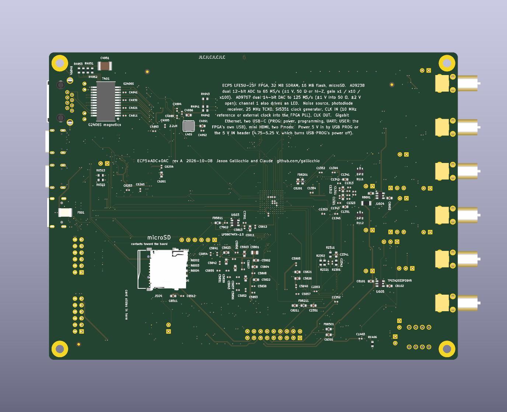

<!-- nav -->
[← Appendix C. How this tutorial was tested](C_how_it_was_tested.md) &emsp;&emsp;&emsp; **[Contents](../README.md#contents)**

# Appendix D. Coming soon… hopefully

Hardware that does not exist yet: the next board, which is drawn, and
three boards of analog and RF building blocks to go with it, which are an
idea. Then the
cheap extras that several pages ask for (long cables, an antenna), what
other teaching platforms cover that this tutorial does not yet, and why
openness all the way down matters for learning with an AI.

## The next board

Everything in this tutorial was built around a $79 development board and a
$30 converter module, and the seams show: one ADC, one DAC, 8 bits, no
anti-alias filter, an input range of ±4 V that no antenna will ever fill,
and a USB serial port as the only way out.

The board above is what Claude and I drew for the next level. It is a
158 × 119 mm six-layer board with the same ECP5 (an LFE5U-25F, so every
design here still fits), 32 MB of SDRAM, 16 MB of flash, gigabit Ethernet
(for Chapter 3's Linux, and for streaming samples faster than a [UART](https://en.wikipedia.org/wiki/Universal_asynchronous_receiver-transmitter) ever
will), an FT2232H for JTAG and serial on one USB-C and a second USB-C
straight into the FPGA, mini-HDMI, microSD and two Pmods.

The analog part is the point: two DC-coupled 12-bit 65 MS/s ADC channels (AD9238,
±1 V, 50 Ω or high impedance, gain ×1/×10/×100) behind proper amplifiers,
two DC-coupled 14-bit 125 MS/s DAC channels (AD9767, ±1 V into 50 Ω),

an
on-board noise source, an LED driver and a [photodiode](https://en.wikipedia.org/wiki/Photodiode) receiver for the
optical lock-in experiments of [4.07](4_07_optical_link.md#407-an-optical-link),
a 25 MHz TCXO and an Si5351 clock generator, and a clock input so that two
boards, or a board and a [GPS-disciplined](https://en.wikipedia.org/wiki/GPS_disciplined_oscillator) reference, can share one clock
([5.01](5_01_two_clocks.md#501-two-clocks)'s problem, solved in copper). Two
channels in and two out is what [6.13](6_13_more_ideas.md#613-more-ideas-and-a-radar-chapter)'s
MIMO and angle-of-arrival ideas, and Chapter 7's NMR, need. Twelve bits
is 24 dB more dynamic range than eight. The design files are generated by
a script, not drawn by hand, and are open hardware like the adapter board
in this repository.

Coming soon. Hopefully. (It is rev A, dated 2026-10-04, and has not been
manufactured; when it exists and works, this tutorial gets a second
edition with two of everything.)

## An AMOD: a board of analog blocks

![A sketch, to scale, of the two lower-frequency AMOD boards: 100 mm squares of 20 mm tiles, one circuit to a tile and every circuit with its own SMA jacks. The passive one holds a 20 dB pad, RC low- and high-passes, a series RLC, two LC low-passes, an LC band-pass, a crystal, a ceramic filter, a diode clipper, a tapped delay line, LEDs and an AM loopstick. The active one holds power, ×10 and ×100 gain blocks, an HF low-noise amplifier, a Johnson-noise amplifier, a one-pin delta-sigma ADC, a one-bit DAC, a heater, a mixer, a light link, 40 kHz ultrasound, and a speaker and microphone, with each powered tile framed by its supply and a Pmod connector on its edge](img/amod_sketch.png)

The [NanoVNA](https://nanovna.com/)'s "RF demo kit" is a $13 board,
10 × 10 cm, of eighteen numbered circuits: calibration standards,
attenuators, filters, resonators. Each circuit is soldered in and has its
own connectors, with its schematic and a sketch of the *expected* result
printed beside it, so a student measures it and checks the answer on the
board itself. Short, open, load and thru are four circuits (13 to 16), not
one. I know of nothing like it for DC to 30 MHz, audio, ultrasound and
light, which is where this tutorial's converters live, nor a cheap one for
the radio bands above them. So here is one, an *AMOD* (an analog module, as
a Pmod is a peripheral module), on three boards: passive blocks, active
blocks, and RF blocks for 915 MHz and up. It is a kit of blocks, not one
integrated circuit, laid out so that each experiment is a square you can
point at.

**The conventions.**

- **One circuit to a tile, soldered in, with its own jacks.** Nothing is
  swapped, as on the NanoVNA's kit. A 20 × 20 mm tile holds one two-port
  circuit, its input and output jacks in opposite corners, or two
  one-ports. A circuit with three jacks or more (a mixer, a tapped line)
  gets a 40 × 20 mm tile. Corners keep every two jacks at least 11 mm
  apart, even on neighbouring tiles: room for a cable's nut and two
  fingers. The only switches are where the frequency is low enough not to
  notice them: a jumper's picofarad and few nanohenries are nothing at a
  megahertz. So a jumper adds the crystal's pulling capacitor, and DIP
  switches pick an LED or a Johnson-noise resistor.
- **Each tile is labelled**: a number, a name, its schematic, a sketch of
  the expected Bode plot or trace, and the sections that use it.
- **The power is visible.** A passive tile has a white outline; a powered
  one has a filled frame marked with its supply, and a jumper that powers
  it, so an unused active tile draws nothing and a student can see what is
  alive. The power planes are hidden, so the silkscreen has to say it.
- **SMA jacks**, not U.FL. A U.FL connector is rated for about 30 matings,
  and a class reconnects a tile more often than that in a week. Generic SMA
  jacks are about $0.30 each at LCSC in tens, against $0.06 for a U.FL plus
  $1.20 for every U.FL-to-SMA pigtail. SMA also matches the converter module
  and the new board, so a tile goes between DAC OUT and ADC IN with the
  same short cables.
- **Power and pins from a Pmod.** A 2 × 6 Pmod header brings 3.3 V and
  eight FPGA pins, for the tiles that need digital I/O: the one-pin
  delta-sigma converters, the ultrasound driver, the RF board's
  synthesizers. USB-C brings 5 V, and a charge pump (an LM2664, about
  $0.40) makes −5 V, behind its own jumper. The Icepi Zero's 40-pin header
  has about ten FPGA pins the adapter does not use, so a rev-B adapter
  could bring them out as a Pmod; the new board has two Pmods.
- **Three boards of 100 × 100 mm**, because that is where the cheapest
  fabrication tier stops: five 2-layer boards of 100 × 100 mm cost $5 at
  PCBWay, and the same five at 150 × 100 mm cost $40 (quoted 2026-10-05).
  On the passive and active boards every part is 0805, SOIC or
  through-hole, so hand soldering is the cheap way; machine assembly at
  JLCPCB is about $100 for five boards with 25 different "extended" parts,
  most of that the $3 loading fee per part. The RF board is different: four
  layers and QFN packages, so it is machine-assembled (below).

A 100 × 100 mm board holds sixteen tiles. One circuit to a tile is more
tiles than the passive and active boards have room for, so each keeps its
sixteen most-used circuits, marked "keep"; the rest are "maybe", for a
second board or a swap. In the tables, *tiles* is the area in 20 × 20 mm
tiles; *used in* is where this tutorial already asks for the part; the
prices are for the parts, at quantity 10, from LCSC, DigiKey or Mouser on
2026-10-05 (the RF board's, 2026-10-07).

### The passive board

| # | circuit | tiles | jacks | used in | parts | verdict |
| --- | --- | ---: | ---: | --- | --- | --- |
| P1 | a π attenuator, −20 dB | 1 | 2 | [6.12](6_12_on_the_air.md#612-on-the-air-whispers-and-how-far-they-carry)'s 20 dB pad ($10 as a connector), [5.06](5_06_modem_and_noise.md#506-the-modem-against-noise) | $0.05 | keep |
| P2 | an RC low-pass (1 kΩ, 1 nF) | 1 | 2 | [4.02](4_02_rc_and_lc_circuits.md#402-rc-and-lc-circuits), [4.08](4_08_feedback_control.md#408-feedback-control-of-an-rc-plant), [7.06](7_06_control.md#706-control-at-the-speed-of-the-cable)'s lag plant | $0.05 | keep |
| P3 | an RC high-pass (1 kΩ, 1 nF) | 1 | 2 | [4.02](4_02_rc_and_lc_circuits.md#402-rc-and-lc-circuits) | $0.05 | keep |
| P4 | a series RLC near 1 MHz, a trimmer for the C | 1 | 2 | [4.02](4_02_rc_and_lc_circuits.md#402-rc-and-lc-circuits), [7.06](7_06_control.md#706-control-at-the-speed-of-the-cable)'s resonant plant, a lockbox (below) | $0.50 | keep |
| P5 | an LC low-pass, 9 MHz | 1 | 2 | the anti-alias filter [1.06](1_06_fast_capture.md#106-fast-captures) lacks (it removes [6.10](6_10_chirps_and_lora.md#610-chirps-zadoffchu-and-lora-ranging-and-radar-on-a-cable)'s ghost) | $0.50 | keep: the most-used tile |
| P6 | an LC low-pass, 100 kHz | 1 | 2 | the reconstruction filter [7.05](7_05_trading_speed_for_bits.md#705-trading-speed-for-bits) lacks | $0.50 | keep |
| P7 | an LC band-pass, 4.7–7.8 MHz: Chapter 6's band | 1 | 2 | [6.10](6_10_chirps_and_lora.md#610-chirps-zadoffchu-and-lora-ranging-and-radar-on-a-cable)'s filtered chips, made in copper; [5.07](5_07_radio_link.md#507-a-radio-link), [6.12](6_12_on_the_air.md#612-on-the-air-whispers-and-how-far-they-carry): the transmitter's harmonics, the receiver's front end | $0.50 | keep |
| P8 | a 4 MHz quartz crystal, with a pulling capacitor on a jumper | 1 | 2 | [4.03](4_03_quartz_crystal.md#403-the-q-of-a-quartz-crystal), [4.09](4_09_your_crystal.md#409-your-crystal-against-a-reference), [4.10](4_10_more_ideas.md#410-more-ideas-for-one-board)'s microbalance | $0.15 | keep |
| P9 | a 455 kHz ceramic filter | 1 | 2 | a superheterodyne's IF, with A9's mixer and P13's loopstick; [4.02](4_02_rc_and_lc_circuits.md#402-rc-and-lc-circuits) | $0.50 | keep |
| P10 | a two-diode clipper | 1 | 2 | [4.04](4_04_harmonics.md#404-harmonics-a-diode-clipper) | $0.10 | keep |
| P11 | a delay line: 20 LC sections of 1 µH and 400 pF, 50 Ω, 20 ns each; jacks at the input, at 100, 200 and 300 ns, and at the output | 2 | 5 | [4.05](4_05_quarter_wave_stub.md#405-a-quarter-wave-stub)'s stub on a tile, [6.05](6_05_the_channel.md#605-the-channel-sounding-it-and-equalizing-it)'s echo, [6.10](6_10_chirps_and_lora.md#610-chirps-zadoffchu-and-lora-ranging-and-radar-on-a-cable)'s radar target, [7.06](7_06_control.md#706-control-at-the-speed-of-the-cable)'s pure-delay plant | $2 | keep: 400 ns is 260 ft of RG-58, and it disperses near its 16 MHz cut-off where you can watch it |
| P12 | LEDs of four colours, one at a time on a DIP switch | 1 | 1 | [4.10](4_10_more_ideas.md#410-more-ideas-for-one-board)'s Planck's constant | $0.20 | keep |
| P13 | an AM loopstick (a ferrite rod) and a two-gang tuning capacitor | 3 | 1 | [1.10](1_10_am_radio.md#110-an-am-radio): hear a real station | $3 | keep, with A4 |

The "maybe"s: a −6 dB pad; a parallel RLC; a 10 MHz crystal; a 10.7 MHz
ceramic filter (the through-hole part is out of stock; an SMD one is
$0.52); a varactor-tuned LC (two BB133, biased through 100 kΩ, for
[7.06](7_06_control.md#706-control-at-the-speed-of-the-cable), a VCO's tank
or FM); a 1:1 transformer, and two 1:4 baluns back to back for
[6.12](6_12_on_the_air.md#612-on-the-air-whispers-and-how-far-they-carry)'s
dipole. The calibration standards moved to the RF board, where they
matter. A centimetre of trace is 61 ps: under a degree of phase at 30 MHz,
where the open, short and load that come with a NanoVNA are as good as
standards on the tile, and 127° at 5.8 GHz, where they are not.

The board's parts cost about $8, plus 27 SMA jacks, about $8.

### The active board

| # | tile | power | tiles | jacks | used in | parts | verdict |
| --- | --- | --- | ---: | ---: | --- | --- | --- |
| A1 | power: USB-C, the −5 V charge pump, a LED on each rail | ±5 | 1 | 0 | every active tile | $1 | keep |
| A2 | an op-amp gain block, ×10, 20 MHz | ±5 | 1 | 2 | [4.07](4_07_optical_link.md#407-an-optical-link), [6.12](6_12_on_the_air.md#612-on-the-air-whispers-and-how-far-they-carry)'s weak signals, the noise tiles | $1.50 | keep |
| A3 | an op-amp gain block, ×100 | ±5 | 1 | 2 | the same; ×1000 after A2; the volts the 8-bit ADC wants, after the RF board's receive mixer | $1.50 | keep |
| A4 | an HF low-noise amplifier, 1–30 MHz, 40 dB | +5 | 1 | 2 | [6.12](6_12_on_the_air.md#612-on-the-air-whispers-and-how-far-they-carry)'s rung 3 (an "SDR preamplifier" costs $15–40), [5.07](5_07_radio_link.md#507-a-radio-link), the AM loopstick | $3 | keep |
| A5 | Johnson noise: a ×1000 low-noise amplifier, and resistors on a DIP switch | ±5 | 1 | 1 | [5.08](5_08_more_hardware.md#508-with-a-little-more-hardware)'s Boltzmann's constant | $5 | keep |
| A6 | a comparator and RC integrator: a delta-sigma ADC from one FPGA pin | +5 | 1 | 1 | [7.05](7_05_trading_speed_for_bits.md#705-trading-speed-for-bits): the side this module cannot show | $2 | keep |
| A7 | a one-bit DAC: a Pmod pin, an RC, a 3.5 mm jack |  | 1 | 0 | [7.05](7_05_trading_speed_for_bits.md#705-trading-speed-for-bits): hear a one-bit stream, with P6 | $0.50 | keep |
| A8 | heat: a 10 Ω resistor, a thermistor and a TMP36 | +5 | 1 | 1 | [5.02](5_02_warming_a_crystal.md#502-warming-a-crystal), which never measured the temperature; [7.06](7_06_control.md#706-control-at-the-speed-of-the-cable)'s slow plant | $2 | keep |
| A9 | a mixer: an MC1496 (RF, LO and IF jacks) | ±5 | 2 | 3 | [1.10](1_10_am_radio.md#110-an-am-radio), a superheterodyne with P9, the two-channel chapter below | $0.30 | keep the MC1496; the AD633 needs ±8 V, the AD835 costs $25, and a passive diode ring $6 |
| A10 | light: an LED, a 650 nm laser module, a photodiode and a transimpedance amplifier | +5 | 2 | 3 | [4.07](4_07_optical_link.md#407-an-optical-link), [4.10](4_10_more_ideas.md#410-more-ideas-for-one-board)'s speed of light, [7.06](7_06_control.md#706-control-at-the-speed-of-the-cable)'s noise-eater, shot noise | $5 (a VCSEL adds $7) | keep; VCSEL maybe |
| A11 | 40 kHz ultrasound: two transducers on the board's edge, an H-bridge driver from two Pmod pins (or a jack, from the DAC), a ×100 receiver | +5 | 2 | 2 | [4.06](4_06_speed_of_sound.md#406-the-speed-of-sound-at-40-khz), [6.13](6_13_more_ideas.md#613-more-ideas-and-a-radar-chapter)'s sonar and radar ideas | $4 | keep |
| A12 | audio: a 20 mm speaker, an electret microphone with its bias, a preamplifier | +5 | 2 | 2 | [4.06](4_06_speed_of_sound.md#406-the-speed-of-sound-at-40-khz), [4.10](4_10_more_ideas.md#410-more-ideas-for-one-board)'s bat sonar | $2 | keep |

The "maybe"s: a fan with a tachometer, driven by a MOSFET from a Pmod pin
(control of something that moves; A8's heater is the plant that fits); a
hardware PLL, a 74HC4046, beside
[5.04](5_04_coupled_oscillators.md#504-oscillators-that-listen-to-each-other)'s
PLL in gateware; a socket for an HB100 and its 60 dB audio amplifier
([5.08](5_08_more_hardware.md#508-with-a-little-more-hardware)'s speed gun);
and an NMR front end, crossed diodes, a λ/4 network and an LNA, for
[7.07](7_07_bigger_ideas.md#707-bigger-ideas-nmr-mri-and-qubits)'s
permanent-magnet NMR (it is tuned to one frequency).

Rejected: an I2S audio DAC or ADC module (plug it into the Pmod
instead: $5, and nothing to lay out); the optics of [5.08](5_08_more_hardware.md#508-with-a-little-more-hardware)'s laser locks (a breadboard's job,
not a PCB's). Anything at 915 MHz needs RF layout, so it has a board of its
own (next).

The board's parts cost about $28, plus 19 SMA jacks, about $6. With the
passive board, that is about $50: less than [6.12](6_12_on_the_air.md#612-on-the-air-whispers-and-how-far-they-carry)'s shopping
list of adapters, an active loop, an amplifier and an attenuator
($85–120).

**One tile, many pages.** The blocks earn their place by serving several
pages each:

- P5 to P7, the LC filters, are first filters to characterize in [4.02](4_02_rc_and_lc_circuits.md#402-rc-and-lc-circuits).
  Then P6, the 100 kHz low-pass, turns [7.05](7_05_trading_speed_for_bits.md#705-trading-speed-for-bits)'s one-bit stream into a tone in
  headphones, and P5, the 9 MHz one, in front of the ADC, removes [6.10](6_10_chirps_and_lora.md#610-chirps-zadoffchu-and-lora-ranging-and-radar-on-a-cable)'s
  ghost. P7, exactly as wide as Chapter 6's band, makes [6.10](6_10_chirps_and_lora.md#610-chirps-zadoffchu-and-lora-ranging-and-radar-on-a-cable)'s
  "filtered" chips in copper instead of arithmetic.
- P11, the delay line, is [4.05](4_05_quarter_wave_stub.md#405-a-quarter-wave-stub)'s stub on the bench, [6.05](6_05_the_channel.md#605-the-channel-sounding-it-and-equalizing-it)'s multipath
  echo, a target for [6.10](6_10_chirps_and_lora.md#610-chirps-zadoffchu-and-lora-ranging-and-radar-on-a-cable)'s radar on a cable, and [7.06](7_06_control.md#706-control-at-the-speed-of-the-cable)'s pure delay,
  the plant that sets every loop's speed.
- P4 and P8, the resonators, are [4.02](4_02_rc_and_lc_circuits.md#402-rc-and-lc-circuits)'s and [4.03](4_03_quartz_crystal.md#403-the-q-of-a-quartz-crystal)'s Q measurements, then
  the plant of the one experiment this tutorial most lacks: a lockbox (below).
- A2 to A4, the amplifiers, serve the antenna ladder of [6.12](6_12_on_the_air.md#612-on-the-air-whispers-and-how-far-they-carry), the
  optical link of [4.07](4_07_optical_link.md#407-an-optical-link), the noise measurements of [5.08](5_08_more_hardware.md#508-with-a-little-more-hardware), and the RF
  board's receiver.

**Two in, two out.** Most of this tutorial uses one ADC and one DAC. The
new board has two of each, and some experiments are only possible, or
only honest, with two:

- *a reference channel*: a Bode plot or a lock-in that measures the input
  and the output at once, so the cable and the converters drop out;
- *impedance*: the voltage across a part and the current through it, at
  the same instant, gives *Z* directly (an LCR meter);
- *quadrature*: I and Q out of two DACs into two mixers, an image-reject
  transmitter; I and Q into two ADCs, a real complex receiver;
- *a lockbox*: one DAC modulates, the other corrects, as in
  [5.08](5_08_more_hardware.md#508-with-a-little-more-hardware)'s Pound–Drever–Hall lock;
- *cross-correlation*: two ADCs on one resistor average their own noise
  away and keep the resistor's (Johnson noise without a perfect amplifier);
- *angle of arrival and MIMO*, from [6.13](6_13_more_ideas.md#613-more-ideas-and-a-radar-chapter); and a plain XY display for
  Lissajous figures.

That is a chapter of its own: "Two channels: phase, impedance and
quadrature", with the AMOD's mixer, resonators and noise tiles as its
hardware.

### The RF board: 915 MHz, 2.4 GHz, and a stretch to 5.8 GHz

![A sketch of the AMOD's RF board, a 100 mm square of tiles: power and a 25 MHz reference, two MAX2870 synthesizers, a 0.1–6 GHz low-noise amplifier, a gain block, 915 MHz and 2.45 GHz band-pass filters, a quarter-wave stub, two LTC5510 mixers, a 2.4 GHz front end with its power amplifier, and calibration standards. Beside it, one way to cable the tiles: the DAC's 6.25 MHz into the transmit mixer, whose LO is one synthesizer, then a filter and an optional power amplifier to an antenna; and an antenna, a low-noise amplifier, a filter, the receive mixer with the other synthesizer as its LO, and the active board's ×100 into the ADC; one 25 MHz reference feeds both synthesizers and the FPGA board's clock](img/amod_rf.png)

[6.00](6_00_digital_communications.md#going-on-the-air) ends with a
shopping list for putting Chapter 6 on the air: at each end, a synthesizer
board, a connectorized mixer, a low-noise amplifier and a filter, about
$130 a side. Mini-Circuits sells most of those blocks in a machined box
with SMA jacks, and they are excellent, at $50 to $120 each. The third AMOD board is those blocks as tiles: cheaper, unshielded,
both ends of the link on one board, cabled together with SMA as you like,
for about $60 in parts.

What is on it:

- **Two synthesizers, one reference.** R2 and R3 are MAX2870s, which make
  any frequency from 23.5 MHz to 6 GHz, set over SPI from the Pmod. One is
  the transmitter's local oscillator (LO), the other the receiver's. Both
  run from R1's 25 MHz TCXO, or from the FPGA board's clock through R1's
  jack, so the synthesizers and the converters share one clock and a phase
  the lock-in measures means something. Each has a second output, so one
  synthesizer can also drive both mixers.
- **Two mixers.** R9 and R10 are LTC5510 active mixers (1 MHz to 6 GHz in,
  a 0 dBm LO, which a MAX2870 drives directly). R9 moves the DAC's 6.25 MHz
  up to the band, and R10 brings the band down to 6.25 MHz for the ADC,
  through the active board's A3: the 8-bit ADC wants volts.
- **Low-noise amplifiers.** R4 is a QPL9547 (0.1–6 GHz; 0.3 dB noise figure
  and 19.5 dB of gain at 1.9 GHz), the receiver's first stage in any of
  the three bands. R11, below, has a second one for 2.4 GHz.
- **Power amplifiers, optional.** R5 is a GALI-84+ gain block (DC to 6 GHz,
  +22 dBm at 1 dB compression at low frequencies): the power amplifier at
  915 MHz, a driver above. It wants about 7 V through a bias resistor, so
  R1 has an 8 V boost converter. R11 is a whole 2.4 GHz front end in one
  $0.68 chip, the RFX2401C from the cheap nRF24L01 "PA+LNA" modules: a
  +22 dBm power amplifier, a low-noise amplifier, and the switch between
  them.
- **Filters.** R6 is a 915 MHz SAW filter (902–928 MHz) and R7 a 2.45 GHz
  LTCC band-pass in an 0805 package. After a power amplifier they take off
  its harmonics; before a low-noise amplifier they keep out the
  neighbours.
- **Things to measure it all against.** R12 holds the calibration
  standards, open, short, load and thru, at the tile, where they have to
  be at 5.8 GHz. R8 is [4.05](4_05_quarter_wave_stub.md#405-a-quarter-wave-stub)'s
  quarter-wave stub at 2.4 GHz: 17 mm of microstrip, a notch, and a tile
  of free copper.

| # | tile | power | tiles | jacks | for | parts | verdict |
| --- | --- | --- | ---: | ---: | --- | --- | --- |
| R1 | power and reference: low-noise 3.3 and 5 V regulators, an 8 V boost, a 25 MHz TCXO, a jack for a reference in or out | +5 | 1 | 1 | every RF tile; one clock with the FPGA board | $5 | keep |
| R2 | the transmitter's synthesizer: a MAX2870, 23.5 MHz to 6 GHz | +3.3 | 1 | 2 | the TX LO; a signal generator | $6.78 | keep |
| R3 | the receiver's synthesizer: the same | +3.3 | 1 | 2 | the RX LO | $6.78 | keep |
| R4 | a low-noise amplifier: a QPL9547, 0.1 to 6 GHz | +5 | 1 | 2 | every receiver | $5.69 | keep |
| R5 | a gain block: a GALI-84+, DC to 6 GHz, +22 dBm | +8 | 1 | 2 | the PA at 915 MHz, a driver above | $1.99 | keep |
| R6 | a 915 MHz SAW band-pass (an Abracon AFS915) | | 1 | 2 | 902–928 MHz in, the rest out | $1.20–3 | keep |
| R7 | a 2.45 GHz LTCC band-pass (a Johanson 2450BP15) | | 1 | 2 | 2.4–2.5 GHz | $0.59 | keep |
| R8 | a quarter-wave open stub at 2.4 GHz, 17 mm of microstrip | | 1 | 2 | [4.05](4_05_quarter_wave_stub.md#405-a-quarter-wave-stub) at 2.4 GHz | free | keep |
| R9 | the transmit mixer: an LTC5510 (IF in, LO, RF out) | +5 | 2 | 3 | 6.25 MHz up to the band | $10.50 | keep |
| R10 | the receive mixer: the same (RF in, LO, IF out) | +5 | 2 | 3 | the band down to 6.25 MHz | $10.50 | keep |
| R11 | a 2.4 GHz front end: an RFX2401C (TX in, RX out, antenna) | +3.3 | 2 | 3 | +22 dBm out, an LNA in, the switch | $0.68 | keep |
| R12 | calibration: open, short, load and thru | | 2 | 5 | every measurement above 1 GHz | $0.10 | keep |

The "maybe"s, for a second RF board: a 5.8 GHz power amplifier (an
SE5004L, $7); a 5.8 GHz band-pass; an I/Q modulator and demodulator
(ADL5375 and ADL5380, 0.4–6 GHz, about $18 and $15); a Schottky-diode power
detector; a printed Wilkinson divider; a printed 2.4 GHz antenna; and
footprints for shield cans over the synthesizers and mixers. Antennas are
SMA whips: 915 MHz ones come with LoRa modules, 2.4 GHz ones with Wi-Fi
gear (and many of those are RP-SMA, not SMA).

The parts cost about $50, plus 29 SMA jacks, about $9. The board is four
layers, with a solid ground under every 50 Ω line, and its QFN packages
want machine assembly, not a soldering iron.

**The three bands.** 915 MHz and 2.4 GHz work end to end. At 5.8 GHz, the
stretch, the receiver works: the synthesizers, R4 and R10's input all
reach 6 GHz. Transmitting there is harder. The LTC5510's output is
specified only to 4.5 GHz, FR4 loses about 0.15 dB per centimetre, and
cheap SMA jacks are rated to 6 GHz at best, so at 5.8 GHz the jacks and
their footprints are part of every measurement until R12 calibrates them
out. The MAX2870 alone is a 5.8 GHz transmitter of on-off keying and
FSK, and the "maybe" tiles above are the rest.

**What it opens.**

- *Chapter 6 on the air*, at 915 MHz and 2.4 GHz, with the Python
  unchanged: [6.00](6_00_digital_communications.md#600-digital-communications-hardware-defined-radio)'s
  figure, built.
- *A network analyzer to 6 GHz.* Set R2 to *f* and R3 to *f* − 6.25 MHz,
  and step both: the lock-in at 6.25 MHz measures a tile's transmission in
  amplitude and, because one reference drives everything, phase.
  Calibrate on R12, then measure R6, R7, R8 and the cables: a NanoVNA,
  built from blocks.
- *A spectrum analyzer*: sweep R3 alone and watch Wi-Fi and Bluetooth at
  2.4 GHz, and LoRa at 915 MHz, [6.10](6_10_chirps_and_lora.md#610-chirps-zadoffchu-and-lora-ranging-and-radar-on-a-cable)'s
  chirps in the wild.
- *Radar*: Doppler at 2.4 or 5.8 GHz, and ranging by stepping both
  synthesizers across a whole ISM band. A range cell is *c*/2*B*:
  83.5 MHz at 2.4 GHz gives 1.8 m, and 150 MHz at 5.8 GHz 1.0 m.
- *A power amplifier's distortion*: drive R5 or R11 into compression
  with [6.03](6_03_qam.md#603-qam-more-bits-per-symbol)'s QAM and
  [6.04](6_04_msk_and_gmsk.md#604-msk-and-gmsk-constant-envelope)'s MSK,
  and watch the QAM's spectrum spread and the MSK's not.
- *Why Mini-Circuits uses boxes*: with no shields, measure how much of
  R2's LO reaches R4's input across the board.

**The catches.**

- *Images.* A mixer makes the sum and the difference, LO ± 6.25 MHz, only
  12.5 MHz apart, and both fit inside 902–928 MHz and 2400–2483.5 MHz, so
  R6 and R7 cannot separate them. The transmitter radiates both, and the
  receiver hears both ([6.00](6_00_digital_communications.md#going-on-the-air)'s
  "one catch"). The cure is quadrature: the new board's two DACs and two
  ADCs, and the I/Q "maybe"s.
- *The law.* FCC Part 15.249 lets anyone transmit in 902–928 MHz,
  2400–2483.5 MHz and 5725–5875 MHz at 50 mV/m at 3 m, about −1 dBm
  EIRP (0.75 mW), with harmonics 40 dB lower still. That is enough: across
  10 m of free space at 2.4 GHz it leaves about 47 dB of signal-to-noise
  ratio at the LNA in Chapter 6's 3 MHz band, more than the 8-bit ADC can
  use. The +22 dBm power amplifiers are for cables and attenuators, and for
  licensed radio amateurs, whose 33, 13 and 5 cm bands overlap all three.
- *Protect the receiver.* Never cable a power amplifier straight into R4
  or R10: put 30 dB of SMA attenuators between them first. Good ones,
  rated to 6 GHz, cost about $10 each, as
  [6.12](6_12_on_the_air.md#612-on-the-air-whispers-and-how-far-they-carry)
  found, and they are the one RF block worth buying instead of building.

## An antenna: on the AMOD, or on its own board?

[5.07](5_07_radio_link.md#507-a-radio-link)'s and [6.12](6_12_on_the_air.md#612-on-the-air-whispers-and-how-far-they-carry)'s loops are 30 cm across. A loop round the edge of a
100 mm board is an eighth of the area, so in the magnetic near field it is
weaker as a transmitter and as a receiver. `air.py`'s model, with two turns
round a 95 mm square and a Q of 20, says it is weak but usable. The DAC
at full power is legal into it (21.8 µV/m at 30 m), and two boards
reach each other at 0.4 m with the 9600 bit/s modem and 4 m with
[6.12](6_12_on_the_air.md#612-on-the-air-whispers-and-how-far-they-carry)'s FT8-style frame. With the AMOD's LNA (A4) they reach 2 m and
about 200 m.

But it should not go round the AMOD's edge. A loop works by the magnetic
flux through it, and a ground plane inside the loop is a shorted turn that
cancels the flux. The AMOD's tiles need their ground.

Put the loop on its own 100 × 100 mm board instead: two turns, a trimmer
and a varactor to tune it, and an SMA. (Four turns would be twice as
strong, and over the limit at full power; turn the DAC down to about 70
codes.) It costs the same $5 for five, and it is the "tuned 30 cm loop" of
the ladder's second rung, made small.

The same
loop covers 6.25 MHz (Chapter 6's carrier) and 6.78 MHz (the ISM band)
with its trimmer, and 13.56 MHz with fewer turns. The 915 MHz and 2.4 GHz
ISM bands have PCB antennas a few centimetres long, but the converters
reach those bands only through the AMOD's RF board, whose tiles take SMA
whips.

## Long cables

Several pages want a long cable: [4.05](4_05_quarter_wave_stub.md#405-a-quarter-wave-stub)'s stub, [4.10](4_10_more_ideas.md#410-more-ideas-for-one-board)'s time-domain
reflectometry, [5.08](5_08_more_hardware.md#508-with-a-little-more-hardware)'s Einstein synchronization, [6.10](6_10_chirps_and_lora.md#610-chirps-zadoffchu-and-lora-ranging-and-radar-on-a-cable)'s radar on a
cable. In the US, on 2026-10-05:

| what | for | about |
| --- | --- | --- |
| 100 ft of RG-58 with BNC plugs, two SMA-to-BNC adapters, a BNC T and a 50 Ω terminator | one long run: 154 ns each way, a quarter wave at 1.62 MHz | $35 ([Cable Wholesale](https://www.cablewholesale.com/specs/10x1-011hd.php), $28 for the cable) |
| ten 10 ft BNC cables, ten BNC T's and adapters | a pulse travelling down a cable you can tap every 15 ns; a standing wave sampled every 10 ft (at 4 MHz its nodes are eight T's apart) | $85 ($69 for the cables, $4 for the T's, $11 for adapters) |
| 100 ft of RG-174 on a spool | the thinnest cheap coax, 2.8 mm; three times RG-58's loss, and 11 Ω of loop resistance that shows as a sloping tail on a TDR step | about $20 |
| 100 ft of RG-316 | thin (2.5 mm), better made, teflon | $75 |
| 100 ft of Cat5e patch cable | four 100 Ω twisted pairs; join them end to end for 400 ft of line | $40–55 |

RG-174 is the cheapest thin cable (about $20 for 100 ft) and RG-178 the
thinnest (1.8 mm, but costly and lossy). Once connectors are counted,
ready-made RG-58 costs no more than either, and its loss is a third. For the ten
sections, lay each one as a hairpin so that every T sits on the bench, and
reach the ADC from a T with an adapter a few centimetres long: a longer lead
is a stub of its own. U.FL cables stop at about a metre, so they are no way
to make a long line on a PCB; the AMOD's delay line (P11) is the PCB's way.

## What other teaching platforms do that this doesn't, yet

The [Red Pitaya](https://redpitaya.com/)'s teaching material, its apps,
[PyRPL](https://pyrpl.readthedocs.io/), [Pavel Demin's notes](https://pavel-demin.github.io/red-pitaya-notes/),
and Analog Devices' [ADALM2000 labs](https://wiki.analog.com/university/courses/electronics/labs)
cover things this tutorial does not, most of them possible with this
hardware:

| missing here | what it would take | AMOD tiles |
| --- | --- | --- |
| **a lockbox**: modulation, an error signal, PID, sweep, lock and relock (PyRPL's and Linien's reason for existing) | the DDS's frequency as the actuator, a resonator as the plant: side-of-fringe, dither and PDH-style error signals compared, all electronic | P4, P8 |
| **pulse-height analysis**: a trapezoid shaper, a histogram, dead time and Poisson statistics | gateware; the DAC as a pulse source with random intervals, then a real detector | none needed |
| **noise as a measurement**: spectral density in V/√Hz, Welch averaging, Johnson and shot noise | an amplifier, and the second channel for cross-correlation | A2, A3, A5, A10 |
| **an impedance analyzer**, with open/short/load calibration | a shunt and two sweeps now; two channels on the new board | R12 |
| **characterizing op-amps** with the instruments built here: gain-bandwidth, slew rate, open-loop gain | the AMOD's op-amp tiles as the parts under test | A2, A3 |
| **the speed of light from a phase**, as in a [2023 AJP tabletop experiment](https://pubs.aip.org/aapt/ajp/article-abstract/91/3/206/2875249/A-tabletop-experiment-for-speed-of-light) | a faster LED or laser than [4.07](4_07_optical_link.md#407-an-optical-link)'s | A10 |
| **a triggered oscilloscope** with level, slope, pre-trigger and a live display | gateware and Python | none needed |
| **I–V curves** of diodes and transistors | a second, slow DAC from a delta-sigma pin | A7, P10, P12 |
| **sensors and slow I/O** over I2C and SPI | LiteX cores and a Pmod | A8 |

What this tutorial has is the inside of every instrument: the lock-in,
FFT, modems and filters are built here, in a toolchain that is open from
source to bitstream. Most of theirs are apps, and where their gateware is
open (PyRPL, Pavel Demin's notes) it is built with Xilinx's closed Vivado. The two are complementary, and the AMOD would close
most of the gap.

## Open to the copper: hardware an AI can read

[Appendix A](A_why_this_hardware.md#open-all-the-way-down-good-for-learning-with-an-ai)
argues that an open toolchain lets an AI assistant work through the whole
system with a student. Today the analog part of that system is a module
whose schematic nobody publishes. An assistant can measure it, but it
cannot read it, and it has to infer the amplifier's bandwidth, the input
impedance and the noise from the measurements. The new board and the AMOD
would be open to the copper: KiCad files generated by a script, every part
named with its datasheet, every resistor's value in text.

An assistant can then reason *forward* from the design. This op-amp and this feedback
network set this bandwidth; this filter's corner is here; so the next
measurement should show this. Then it can check the prediction on the
bench, and if the prediction is wrong, propose a component change and
re-run the script that draws the board. That is the loop
[Appendix C](C_how_it_was_tested.md) describes for gateware, extended to
the hardware. It is also the habit a good experimentalist has: predict
from the schematic first, then measure.

<!-- nav -->
[← Appendix C. How this tutorial was tested](C_how_it_was_tested.md) &emsp;&emsp;&emsp; **[Contents](../README.md#contents)**

<!-- author -->
Jason Gallicchio, jason@hmc.edu, Harvey Mudd College
